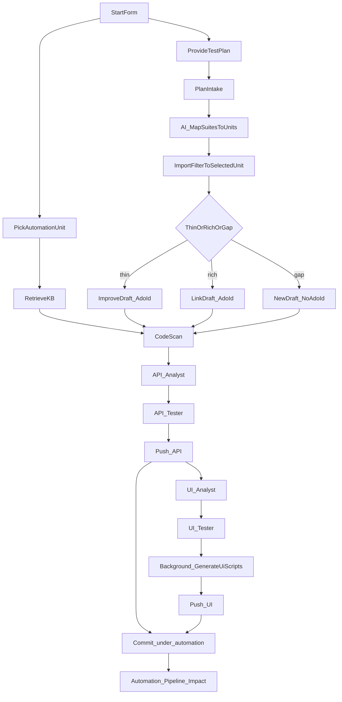

# Feature: Automation Framework Bridge

**Status:** Phases 0–5 + UX + Polish complete (INT-001..501, INT-UX-*, INT-901)  
**Ralph loop:** [`docs/progress/RalphLoop/qa-loop-automation-integrate/`](../progress/RalphLoop/qa-loop-automation-integrate/)  
**Tasks:** `INT-###` · Predecessor: [QA Loop FRS-Grounded](qa-loop-frs-grounded.md)

### Phase 1 shipped (summary)

| Setting / behavior | Detail |
|--------------------|--------|
| `AUTOMATION_ROOT` / `qaloop.automation_root` | Absolute path to product `automation/`; Settings → QA Loop |
| Scripts Board inventory | Scans `modules/{unit}/api\|ui/**/*.spec.ts` when root set (`IOptionsMonitor`) |
| Scripts Board run | Specs under root → Playwright **cwd = AUTOMATION_ROOT** + overlay config |

### Phase 2 shipped (summary)

| Behavior | Detail |
|----------|--------|
| Required Test Plan | Scan start rejects missing `testPlanId`; start form marks Test Plan required |
| Suite→unit map | `SuiteUnitMapJson` / `PlanImportMetaJson`; `POST .../plan-map` (heuristic + optional AI) |
| Plan import | `POST .../plan-import` — thin→improve + `AdoTestCaseId`, rich→link, gaps→new; re-run dedups |
| Orchestrator Plan Intake | After Retrieve KB: status `ImportingPlan`, phase `plan-intake` (map + import) |
| Analyzer / generators / UI author | Consume imported drafts; UI author injects existing suite + title dedup (L1) |
| Push | Patch TC when `AdoTestCaseId` set (`UpdateTestCaseAsync`); create only gaps |

### Phase 3 shipped (summary)

| Flow | What the operator sees |
|------|------------------------|
| Approve → Generate (API) | With `AUTOMATION_ROOT` set, new API specs + schemas land under product `automation/modules/{unit}/api/...` (not `backend/data/scripts`); registry touched; Scripts Board can pick them up |
| UI script gen | Specs write under `modules/{unit}/ui/tests/{bucket}/`; missing UI fixtures/auth stubs created under the product framework |
| Heal | Failed specs are healed **in place** under `automation/` (write guard still blocks paths outside the root) |
| Legacy | Empty `AUTOMATION_ROOT` keeps the old private-scripts layout |

### Phase 4 shipped (summary)

| Flow | What the operator sees |
|------|------------------------|
| Impact seed | Scripts Board can refresh product `impact-map.json` from CRM `*/build/build-qa.yml` path includes (read-only); Deals + deps map to `@deals` |
| Path simulate | Changed Lead/shared/customer/orders/deals FE paths → `@deals`; unrelated → `@smoke` |
| Automation CI | Product `automation/pipelines/` Execute stage runs **API + UI** projects for selected tags — no service `*-QA` YAML edits |
| Push tab | Shows **repo lane**: uncommitted files under `automation/` + reminder that Push ≠ CI (commit required) |

---

## What it is

ADO_Tester is the **control plane** (cases, review, inventory, launch, ADO TC/bug glue).  
Product `{repo}/automation/` is the **code of record** for Playwright specs, fixtures, registry,
impact maps, and automation CI.

QA Loop sessions drive **import → improve → gap-fill → structured push** into that folder for one
**automation unit** at a time. Bridge starts on the existing **Deals** slice; other units grow
one-by-one through the same path — no empty-module scaffold big-bang.

---

## Hard rules (never compromise)

| Rule | Detail |
|------|--------|
| **Write boundary** | Agents may **read** the whole product repo; may **write only** under `{productRepo}/automation/`. Never edit `Lead/`, `customer/`, `web-app/`, service `*/build/*.yml`, or any path outside `automation/`. |
| **Ownership** | Framework under `automation/` = code of record. ADO_Tester does not become a second script home for product work. |
| **CI (now)** | **Parallel** — do not edit module `*-QA` YAMLs. Automation runs only from YAMLs under `automation/pipelines/`. |
| **Playwright root** | `AUTOMATION_ROOT` = absolute path to product `automation/`. Product runs must not write to ADO_Tester `backend/data/scripts` or private `generated/ui/`. |
| **Push ≠ CI** | Disk write under `automation/` is local until **committed/PR’d**. CI consumes git, not ADO_Tester RAM. |

---

## Automation unit (not side-menu)

An **automation unit** is whatever FRS + Test Plans treat as a coherent test surface — a top-level
FRS module **or** a nested tab/permission-gated area.

| Example | Unit slug (default) | Must not collapse into |
|---------|---------------------|------------------------|
| Deals | `deals` | — |
| CPQ+ (permission-gated; includes Settings CPQ admin tab) | `cpq-plus` | `deals` |
| Customers → Data Review | `customers-data-review` *(deferred — no FRS docs yet)* | plain Customers list |
| Survey → Feedback | `survey-feedback` *(deferred — no FRS docs yet)* | Survey designer only |

**Convention:** flat kebab slugs. Sessions, `@qa-meta.module`, disk paths, and impact tags use the
unit slug. Parent nav is context only (entry route / permissions).

---

## Artifact shape (structured)

When ADO_Tester generates or pushes a script, output must be **framework-shaped**:

```text
automation/
  common/                    # fixtures, routes, builders — import these; do not invent a private client
  modules/{unit}/api/
    schemas/*.schema.ts
    tests/{contracts,endpoints,workflows}/*.spec.ts
  modules/{unit}/ui/tests/{smoke,regression,e2e}/
  resources/registry.{unit}.json
  resources/impact-map.json
  pipelines/                 # automation CI only
```

- Specs import from `common/fixtures`, `common/constants/routes.*`, builders.
- Preserve `<auto-generated>` / `<manual>` regions and stamp `@qa-meta.adoTestCaseId`.
- Healing updates the same files in place (still only under `automation/`).
- Test data today = **builders**, not JSON `data/` libraries — do not assume `modules/{m}/data/*.json`.

---

## ADO Test Plan intake (import-first)

Operator always supplies the product’s **complete** Azure Test Plan id.

```text
1. Fetch suite tree + test cases
2. AI maps folders/suites → automation units (aliases: CPQ, Data Review, Feedback, …)
3. Persist full map; session imports only the selected unit (+ optional siblings)
4. Per case:
   - EXISTING + thin (title only / empty steps) → Draft with AdoTestCaseId → IMPROVE
   - EXISTING + rich → Draft linked (light polish only if asked)
   - MISSING (gap vs FRS/code) → new Draft (no AdoTestCaseId)
5. Human reviews → approve
6. Push: patch existing WI when AdoTestCaseId set; create only net-new; scripts bind @qa-meta
```

**Default behavior:** UI = `importFirst`; API = `gapFill` + dedup against Plan titles/steps.  
**Thin-case rule:** a TC id with empty steps is **improve-existing**, not “already done.”

Ambiguous folders → flag for human confirm (do not silently assign to side-menu parent).

---

## Push = dual lanes

| Lane | Action |
|------|--------|
| **Repo files** | Structured write under `automation/modules/{unit}/…` + registry |
| **ADO work items** | Patch TC when `AdoTestCaseId` set; create only gaps |

UI must show both result lanes with per-lane retry. After Push, surface **git status / commit
instructions** under `automation/` (optional operator-opt-in branch commit later — still never
outside `automation/`).

- **API scripts** generate at **Push (API)** (or explicit Generate on Tester).
- **UI scripts** generate in **background** after UI Tester Approve; cards show
  `pending | generating | ready | failed` and `Automated X / Remaining Y`.
- Refining an approved case **cancels/supersedes** its in-flight UI script job.

---

## Impact execution (API + UI)

```text
changed files
  → resolve units via impact-map (seeded from read-only */build/build-qa.yml paths.include
     + frontend paths + automation/modules/{unit})
  → for each selected unit: run API (contracts→endpoints→workflows)
                            AND UI (smoke→regression→e2e)
  → fail automation pipeline if any selected suite fails
```

Service `Lead QA` / `Customer QA` / … pipelines stay **unchanged** (deep-link only, later).  
v1 cost valve: run **all committed** API + UI specs for selected units.

---

## End-state QA Loop execution



### Step rail (shipped UX)

```text
Retrieve KB → Plan Intake → API Analyst (brief + coverage + refine)
  → API Tests (Contract | Endpoint | Workflow) → Push (API)
→ UI Analyst → UI Tester → Push (UI)
```

Code Scan runs under API Analyst (not a circle). Activity rail stays on the right for the whole session.

| Layout | Role |
|--------|------|
| **Left** | Active step body only |
| **Right** | Activity rail — always on for the whole session (not a step) |
| **Circles** | Navigate back to unlocked steps |

Bugs this UX must fix: Activity stuck during UI script gen; Drafting `… {title}` list (use cards);
Activity treated as a phase/tab.

---

## Integration contract (settings / seams)

| Concern | Rule |
|---------|------|
| `AUTOMATION_ROOT` | Absolute path to product `automation/` (`.env` + Settings overlay) |
| Spec write | `ScriptPathAdapter`: unit + api\|ui + level\|bucket + file → path under root |
| Imports | Framework `common/*` only |
| Registry | Update `resources/registry.{unit}.json`; no orphan specs |
| Profiles | `AUTOMATION_PROFILE`; per-unit permission overrides when needed (e.g. CPQ) |
| Determinism | CI never calls LLM; heal/generate at authoring time / Scripts Board / bg jobs |
| Notify | One owner per run path |

---

## Build order

| Phase | Done when |
|-------|-----------|
| **0** Contract (this page) | ✅ Both sides can point here |
| **1** `AUTOMATION_ROOT` + Scripts Board run Deals | ✅ Real Deals API specs run from framework disk |
| **2** Plan import / improve / gaps | ✅ Deals session imports + improve queue; no dup creates |
| **3** ScriptPathAdapter | ✅ Framework-shaped files under `modules/deals/...` only |
| **4** Impact + `automation/pipelines/` | ✅ Path sim selects Deals; API+UI; no `*-QA` edits |
| **5** Grow units | ✅ Messaging onboarded (impact + triggers); more units one-by-one |
| UX | Step rail + Activity | ✅ INT-UX-01..05 |
| **Polish** Deep-links, retire private scripts, optional JUnit | ✅ Pipeline URL deep-link; product-mode inventory skips legacy scripts; Teams = one webhook owner; JUnit stays in product pipeline |

---

## Explicit non-goals

- Injecting Playwright into each module `*-QA` pipeline (deferred).
- Merging codebases or moving framework generators into ADO_Tester.
- Replacing framework discovery/registry/impact with ADO_Tester logic.
- Auto-committing generated specs from CI.

---

## Success criteria

1. Scripts Board cwd = product `automation/`; status matches console (no false Passed).
2. Generated Deals API/UI land under `modules/deals/api|ui/...`, not `backend/data/scripts`.
3. Service `*-QA` pipelines unchanged.
4. Product `git status` for this work shows changes **only under `automation/`**.
5. Structured API output (schema + test + shared imports).
6. Full Plan → AI map → filtered unit import; thin→improve; no duplicate ADO creates.
7. Push shows repo + ADO lanes; local write alone ≠ CI green.
8. Step circles + right Activity; background UI scripts with card statuses.

---

## Key files (implementation targets)

**ADO_Tester:** `QaLoopOptions` / `StorageOptions`, Scripts Board + `PlaywrightRunner`,
`QaLoopOrchestrator` → `ScriptPathAdapter`, client QA Loop session config.

**Product framework:** `modules/`, `playwright.config.ts`, `resources/`, `pipelines/` on the
product repo (the target project under test).

**Design / backlog:** [`solution.md`](../progress/RalphLoop/qa-loop-automation-integrate/solution.md) ·
[`prd.md`](../progress/RalphLoop/qa-loop-automation-integrate/prd.md)
