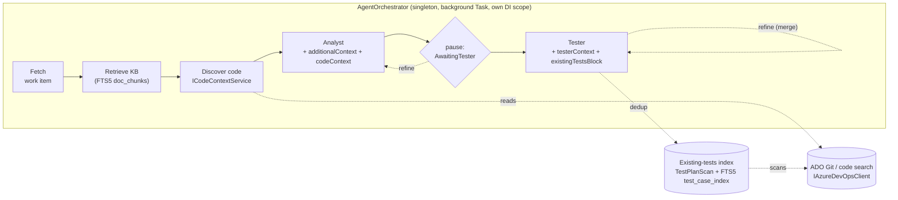

# Technical Design Document

| **Project Title**    | Author Tests Enhancements — Free-Text Context, Code Discovery, Refine Loops, Existing-Test Dedup |
| -------------------- | ------------------------------------------------------------------------------------------------ |
| **Document Version** | 1.0                                                                                              |
| **Date**             | July 28, 2026                                                                                    |
| **Prepared By**      | Mahmood Ahmad (BA / QA) + Claude                                                                 |
| **Companion docs**   | `prd.md` (task backlog) · `blueprint.md` (implementation guide) · `progress.md` (status + log)   |

# Revision History

| **Version** | **Date**      | **Author**        | **Description of Change** |
| ----------- | ------------- | ----------------- | ------------------------- |
| 1.0         | July 28, 2026 | Mahmood + Claude  | Initial design: three-phase carve of the Author Tests pipeline — free-text context + Analyst/Tester refine loops (Phase 1), shared code-discovery step (Phase 2), cached existing-test dedup index (Phase 3). Locked decisions: keep work-item required; two free-text gates (start → Analyst, gate → Tester); code discovery is a shared `ICodeContextService` with `alwaysSearch`/`extraHintText` knobs; dedup is a cached FTS5-backed plan scan with prompt-level + post-gen enforcement (auto-drop clear duplicates, flag borderline); `BugOrchestrator` and all embedded system prompts unchanged. |

# Table of Contents

- [Purpose](#purpose)
- [Scope](#scope)
- [Architecture Overview](#architecture-overview)
- [Data Design](#data-design)
- [API Design](#api-design)
- [Agent Prompt Injection & Refine Design](#agent-prompt-injection--refine-design)
- [Code Discovery Design](#code-discovery-design)
- [Existing-Test Dedup Design](#existing-test-dedup-design)
- [Frontend Layout](#frontend-layout)
- [Error Handling](#error-handling)
- [Verification](#verification)
- [Conclusion](#conclusion)

# Purpose

A tester using the **Author Tests** page (`/author-tests`) today can only feed the pipeline a
work-item id. The Analyst runs on ticket text + knowledgebase and has **zero code awareness** —
confirmed: `AgentOrchestrator`, `AnalystAgent`, and `TesterAgent` never touch the ADO Git/code-search
surface. Two real-world QA walls follow from this:

1. **Thin / missing stories.** A whole module can ship with no story or a one-line ticket. The tester
   knows *where* the feature lives (a route, a sub-tab, a screen) but the pipeline cannot use that.
2. **No way to steer mid-run.** The only human input channels are the analysis edit and the
   Open-Questions answers; there is no plain "here's extra context, use it" box — unlike Find Bugs,
   which already has an `actualBehavior` free-text field.

This design keeps a work item required but adds four capabilities, delivered in three
independently-shippable phases:

- **Free-text context** at the two meaningful gates: *start* (guides code discovery **and** the
  Analyst) and the existing *Analyst → Tester pause* (guides the Tester).
- **Refine loops** for both agents that improve existing output instead of regenerating: an **Analyst
  refine** (fill gaps in the current analysis from reviewer feedback) and a **Tester refine** (merge
  per-test + overall feedback into existing drafts).
- **Code awareness** via a new *Discover code* step backed by a shared `ICodeContextService` that
  backtracks the feature through the ADO repo from linked PRs/commits + free-text hints and feeds real
  code into the Analyst.
- **Existing-test dedup** so the Tester does not recreate test cases that already live in ADO, backed
  by a cached, reusable plan scan/index that improves across runs.

The pipeline changes from `Fetch → Retrieve KB → Analyst → Tester` to
`Fetch → Retrieve KB → Discover code → Analyst → (pause) → Tester`.

# Scope

**In Scope**

- A free-text **Additional context** field on the start form, consumed by code discovery (as search
  hints) **and** the Analyst prompt.
- A free-text **Extra Tester context** box at the `AwaitingTester` gate, consumed by the Tester prompt.
- **Analyst refine** — re-run the Analyst with feedback to improve/fill gaps in the existing analysis;
  result replaces the analysis and the session returns to `AwaitingTester`.
- **Tester refine** — per-test-case feedback + a "remove" toggle + overall feedback; the system MERGES
  (update flagged in place, add new, remove only explicitly flagged, reset changed `Approved → Draft`,
  never touch `Pushed`).
- A **Discover code** pipeline step (shared `ICodeContextService`) anchored on linked PRs/commits +
  free-text route/screen hints, with `alwaysSearch:true` for thin tickets; discovered code stored on
  `session.CodeContext` and fed to the Analyst.
- **Existing-test dedup** against an optional reference Test Plan (+ optional suite) chosen at start or
  the gate, plus a navigation hint. Backed by a cached FTS5 index; enforced prompt-level (existing
  titles + title-pattern summary) **and** post-gen (similarity check auto-dropping clear duplicates,
  flagging borderline).
- The matching React surface: pipeline step insert + index shift, three free-text boxes, reference-plan
  pickers + Rescan + scan status, Analyst/Tester refine UI, and code-context + dedup result cards.

**Out of Scope**

- Changing ADO write bodies (Steps XML, json-patch op order, Priority) — byte-exact parity is
  load-bearing.
- Editing the embedded `AnalystSystem` / `TesterSystem` prompt resources — all new instructions live in
  the **user** prompt.
- Any change to `BugOrchestrator`'s observable behavior — the code-discovery engine is used by Author
  Tests only for now; the bug pipeline is left as-is (parity guardrail).
- Adopting code discovery / dedup in Find Bugs or QA Loop — the services are built reusable, but wiring
  those pipelines is a follow-up.

# Architecture Overview

| Component | Role |
| --- | --- |
| **AgentOrchestrator** | Existing singleton; unchanged background-task-with-own-DI-scope pattern. Gains the Discover step, context persistence, `RerunAnalystAsync`, `RefineTesterAsync` + a `ReconcileDrafts` merge helper, and the dedup injection/post-gen wiring. |
| **ICodeContextService** | New shared service. Anchors on a work item's linked PRs/commits and (optionally) free-text hints to find, read, and triage the relevant repo files. Two knobs — `extraHintText` and `alwaysSearch` — generalize the bug pipeline's engine for Author Tests' thin-ticket path. Returns `(DiffSummary, Code)`. |
| **IExistingTestsIndexService** | New shared service. Scans a reference Test Plan/suite recursively, persists an index + FTS5 mirror, builds the Tester dedup block within a byte budget, and runs the post-gen similarity check. 24h TTL cache + manual Rescan. |
| **AnalystAgent / TesterAgent** | Existing agents; each gains user-prompt injection sections and a `RefineAsync` overload. Embedded system prompts untouched. |
| **AuthorTestsController** | Existing thin controller; threads the new request fields through and adds `rerun-analyst`, `refine-tester`, `plans/{id}/rescan`, `plans/{id}/scan-status`. |
| **Frontend `authorTests.tsx`** | Existing session config; gains the pipeline step, the three free-text boxes, reference-plan pickers, refine UI, and the code-context + dedup result cards. |

**Invariants carried over unchanged:** background task = own DI scope; `IEventBus` → SSE with
`Last-Event-ID` replay; `EventLogJson` is the durable transcript; cancellation via
`CancellationRegistry`; global concurrency cap via `PipelineConcurrency`.

# Data Design

All persistence is additive to `QaDbContext`; existing entities are untouched. One EF migration
(`AuthorTestsContextAndIndex`) covers everything below and applies on startup via
`DatabaseInitializer`.

## TestSession — new columns (Table: `TestSessions`)

| Column | Type | Description |
| --- | --- | --- |
| AdditionalContext | TEXT NULL | Free-text guidance from the start form (routes/screens/notes). |
| CodeContext | TEXT NULL | The discovered code block assembled by `ICodeContextService`; mirrors `BugSession.CodeContext`. |
| TesterContext | TEXT NULL | Extra Tester context entered at the `AwaitingTester` gate. |
| ReferenceTestPlanId | INTEGER NULL | Reference plan whose existing cases the Tester should not duplicate. |
| ReferenceTestSuiteId | INTEGER NULL | Optional suite scope within the reference plan (null = whole plan). |
| PlanNavigationHint | TEXT NULL | Free-text steer for which suite folders matter. |

## TestPlanScan (Table: `TestPlanScans`)

One row per (plan, suite-scope) scan. Reused across runs until stale; refreshed on `forceRescan`.

| Column | Type | Description |
| --- | --- | --- |
| Id | INTEGER PK | |
| PlanId | INTEGER NOT NULL | ADO Test Plan id. |
| SuiteId | INTEGER NULL | Null = whole plan (root suite, recursive); non-null = specific suite scope. |
| ScannedAt | DATETIME NOT NULL | Drives the 24h staleness TTL. |
| CaseCount | INTEGER NOT NULL | Number of indexed cases (shown in the UI status line). |
| TitlePatternSummary | TEXT NULL | Heuristic naming-convention summary injected into the Tester prompt. |

## ExistingTestCaseIndexEntry (Table: `ExistingTestCaseIndexEntries`)

One row per indexed case; the input to the post-gen similarity check.

| Column | Type | Description |
| --- | --- | --- |
| Id | INTEGER PK | |
| ScanId | INTEGER NOT NULL | FK → `TestPlanScan`. |
| AdoTestCaseId | INTEGER NOT NULL | The ADO Test Case work-item id. |
| SuitePath | TEXT NOT NULL DEFAULT '' | Suite path within the plan (empty when ADO does not surface it in the batch). |
| Title | TEXT NOT NULL | Raw case title. |
| TitleSignature | TEXT NOT NULL | Normalized (lowercase, stopwords/punct stripped) for equality + Jaccard similarity. |
| StepsSummary | TEXT NULL | Concatenated step actions (≤ 1000 chars); mirrored into the FTS5 table. |
| StepsHash | TEXT NULL | Hash of the steps for fast exact-overlap detection. |

## FTS5 mirror — `test_case_index`

A virtual table mirroring title + steps, bootstrapped in `DatabaseInitializer` alongside the existing
`doc_chunks` KB index. Used to FTS-rank the most feature-relevant existing cases when building the
Tester dedup block within its byte budget, reusing the KB-retrieval pattern.

## Wire vocabulary — `EventPhases.Dedup`

A new frozen constant `EventPhases.Dedup = "dedup"` in `ConsoleEvent.cs`. The post-gen dedup result is
published as a `dedup`-phase event whose `data` carries `{ skipped[], flagged[] }`, each item
`{ title, matchedTitle?, matchedAdoId? }`, so the UI can show what was avoided.

# API Design

All endpoints live under the existing `/api/author-tests` controller.

| Method | Path | Notes |
| --- | --- | --- |
| `POST` | `/api/author-tests/{projectId}/start` | Body `StartRequest` now carries `additionalContext?`, `referenceTestPlanId?`, `referenceTestSuiteId?`, `planNavigationHint?`. Maps into an `AuthorRunContext`. |
| `POST` | `/api/author-tests/sessions/{id}/run-tester` | Now accepts `RunTesterRequest` (previously no body): extra Tester context + reference-plan fields. An empty body preserves the old behavior. |
| `POST` | `/api/author-tests/sessions/{id}/rerun-analyst` | **New.** Body `RerunAnalystRequest { feedback }`. Background Analyst refine; returns 202. |
| `POST` | `/api/author-tests/sessions/{id}/refine-tester` | **New.** Body `RefineTesterRequest { overallFeedback?, perTest[] }` where `TestFeedback { draftId, feedback?, remove }`. Background Tester merge-refine; returns 202. |
| `POST` | `/api/author-tests/plans/{planId}/rescan` | **New.** Optional `?suiteId=`. Forces `EnsureIndexAsync(forceRescan:true)`; returns `RescanPlanResponse { scanId, caseCount, scannedAt }`. |
| `GET` | `/api/author-tests/plans/{planId}/scan-status` | **New.** Optional `?suiteId=`. Returns `ScanStatusResponse { scanId?, caseCount?, scannedAt? }` (null = never scanned). |

`AuthorRunContext` is a `sealed record (string? AdditionalContext, int? ReferenceTestPlanId, int?
ReferenceTestSuiteId, string? PlanNavigationHint)` — one optional carrier so the orchestrator surface
stays small and a null context reproduces pre-enhancement behavior. `TestSessionDetail` gains the six
new fields (mapped in `From(...)`) so the frontend re-seeds all inputs on reload.

# Agent Prompt Injection & Refine Design

Both agents mirror Find Bugs' labeled-section pattern (`BugWriterAgent.BuildUserPrompt`). **The embedded
`AnalystSystem`/`TesterSystem` resources are byte-exact and are not touched** — every new instruction
lives in the **user** prompt, and the `ref` key introduced for Tester refine is an additive, tolerated
field that leaves the initial-run output shape unchanged.

- **AnalystAgent.BuildUserPrompt** gains `additionalContext` + `codeContext` → `## Additional Context
  (from tester)` and `## Code Context (snippets from the repo)`, appended only when non-empty.
- **AnalystAgent.RefineAsync** builds a user prompt with the prior `AnalystOutput` JSON + `## Reviewer
  Feedback (refine, do not restart)`, asking the model to improve/fill gaps while keeping the same
  output shape. Returns `AnalystOutput`.
- **TesterAgent.BuildUserPrompt** gains `testerContext` → `## Extra Context (from tester)` and
  `existingTestsBlock` → `## Existing Test Cases in ADO (do NOT duplicate)`, alongside the existing
  Open-Questions channel. Instruction: produce only net-new/complementary coverage; you may cite an
  existing TC id.
- **TesterAgent.RefineAsync** renders each already-generated test with a stable `ref` + status (Pushed
  marked read-only), its per-test feedback, the overall feedback, and the dedup block. It returns the
  revised array where each item carries its `ref` (existing) or `"new"`. The parser reads an optional
  `ref`/`id` key tolerantly (like the existing `StrOr` extraction).

**ReconcileDrafts (merge, not wipe).** `RefineTesterAsync` does not delete-and-reinsert. It:
1. updates drafts whose `ref` matches (resetting content-changed ones `Approved → Draft` for re-review),
2. inserts items whose `ref == "new"`,
3. deletes only drafts the user explicitly flagged `remove`,
4. never edits or removes a `Pushed` draft (passed to the agent as read-only context).

# Code Discovery Design

`ICodeContextService.DiscoverAsync` returns `(string DiffSummary, string Code)` and takes the work-item
id + fetched `AdoWorkItem` + optional `AnalystOutput` (null when discovery runs *before* the Analyst,
as in Author Tests) + manual `commitIds`/`prIds` + `extraHintText` + `alwaysSearch` + `ILlmClient` +
SSE `key` + `ct`.

The implementation is the bug pipeline's anchored-context + triage engine, generalized with two knobs:
- **`extraHintText`** — the run's free-text additional context, appended to the `SearchCodeAsync` seed
  terms so route/screen/module hints drive backtracking on thin tickets.
- **`alwaysSearch`** — when true (Author Tests), run a code search even when linked PRs/commits already
  exist; when false (Find Bugs default), only search when no linked refs are found. This is what lets a
  one-line ticket with a route hint still find its implementation.

It reuses `BugHelpers` (`SearchQuery` / `ExtractRelativeImports` / `ResolveImport`) and the full
`IAzureDevOpsClient` Git surface (`GetWorkItemGitRefsAsync`, `GetPullRequestDiffAsync`,
`GetCommitDiffAsync`, `GetCommitsForPathAsync`, `SearchCodeAsync`, `GetFileContentAsync`). Byte budgets:
`MaxFiles = 20`, `MaxBytesPerFile = 30_000`, `MaxTotalBytes = 250_000`.

In the orchestrator the Discover step runs after Retrieve KB with `alwaysSearch:true` and
`extraHintText` = the run's additional context, stores the block on `session.CodeContext`, and passes
`additionalContext` + the code into the Analyst call.

> **Parity guardrail.** `BugOrchestrator` is left unchanged for this effort — the shared service is used
> by Author Tests only, so the bug pipeline's golden/parity output cannot regress. Retrofitting
> `BugOrchestrator` onto the service (with `alwaysSearch:false`, no `extraHintText`) is a documented,
> separately-verified follow-up.

# Existing-Test Dedup Design

The user's steer was *"everything in scope but be smart and efficient while maintaining coverage"* and
*"learn from title patterns … first-time test plan scan … improve with runs"*.

- **First-time scan, then cached.** The first time a run references a plan (+ optional suite),
  `EnsureIndexAsync` scans recursively via the existing
  `GetSuiteTestCasesAsync(planId, suiteId ?? rootSuite, recurse:true)` (returns titles + parsed
  Action/Expected steps across sub-folders), upserts the index rows, refreshes the FTS mirror, and
  records `ScannedAt` + a derived `TitlePatternSummary`. Later runs reuse the cache; a 24h TTL +
  manual Rescan keep it current. Because pushed tests land back in the plan, the index improves with
  runs.
- **Full coverage, done efficiently.** `BuildTesterContextAsync` gives the Tester prompt **all existing
  titles** (grouped by suite path) + the learned pattern summary, plus full steps only for the cases
  most relevant to the feature/AC (FTS-ranked via `test_case_index`) within a byte budget. Nothing in
  scope is missed; tokens stay bounded.
- **Two enforcement layers.**
  1. *Prompt-level* — the Tester is told to skip already-covered scenarios and may cite an existing TC
     id.
  2. *Post-gen* — `FindDuplicatesAsync` checks each generated case against the index by normalized
     title-signature + step overlap (Jaccard). It returns a `DedupResult(Title, IsClearDuplicate,
     MatchedTitle?, MatchedAdoId?)` for each match; the orchestrator **auto-drops clear duplicates** and
     **flags borderline ones for review** (never silently discards ambiguous cases), then emits the
     `dedup` event.
- **Navigation.** The agent reads the suite tree via the injected titles; the optional
  `PlanNavigationHint` ("only Billing → Invoices; ignore Regression") steers which folders matter.

# Frontend Layout

All changes are in `client/src/session/configs/authorTests.tsx` unless noted.

- **Pipeline steps.** A "Discover code" step is inserted at index 2 between Retrieve KB and Analyst;
  `activeStepIndex`/`reachedIdx` shift so discover = 2, analyst = 3, tester = 4. `reachedIdx` reads
  `session.codeContext` to detect the Discover gate, so the stepper highlights correctly even on
  terminal failure.
- **Start form (`AuthorStartForm`).** A multiline "Additional context (optional)" field with
  route/screen helper text; reference Test Plan + suite pickers (reuse `getPlans`/`getSuites`); a plan
  navigation-hint field. All passed into `startSession`.
- **`AwaitingTester` gate.** An "Extra context for the Tester (optional)" box; the same reference-plan
  pickers + a "Rescan plan" button + an "indexed N cases · scanned <time>" status line + nav-hint
  field. All three free-text fields re-seed from `session` detail.
- **Discover panel (`sel === 2`).** A scrollable, monospace code-context card, or an in-flight / "no
  code context" fallback.
- **Analyst panel.** A "Refine analysis with feedback" box + button → `rerunAnalyst(id, feedback)`,
  available whenever an analysis exists, disabled while in-flight.
- **Tester panel.** A per-test feedback field + a "remove" toggle on each non-pushed draft card, an
  overall-feedback box, and a "Regenerate with feedback" button → `refineTester(id, { overallFeedback,
  perTest })`. Pushed cards render locked with a note that pushed tests are preserved. A dedup results
  card renders "Skipped (already covered)" and "Similar to existing (kept for review)" chip rows from
  the `dedup` event, each chip's tooltip showing the matched title + TC id.
- **Types.** `ConsoleEvent.phase` (`useEventStream.ts`) gains `'dedup'`; `PHASE_LABEL` (`shared.tsx`)
  gains `dedup: 'DEDUP'`.
- **API (`api/authorTests.ts`).** `startSession`/`runTester` bodies extended; `rerunAnalyst`,
  `refineTester`, `rescanPlan(planId, suiteId?)`, `getScanStatus(planId, suiteId?)` added.

# Error Handling

- **Discovery failure.** A code-discovery error degrades gracefully — the pipeline continues to the
  Analyst with whatever context exists; `session.CodeContext` records what was found so the stepper and
  panel stay coherent even on terminal failure.
- **No reference plan.** Dedup injection and the post-gen check are skipped entirely when no reference
  plan is set — the pipeline behaves exactly as before.
- **Borderline dedup matches.** Never silently discarded — auto-drop applies only to clear duplicates;
  borderline matches are kept and flagged for the tester in the dedup card.
- **Refine safety.** A Tester refine never silently drops an unflagged test and never edits/removes a
  `Pushed` test; an Analyst refine improves the analysis in place rather than blanking it.
- **Frozen artifacts.** ADO write bodies and embedded system prompts are unchanged; the golden/parity
  suite must stay green.

# Verification

1. **Backend build + tests (local):** `dotnet build`, then `dotnet test` — with attention to
   `AdoGoldenTests` (byte-parity) and `AgentOrchestratorTests`.
2. **Migration (local):** `dotnet ef migrations add AuthorTestsContextAndIndex --project
   src/QaAutomation.Infrastructure --startup-project src/QaAutomation.Api`; confirm it applies on
   backend start (new columns + two tables present).
3. **Frontend:** `npm run build` and `npm run lint` (done in-container — build clean; lint warnings are
   the pre-existing `react-hooks/set-state-in-effect` pattern, no new errors).
4. **Manual (backend :5250, client :5173):**
   - Standing ticket **171740** with free-text context → Discover step runs, code panel populates,
     context steers the Analyst.
   - Thin ticket + a route/screen hint (no linked PRs) → hint-driven `SearchCodeAsync` finds the
     implementation and pulls real code into the Analyst.
   - Analyst→Tester pause → extra Tester context reaches the Tester.
   - Analyst refine → gaps filled in place, session returns to `AwaitingTester`.
   - Tester refine → flagged tests update, new tests appear, removal-flagged dropped, unflagged survive,
     Pushed untouched.
   - Reference plan/suite with overlapping cases → first run scans + indexes (status shows count/time),
     Tester avoids covered scenarios, dedup card lists what was skipped, second run reuses the cache
     until "Rescan plan" is clicked.
5. Only once the above pass: write the `docs/features/*` page + `docs/changelog/` entry (ATE-040).

# Conclusion

The three phases layer context, code awareness, iterative refinement, and dedup onto the Author Tests
pipeline while preserving every load-bearing invariant: byte-exact ADO parity, frozen system prompts,
the background-task orchestration model, and unchanged bug-pipeline behavior. The two new capabilities
are built as **shared services** (`ICodeContextService`, `IExistingTestsIndexService`) so Find Bugs and
QA Loop can adopt them next with no re-implementation.
