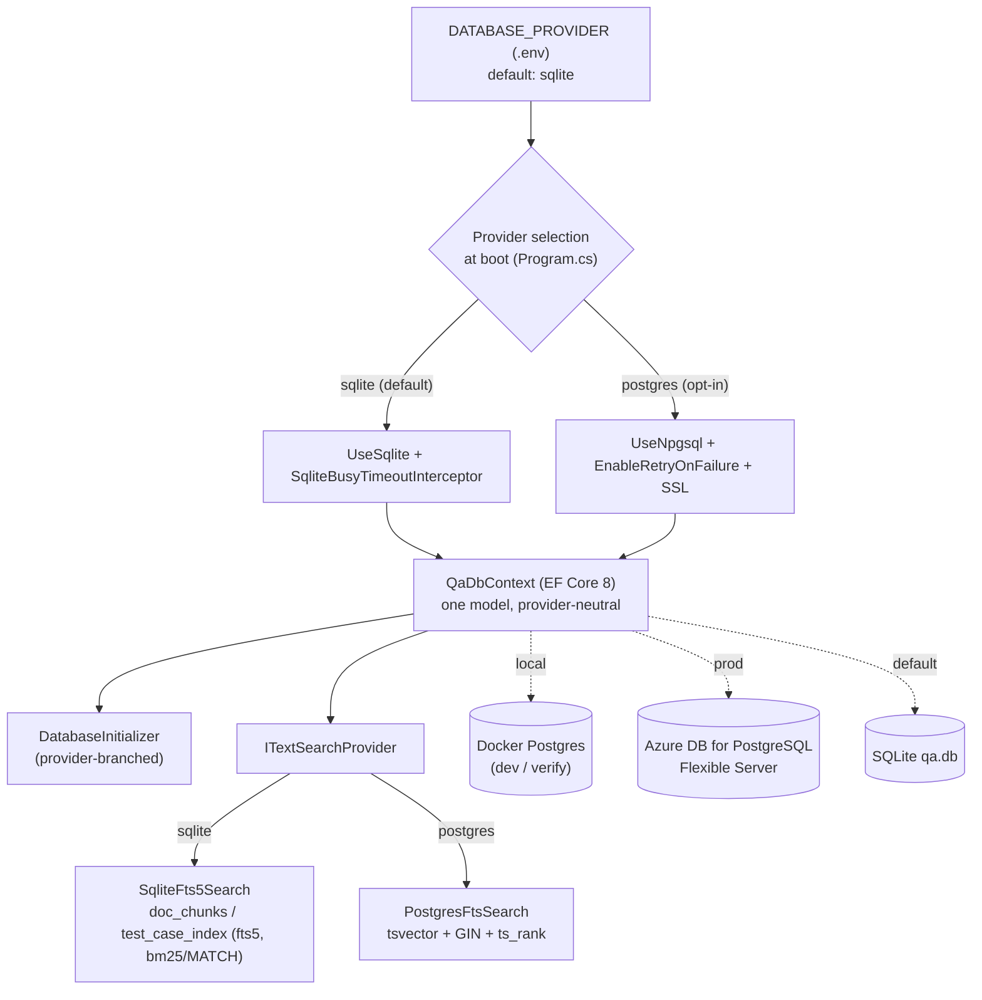

# Technical Design Document

| **Project Title**    | PostgreSQL Migration — dual-provider (SQLite default), Azure-ready          |
| -------------------- | -------------------------------------------------------------------------- |
| **Document Version** | 1.0                                                                        |
| **Date**             | July 28, 2026                                                              |
| **Prepared By**      | Mahmood Ahmad (BA / QA) + Claude                                           |
| **Companion docs**   | `prd.md` (task backlog) · `blueprint.md` (implementation guide) · `progress.md` (status + log) · `docs/setup/postgresql-docker.md` · `docs/setup/postgresql-azure.md` |

# Revision History

| **Version** | **Date**      | **Author**       | **Description of Change** |
| ----------- | ------------- | ---------------- | ------------------------- |
| 1.0         | July 28, 2026 | Mahmood + Claude | Initial design: make the data layer **dual-provider** (SQLite default, PostgreSQL opt-in via `DATABASE_PROVIDER`), with native Postgres full-text search behind an abstraction, a parallel Npgsql migration set, and a fresh-start (no ETL) data policy. Local Docker for dev/verify; Azure Database for PostgreSQL Flexible Server for the live deployment. SQLite stays the default and fully working until verified locally. |

# Table of Contents

- [Purpose](#purpose)
- [Scope](#scope)
- [Architecture Overview](#architecture-overview)
- [Provider Selection (boot-time)](#provider-selection-boot-time)
- [Data Design](#data-design)
- [Full-Text Search Abstraction](#full-text-search-abstraction)
- [Migrations (dual provider)](#migrations-dual-provider)
- [DatabaseInitializer (provider-branched)](#databaseinitializer-provider-branched)
- [Settings & Configuration](#settings--configuration)
- [Azure Deployment](#azure-deployment)
- [Error Handling](#error-handling)
- [Verification](#verification)
- [Conclusion](#conclusion)

# Purpose

ADO_Tester persists everything to **SQLite** (EF Core 8) — sessions, drafts, KB documents + an FTS5
retrieval index, plan scans, settings. The team needs to run the tool on **PostgreSQL** so it can be
deployed on **Azure** for the QA team to use, while keeping SQLite as a zero-friction local default.

The migration is therefore **dual-provider, not a cutover**:

- **SQLite stays the default** and stays fully working. Nothing is removed. With no configuration
  change, the app behaves exactly as today.
- **PostgreSQL is opt-in** via a single boot-time setting (`DATABASE_PROVIDER=postgres`). Chosen for
  local Docker during development/verification and for Azure Database for PostgreSQL Flexible Server in
  production — the same code, only the connection string differs.
- The switch is made **once at startup** (EF binds the provider when `AddDbContext` runs), so changing
  providers means an app restart — which exactly matches "SQLite until I've verified Postgres myself."

The design keeps the two databases behaving identically to the application by hiding the one genuinely
provider-specific capability — **full-text search** (SQLite FTS5 vs PostgreSQL `tsvector`) — behind an
abstraction, and by maintaining a **separate migration set per provider**.

# Scope

**In Scope**

- Add the Npgsql EF Core provider and a `DATABASE_PROVIDER` toggle (default `sqlite`).
- Boot-time provider selection in `Program.cs` / `AddInfrastructure` / the design-time factory.
- A parallel **Npgsql migration set** (the existing SQLite migrations are untouched).
- An `ITextSearchProvider` abstraction with a SQLite (FTS5/BM25) implementation and a PostgreSQL
  (`tsvector`/`ts_rank`) implementation; `KnowledgebaseService` and `ExistingTestsIndexService`
  delegate their full-text read + index-maintenance to it.
- Provider-branching in `DatabaseInitializer` (SQLite keeps adopt-existing-`qa.db` + fts5 bootstrap;
  Postgres does a plain migrate and relies on migrations for the FTS tables).
- `.env` / `.env.example` keys + a step-by-step **local Docker** setup guide and an **Azure** deploy
  guide.

**Out of Scope**

- Data migration (ETL) from SQLite → PostgreSQL. **Fresh start only** — Postgres begins empty; schema
  created by EF migrations.
- Removing or deprecating SQLite. It remains the default indefinitely.
- Runtime (no-restart) provider switching from the UI. The provider is a boot-time setting (see
  rationale under *Settings*).
- Changing any ADO write body, embedded agent prompt, or bug-pipeline behavior — this is a data-layer
  change only; byte-exact parity is preserved.
- The DB Schema Explorer's `Microsoft.Data.SqlClient` usage — that reads *external* SQL Server product
  databases and is unrelated to the app DB.

# Architecture Overview



| Component | Change |
| --- | --- |
| **Provider selection** | `Program.cs` reads `DATABASE_PROVIDER` + connection string and passes them to a generalized `AddInfrastructure`; the DI root branches `UseSqlite` vs `UseNpgsql`. One decision, made once at boot. |
| **QaDbContext** | Unchanged model. Enums-as-string, `HasDefaultValue`, FKs/cascades are provider-neutral and port as-is. The only care item is DateTime (see Data Design). |
| **ITextSearchProvider** | New abstraction isolating the one provider-specific feature (full-text search). Two implementations; the KB + dedup services delegate to it. |
| **DatabaseInitializer** | Provider-branched: SQLite keeps its adopt/fts5-bootstrap path; Postgres migrates fresh and gets its FTS objects from migrations. |
| **Migrations** | The SQLite set is frozen; a parallel Npgsql set is added in its own folder/namespace. |
| **Settings / .env** | New `DATABASE_PROVIDER` + `POSTGRES_CONNECTION_STRING` keys, read at boot. |

**Invariants preserved:** the singleton-orchestrator + background-task-with-own-DI-scope model, SSE via
`IEventBus`, `EventLogJson` replay, `CancellationRegistry`, `PipelineConcurrency`, and all ADO write
parity are untouched. This change is confined to how the `DbContext` is provisioned and how full-text
search executes.

# Provider Selection (boot-time)

The DbContext provider is bound once, when `AddDbContext` runs. There is no per-request or per-call
selection (unlike the LLM provider, which builds a fresh client per call). Therefore:

- `Program.cs` resolves the provider and connection string **before** `AddInfrastructure`:
  - `DATABASE_PROVIDER` — `sqlite` (default) or `postgres`.
  - For `sqlite`: the existing `$"Data Source={dbPath}"` logic is unchanged.
  - For `postgres`: the connection string comes from `POSTGRES_CONNECTION_STRING` (or `DATABASE_URL`).
- `AddInfrastructure(config, provider, connectionString)` branches:
  - `sqlite` → `.UseSqlite(cs).AddInterceptors(SqliteBusyTimeoutInterceptor.Instance)` (as today).
  - `postgres` → `.UseNpgsql(cs, o => o.EnableRetryOnFailure().MigrationsAssembly(...))`, **no** SQLite
    interceptor.
- `QaDbContextFactory` (design-time, used by `dotnet ef`) reads the same env var and branches so
  migrations can be generated/applied against either provider.

Switching providers is a config change + restart. This is intentional and matches the requirement that
SQLite remain the trusted default until Postgres is verified.

# Data Design

The relational model in `QaDbContext` is **provider-neutral** and unchanged. What EF already does ports
cleanly to Npgsql:

- **Enums** persisted via `HasConversion<string>()` and the six wire-string converters
  (`testLevelConverter`, etc.) — identical behavior on both providers.
- **`HasDefaultValue`** (Title `""`, `ActivityEnabled` `true`, `Enabled` `true`, …) — becomes a Postgres
  column `DEFAULT`.
- **Identity PKs** — SQLite `INTEGER … AUTOINCREMENT` becomes Postgres `GENERATED … AS IDENTITY`; EF
  emits the right DDL per provider when the Npgsql migration is generated.
- **FKs / cascade deletes** — identical.

**The one care item: `DateTime`.** All timestamps are plain `DateTime` with no converter — SQLite stores
them as ISO-8601 TEXT. Npgsql maps `DateTime` to `timestamp with time zone` and throws on a non-UTC
`Kind`. Mitigation for a low-risk first port:

- Enable the compatibility switch at startup: `AppContext.SetSwitch("Npgsql.EnableLegacyTimestampBehavior", true);`
  The app already writes `DateTime.UtcNow` throughout, so legacy behavior (treat `DateTime` as
  `timestamp without time zone`) is safe and requires no model changes.
- **Hardening follow-up (documented, not required for week-one):** drop the switch and model timestamps
  as `timestamptz` with `Kind=Utc` normalization.

**FTS tables differ by provider** (see next section): on SQLite they are fts5 virtual tables bootstrapped
outside EF; on Postgres they are **real EF-modeled tables** carrying a `tsvector` column + GIN index,
created by the Npgsql migrations.

# Full-Text Search Abstraction

Full-text search is the only genuinely provider-specific behavior. Today it is SQLite FTS5:

- **`doc_chunks`** (KB retrieval) — read with `SELECT … bm25(doc_chunks) … WHERE doc_chunks MATCH $q AND
  project_id = $p ORDER BY score LIMIT $k`; written with app-code `INSERT`/`DELETE`. In
  `KnowledgebaseService`.
- **`test_case_index`** (existing-test dedup) — read with `… WHERE test_case_index MATCH $q AND scan_id =
  $sid ORDER BY rank LIMIT $top`; written with app-code `INSERT`/`DELETE`. In `ExistingTestsIndexService`.

Both are contentless plain fts5 tables kept in sync by application code (no triggers). This is isolated
behind a new abstraction:

```
ITextSearchProvider
  ├─ EnsureAsync(...)                        // create/verify the FTS objects (SQLite: fts5 bootstrap; PG: no-op, migrations own it)
  ├─ UpsertDocChunk / DeleteDocChunks(...)   // KB mirror maintenance
  ├─ SearchDocChunksAsync(projectId, q, k)   // KB ranked read
  ├─ UpsertTestCase / DeleteTestCasesForScan // dedup mirror maintenance
  └─ SearchTestCasesAsync(scanId, q, top)    // dedup ranked read
```

- **`SqliteFts5Search`** — the current `bm25`/`MATCH` SQL, moved verbatim (preserves today's behavior and
  keeps `KnowledgebaseServiceTests` BM25 assertions green).
- **`PostgresFtsSearch`** — Postgres-native:
  - `doc_chunks` / `test_case_index` are real tables with a `content`/`title`+`steps_summary` text column
    plus a generated (or maintained) `tsvector` column and a **GIN** index.
  - Writes populate the row and its `tsvector` (`to_tsvector('english', …)`).
  - Reads use `WHERE tsv @@ websearch_to_tsquery('english', $q) … ORDER BY ts_rank(tsv, …) DESC LIMIT
    $k`, scoped by `project_id` / `scan_id`.

`KnowledgebaseService` and `ExistingTestsIndexService` keep their public interfaces; internally they call
`ITextSearchProvider` instead of raw `SqliteConnection`/`bm25`/`MATCH`. `FindDuplicatesAsync` (in-memory
title-signature + Jaccard) is provider-agnostic and unchanged. The provider is registered per
`DATABASE_PROVIDER` in the DI root.

# Migrations (dual provider)

EF migrations are provider-specific (the SQLite set uses `INTEGER`/`TEXT`/`REAL` +
`Sqlite:Autoincrement` and will not run on Npgsql). Approach (Microsoft "migrations with multiple
providers" pattern):

- **Keep** the existing SQLite migrations under `Data/Migrations/` untouched.
- **Add** an Npgsql set under `Data/Migrations/Npgsql/` with its own namespace and model snapshot,
  generated via `dotnet ef migrations add InitialNpgsql --output-dir Data/Migrations/Npgsql` with
  `DATABASE_PROVIDER=postgres`.
- Select the active set by provider at both design-time (the factory) and runtime
  (`o.MigrationsAssembly(...)` / `MigrationsHistoryTable`).
- The Npgsql initial migration includes the **real** `doc_chunks` / `test_case_index` tables + their
  `tsvector` columns + GIN indexes (which on SQLite are fts5 virtual tables outside EF).

> **Risk (highest in this effort):** a single assembly has one `QaDbContextModelSnapshot` class, so two
> provider snapshots can collide. Primary approach: separate folders/namespaces with the design-time
> factory scoping snapshot discovery per provider. **Fallback if that proves fiddly:** move migrations
> into a dedicated per-provider migrations assembly/project. This is called out as its own PRD task.

# DatabaseInitializer (provider-branched)

`Initialize()` currently: adopt-existing-`qa.db` (SQLite catalog probes + `INSERT OR IGNORE` baseline) →
`Migrate()` → fts5 bootstrap → seed Project id=1 → reconcile orphaned runs. Provider-branched:

- **SQLite** — unchanged (adopt path + `EnsureFtsTable()` fts5 bootstrap).
- **PostgreSQL** — skip adoption entirely (fresh DB); `Migrate()` builds the full schema **including** the
  FTS tables/indexes; `EnsureFtsTable()` becomes a no-op (or delegates to `ITextSearchProvider.EnsureAsync`).
  The `sqlite_master` / `INSERT OR IGNORE` SQL is gated to the SQLite branch only.
- **Provider-agnostic** — `SeedProject()` (Project id=1) and `ReconcileOrphanedRuns()` run on both.

# Settings & Configuration

Two new keys, read at **boot** (before `AddDbContext`):

- `DATABASE_PROVIDER` — `sqlite` (default) | `postgres`.
- `POSTGRES_CONNECTION_STRING` (a.k.a. `DATABASE_URL`) — standard Npgsql connection string.

Both go in `.env` and `.env.example`. Unlike the ADO/LLM settings, these are **not** part of the runtime
`AppSettingsService` overlay: `ApplyAsync()` evicts `IOptionsMonitorCache` so option snapshots rebuild,
but it cannot rebuild an already-registered `DbContext`. The LLM provider can switch live because
`LlmClientFactory` builds a fresh client per call; the DbContext provider is bound once at
`AddDbContext`. So the DB provider is a boot-time env setting, and switching requires a restart — this is
documented in both setup guides.

# Azure Deployment

Because the design is provider-agnostic, Azure requires **no code change**:

- **Database:** Azure Database for PostgreSQL **Flexible Server** (Burstable B1ms is plenty for this
  workload; free for 12 months on a new free account, or any paid tier on company Azure).
- **Backend:** Azure **App Service** (.NET 8). Set `DATABASE_PROVIDER=postgres` and
  `POSTGRES_CONNECTION_STRING` as App Service application settings (or wire via Service Connector, which
  injects the connection env var).
- **Connection string:** standard Npgsql + `SSL Mode=Require` (Azure enforces TLS); `EnableRetryOnFailure`
  already handles transient drops.
- **Migrations:** applied on startup by `DatabaseInitializer.Migrate()` (fresh schema), or run explicitly
  from CI/CD before the app boots.

Full step-by-step in `docs/setup/postgresql-azure.md`; local Docker in `docs/setup/postgresql-docker.md`.

# Error Handling

- **Unknown/blank `DATABASE_PROVIDER`** → default to `sqlite` (never fail to boot into the trusted path).
- **Missing Postgres connection string when provider=postgres** → fail fast at startup with a clear
  message (don't silently fall back and confuse "why is my data empty").
- **Transient Postgres drops / cold starts** → `EnableRetryOnFailure` (execution strategy).
- **FTS behavior parity** → the SQLite implementation is moved verbatim so existing BM25 tests stay
  green; the Postgres implementation is covered by the local-Docker verification round-trip.
- **SQLite path** → completely unchanged, so the default remains the safe fallback at all times.

# Verification

Run by the user locally (the container has no .NET SDK or Docker, so backend/DB steps are user-run):

1. **SQLite default unchanged** — with no env changes, `dotnet build` + `dotnet test` stay green,
   especially `AdoGoldenTests` (parity), `KnowledgebaseServiceTests` (BM25), `DatabaseInitializerTests`
   (fts5 bootstrap + adopt).
2. **Postgres opt-in (local Docker)** — start Postgres per the setup guide; set `DATABASE_PROVIDER=postgres`
   + connection string; `dotnet ef migrations add InitialNpgsql --output-dir Data/Migrations/Npgsql`;
   start the backend → schema + `tsvector`/GIN FTS objects created; KB upload → search returns ranked
   hits; an author-tests dedup scan indexes and `ts_rank` retrieval works.
3. **Azure** — deploy to Flexible Server + App Service; migrate; QA smoke-test the real flows.
4. **Switch back to SQLite** — flip the env back; the app runs on the original `qa.db`, untouched.

# Conclusion

Making the data layer dual-provider — SQLite default, PostgreSQL opt-in — lets the team deploy on Azure
this week without giving up the frictionless local SQLite default, and without touching ADO parity,
prompts, or pipeline behavior. The only provider-specific surface (full-text search) is isolated behind
`ITextSearchProvider`, and the migration risk is contained to a parallel Npgsql migration set. Postgres
becomes a connection-string away — Docker locally, Azure Flexible Server in production — while SQLite
remains the trusted fallback until the user has verified everything themselves.
