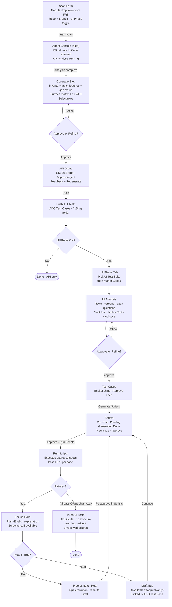
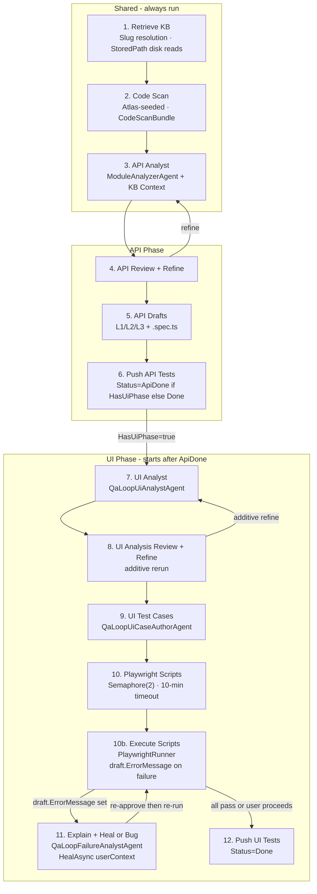

# Technical Design Document — QA Loop KB-Grounded Redesign

| **Project Title**    | QA Loop KB-Grounded — KB Retrieve · Code Scan · Dual Analyst · API Phase · UI Phase |
| -------------------- | ------------------------------------------------------------------------------------ |
| **Document Version** | 6.0                                                                                  |
| **Date**             | August 1, 2026                                                                       |
| **Prepared By**      | Mahmood Ahmad (BA / QA) + Claude                                                     |
| **Companion docs**   | `Ralph loop.md` · `blueprint.md` · `prd.md` · `progress.md`                         |

# Revision History

| **Version** | **Date**       | **Change** |
| ----------- | -------------- | ---------- |
| 1.0–3.0     | August 1, 2026 | Progressive drafts and audit passes. |
| 4.0         | August 1, 2026 | God-mode audit round 3 (18 issues) + proactive round 4/5 fixes. |
| 5.0         | August 1, 2026 | Iteration 2 audit (20 issues): Bug-draft deferred to post-push only; LastUiRunId attempt formula; ListSlugsAsync dedup; uiInFlightStatuses TypeScript via getUiStatus callback; explain-failure DraftKind guard; run-ui-scripts 400 on zero approved; JUnit classname normalization; FrsKbService scope memoization; pipelineSteps step-0 relabeled; UiTestSuiteId same plan; Author Cases button replaces separate Approve; screenshot path Playwright note; ScanStartRequest.hasUiPhase confirmed unchanged; System.Text.Json note; GetDocumentsByFolderAsync DISTINCT; explain-failure echoes draftId; activeStepIndex Analyzing=1 confirmed; scoped-per-run caching acceptable. |
| 6.0         | August 1, 2026 | Iterations 3-5 audit (28 issues): HealSpecsRequest/ExplainFailureResponse contracts; IQaLoopOrchestrator interface additions; QaLoopController new endpoints; PipelineConcurrency+CancellationRegistry for step 10b; SSE events per spec result; EventPhases.RetrieveKb/Scan/RunUi/AnalyzeUi constants; author-ui-cases guard UiStatus=null OK (old sessions); uiAnalysisJson null handled gracefully; api/qaLoop.ts additions listed; KnowledgebaseContracts additions; UiTestSuiteId picker throughout UI Phase; PATCH ui-suite endpoint; explain-failure graceful on null LastUiRunId; 4 pipeline steps confirmed; generate-ui-scripts guard; RerunUiAnalysisAsync prompt shape; CodeScanJson deserialization in step 7; PlaywrightRunSpec.Module; @qa-meta.tags level tags OK; getUiStatus type-safe callback; GetDocumentsByFolderAsync root-folder empty-string fix; explain-failure screenshot directory; DraftKind=UiScript guard. |

# Purpose

The QA Loop today is a sequential pipeline: fetch source code → AI analyzer → three-level API spec generator → push to ADO. It has no product knowledge, no structured code intelligence layer, and its existing UI phase (Slab 2, QLV2-201..208) has no dedicated analysis step — `UiCaseAuthorAgent` takes the API `InventoryDoc` rather than a purpose-built UI analysis.

This design introduces: a structured three-step shared phase (KB retrieval, code scan, API analyst) with FRS KB enrichment; an opt-in UI Phase superseding Slab 2 with a dedicated UI analyst, module-scoped test case authoring, per-case Playwright generation, inline execution, and failure explanation with Heal/Bug choice; and KB folder-tree upload with tree-view display.

**QA Loop code is completely separate from Author Tests. No services, no types, no utilities are shared — duplication is explicitly acceptable.**

# Scope

**In scope:**
- `KnowledgebaseDocument.FolderPath` column; JSON folder-upload endpoint; collapsible tree view on KB page.
- `IKnowledgebaseService`: `UploadAsync` += `folderPath?`; `GetDocumentsByFolderAsync`; `GetDocumentByPathAsync`.
- `IFrsKbService` / `FrsKbService`: disk-based FRS reader; slug resolver; YAML parser; defensive.
- `FrsModuleContext`, `CodeScanBundle`, `QaLoopUiAnalystOutput` records in `Core/Models/`.
- `ApiSessionStatus` += `RetrievingKb`, `Scanning`, **`ApiDone`**.
- `ApiUiStatus` += `AnalyzingUi`, `AwaitingUiAnalysisReview`, `RunningUiScripts`.
- `ApiTestSession` += `FrsSlug`, `KbContextJson`, `CodeScanJson`, `UiAnalysisJson`, `UiTestSuiteId`, **`LastUiRunId`**.
- `IQaLoopCodeScanService` / `QaLoopCodeScanService`: atlas-seeded, shared bundle.
- `ModuleAnalyzerAgent.BuildInventoryPrompt` += KB Context block. System prompt frozen.
- Generator agents += RULES + FE↔BE + features JSON in `extraContext`. System prompts frozen.
- Module field → `Autocomplete` combobox from `GET /api/qaloop/{projectId}/frs-modules`.
- Scripts Board alignment: `frsSlug` in `@qa-meta.module`; pack + feature tags.
- **UI Phase (supersedes Slab 2):** `QaLoopUiAnalystAgent`; `QaLoopUiCaseAuthorAgent`; `QaLoopFailureAnalystAgent`; `PlaywrightAgentService.HealAsync` += `userContext?`; `SemaphoreSlim(2)` per-case gen; step 10b inline execution; `UiTestSuiteId`; `LastUiRunId`.
- `SessionModuleConfig` += `uiInFlightStatuses?` for UI phase polling continuation.
- `qaLoopConfig.inFlightStatuses` += `'RetrievingKb'`, `'ApiDone'`.
- `qaLoopConfig.uiInFlightStatuses` = `['AnalyzingUi', 'RunningUiScripts']`.

**Out of scope:** Sharing with Author Tests or Find Bugs; multi-module scans; semantic KB retrieval; atlas Blast radius packs (Scripts Board v2); wiring `IFrsKbService` into `AgentOrchestrator` or `BugOrchestrator`.

# What Already Exists (grounding)

| Component | Notes |
|---|---|
| `QaLoopOrchestrator` (singleton) | Extended. Scoped services resolved via `scope.ServiceProvider.GetRequiredService<T>()`. `IFrsKbService` follows this pattern. Never constructor-injected. |
| `ApiTestSession` | Additive columns only. All existing columns preserved. |
| `ApiSessionStatus` | += `RetrievingKb`, `Scanning`, `ApiDone`. Old sessions starting at `Analyzing` unaffected. |
| `ApiUiStatus` | += `AnalyzingUi`, `AwaitingUiAnalysisReview`, `RunningUiScripts`. Old Slab 2 sessions in `Authoring`+ unaffected. |
| `TerminalStatuses` (orchestrator) | `{Done, Drafted, Failed, Cancelled}` — `ApiDone` is NOT in this set so UI phase tasks can launch via `Launch(...)`. |
| `ModuleAnalyzerAgent` | `BuildInventoryPrompt` += KB Context block. System prompt frozen. |
| Generator agents (3) | `extraContext` enriched. System prompts frozen. |
| `IModuleSourceDiscoveryService` | Used as fallback inside `QaLoopCodeScanService`. QA Loop service — no separation issue. |
| `QaMeta.Build`/`Upsert` | `module` + `tags` use FRS slug and extracted tags. Structure frozen. |
| `PlaywrightAgentService` | `HealAsync` += `userContext?`; `GenerateScriptAsync` already has `moduleRoute?`. |
| `PlaywrightRunner` | Reused for step 10b inline execution. `EnableCapture = true` for UI runs (QLV2-205). |
| `IKnowledgebaseService` | Extended (see above). FTS5 chunking unchanged. |
| `UiCaseAuthorAgent` (QLV2-203) | **Deprecated** — kept for backward-compat fallback when `UiAnalysisJson = null`. |
| `DependencyInjection.cs` | Must register `IFrsKbService` (scoped), `IQaLoopCodeScanService` (scoped). |

**Not reused (reference only):** `AgentOrchestrator`, `AnalystAgent`, `TesterAgent`, `ICodeContextService` (Author Tests).

**Prerequisite: QLV2-304 before per-case Playwright generation.** QLV2-304 refactors `PlaywrightAgentService` internals; concurrent edits conflict.

# Architecture

## High-level UI flow (user perspective)



## Full pipeline (component view)



## Session state machine

`ApiSessionStatus` (exact-name enum, additive, stored as C# member name string):
```
[NEW] RetrievingKb → Scanning → [EXISTING] Analyzing → AwaitingReview → Drafting → Drafted
  → Pushing → [NEW] ApiDone (HasUiPhase=true) | Done (HasUiPhase=false)
  [UI phase completes] → Done
  Failed / Cancelled (any time)
```

**`ApiDone`:** API phase complete, UI phase running or pending. NOT in `TerminalStatuses`. NOT a `Done`-equivalent for the push panel (see Frontend section). Frontend keeps polling while `status = ApiDone`.

`ApiUiStatus` (exact-name enum, additive):
```
[NEW] AnalyzingUi → AwaitingUiAnalysisReview → [EXISTING] Authoring → AwaitingReview →
  Drafting → Drafted → [NEW] RunningUiScripts → [EXISTING] Pushing → Done
  Failed / Cancelled
```

**Frontend polling — `SessionModuleConfig` changes:**
- `inFlightStatuses` += `'RetrievingKb'`, `'ApiDone'`.
- New `getUiStatus?: (d: TDetail) => string | undefined` optional method on `SessionModuleConfig<TDetail>` (type-safe; `qaLoopConfig` sets it to `d => d.uiStatus`; other configs omit it).
- New `uiInFlightStatuses?: string[]` field: `qaLoopConfig.uiInFlightStatuses = ['AnalyzingUi', 'RunningUiScripts']`.
- `useSessionDetail` `refetchInterval`: `(mainInFlight || (config.getUiStatus?.(d) && config.uiInFlightStatuses?.includes(config.getUiStatus!(d)!))) ? 2500 : false`.

**`activeStepIndex` in `qaLoop.tsx`:** (`'Scanning': 0` shifts to include `RetrievingKb`; `'Analyzing'` is now explicit at step 1)
```typescript
case 'RetrievingKb':
case 'Scanning':       return 0   // KB + Scan (relabel PIPELINE_STEPS[0] → "Retrieve KB")
case 'Analyzing':
case 'AwaitingReview': return 1   // Coverage
case 'Drafting':       return 2   // Drafts
case 'Drafted':
case 'Pushing':
case 'ApiDone':
case 'Done':           return 3   // Push
```
`PIPELINE_STEPS[0].label` changes from `"Scan"` to `"Retrieve KB"`. `ScanStartRequest.hasUiPhase` is unchanged from Slab 2.

**`live` check (`QaLoopDetailBody`):** `const live = !['Done', 'Failed', 'Cancelled'].includes(s.status)` — `ApiDone` is NOT in this list → `live = true` → cancel button visible, session navigable.

**`PushPanel` `isDone`:** `const isDone = session.status === 'Done' || session.status === 'ApiDone'` — API push panel shows "Pushed ✓" in both cases.

**`CoverageMatrix` `readOnly`:** `!['RetrievingKb', 'Scanning', 'AwaitingReview'].includes(s.status)` — editable only during analysis; read-only during KB retrieval and after approval.

**`DraftsByLevel` `readOnly`:** `s.status === 'Done' || s.status === 'ApiDone'`.

**`UiPhasePanel` state checks:** Updated to handle new states:
- `(!uiStatus || uiStatus === 'AnalyzingUi')` → loading spinner (UI Analyst running)
- `uiStatus === 'AwaitingUiAnalysisReview'` → show UI Analysis card + Refine box + Approve button
- `uiStatus === 'Authoring'` → loading spinner (case authoring)
- `uiStatus === 'AwaitingReview'` → show test cases for review
- `uiStatus === 'Drafting'` → loading spinner (scripts generating)
- `uiStatus === 'Drafted'` → show scripts, Approve, Run Scripts button; failure cards if `draft.errorMessage`
- `uiStatus === 'RunningUiScripts'` → loading spinner (execution)
- `uiStatus === 'Pushing'` → loading spinner (push)
- `uiStatus === 'Done'` → done state

# KB Enhancement — Directory-Tree Upload and View

## Storage
`KnowledgebaseDocument` += `FolderPath TEXT NULL` (migration `AddKbFolderPath`, both providers).

## UploadAsync signature (additive, backward-compat)
```csharp
Task<KnowledgebaseDocument> UploadAsync(
    int projectId, string fileName, string markdown,
    string? folderPath = null, CancellationToken ct = default);
```

## Upload endpoint
`POST /api/knowledgebase/{projectId}/folder` — JSON body `[{ folderPath, fileName, content }]`.
Response: `{ uploaded: [{id, fileName}], failed: [{fileName, error}] }` — continues on per-item failure, never aborts the batch.

## Frontend folder-select
`<input type="file" webkitdirectory multiple accept=".md">`. Algorithm for each `file.webkitRelativePath` (e.g. `"FRS/modules/messaging.md"`):
1. Split on `/`. First segment = root folder name (discard).
2. Last segment = `fileName`. Intermediate segments joined with `/` = `folderPath` (`""` for root files).
3. Send all items as a JSON array to `POST /api/knowledgebase/{projectId}/folder`.

**Constraint:** `webkitdirectory` is folder-select mode only — individual file drag-drop does not populate relative paths.

## View
Collapsible tree (MUI `SimpleTreeView`). Folder nodes show child count; leaf nodes show filename + delete. Folder-level delete cascades. Flat-list fallback when all `FolderPath = null` (legacy).

## IKnowledgebaseService additions
```csharp
// Exact folder OR descendent: WHERE (FolderPath = @fp OR FolderPath LIKE @fp || '/%')
// Special case: @fp = "" → WHERE (FolderPath = '' OR FolderPath IS NULL) — root documents only.
Task<IReadOnlyList<KnowledgebaseDocument>> GetDocumentsByFolderAsync(
    int projectId, string folderPath, CancellationToken ct = default);

// Exact match on FolderPath + FileName. Latest by UploadedAt when duplicates exist.
Task<KnowledgebaseDocument?> GetDocumentByPathAsync(
    int projectId, string folderPath, string fileName, CancellationToken ct = default);
```
Both return `KnowledgebaseDocument` with `StoredPath` populated for full disk reads. `GetDocumentByPathAsync` uses `ORDER BY UploadedAt DESC LIMIT 1` for deduplication (user re-uploads → latest wins).

# IFrsKbService

**Location:** `Core/Abstractions/IFrsKbService.cs` + `Infrastructure/QaLoop/FrsKbService.cs`. **Registration:** Scoped. **Resolution:** `scope.ServiceProvider.GetRequiredService<IFrsKbService>()` in orchestrator background scopes.

```csharp
public interface IFrsKbService
{
    Task<FrsModuleContext?> ResolveModuleAsync(
        string moduleName, int projectId, CancellationToken ct = default);

    // Filenames only — no YAML, no disk reads. Fast for dropdown.
    Task<IReadOnlyList<string>> ListSlugsAsync(
        int projectId, CancellationToken ct = default);
}
```

## ListSlugsAsync
`GetDocumentsByFolderAsync(projectId, "modules")` → deduplicated set of `doc.FileName.Replace(".md", "")` (if user uploads same file twice, each slug appears once). No disk reads.

## Resolution algorithm
1. `GetDocumentsByFolderAsync(projectId, "modules")` → list of `modules/*.md` documents. Deduplicate by `FileName` (latest `UploadedAt` wins per filename).
2. For each: `slug = doc.FileName.Replace(".md", "")`. Attempt exact case-insensitive match vs `moduleName`. First match wins.
3. No exact match: read each corresponding atlas file from disk via `StoredPath`. **Memoize atlas reads within the scoped lifetime** (one read per atlas per scan — acceptable O(n) for ~22 modules). Parse YAML. Attempt alias + `keywords_exclusive[]` match. Defensive: parse error → skip, do not throw.
4. On match: read `modules/<slug>.md`, `atlas/<slug>.md`, `RULES.md` from disk via `StoredPath`. Use latest `UploadedAt` document when duplicates exist (applies to all three files).
5. Atlas YAML: extract between **first** and **second** `---` (< 2 fences → empty). Parse `frontend_path_includes`, `backend_path_includes`, `keywords_exclusive`, `features[]`.
6. RULES.md: `GetDocumentByPathAsync(projectId, "", "RULES.md")` → latest by `UploadedAt`. Extract `## <slug>` section to next `## ` heading.
7. Extract `## Frontend ↔ Backend links` table from atlas.
8. Serialize `features[]` as `[{id, aliases, apis}]`.
9. Return `FrsModuleContext`. Null → session columns remain null.

# Core Model Definitions

**Core model types** use `System.Text.Json.JsonSerializer` for serialization/deserialization (same as all other session JSON columns). C# `sealed record` with nested records and primitive arrays serializes correctly without custom converters. No special handling needed for `FrsModuleContext`, `CodeScanBundle`, or `QaLoopUiAnalystOutput`.

**FrsModuleContext** (`Core/Models/FrsModuleContext.cs`):
```csharp
public sealed record FrsModuleContext(
    string Slug, string ModuleMarkdown, string AtlasMarkdown,
    string[] FrontendPathIncludes, string[] BackendPathIncludes,
    string[] KeywordsExclusive, string RulesMarkdown,
    string FeBackLinksMarkdown, string FeaturesJson);
```

**CodeScanBundle** (`Core/Models/CodeScanBundle.cs`):
```csharp
public sealed record CodeScanBundle(
    CodeScanFile[] FrontendFiles, CodeScanFile[] BackendFiles,
    string[] ApiCallCandidates, string DiscoverySource);
public sealed record CodeScanFile(string Path, string Content);
```

**QaLoopUiAnalystOutput** (`Core/Models/QaLoopUiAnalystOutput.cs`):
```csharp
public sealed record QaLoopUiAnalystOutput(
    UiAnalystFeature[] Features, UiAnalystFlow[] Flows, UiAnalystScreen[] Screens,
    string[] OpenQuestions, string[] MustTest, string[] MustNotTest,
    string AuthPermissionsSummary, string DmsVariantsSummary);
public sealed record UiAnalystFeature(string Id, string Name, string Description);
public sealed record UiAnalystFlow(string Name, string Trigger, string[] Steps, string[] Breaks);
public sealed record UiAnalystScreen(string Name, string Route, string[] Components);
```

# Scan Form — Module Dropdown

`module` field → MUI `Autocomplete` (`freeSolo=true`). Options from `GET /api/qaloop/{projectId}/frs-modules`. `"KB: <slug>"` chip on coverage step when resolved; `"KB: —"` when KB empty. Existing `FrontendPath`, `SourceDirs`, `FrontendModule` → **Advanced expander** (preserved, backward-compat).

# Step 1 — Retrieve KB

**State:** `RetrievingKb`. Calls `IFrsKbService.ResolveModuleAsync`. Persists `FrsSlug` + `KbContextJson`. **Degradation:** null result → `Warn` SSE + continue without KB enrichment. `KbContextJson` and `FrsSlug` remain null.

# Step 2 — Code Scan

**State:** `Scanning`. New `IQaLoopCodeScanService` / `QaLoopCodeScanService` (`Infrastructure/QaLoop/`):
1. If `FrsModuleContext != null`: atlas glob seeds via `IAzureDevOpsClient.GetFileContentAsync`.
2. Fallback: `IModuleSourceDiscoveryService` when atlas produces no files.
3. Deterministic frontend API extractor → `ApiCallCandidates[]`.
4. Resolve backend `.cs` handlers.
5. Caps: ≤ 40 FE files, ≤ 20 BE files, ≤ 400 KB total.
6. ADO failure → `Warn` + empty bundle (same pattern as `FetchSourceAsync`).

Persists `CodeScanJson`. **NOT in `ApiSessionDetail`.** Existing `DiscoveryJson`, `FrontendPath`, `SourceDirsJson`, `FrontendModule` preserved.

# Step 3 — API Analyst

**State:** `Analyzing`. `ModuleAnalyzerAgent.BuildInventoryPrompt` gains `FrsModuleContext? frsContext`. When non-null, inserts `## Knowledge Base Context (FRS: <slug>)` block containing: module brief (first 6,000 chars of `ModuleMarkdown`), FE↔BE links (`FeBackLinksMarkdown`), domain rules (`RulesMarkdown`), and disambiguation traps (first 3,000 chars of the `## Disambiguation traps` section extracted from `AtlasMarkdown`). System prompt frozen.

Coverage step shows two cards: **Inventory** (readable feature table) + **Surface matrix** (L1/L2/L3 rows, gap pre-selected). `AutoHandoff` applies (skips `AwaitingReview` gate). `CoverageMatrix` `readOnly` when status is NOT `AwaitingReview`.

# Steps 4–6 — API Review, Drafts, Push

Generators receive enriched `extraContext` (RULES + FE↔BE + FeaturesJson + tag instructions). Frozen system prompts. `@qa-meta.tags` populated by extracting `@[a-z][a-z0-9\-]+` tokens from the first `test(` line of `SpecCode` at `PersistDraft` time — this matches `@smoke`, `@regression`, `@e2e`, `@feature-*`, and level tags (`@contract`, `@endpoint`, `@workflow`); all are valid Scripts Board filter tags. `@qa-meta.module = frsSlug ?? module`. `WorkItemId` null-guarded in push.

**Push:** If `HasUiPhase = true` → `Status = ApiDone`. If `HasUiPhase = false` → `Status = Done` (unchanged). `DraftsByLevel` readOnly when `ApiDone` or `Done`.

# Step 7 — UI Analyst

**Trigger:** After API push step, if `HasUiPhase = true` (orchestrator continues inline). **State:** `AnalyzingUi`.

Agent: `QaLoopUiAnalystAgent`. System prompt: `qa_loop_ui_analyst_system.txt` — **authored from scratch**, not from Python. Infrastructure embedded resource. `AgentPrompts.QaLoopUiAnalystSystem`.

**Input:** `FrsModuleContext.ModuleMarkdown` + `CodeScanBundle.FrontendFiles` (deserialized from `session.CodeScanJson`; if null, analysis proceeds from KB alone). Output: `QaLoopUiAnalystOutput` → `UiAnalysisJson`. **Mapped in `ApiSessionDetail` as `uiAnalysisJson?`** (null for API-only sessions — frontend UI Phase tab renders nothing when null).

**`RerunUiAnalysisAsync` (guard: `UiStatus = AwaitingUiAnalysisReview`):** Sets `UiStatus = AnalyzingUi`. Agent receives prior `QaLoopUiAnalystOutput` (deserialized from `UiAnalysisJson`) + `## Reviewer Feedback (improve, do NOT restart)` + feedback — analogous to `RefineInventoryAsync`. Output **replaces** `UiAnalysisJson` with an improved version. After completion: `UiStatus = AwaitingUiAnalysisReview`.

Guard: only callable when `UiStatus = AwaitingUiAnalysisReview`.

# Step 8 — UI Analysis Review

**State:** `AwaitingUiAnalysisReview`. User reads the UI Analysis card (Author Tests card style). Two actions are available:
- **Rerun** — submit free-text feedback → `RerunUiAnalysisAsync` (guard: only in `AwaitingUiAnalysisReview`).
- **Author Cases** — clicking this IS the approval action; directly triggers `AuthorUiCasesAsync`. No separate "Approve" button. Guard: only in `AwaitingUiAnalysisReview`.

**`UiTestSuiteId` picker** is shown here — before the "Author Cases" button. User selects the ADO suite within the **same `testPlanId`** as the API tests (no separate plan picker needed). If left unset, falls back to `session.TestSuiteId`. Updateable any time before step 12 push.

# Step 9 — UI Test Cases

**State:** `Authoring`. Guard: `UiStatus = null` (old Slab 2 session — backward-compat) OR `UiStatus = AwaitingUiAnalysisReview` (new flow). Any other state → 409.

Agent: `QaLoopUiCaseAuthorAgent`. System prompt: `qa_loop_ui_case_author_system.txt` — **authored from scratch**. `AgentPrompts.QaLoopUiCaseAuthorSystem`.

**Backward-compat guard:**
```
if (session.UiAnalysisJson != null)
    → new QaLoopUiCaseAuthorAgent(QaLoopUiAnalystOutput)
else
    → deprecated UiCaseAuthorAgent(session.InventoryJson) fallback
```

Output: `ApiTestDraft` rows with `DraftKind = UiCase`, `Level = Ui`, `Bucket`, `StepsJson`. `StepsJson` → ADO XML via existing `BuildStepsXml` push path (no format change). Suite: `session.UiTestSuiteId ?? session.TestSuiteId`. No story picker.

Refine: per-case feedback + overall feedback + "Regenerate with feedback" (existing `RefineDraftsAsync` pattern).

# Step 10 — Playwright Script Generation (per test case)

**State:** `Drafting`. Guard: `UiStatus = AwaitingReview` (test cases reviewed and approved). Other states → 409.

**Note on `generate-ui-scripts`:** this is the existing endpoint from Slab 2 (QLV2-204). With the new flow it now also requires the `AwaitingReview` guard (user must have approved test cases first).

`SemaphoreSlim(2)`. Per-case `CancellationTokenSource(10 min)` linked to session token. Timeout → `draft.Status = Draft` + `draft.ErrorMessage = "Generation timed out"`. Other cases continue.

Agent receives: `Title` + `Steps[]` (formatted text) + first entry of atlas `routes[]` as `moduleRoute` (null if empty).

**Spec file path** (matches actual implementation): `{PlaywrightRoot}/generated/ui/{bucket}/{Slug(caseTitle)}-{tcIdPending}.ui.spec.ts`.

`@qa-meta.tags`: pack + feature tokens extracted from test title at `PersistDraft` time.

Output: `ApiTestDraft` rows with `DraftKind = UiScript`, `Level = Ui`, `Bucket`, `SpecCode`, `SpecFilePath`. Drafts start as `Status = Draft`. User reviews spec code and marks `Approved`. **Only `Approved UiScript` drafts proceed to execution or push.**

# Step 10b — Execute UI Scripts

**State:** `RunningUiScripts`. Endpoint: `POST /api/qaloop/sessions/{id}/run-ui-scripts` (202). Guard: 409 Conflict if `UiStatus = RunningUiScripts` already.

**Precondition:** `PlaywrightRoot` must be configured. If empty → 400 with actionable message, do not launch.

**Concurrency and cancellation:** Step 10b uses `_concurrency` (`PipelineConcurrency` global cap) and `_cancellations` (`CancellationRegistry`) — same as all other background steps. Registered with `CancellationRegistry` so the user can cancel mid-run.

**SSE events:** Each spec result emitted as `EventKinds.Result` with `EventPhases.RunUi` (`"run-ui"`): `"Spec {fileName}: passed"` / `"Spec {fileName}: failed"`. The Agent Console shows live per-spec results.

**EventPhases additions:** `EventPhases.RetrieveKb = "retrieve-kb"` and `EventPhases.Scan = "scan"` and `EventPhases.RunUi = "run-ui"` and `EventPhases.AnalyzeUi = "analyze-ui"` — new frozen constants.

**Implementation:**
1. Sets `UiStatus = RunningUiScripts`.
2. Collects `Approved UiScript` drafts with valid `SpecFilePath`.
3. Assigns `runId = session.Id * 10_000 + (session.LastUiRunId == null ? 1 : session.LastUiRunId.Value % 10_000 + 1)`. Stores in `session.LastUiRunId`. Sets `PlaywrightRunSpec.Module = session.FrsSlug ?? session.Module` (for Allure history keying). This self-increments on each run without a separate counter column.
4. Builds `PlaywrightRunSpec { RunId = runId, SpecFilePaths = [...], EnableCapture = true, Headed = false, Workers = null }`. (`Headed = false` = headless; `Workers = null` = use `playwright.config` default.)
5. `PlaywrightRunner.RunAsync(spec, ct)` — output written to `{DataDir}/runs/{runId}/`.
6. Parses JUnit XML result: for each `<testcase>` with a `<failure>` child, extract `classname` (relative spec path from `PlaywrightRoot`). Resolve to absolute path via `Path.GetFullPath(Path.Combine(PlaywrightRoot, classname))`. Match against `draft.SpecFilePath` (case-insensitive, path-normalized). Failing match → `draft.ErrorMessage = failure.innerText`. Passing → `draft.ErrorMessage = null` (cleared).
7. Sets `UiStatus = Drafted`. Guard: returns 400 "No approved UI scripts to run" if step 2 yields zero drafts.

**No `TestRun` DB row. No `TestFailure` rows.** Failures stored directly on `draft.ErrorMessage`.

# Step 11 — Failure Explanation, Heal, or Bug Draft

**Trigger:** User clicks "Explain" on a script card where `draft.errorMessage != null`.

## QaLoopFailureAnalystAgent

System prompt: `qa_loop_failure_analyst_system.txt` — **authored from scratch**. `AgentPrompts.QaLoopFailureAnalystSystem`.

**Endpoint:** `POST /api/qaloop/sessions/{id}/explain-failure` — body `{ draftId }` only (no `runId`).
1. Load `ApiTestDraft` by `draftId` (verify `SessionId` matches, `DraftKind = UiScript`). Fail 404 if not found.
2. Failure text: `draft.ErrorMessage`. If null → 400 "Draft has no recorded failure."
3. Screenshot path: within `{DataDir}/runs/{session.LastUiRunId}/` (Playwright's default `test-results/` subdirectory or the configured `outputDir`). Pass the directory to the agent if it exists; omit if not.
4. Agent input: `draft.ErrorMessage` + `draft.Title` + `draft.StepsJson` + screenshot directory path.
5. Return `{ draftId, explanation: string }`. **Synchronous. 30-second HTTP timeout.**

## IPlaywrightAgentService.HealAsync extended (additive)
```csharp
Task HealAsync(
    string specFilePath, string failureMessage,
    IProgress<string>? progress, CancellationToken ct,
    string? userContext = null);
```
`userContext` appended to failure message: `failureMessage + "\n\nUser context: " + userContext`.

## User choices
- **Heal:** `HealAsync(..., userContext)`. Spec rewritten. `draft.ErrorMessage = null`. `draft.Status = Draft` (re-approve required before re-run).
- **Draft bug:** Only available when `draft.AdoTestCaseId != null` (i.e. after UI test cases have been pushed in step 12). Before push, the "Draft Bug" button is disabled — the user must heal first or push then file. After push: `BugDraftJson` linked to `draft.AdoTestCaseId`, routed to existing bug-draft review.

**Why no pre-push bug draft:** `draft.AdoTestCaseId` is null before push. There is no ADO entity to link to yet. The user must either heal the failing script now, or push the test cases first and file the bug afterward.

**Healer never fires automatically.** After healing: user re-approves the healed draft → clicks "Run Scripts" → step 10b re-runs all `Approved UiScript` drafts.

## Re-run behavior
Step 10b always runs all `Approved UiScript` drafts. After healing, re-approve the draft, then run again. `LastUiRunId` is overwritten on each run (latest run screenshots are used). Multiple runs are supported.

# Step 12 — Push UI Tests

ADO Test Cases in `session.UiTestSuiteId ?? session.TestSuiteId`. No `Tested-By` link. `@qa-meta` rewritten with real `tcId`. Sets `UiStatus = Pushing` → `Done` then `Status = Done`.

**Push button availability:** Available whenever there are `Approved UiCase` drafts — even with unresolved failures (some `UiScript` drafts have `ErrorMessage != null`). A warning badge shows the count of unresolved failures. User decides whether to fix first or push as-is.

# Data Design (all additive)

## Migration: `AddKbFolderPath`
`KnowledgebaseDocuments` += `FolderPath TEXT NULL`.

## Migration: `AddQaLoopFrsColumns`
`ApiTestSessions` +=

| Column | Type | `ApiSessionDetail`? | Notes |
|---|---|---|---|
| `FrsSlug` | TEXT NULL | Yes — `frsSlug?` | Resolved FRS slug |
| `KbContextJson` | TEXT NULL | **No** | Serialized `FrsModuleContext`. Internal only. |
| `CodeScanJson` | TEXT NULL | **No** | Serialized `CodeScanBundle`. Internal only. |
| `UiAnalysisJson` | TEXT NULL | Yes — `uiAnalysisJson?` | Serialized `QaLoopUiAnalystOutput`. |
| `UiTestSuiteId` | INTEGER NULL | Yes — `uiTestSuiteId?` | Suite for UI push. |
| `LastUiRunId` | INTEGER NULL | Yes — `lastUiRunId?` | Last step-10b run id for screenshot path. |

## Enum additions
`ApiSessionStatus` += `RetrievingKb`, `Scanning`, `ApiDone` (leading + middle). All exact-name.

`ApiUiStatus` += `AnalyzingUi`, `AwaitingUiAnalysisReview` (leading), `RunningUiScripts` (between `Drafted` and `Pushing`). All exact-name.

# API Design (all changes)

| Method | Path | Notes |
|---|---|---|
| `GET` | `/api/qaloop/{projectId}/frs-modules` | `string[]` slugs. Filenames only. |
| `POST` | `/api/knowledgebase/{projectId}/folder` | JSON `[{folderPath,fileName,content}]`. Returns `{uploaded,failed}`. |
| `POST` | `/api/qaloop/sessions/{id}/rerun-ui-analysis` | Body `RerunUiAnalysisRequest { feedback }`. 202. Guard: `UiStatus = AwaitingUiAnalysisReview`. |
| `POST` | `/api/qaloop/sessions/{id}/author-ui-cases` | Existing. Guard: `UiStatus = null` (old Slab 2) OR `AwaitingUiAnalysisReview`. 409 otherwise. Routes to new or deprecated agent based on `UiAnalysisJson`. |
| `POST` | `/api/qaloop/sessions/{id}/generate-ui-scripts` | Existing (QLV2-204). Guard: `UiStatus = AwaitingReview`. 409 otherwise. |
| `POST` | `/api/qaloop/sessions/{id}/run-ui-scripts` | NEW. 202. Guard: `PlaywrightRoot` configured; `UiStatus != RunningUiScripts` (else 409); ≥ 1 `Approved UiScript` draft (else 400). |
| `POST` | `/api/qaloop/sessions/{id}/explain-failure` | Body `{ draftId }`. Guard: draft owned by session, `DraftKind = UiScript`, `ErrorMessage != null`. Sync. 30s via `CancellationTokenSource`. Returns `ExplainFailureResponse`. `LastUiRunId = null` → screenshot omitted gracefully. |
| `POST` | `/api/qaloop/sessions/{id}/heal-specs` | Existing. `HealSpecsRequest` gains `UserContext?`. |
| `PATCH` | `/api/qaloop/sessions/{id}/ui-suite` | Body `{ suiteId? }`. Synchronous DB update (200, no background task). Updates `UiTestSuiteId`. Available any time before step 12 push. |
| `GET` | `/api/qaloop/sessions/{id}` | `ApiSessionDetail` += `frsSlug?`, `uiAnalysisJson?` (null for API-only; frontend renders nothing when null), `uiTestSuiteId?`, `lastUiRunId?`. `ApiSessionDetail.From()` mapper updated. |

## New contracts
```csharp
public sealed record RerunUiAnalysisRequest(string Feedback);
public sealed record ExplainFailureResponse(int DraftId, string Explanation);
// HealSpecsRequest gains: string? UserContext = null
public sealed record HealSpecsRequest(int[] DraftIds, string? UserContext = null);
```

`IQaLoopOrchestrator` gains:
```csharp
Task RerunUiAnalysisAsync(int sessionId, string feedback, CancellationToken ct = default);
Task RunUiScriptsAsync(int sessionId, CancellationToken ct = default);
```
`QaLoopController` gains `POST sessions/{id}/rerun-ui-analysis` and `POST sessions/{id}/run-ui-scripts` — same 202 background-task pattern as all existing action endpoints. `PATCH sessions/{id}/ui-suite` is a **synchronous DB-only update** (no background task, returns 200). `api/qaLoop.ts` gains matching TypeScript functions: `rerunUiAnalysis(id, feedback)`, `runUiScripts(id)`, `explainFailure(id, draftId)`, `healSpecs(id, draftIds, userContext?)`, `patchUiSuite(id, suiteId)`. `KnowledgebaseContracts.cs` gains:
```csharp
public sealed record KbFolderUploadItem(string FolderPath, string FileName, string Content);
public sealed record KbFolderUploadResult(int Id, string FileName);
public sealed record KbFolderUploadError(string FileName, string Error);
public sealed record KbFolderUploadResponse(
    KbFolderUploadResult[] Uploaded, KbFolderUploadError[] Failed);
```

`UiTestSuiteId` is updated via `PATCH /api/qaloop/sessions/{id}/ui-suite` body `{ suiteId?: int }` — a lightweight new endpoint so users can change the suite after the session is created without re-scanning.

# New System Prompts — All Authored From Scratch

| File | `AgentPrompts` property | Purpose |
|---|---|---|
| `qa_loop_ui_analyst_system.txt` | `QaLoopUiAnalystSystem` | Module-scoped UI analysis |
| `qa_loop_ui_case_author_system.txt` | `QaLoopUiCaseAuthorSystem` | Module-scoped test case authoring |
| `qa_loop_failure_analyst_system.txt` | `QaLoopFailureAnalystSystem` | Failure explanation from Playwright error + steps |

`write_prompts.py` NOT used — these are new, not Python originals.

# New PHASE_LABEL entries (shared.tsx + AgentConsole.tsx)
`'retrieve-kb': 'KB'`, `'scan': 'SCAN'`, `'analyze-ui': 'UI ANALYSIS'`, `'failure-explain': 'FAILURE'`, `'run-ui': 'RUN'`. The existing `'analyze': 'ANALYZE'` phase label is unchanged.

# Separation from Author Tests

| New QA Loop type | Author Tests reference |
|---|---|
| `QaLoopUiAnalystAgent` + prompt | `AnalystAgent` |
| `QaLoopUiCaseAuthorAgent` + prompt | `UiCaseAuthorAgent` (deprecated) |
| `QaLoopFailureAnalystAgent` + prompt | (none) |
| `IQaLoopCodeScanService` / `QaLoopCodeScanService` | `ICodeContextService` |
| `IFrsKbService` / `FrsKbService` | (none) |
| `FrsModuleContext`, `CodeScanBundle`, `QaLoopUiAnalystOutput` | (none) |

No `using` Author Tests infrastructure namespaces. `QaAutomation.Core.Agents.JsonUtils` + `AgentPrompts` (Core) permitted.

# Invariants

- **Byte-exact ADO parity.** New instructions in user prompts only. All existing system prompts frozen. New prompts are new embedded resources.
- **Backward compat.** Old `Analyzing`/`Authoring` sessions remain valid. `author-ui-cases` falls back to deprecated agent when `UiAnalysisJson = null`.
- **Background-task / DI scope.** All scoped services resolved via `GetRequiredService<T>()`.
- **`AdoGoldenTests` stays green.** `@qa-meta` structure frozen.
- **4 pipeline steps.** `PIPELINE_STEPS` has 4 entries (KB+Scan, Coverage, Drafts, Push). Step 0 label changes from `"Scan"` to `"Retrieve KB"`. No new step added.
- **New `EventPhases` constants.** `EventPhases.RetrieveKb = "retrieve-kb"`, `EventPhases.Scan = "scan"`, `EventPhases.AnalyzeUi = "analyze-ui"`, `EventPhases.RunUi = "run-ui"` — new frozen string constants in `ConsoleEvent.cs` alongside existing constants. SSE streams use these for `PHASE_LABEL` mapping.
- **`DatabaseInitializer` migrations auto-apply.** All new migrations apply on startup — no manual step required.
- **`ApiDone` is not terminal.** UI phase tasks can launch. Polling continues.
- **Healer never fires automatically.** Heal → re-approve → re-run is the user-driven flow.
- **UI Phase suite-only.** `UiTestSuiteId ?? TestSuiteId`. `WorkItemId` null-guarded.
- **No `TestRun`/`TestFailure` rows for step 10b.** Failures stored on `draft.ErrorMessage`.
- **Graceful degradation.** Missing KB / scan failure = `Warn` + continue.
- **`AutoHandoff` is API-phase only.**

# Verification

- **KB tree:** folder-select → `FolderPath` populated; tree renders; `GetDocumentByPathAsync` returns latest upload; YAML parsed from `StoredPath`; root files (`FolderPath = ""`) retrieved correctly.
- **Retrieve KB:** scan `messaging` → `FrsSlug = "messaging"`; `KbContextJson` non-null; degradation → `Warn` only, pipeline continues.
- **Code Scan:** non-degenerate bundle; atlas paths first; discovery fallback; ADO failure → Warn + empty bundle.
- **API Analyst:** KB Context block in SSE; inventory table card renders; `AdoGoldenTests` green; `AutoHandoff` skips gate.
- **API push with `HasUiPhase`:** `Status = ApiDone` (not Done); polling continues; `PushPanel` shows "Pushed ✓"; `DraftsByLevel` readOnly.
- **API push without `HasUiPhase`:** `Status = Done` (unchanged).
- **UI Analyst:** starts after `ApiDone`; `AnalyzingUi` → `AwaitingUiAnalysisReview`; UI Analysis card shows; additive rerun updates output; `rerun-ui-analysis` blocked unless `AwaitingUiAnalysisReview`.
- **`author-ui-cases` backward compat:** old session → deprecated agent; new session → new agent.
- **`UiTestSuiteId` picker:** visible on UI Phase tab at step 8; falls back to `TestSuiteId` if unset.
- **Per-case Playwright:** max 2 concurrent; 10-min timeout → `ErrorMessage` set; others continue; `PlaywrightRoot` precondition checked.
- **Execute UI Scripts (step 10b):** `RunningUiScripts`; 409 if already running; JUnit parsed; failing draft gets `ErrorMessage`; `LastUiRunId` stored.
- **Failure explanation:** `explain-failure {draftId}` returns explanation; screenshot from `test-results/` subdirectory; 30s timeout.
- **Heal:** spec rewritten; `ErrorMessage` cleared; `Status = Draft`; re-approve → re-run works.
- **UI push:** warning badge on unresolved failures; test cases in `UiTestSuiteId ?? TestSuiteId`; `Status = Done` after.
- **Scripts Board:** `@qa-meta.module = frsSlug`; pack + feature tags present.
- **`uiInFlightStatuses` polling:** frontend keeps polling during `AnalyzingUi` and `RunningUiScripts` even when `status = ApiDone`.
- **Live ADO (2026-08-01):** PAT refreshed; messaging session through push (`ApiDone`) + UI Analyst review on ClaudeCli/haiku. UI scripts→run→heal→UI-push soft-remaining.
# Reference Documents

- `docs/progress/RalphLoop/qa-loop-v2/solution.md` · `qa-loop-smart-discovery/solution.md` · `author-tests-enhancements/solution.md`
- `C:\Users\temp\Downloads\Projects\TCRN\CRM Project\FRS\CONVENTIONS.md`
- `CLAUDE.md` — architecture invariants.
