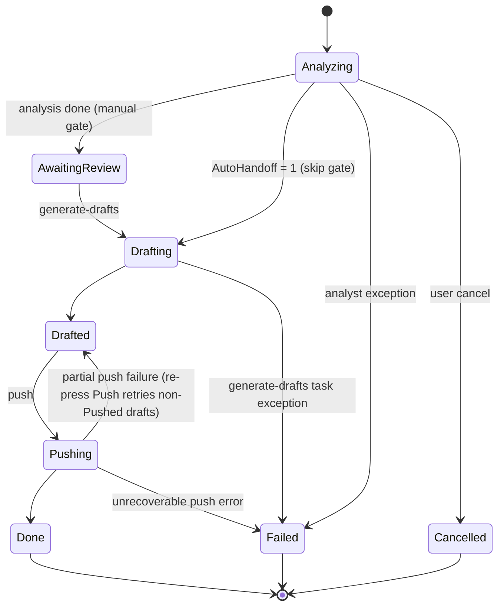
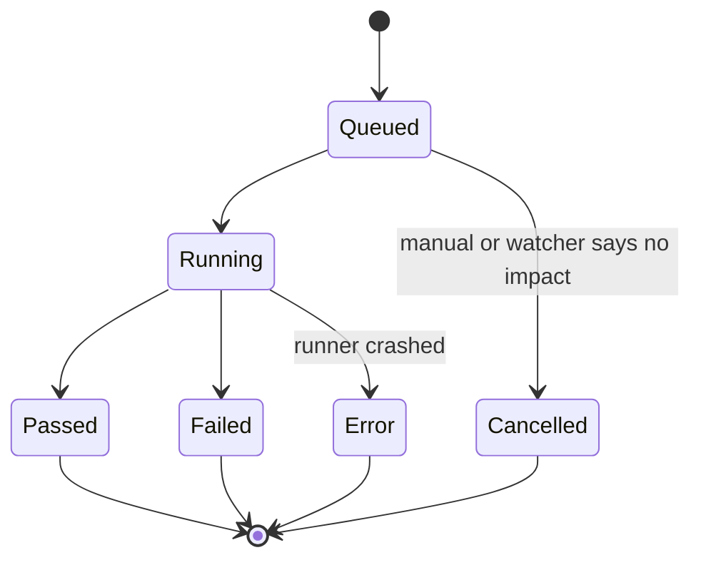

# QA Loop Re-shape - Technical Implementation Guide

| | |
| --- | --- |
| **Project Title** | QA Loop Re-shape - 3-Level API Testing + AI Impact Analysis |
| **Document** | `blueprint.md` - implementation guide (companion to `solution.md`) |
| **Version** | 1.0 |
| **Date** | June 30, 2026 |
| **Prepared By** | Mahmood Ahmad (BA / QA, YourOrg) + Claude |

## Purpose

This document is the **implementation guide** for the QA Loop Re-shape designed in
[`solution.md`](./solution.md). It turns that design into a concrete, file-by-file build plan for the
existing **ADO_Tester** repo - a .NET 8 (ASP.NET Core + EF Core 8 / SQLite, FTS5) backend and a
React 19 + Vite + MUI frontend. It is intended to be consumed by a developer or a coding agent to
implement the service end to end.

The carve adds, inside ADO_Tester: a hybrid Module Analyzer, three per-level API-test generators
(Contract / Endpoint / Workflow), a backend-owned Playwright runner, an ADO Test Run lifecycle, a
pipeline watcher with AI impact analysis, draft-first Bug filing, and Teams notifications - across
three new frontend pages (`/qa-loop`, `/qa-runs`, `/qa-pipelines`). It reuses the proven
`AgentOrchestrator` background-task pattern, the `FailureTriageAgent` classifier, KB+FTS5 retrieval,
and the runtime-switchable LLM provider layer.

> Every contract, column, and lifecycle here is locked in `solution.md` (v1.3). Where this guide
> shows code it mirrors the repo's existing conventions (the real files mirrored are cited per
> section). Class names, namespaces, and file paths follow the Project Structure manifest below.

## Technology Stack

| Component | Technology |
| --- | --- |
| Backend framework | .NET 8 / ASP.NET Core |
| Language | C# 12 |
| ORM / Database | EF Core 8 / SQLite (FTS5 for KB retrieval) |
| Project layout | Clean layering: `QaAutomation.Core` / `.Infrastructure` / `.Api` / `.Tests` |
| Background work | Singleton orchestrator + background `Task` with its OWN DI scope; `IHostedService` for the watcher |
| Live progress | Server-Sent Events over `IEventBus` (in-memory pub/sub); durable replay via `EventLogJson` |
| LLM layer | `ILlmClientFactory` - `ClaudeCli` (default), `Anthropic`, `AzureOpenAi`, `OpenAiCompatible` |
| Test execution | Playwright (`npx playwright test`) - JUnit + HTML + JSON reporters |
| Run report | Node-native Allure (single-file `.html`, no Java) gated by `qaloop.report_provider`; JUnit + JSON always-on (triage/ADO/counts depend on them) |
| ADO integration | `AzureDevOpsClient` (PAT Basic auth) - work items, test plans/suites, Git, Build, Test Management |
| Frontend | React 19 + Vite + MUI + Redux Toolkit + React Query |
| Notifications | Microsoft Teams incoming webhook |

## Project Structure

New and modified files across the four backend projects and the React client. Paths and type names
below are the canonical manifest every section conforms to.

```
backend/src/QaAutomation.Core/
  Models/
    ApiTestSession.cs                          (new)  — ApiTestSession + ApiTestDraft entities
    TestRun.cs                                 (new)  — TestRun + TestFailure entities
    PipelineWatch.cs                           (new)  — PipelineWatch entity
    Enums.cs                                   (modified) — add ApiSessionStatus, ApiDraftStatus, TestLevel, TestRunStatus, FailureClassification, TriggerSource, DmsProfile
    AgentOutputs.cs                            (modified) — add InventoryJson/AnalysisJson/ImpactAnalysis POCOs (shared agent shapes)
  Contracts/
    QaLoopContracts.cs                         (new)  — scan/start, analysis PATCH, draft DTOs, session list/detail
    QaRunsContracts.cs                         (new)  — run start, run list/detail, triage, file-bugs DTOs
    QaPipelinesContracts.cs                    (new)  — watch list/add/patch, run-latest, preview-impact DTOs
  Abstractions/
    IQaLoopOrchestrator.cs                     (new)
    IPlaywrightRunner.cs                       (new)
    ITeamsNotifier.cs                          (new)
    IAzureDevOpsClient.cs                      (modified) — +5 methods (test-run lifecycle, test points, build reads)
    IResultsIngestService.cs                   (modified) — split: TriageAsync + FileBugsAsync
  Configuration/
    QaLoopOptions.cs                           (new)  — poll interval, teams webhook/template, report provider, activity flag
    DmsProfileOptions.cs                       (new)  — 4-profile registry (Infinity credentialed)
backend/src/QaAutomation.Infrastructure/
  Agents/
    ModuleAnalyzerAgent.cs                     (modified) — rewrite: inventory + per-level coverage matrix + 1-pass refinement
    ContractGeneratorAgent.cs                  (new)
    EndpointGeneratorAgent.cs                  (new)
    WorkflowGeneratorAgent.cs                  (new)
    ImpactAnalyzerAgent.cs                     (new)
    FailureTriageAgent.cs                      (unchanged, reused)
    AgentPrompts.cs                            (modified) — register 7 new embedded prompts
    Prompts/
      module_analyzer_system.txt              (modified) — new inventory/matrix contract
      contract_generator_system.txt           (new)
      contract_testcase_system.txt            (new)
      endpoint_generator_system.txt           (new)
      endpoint_testcase_system.txt            (new)
      workflow_generator_system.txt           (new)
      workflow_testcase_system.txt            (new)
      impact_analyzer_system.txt              (new)
  Orchestrators/
    QaLoopOrchestrator.cs                      (new)  — scan→analyze→generate→push background pipeline
  QaRuns/
    PlaywrightRunner.cs                        (new)
    RunExecutionService.cs                     (new)  — drives runner + ADO test-run lifecycle + triage handoff
  QaPipelines/
    PipelineWatcherHostedService.cs            (new)
  Results/
    ResultsIngestService.cs                    (modified) — split IngestAsync → TriageAsync + FileBugsAsync; reuse body builders
    JUnitParser.cs                             (unchanged, reused)
  Notifications/
    TeamsNotifier.cs                           (new)
    Templates/
      teams_summary_compact.json.template     (new)
      teams_summary_developer.json.template    (new)
      teams_summary_scheduled.json.template     (new)
  AzureDevOps/
    AzureDevOpsClient.cs                       (modified) — implement the 5 new IAzureDevOpsClient methods
  Settings/
    AppSettingsService.cs                      (modified) — add 5 dotted keys to AllKeys/Defaults (teams + report provider + activity)
  Data/
    QaDbContext.cs                             (modified) — 5 DbSets + OnModelCreating registrations
    Migrations/
      <ts>_AddQaLoopReshape.cs                 (new)
      <ts>_AddQaLoopReshape.Designer.cs        (new)
      QaDbContextModelSnapshot.cs              (modified)
  DependencyInjection.cs                       (modified) — register orchestrator, runner, watcher hosted service, notifier, agents, options
backend/src/QaAutomation.Api/
  Controllers/
    QaLoopController.cs                        (new)  — /api/qaloop/... scan & author
    QaRunsController.cs                        (new)  — /api/qaloop/runs/...
    QaPipelinesController.cs                   (new)  — /api/qaloop/pipelines/...
backend/src/QaAutomation.Tests/
  QaLoopOrchestratorTests.cs                   (new)
  ImpactAnalyzerAgentTests.cs                  (new)
  JUnitTriageSplitTests.cs                     (new)
client/src/
  api/
    qaLoop.ts                                  (modified) — rewritten for /api/qaloop scan endpoints
    qaRuns.ts                                  (new)
    qaPipelines.ts                             (new)
  pages/
    QaLoopPage.tsx                             (modified) — repointed to SessionWorkspace (old UI removed)
    QaRunsPage.tsx                             (new)
    QaPipelinesPage.tsx                        (new)
  session/
    configs/
      qaLoop.tsx                               (new)  — SessionModuleConfig for /qa-loop scan&author
    types.ts                                   (modified) — nullable workItemId + renderIdentity on config
    SessionWorkspace.tsx                       (modified) — config-driven identity (card/drawer/analytics)
    SessionDetailFullScreen.tsx                (modified) — config-driven identity header
  routes/
    paths.ts                                   (modified) — add qaRuns, qaPipelines
    AppRoutes.tsx                              (modified) — register /qa-loop/:sessionId, /qa-runs, /qa-pipelines
  layout/
    Layout.tsx                                 (modified) — navItems: QA Runs + Pipelines; repoint /qa-loop
```


### Canonical naming

| Component | Type / namespace | File path |
| --- | --- | --- |
| ApiTestSession entity | `class QaAutomation.Core.Models.ApiTestSession` | `Core/Models/ApiTestSession.cs` |
| ApiTestDraft entity | `class QaAutomation.Core.Models.ApiTestDraft` | `Core/Models/ApiTestSession.cs` |
| TestRun entity | `class QaAutomation.Core.Models.TestRun` | `Core/Models/TestRun.cs` |
| TestFailure entity | `class QaAutomation.Core.Models.TestFailure` | `Core/Models/TestRun.cs` |
| PipelineWatch entity | `class QaAutomation.Core.Models.PipelineWatch` | `Core/Models/PipelineWatch.cs` |
| Status/level enums | `enum ApiSessionStatus, ApiDraftStatus, TestLevel, TestRunStatus, FailureClassification, TriggerSource, DmsProfile` in `QaAutomation.Core.Models` | `Core/Models/Enums.cs` |
| Inventory / matrix / impact POCOs | `record InventoryDoc, SurfaceMatrix, ImpactAnalysis` in `QaAutomation.Core.Models` | `Core/Models/AgentOutputs.cs` |
| Scan & author contracts | DTOs in `QaAutomation.Core.Contracts` (`ScanStartRequest`, `ScanStartResponse`, `ApiAnalysisUpdate`, `ApiTestDraftDto`, `UpdateApiDraftRequest`, `ApiSessionSummary/List/Detail`) | `Core/Contracts/QaLoopContracts.cs` |
| Runs contracts | `QaAutomation.Core.Contracts` (`RunStartRequest`, `RunStartResponse`, `TestRunSummary/List/Detail`, `TriageRequest`, `FileBugsRequest`, `TestFailureDto`) | `Core/Contracts/QaRunsContracts.cs` |
| Pipelines contracts | `QaAutomation.Core.Contracts` (`PipelineWatchDto`, `AddWatchRequest`, `UpdateWatchRequest`, `RunLatestResponse`, `PreviewImpactRequest`) | `Core/Contracts/QaPipelinesContracts.cs` |
| Orchestrator abstraction | `interface QaAutomation.Core.Abstractions.IQaLoopOrchestrator` | `Core/Abstractions/IQaLoopOrchestrator.cs` |
| Orchestrator impl | `class QaAutomation.Infrastructure.Orchestrators.QaLoopOrchestrator : IQaLoopOrchestrator` (singleton) | `Infrastructure/Orchestrators/QaLoopOrchestrator.cs` |
| Module analyzer (rewrite) | `class QaAutomation.Infrastructure.Agents.ModuleAnalyzerAgent` | `Infrastructure/Agents/ModuleAnalyzerAgent.cs` |
| Contract generator agent | `class QaAutomation.Infrastructure.Agents.ContractGeneratorAgent` | `Infrastructure/Agents/ContractGeneratorAgent.cs` |
| Endpoint generator agent | `class QaAutomation.Infrastructure.Agents.EndpointGeneratorAgent` | `Infrastructure/Agents/EndpointGeneratorAgent.cs` |
| Workflow generator agent | `class QaAutomation.Infrastructure.Agents.WorkflowGeneratorAgent` | `Infrastructure/Agents/WorkflowGeneratorAgent.cs` |
| Impact analyzer agent | `class QaAutomation.Infrastructure.Agents.ImpactAnalyzerAgent` | `Infrastructure/Agents/ImpactAnalyzerAgent.cs` |
| Prompt registry | `static class QaAutomation.Infrastructure.Agents.AgentPrompts` | `Infrastructure/Agents/AgentPrompts.cs` |
| Playwright runner abstraction | `interface QaAutomation.Core.Abstractions.IPlaywrightRunner` | `Core/Abstractions/IPlaywrightRunner.cs` |
| Playwright runner impl | `class QaAutomation.Infrastructure.QaRuns.PlaywrightRunner : IPlaywrightRunner` | `Infrastructure/QaRuns/PlaywrightRunner.cs` |
| Run execution service | `class QaAutomation.Infrastructure.QaRuns.RunExecutionService` | `Infrastructure/QaRuns/RunExecutionService.cs` |
| Pipeline watcher | `class QaAutomation.Infrastructure.QaPipelines.PipelineWatcherHostedService : IHostedService` | `Infrastructure/QaPipelines/PipelineWatcherHostedService.cs` |
| Triage/file-bugs split | `class QaAutomation.Infrastructure.Results.ResultsIngestService : IResultsIngestService` | `Infrastructure/Results/ResultsIngestService.cs` |
| Teams notifier abstraction | `interface QaAutomation.Core.Abstractions.ITeamsNotifier` | `Core/Abstractions/ITeamsNotifier.cs` |
| Teams notifier impl | `class QaAutomation.Infrastructure.Notifications.TeamsNotifier : ITeamsNotifier` | `Infrastructure/Notifications/TeamsNotifier.cs` |
| ADO client (new methods) | `IAzureDevOpsClient`: `CreateAdoTestRunAsync`, `SetAdoTestResultAsync`, `CompleteAdoTestRunAsync`, `GetTestPointsAsync`, `GetPipelineBuildsAsync`, `GetBuildChangesAsync` | `Core/Abstractions/IAzureDevOpsClient.cs` + `Infrastructure/AzureDevOps/AzureDevOpsClient.cs` |
| QA Loop options | `class QaAutomation.Core.Configuration.QaLoopOptions` (SectionName `"QaLoop"`) | `Core/Configuration/QaLoopOptions.cs` |
| DMS profile options | `class QaAutomation.Core.Configuration.DmsProfileOptions` | `Core/Configuration/DmsProfileOptions.cs` |
| Scan & author controller | `class QaAutomation.Api.Controllers.QaLoopController : ControllerBase`, `[Route("api/qaloop")]` | `Api/Controllers/QaLoopController.cs` |
| Runs controller | `class QaAutomation.Api.Controllers.QaRunsController : ControllerBase`, `[Route("api/qaloop/runs")]` | `Api/Controllers/QaRunsController.cs` |
| Pipelines controller | `class QaAutomation.Api.Controllers.QaPipelinesController : ControllerBase`, `[Route("api/qaloop/pipelines")]` | `Api/Controllers/QaPipelinesController.cs` |
| QA Loop API module | `qaLoop` axios object | `client/src/api/qaLoop.ts` |
| QA Runs API module | `qaRuns` axios object | `client/src/api/qaRuns.ts` |
| QA Pipelines API module | `qaPipelines` axios object | `client/src/api/qaPipelines.ts` |
| QA Loop session config | `qaLoopConfig: SessionModuleConfig` | `client/src/session/configs/qaLoop.tsx` |
| QA Runs page | `QaRunsPage` | `client/src/pages/QaRunsPage.tsx` |
| QA Pipelines page | `QaPipelinesPage` | `client/src/pages/QaPipelinesPage.tsx` |
| Scan start form | `QaLoopStartForm` (StartFormProps) | `client/src/session/configs/qaLoop.tsx` |

### Net-new embedded prompts

All net-new under `backend/src/QaAutomation.Infrastructure/Agents/Prompts/`, each registered as a property on `AgentPrompts.cs` and loaded by its agent:

- `contract_generator_system.txt` — `ContractGeneratorAgent` (Zod schema + validator `.spec.ts`)
- `contract_testcase_system.txt` — `ContractGeneratorAgent` (ADO Test Case body, `tester_system.txt` skeleton)
- `endpoint_generator_system.txt` — `EndpointGeneratorAgent` (status/auth/validation spec cases)
- `endpoint_testcase_system.txt` — `EndpointGeneratorAgent` (per-case ADO Test Case body)
- `workflow_generator_system.txt` — `WorkflowGeneratorAgent` (chained-call business-flow spec)
- `workflow_testcase_system.txt` — `WorkflowGeneratorAgent` (workflow ADO Test Case body)
- `impact_analyzer_system.txt` — `ImpactAnalyzerAgent` (changed files + inventory → impacted draft ids)

Modified (not net-new): `module_analyzer_system.txt` — rewritten contract for the `ModuleAnalyzerAgent` rewrite (inventory + per-level matrix). It already exists and is byte-frozen today; the rewrite replaces its body, so it is **(modified)**, not new.

Net-new Teams templates (embedded `.txt`, loaded by `TeamsNotifier`, **not** under `Prompts/`) live at `backend/src/QaAutomation.Infrastructure/Notifications/Templates/`: `teams_summary_compact.json.template`, `teams_summary_developer.json.template`, `teams_summary_scheduled.json.template`.

**Conventions:** **Namespace root** is `QaAutomation.*` (not reverse-DNS). Four projects, clean layering preserved: entities/enums/contracts/abstractions/options in `QaAutomation.Core`; all impl + agents + orchestrator + runner + watcher + notifier in `QaAutomation.Infrastructure`; thin controllers in `QaAutomation.Api`; xUnit in `QaAutomation.Tests`. No new project.

**EF entity style (match existing exactly):** `public sealed class`, `int Id`, plain `int FK` properties, `DateTime CreatedAt/UpdatedAt`, nav collection `= []`. Enums stored as their exact name via `.HasConversion<string>()` (the React UI keys off the string). PascalCase table + column names (`HasColumnName`). Register every entity in `QaDbContext.OnModelCreating` with `ToTable` + explicit `HasColumnName` + `HasIndex(...).HasDatabaseName("ix_<Table>_<Col>")` + cascade FK to `Project`/parent (`OnDelete(DeleteBehavior.Cascade)`). Add the 5 `DbSet<>` properties: `ApiTestSessions`, `ApiTestDrafts`, `TestRuns`, `TestFailures`, `PipelineWatches`. JSON-blob columns (`AnalysisJson`, `InventoryJson`, `StepsJson`, `SchemaJson`, `SourceRoutesJson`, `ImpactAnalysisJson`, `BugDraftJson`, `ArtifactPaths`, `EventLogJson`) are `TEXT NULL` strings — no value converters.

**New enums (Enums.cs):** keep `Drafted` as a terminal status (the existing `SessionStatus` already has it). New `ApiSessionStatus { Analyzing, AwaitingReview, Drafting, Drafted, Pushing, Done, Failed, Cancelled }`; `ApiDraftStatus { Draft, Approved, Pushed, Rejected }`; `TestLevel { Contract, Endpoint, Workflow }` (wire/DB lowercase — use the same `[EnumMember]` + extension pattern as `BatchModule` since members must serialize lowercase; reserve `Ui`); `TestRunStatus { Queued, Running, Passed, Failed, Cancelled, Error }`; `FailureClassification { RealBug, Flaky, TestIssue, StaleTest }` (wire snake_case `real_bug`/`flaky`/`test_issue`/`stale_test` — match `FailureTriageAgent` output, so use the `[EnumMember]`+extension pattern); `TriggerSource { Manual, PipelineWatcher }` (wire `manual`/`pipeline-watcher`); `DmsProfile { Ideal, Infinity, Aspen, Quantum }` (wire lowercase).

**EF migration name:** `AddQaLoopReshape` — generate with `dotnet ef migrations add AddQaLoopReshape --project src\QaAutomation.Infrastructure --startup-project src\QaAutomation.Api`. It applies automatically on next backend start via `DatabaseInitializer` (no manual apply step). Update `QaDbContextModelSnapshot.cs` (EF does this).

**Contracts style:** request/response DTOs are `sealed class` in `QaAutomation.Core.Contracts`, camelCase on the wire (global STJ policy), enum status fields serialize by exact name. Provide static `From(entity)` mappers and `{ Total, Items }` list DTOs, exactly like `AuthorTestsContracts.cs`. PATCH-draft = skip-null; PATCH-analysis = full-replace (mirror `UpdateDraftRequest` / `TestAnalysisUpdate`).

**Agents stay provider-portable single-shot completion calls** (no Claude-CLI skills). Each agent wraps `ILlmClient`, loads its prompt from `AgentPrompts`, and uses `JsonUtils.CompleteJsonAsync` + the global `PipelineConcurrency` gate — same shape as `ModuleAnalyzerAgent`/`AnalystAgent`. Generators run in parallel via `Task.WhenAll` inside the orchestrator; per-draft errors go to `ApiTestDraft.ErrorMessage` without failing the batch. Every generated spec title must carry `[<tcId-pending>]`; a post-LLM regex enforces/auto-injects it (JUnit parser keys on `\[(\d+)\]`).

**Orchestrator + runner + watcher are singletons / hosted services** registered in `Infrastructure/DependencyInjection.cs` (add an `AddQaLoop(...)` private extension called from `AddInfrastructure`): `IQaLoopOrchestrator→QaLoopOrchestrator` (singleton), `IPlaywrightRunner→PlaywrightRunner` (singleton), `RunExecutionService` (scoped — uses DbContext), `ITeamsNotifier→TeamsNotifier` (singleton), `PipelineWatcherHostedService` via `AddHostedService`, and the 5 agents (transient/scoped to match existing agents). Background pipelines use their OWN DI scope (`IServiceScopeFactory.CreateScope`), never the request scope — copy the `AgentOrchestrator` skeleton (Start/Launch/RunPipeline + `IEventBus` SSE + `EventLogJson` + `CancellationRegistry`).

**Two-layer settings — three new dotted keys** (register in BOTH places per CLAUDE.md): `teams.webhook_url`, `teams.template` (default `"developer"`), `qaloop.poll_interval_minutes` (default `5`). Add them to `AppSettingsService.AllKeys` + `Defaults` (and `SecretKeys` for `teams.webhook_url` if treated as secret). Bridge `.env` (flat names e.g. `TEAMS_WEBHOOK_URL`, `TEAMS_TEMPLATE`, `QALOOP_POLL_INTERVAL_MINUTES`) → `QaLoopOptions` via `PostConfigure` in `AddLlm`/a new `AddQaLoop`, then a `RuntimeSettings.Get(key)` overlay `PostConfigure` *after* so a DB value wins. `RuntimeSettings` is a key/value bag (`Get`/`Replace`), not a typed class — read keys, do not add typed properties to it.

**Controllers** are thin (`[ApiController]`, constructor-injected orchestrator/ado/bus/db/logger), all under `/api/qaloop/...`. 200 on sync lifecycle ops, 202 on async start/push, `{total,items}` paging, ProblemDetails errors (ADO→502, DB/orchestrator→500) — match `AuthorTestsController`. `ExceptionHandlingMiddleware` already wraps everything; keep `Program.cs` one-liners.

**Spec/run storage paths:** generated specs at `backend/data/scripts/{module}/{level}/{slug}.spec.ts` (`ui/` reserved, not built); run artifacts at `backend/data/runs/{runId}/` (junit.xml, results.json, html/); shared Playwright runtime provisioned once at `backend/data/playwright-runtime/`. All resolved off `StorageOptions.DataDirectory` (add `ScriptsFolderName`/`RunsFolderName` if you want them configurable, default `"scripts"`/`"runs"`). The runner sets `AUTOMATION_PROFILE` on the child `ProcessStartInfo.Environment` (not a CLI flag) and serializes spawns through the existing `PipelineConcurrency` gate.

**Frontend:** routes enumerated per-config in `AppRoutes.tsx` (not looped) — add `/qa-loop/:sessionId`, `/qa-runs`, `/qa-pipelines`; add `qaRuns`/`qaPipelines` to `paths.ts`; add nav entries in `Layout.tsx`. `/qa-loop` reuses `SessionWorkspace` via a new `qaLoopConfig` (mirror `configs/authorTests.tsx`); widen `SessionModuleConfig.key` to include `'qa-loop'`, make `SessionSummary/Detail.workItemId` nullable, add `renderIdentity()` to the config, and apply it at the 4 hardcoded identity sites (`SessionWorkspace.tsx` card/drawer/analytics + `SessionDetailFullScreen.tsx`). `/qa-runs` and `/qa-pipelines` are lighter list+drawer pages (not SessionWorkspace). Reuse existing components: `PageHeader`, `AgentConsole`+`useEventStream`, `AgentPipeline`/`PipelineStepIcon`, `StatusChip`, `LiveActivityIndicator`, `StatTile`/`MiniDonut`, `EmptyState`.

**Reused as-is (do NOT modify):** `FailureTriageAgent`, `JUnitParser`, the house-style Bug body builders in `ResultsIngestService` (`BuildReproHtml`/`BuildSystemInfo`). The only `ResultsIngestService` change is splitting `IngestAsync` into a triage-persist pass (writes `TestFailure` + `BugDraftJson`, never files) and a user-gated `FileBugsAsync` (deserializes `BugDraftJson` → `CreateBugAsync`, no second LLM call). Update `IResultsIngestService` to expose both. Existing `/api/modules`, `/api/generation`, `/api/results` endpoints stay operational but unused by the new UI (removed in a later phase) — do not touch them now. Byte-exact ADO write parity (golden tests) still applies to `CreateTestCaseAsync`/`CreateBugAsync` bodies — the new ADO methods are additive only.

---

## Data Layer (entities, DbContext, migration)

This phase adds **five new tables** to the existing SQLite store (`backend/data/qa.db`) and **zero changes** to the legacy entities. The QA Loop Re-shape flow owns its own tables (`ApiTestSessions`, `ApiTestDrafts`, `TestRuns`, `TestFailures`, `PipelineWatches`) and does **not** reuse the Author Tests `TestSession`/`TestCaseDraft` shape — the legacy entities stay byte-identical so the D6 adoption path keeps reading the live DB with no drift.

Everything here mirrors the conventions already enforced in `QaDbContext.cs` and `Core/Models/*.cs`:

- `public sealed class`, `int Id` PK, plain `int` FK properties (no nav-property FK except the cascade collection), `DateTime CreatedAt/UpdatedAt`, nav collections initialized `= []`.
- Enums persist as their **exact string** via `.HasConversion<string>()` — **except** enums whose wire/DB value must be lowercase or snake_case (`TestLevel`, `FailureClassification`, `TriggerSource`, `DmsProfile`), which follow the `[EnumMember]` + extension + `ValueConverter` pattern already used for `BatchModule`/`BatchMode`. The React UI keys off these strings, so the wire value is load-bearing.
- PascalCase table + column names, every property mapped with explicit `HasColumnName`.
- Each entity registered in `OnModelCreating` with `ToTable` + `HasColumnName` per property + `HasIndex(...).HasDatabaseName("ix_<Table>_<Col>")` + a cascade FK to `Project` (and parent → child cascade for the 1:many).
- JSON-blob columns (`AnalysisJson`, `InventoryJson`, `StepsJson`, `SchemaJson`, `SourceRoutesJson`, `ImpactAnalysisJson`, `BugDraftJson`, `ArtifactPaths`, `EventLogJson`) are plain `TEXT NULL` strings — **no value converters**; serialization is done by the services that read/write them.

### Enums (`Core/Models/Enums.cs`, modified)

Add the seven new enums to the existing file. Four serialize by exact name (plain `HasConversion<string>()`); four need a lowercase/snake_case/kebab wire value and therefore reuse the `[EnumMember]` + extension pattern that `BatchModule`/`BatchMode` already established at the bottom of this file.

| Enum | Members | Wire/DB form | Converter strategy |
| --- | --- | --- | --- |
| `ApiSessionStatus` | `Analyzing, AwaitingReview, Drafting, Drafted, Pushing, Done, Failed, Cancelled` | exact name | `.HasConversion<string>()` |
| `ApiDraftStatus` | `Draft, Approved, Pushed, Rejected` | exact name | `.HasConversion<string>()` |
| `TestRunStatus` | `Queued, Running, Passed, Failed, Cancelled, Error` | exact name | `.HasConversion<string>()` |
| `TestLevel` | `Contract, Endpoint, Workflow` (`Ui` reserved, not built) | `contract` / `endpoint` / `workflow` / `ui` | `[EnumMember]` + extension + `ValueConverter` |
| `FailureClassification` | `RealBug, Flaky, TestIssue, StaleTest` | `real_bug` / `flaky` / `test_issue` / `stale_test` | `[EnumMember]` + extension + `ValueConverter` (must match `FailureTriageAgent` output) |
| `TriggerSource` | `Manual, PipelineWatcher` | `manual` / `pipeline-watcher` | `[EnumMember]` + extension + `ValueConverter` |
| `DmsProfile` | `Ideal, Infinity, Aspen, Quantum` | `ideal` / `infinity` / `aspen` / `quantum` | `[EnumMember]` + extension + `ValueConverter` |

> Note: `ApiSessionStatus` keeps `Drafted` as a terminal-adjacent status, exactly like the existing `SessionStatus`. It is a **separate** enum from `SessionStatus` (different review-gate member: `AwaitingReview` vs `AwaitingTester`) — do not unify them.

```csharp
using System.Runtime.Serialization;

namespace QaAutomation.Core.Models;

// ─── QA Loop Re-shape: exact-name enums (plain .HasConversion<string>()) ─────────────

/// <summary>QA Loop scan/author session lifecycle. Serializes as the exact member name — the React
/// UI keys off these strings. Separate from <see cref="SessionStatus"/> (different review member).</summary>
public enum ApiSessionStatus { Analyzing, AwaitingReview, Drafting, Drafted, Pushing, Done, Failed, Cancelled }

/// <summary>QA Loop generated-draft lifecycle. Exact-name serialization.</summary>
public enum ApiDraftStatus { Draft, Approved, Pushed, Rejected }

/// <summary>A single test-execution run. Exact-name serialization.</summary>
public enum TestRunStatus { Queued, Running, Passed, Failed, Cancelled, Error }

// ─── QA Loop Re-shape: lowercase / snake_case / kebab wire enums ─────────────────────
// Same pattern as BatchModule/BatchMode: the C# member is PascalCase, the wire+DB string is the
// [EnumMember] value, and EF stores it through a ValueConverter (see QaDbContext). The attributes
// mark the canonical wire value; net8's JsonStringEnumConverter does not honor [EnumMember], so any
// JSON path that touches these enums must use the matching extension below (mirrors B8 note).

/// <summary>Test level. Wire/DB lowercase. <c>Ui</c> is reserved for a future fourth level — not built.</summary>
public enum TestLevel
{
    [EnumMember(Value = "contract")] Contract,
    [EnumMember(Value = "endpoint")] Endpoint,
    [EnumMember(Value = "workflow")] Workflow,
    [EnumMember(Value = "ui")] Ui,
}

/// <summary>Triage classification. Wire/DB snake_case — MUST match <c>FailureTriageAgent</c> output.</summary>
public enum FailureClassification
{
    [EnumMember(Value = "real_bug")] RealBug,
    [EnumMember(Value = "flaky")] Flaky,
    [EnumMember(Value = "test_issue")] TestIssue,
    [EnumMember(Value = "stale_test")] StaleTest,
}

/// <summary>What kicked off a run. Wire/DB: <c>manual</c> / <c>pipeline-watcher</c>.</summary>
public enum TriggerSource
{
    [EnumMember(Value = "manual")] Manual,
    [EnumMember(Value = "pipeline-watcher")] PipelineWatcher,
}

/// <summary>DMS environment profile. Wire/DB lowercase.</summary>
public enum DmsProfile
{
    [EnumMember(Value = "ideal")] Ideal,
    [EnumMember(Value = "infinity")] Infinity,
    [EnumMember(Value = "aspen")] Aspen,
    [EnumMember(Value = "quantum")] Quantum,
}

/// <summary>Maps the QA Loop wire-string enums to/from their lowercase/snake_case/kebab DB+wire
/// strings (used by the EF converters in QaDbContext; reuse from any JSON converter path).</summary>
public static class QaLoopEnumExtensions
{
    public static string ToWire(this TestLevel v) => v switch
    {
        TestLevel.Contract => "contract",
        TestLevel.Endpoint => "endpoint",
        TestLevel.Workflow => "workflow",
        TestLevel.Ui => "ui",
        _ => "contract",
    };
    public static TestLevel ToTestLevel(string s) => s switch
    {
        "endpoint" => TestLevel.Endpoint,
        "workflow" => TestLevel.Workflow,
        "ui" => TestLevel.Ui,
        _ => TestLevel.Contract,
    };

    public static string ToWire(this FailureClassification v) => v switch
    {
        FailureClassification.RealBug => "real_bug",
        FailureClassification.Flaky => "flaky",
        FailureClassification.TestIssue => "test_issue",
        FailureClassification.StaleTest => "stale_test",
        _ => "test_issue",
    };
    public static FailureClassification ToFailureClassification(string s) => s switch
    {
        "real_bug" => FailureClassification.RealBug,
        "flaky" => FailureClassification.Flaky,
        "stale_test" => FailureClassification.StaleTest,
        _ => FailureClassification.TestIssue,
    };

    public static string ToWire(this TriggerSource v) =>
        v == TriggerSource.PipelineWatcher ? "pipeline-watcher" : "manual";
    public static TriggerSource ToTriggerSource(string s) =>
        s == "pipeline-watcher" ? TriggerSource.PipelineWatcher : TriggerSource.Manual;

    public static string ToWire(this DmsProfile v) => v switch
    {
        DmsProfile.Infinity => "infinity",
        DmsProfile.Aspen => "aspen",
        DmsProfile.Quantum => "quantum",
        _ => "ideal",
    };
    public static DmsProfile ToDmsProfile(string s) => s switch
    {
        "infinity" => DmsProfile.Infinity,
        "aspen" => DmsProfile.Aspen,
        "quantum" => DmsProfile.Quantum,
        _ => DmsProfile.Ideal,
    };
}
```

### Entities

#### `ApiTestSession` + `ApiTestDraft` (`Core/Models/ApiTestSession.cs`, new)

One `ApiTestSession` row per module-scan session (Analyze → Drafts → Push); one `ApiTestDraft` per generated test case regardless of level. Columns are exact per the Data Design table — note `WorkItemId`/`WorkItemTitle` are **nullable** (module-scan mode has no story), and `ApiTestDraft` carries the late additions `SourceRoutesJson` (the join key the Impact Analyzer reads) and `ErrorMessage` (per-draft graceful degradation).

```csharp
namespace QaAutomation.Core.Models;

/// <summary>One QA-Loop module-scan session: module → Analyze → coverage matrix → drafts → ADO push.
/// Unlike the Author-Tests <see cref="TestSession"/>, <c>WorkItemId</c> is nullable (scan mode has no
/// story). Table: ApiTestSessions.</summary>
public sealed class ApiTestSession
{
    public int Id { get; set; }
    public int ProjectId { get; set; }
    public string Module { get; set; } = string.Empty;
    /// <summary>ADO repo name; NULL ⇒ default from Settings.</summary>
    public string? Repository { get; set; }
    /// <summary>Branch; NULL ⇒ repo default branch.</summary>
    public string? Branch { get; set; }
    /// <summary>NULL in module-scan mode — the one shape difference vs <see cref="TestSession"/>.</summary>
    public int? WorkItemId { get; set; }
    public string? WorkItemTitle { get; set; }
    /// <summary>Chosen by the user before push.</summary>
    public int? TestPlanId { get; set; }
    public int? TestSuiteId { get; set; }
    public ApiSessionStatus Status { get; set; } = ApiSessionStatus.Analyzing;
    /// <summary>Analyst output — the per-level coverage matrix (see Generator Design AnalysisJson shape).</summary>
    public string? AnalysisJson { get; set; }
    /// <summary>Machine-readable inventory (routes + DTOs + workflow graph) the generators consume.</summary>
    public string? InventoryJson { get; set; }
    /// <summary>Persisted SSE narrative for replay; never tokens.</summary>
    public string? EventLogJson { get; set; }
    public string? ErrorMessage { get; set; }
    /// <summary>When true, skip the human review gate between Analyze and Drafts.</summary>
    public bool AutoHandoff { get; set; }
    /// <summary>Captured from qaloop.activity_enabled at row creation. false ⇒ orchestrator suppresses
    /// token-level agent streaming + heavy EventLogJson persistence (coarse phase/status still emit).
    /// Migration DEFAULT 1 so existing rows always show their activity.</summary>
    public bool ActivityEnabled { get; set; } = true;
    public DateTime CreatedAt { get; set; }
    public DateTime UpdatedAt { get; set; }

    public List<ApiTestDraft> Drafts { get; set; } = [];
}

/// <summary>One generated test case (any level). Editable before push. After push, <c>Title</c> is
/// prefixed with the real <c>[adoTcId]</c>. Table: ApiTestDrafts.</summary>
public sealed class ApiTestDraft
{
    public int Id { get; set; }
    public int SessionId { get; set; }
    public TestLevel Level { get; set; } = TestLevel.Contract;
    public string Title { get; set; } = string.Empty;
    public string Preconditions { get; set; } = string.Empty;
    /// <summary>ADO Steps: JSON array of {action, expected} (shape = <see cref="TestCaseStep"/>).</summary>
    public string StepsJson { get; set; } = "[]";
    /// <summary>Zod schema source — Contract level only; NULL otherwise.</summary>
    public string? SchemaJson { get; set; }
    /// <summary>The full <c>.spec.ts</c> file contents.</summary>
    public string SpecCode { get; set; } = string.Empty;
    /// <summary>Filled after the spec is written to <c>backend/data/scripts/...</c>.</summary>
    public string? SpecFilePath { get; set; }
    /// <summary>Space-separated level markers for the manual-run tagFilter, e.g. "@deals @contract @smoke".</summary>
    public string? Tags { get; set; }
    /// <summary>JSON array of route(s) this draft covers, e.g. ["GET /deals"] (workflow drafts list all
    /// chained routes). The join key the ImpactAnalyzer projection reads.</summary>
    public string? SourceRoutesJson { get; set; }
    /// <summary>Per-draft generator/spec-write error; set for graceful degradation without failing the batch.</summary>
    public string? ErrorMessage { get; set; }
    public ApiDraftStatus Status { get; set; } = ApiDraftStatus.Draft;
    public int? AdoTestCaseId { get; set; }
    public int SortOrder { get; set; }
    public DateTime CreatedAt { get; set; }
    public DateTime UpdatedAt { get; set; }
}
```

#### `TestRun` + `TestFailure` (`Core/Models/TestRun.cs`, new)

One `TestRun` per execution (manual or pipeline-driven); one `TestFailure` per failed test carrying its LLM triage state. `TestRun` carries the late additions `TestPlanId`/`TestSuiteId` (resolved at run creation for the ADO Test Run); `TestFailure` carries `BugDraftJson` (the composed Bug serialized at triage so `/file-bugs` files it with no second LLM call).

```csharp
namespace QaAutomation.Core.Models;

/// <summary>One Playwright execution (manual or pipeline-driven) + its ADO Test Run linkage.
/// Table: TestRuns.</summary>
public sealed class TestRun
{
    public int Id { get; set; }
    public int ProjectId { get; set; }
    /// <summary>Module filter; NULL = all.</summary>
    public string? Module { get; set; }
    /// <summary>contract / endpoint / workflow / NULL.</summary>
    public TestLevel? LevelFilter { get; set; }
    /// <summary>Extra Playwright --grep.</summary>
    public string? TagFilter { get; set; }
    public DmsProfile Profile { get; set; } = DmsProfile.Infinity;
    /// <summary>ADO Plan for the ADO Test Run — resolved at run creation from the single ApiTestSession
    /// the selected/impacted drafts belong to; NULL ⇒ ADO Test Run skipped.</summary>
    public int? TestPlanId { get; set; }
    public int? TestSuiteId { get; set; }
    public TriggerSource TriggerSource { get; set; } = TriggerSource.Manual;
    public int? TriggerPipelineId { get; set; }
    public int? TriggerBuildId { get; set; }
    public string? TriggerCommitSha { get; set; }
    /// <summary>{ impactedDraftIds, reasoning, confidence, skippedReason?, fallback? } — pipeline-driven only.</summary>
    public string? ImpactAnalysisJson { get; set; }
    public TestRunStatus Status { get; set; } = TestRunStatus.Queued;
    public int Passed { get; set; }
    public int Failed { get; set; }
    public int Skipped { get; set; }
    public int DurationMs { get; set; }
    /// <summary>backend/data/runs/{Id}/junit.xml</summary>
    public string? JunitPath { get; set; }
    /// <summary>Human report. provider=allure|both ⇒ Allure single-file .html
    /// (backend/data/runs/{Id}/allure-report/index.html); provider=playwright ⇒ Playwright
    /// html/index.html. Fallback when the single-file build can't carry trends (QAL-057): folder
    /// index.html. NULL when generate failed and no Playwright html exists.</summary>
    public string? ReportPath { get; set; }
    /// <summary>The fresh ADO Test Run created for this execution.</summary>
    public int? AdoTestRunId { get; set; }
    /// <summary>Captured from qaloop.activity_enabled at row creation. false ⇒ suppress Playwright-stdout
    /// streaming + heavy EventLogJson (coarse phase/status still emit). Migration DEFAULT 1 so existing
    /// rows keep their activity.</summary>
    public bool ActivityEnabled { get; set; } = true;
    public DateTime? StartedAt { get; set; }
    public DateTime? FinishedAt { get; set; }
    public DateTime CreatedAt { get; set; }
    public DateTime UpdatedAt { get; set; }

    public List<TestFailure> Failures { get; set; } = [];
}

/// <summary>One failed test in a run + its LLM triage outcome. Table: TestFailures.</summary>
public sealed class TestFailure
{
    public int Id { get; set; }
    public int RunId { get; set; }
    /// <summary>Full breadcrumb from JUnit.</summary>
    public string TestTitle { get; set; } = string.Empty;
    /// <summary>Extracted from the [&lt;id&gt;] tag in the title (JUnitParser regex \[(\d+)\]).</summary>
    public int? AdoTestCaseId { get; set; }
    public FailureClassification Classification { get; set; } = FailureClassification.TestIssue;
    /// <summary>high / medium / low — LLM-supplied.</summary>
    public string Confidence { get; set; } = string.Empty;
    /// <summary>LLM-supplied rationale.</summary>
    public string Reason { get; set; } = string.Empty;
    /// <summary>Composed Bug draft (title/severity/preconditions/repro/expected/observations) serialized
    /// at triage for real_bug. /file-bugs deserializes it and calls CreateBugAsync with NO second LLM
    /// call, so the user files exactly what they reviewed.</summary>
    public string? BugDraftJson { get; set; }
    /// <summary>Set after the user files the draft.</summary>
    public int? BugId { get; set; }
    /// <summary>JSON array of attachment paths.</summary>
    public string? ArtifactPaths { get; set; }
    public DateTime CreatedAt { get; set; }
    public DateTime UpdatedAt { get; set; }
}
```

#### `PipelineWatch` (`Core/Models/PipelineWatch.cs`, new)

Configured pipelines being polled. MVP has exactly one row; the unique index on `(ProjectId, AdoPipelineId)` enforces no duplicate watch per pipeline.

```csharp
namespace QaAutomation.Core.Models;

/// <summary>One ADO pipeline being polled by the watcher. MVP: a single row (Lead QA → deals).
/// Table: PipelineWatches.</summary>
public sealed class PipelineWatch
{
    public int Id { get; set; }
    public int ProjectId { get; set; }
    public int AdoPipelineId { get; set; }
    public string AdoPipelineName { get; set; } = string.Empty;
    /// <summary>The module this pipeline maps to ("deals" for MVP).</summary>
    public string Module { get; set; } = string.Empty;
    /// <summary>For incremental polling (next poll uses id &gt; LastSeenBuildId).</summary>
    public int? LastSeenBuildId { get; set; }
    public DateTime? LastPollAt { get; set; }
    /// <summary>When polling fails — drives back-off.</summary>
    public string? LastPollError { get; set; }
    public bool Enabled { get; set; } = true;
    public DateTime CreatedAt { get; set; }
    public DateTime UpdatedAt { get; set; }
}
```

### `QaDbContext` changes (`Infrastructure/Data/QaDbContext.cs`, modified)

Add five `DbSet<>` properties and five entity registrations. The lowercase/snake_case enums get `ValueConverter`s declared at the top of `OnModelCreating` (alongside the existing `moduleConverter`/`modeConverter`); the exact-name enums use plain `.HasConversion<string>()`.

**DbSets** (after the existing `ErrorLogs` set):

```csharp
public DbSet<ApiTestSession> ApiTestSessions => Set<ApiTestSession>();
public DbSet<ApiTestDraft> ApiTestDrafts => Set<ApiTestDraft>();
public DbSet<TestRun> TestRuns => Set<TestRun>();
public DbSet<TestFailure> TestFailures => Set<TestFailure>();
public DbSet<PipelineWatch> PipelineWatches => Set<PipelineWatch>();
```

**Converters** (top of `OnModelCreating`, next to `moduleConverter`):

```csharp
var testLevelConverter = new ValueConverter<TestLevel, string>(
    v => v.ToWire(), v => QaLoopEnumExtensions.ToTestLevel(v));
var testLevelNullableConverter = new ValueConverter<TestLevel?, string?>(
    v => v == null ? null : v.Value.ToWire(),
    v => v == null ? null : QaLoopEnumExtensions.ToTestLevel(v));
var classificationConverter = new ValueConverter<FailureClassification, string>(
    v => v.ToWire(), v => QaLoopEnumExtensions.ToFailureClassification(v));
var triggerConverter = new ValueConverter<TriggerSource, string>(
    v => v.ToWire(), v => QaLoopEnumExtensions.ToTriggerSource(v));
var profileConverter = new ValueConverter<DmsProfile, string>(
    v => v.ToWire(), v => QaLoopEnumExtensions.ToDmsProfile(v));
```

**Entity registrations** (append to `OnModelCreating`):

```csharp
model.Entity<ApiTestSession>(e =>
{
    e.ToTable("ApiTestSessions");
    e.HasKey(x => x.Id);
    e.Property(x => x.Id).HasColumnName("Id").ValueGeneratedOnAdd();
    e.Property(x => x.ProjectId).HasColumnName("ProjectId").IsRequired();
    e.Property(x => x.Module).HasColumnName("Module").IsRequired();
    e.Property(x => x.Repository).HasColumnName("Repository");
    e.Property(x => x.Branch).HasColumnName("Branch");
    e.Property(x => x.WorkItemId).HasColumnName("WorkItemId");        // nullable — scan mode
    e.Property(x => x.WorkItemTitle).HasColumnName("WorkItemTitle");
    e.Property(x => x.TestPlanId).HasColumnName("TestPlanId");
    e.Property(x => x.TestSuiteId).HasColumnName("TestSuiteId");
    e.Property(x => x.Status).HasColumnName("Status").HasConversion<string>().IsRequired();
    e.Property(x => x.AnalysisJson).HasColumnName("AnalysisJson");
    e.Property(x => x.InventoryJson).HasColumnName("InventoryJson");
    e.Property(x => x.EventLogJson).HasColumnName("EventLogJson");
    e.Property(x => x.ErrorMessage).HasColumnName("ErrorMessage");
    e.Property(x => x.AutoHandoff).HasColumnName("AutoHandoff").IsRequired().HasDefaultValue(false);
    e.Property(x => x.ActivityEnabled).HasColumnName("ActivityEnabled").IsRequired().HasDefaultValue(true);
    e.Property(x => x.CreatedAt).HasColumnName("CreatedAt").IsRequired();
    e.Property(x => x.UpdatedAt).HasColumnName("UpdatedAt").IsRequired();
    // List page: most-recent first per project.
    e.HasIndex(x => new { x.ProjectId, x.CreatedAt }).HasDatabaseName("ix_ApiTestSessions_ProjectId_CreatedAt");
    e.HasOne<Project>().WithMany().HasForeignKey(x => x.ProjectId).OnDelete(DeleteBehavior.Cascade);
    e.HasMany(x => x.Drafts).WithOne().HasForeignKey(d => d.SessionId).OnDelete(DeleteBehavior.Cascade);
});

model.Entity<ApiTestDraft>(e =>
{
    e.ToTable("ApiTestDrafts");
    e.HasKey(x => x.Id);
    e.Property(x => x.Id).HasColumnName("Id").ValueGeneratedOnAdd();
    e.Property(x => x.SessionId).HasColumnName("SessionId").IsRequired();
    e.Property(x => x.Level).HasColumnName("Level").HasConversion(testLevelConverter).IsRequired();
    e.Property(x => x.Title).HasColumnName("Title").IsRequired();
    e.Property(x => x.Preconditions).HasColumnName("Preconditions").IsRequired().HasDefaultValue(string.Empty);
    e.Property(x => x.StepsJson).HasColumnName("StepsJson").IsRequired().HasDefaultValue("[]");
    e.Property(x => x.SchemaJson).HasColumnName("SchemaJson");
    e.Property(x => x.SpecCode).HasColumnName("SpecCode").IsRequired();
    e.Property(x => x.SpecFilePath).HasColumnName("SpecFilePath");
    e.Property(x => x.Tags).HasColumnName("Tags");
    e.Property(x => x.SourceRoutesJson).HasColumnName("SourceRoutesJson");
    e.Property(x => x.ErrorMessage).HasColumnName("ErrorMessage");
    e.Property(x => x.Status).HasColumnName("Status").HasConversion<string>().IsRequired();
    e.Property(x => x.AdoTestCaseId).HasColumnName("AdoTestCaseId");
    e.Property(x => x.SortOrder).HasColumnName("SortOrder").IsRequired();
    e.Property(x => x.CreatedAt).HasColumnName("CreatedAt").IsRequired();
    e.Property(x => x.UpdatedAt).HasColumnName("UpdatedAt").IsRequired();
    e.HasIndex(x => x.SessionId).HasDatabaseName("ix_ApiTestDrafts_SessionId");
});

model.Entity<TestRun>(e =>
{
    e.ToTable("TestRuns");
    e.HasKey(x => x.Id);
    e.Property(x => x.Id).HasColumnName("Id").ValueGeneratedOnAdd();
    e.Property(x => x.ProjectId).HasColumnName("ProjectId").IsRequired();
    e.Property(x => x.Module).HasColumnName("Module");
    e.Property(x => x.LevelFilter).HasColumnName("LevelFilter").HasConversion(testLevelNullableConverter);
    e.Property(x => x.TagFilter).HasColumnName("TagFilter");
    e.Property(x => x.Profile).HasColumnName("Profile").HasConversion(profileConverter).IsRequired();
    e.Property(x => x.TestPlanId).HasColumnName("TestPlanId");
    e.Property(x => x.TestSuiteId).HasColumnName("TestSuiteId");
    e.Property(x => x.TriggerSource).HasColumnName("TriggerSource").HasConversion(triggerConverter).IsRequired();
    e.Property(x => x.TriggerPipelineId).HasColumnName("TriggerPipelineId");
    e.Property(x => x.TriggerBuildId).HasColumnName("TriggerBuildId");
    e.Property(x => x.TriggerCommitSha).HasColumnName("TriggerCommitSha");
    e.Property(x => x.ImpactAnalysisJson).HasColumnName("ImpactAnalysisJson");
    e.Property(x => x.Status).HasColumnName("Status").HasConversion<string>().IsRequired();
    e.Property(x => x.Passed).HasColumnName("Passed").IsRequired();
    e.Property(x => x.Failed).HasColumnName("Failed").IsRequired();
    e.Property(x => x.Skipped).HasColumnName("Skipped").IsRequired();
    e.Property(x => x.DurationMs).HasColumnName("DurationMs").IsRequired();
    e.Property(x => x.JunitPath).HasColumnName("JunitPath");
    e.Property(x => x.ReportPath).HasColumnName("ReportPath");
    e.Property(x => x.AdoTestRunId).HasColumnName("AdoTestRunId");
    e.Property(x => x.ActivityEnabled).HasColumnName("ActivityEnabled").IsRequired().HasDefaultValue(true);
    e.Property(x => x.StartedAt).HasColumnName("StartedAt");
    e.Property(x => x.FinishedAt).HasColumnName("FinishedAt");
    e.Property(x => x.CreatedAt).HasColumnName("CreatedAt").IsRequired();
    e.Property(x => x.UpdatedAt).HasColumnName("UpdatedAt").IsRequired();
    e.HasIndex(x => new { x.ProjectId, x.CreatedAt }).HasDatabaseName("ix_TestRuns_ProjectId_CreatedAt");
    e.HasOne<Project>().WithMany().HasForeignKey(x => x.ProjectId).OnDelete(DeleteBehavior.Cascade);
    e.HasMany(x => x.Failures).WithOne().HasForeignKey(f => f.RunId).OnDelete(DeleteBehavior.Cascade);
});

model.Entity<TestFailure>(e =>
{
    e.ToTable("TestFailures");
    e.HasKey(x => x.Id);
    e.Property(x => x.Id).HasColumnName("Id").ValueGeneratedOnAdd();
    e.Property(x => x.RunId).HasColumnName("RunId").IsRequired();
    e.Property(x => x.TestTitle).HasColumnName("TestTitle").IsRequired();
    e.Property(x => x.AdoTestCaseId).HasColumnName("AdoTestCaseId");
    e.Property(x => x.Classification).HasColumnName("Classification").HasConversion(classificationConverter).IsRequired();
    e.Property(x => x.Confidence).HasColumnName("Confidence").IsRequired();
    e.Property(x => x.Reason).HasColumnName("Reason").IsRequired();
    e.Property(x => x.BugDraftJson).HasColumnName("BugDraftJson");
    e.Property(x => x.BugId).HasColumnName("BugId");
    e.Property(x => x.ArtifactPaths).HasColumnName("ArtifactPaths");
    e.Property(x => x.CreatedAt).HasColumnName("CreatedAt").IsRequired();
    e.Property(x => x.UpdatedAt).HasColumnName("UpdatedAt").IsRequired();
    e.HasIndex(x => x.RunId).HasDatabaseName("ix_TestFailures_RunId");
});

model.Entity<PipelineWatch>(e =>
{
    e.ToTable("PipelineWatches");
    e.HasKey(x => x.Id);
    e.Property(x => x.Id).HasColumnName("Id").ValueGeneratedOnAdd();
    e.Property(x => x.ProjectId).HasColumnName("ProjectId").IsRequired();
    e.Property(x => x.AdoPipelineId).HasColumnName("AdoPipelineId").IsRequired();
    e.Property(x => x.AdoPipelineName).HasColumnName("AdoPipelineName").IsRequired();
    e.Property(x => x.Module).HasColumnName("Module").IsRequired();
    e.Property(x => x.LastSeenBuildId).HasColumnName("LastSeenBuildId");
    e.Property(x => x.LastPollAt).HasColumnName("LastPollAt");
    e.Property(x => x.LastPollError).HasColumnName("LastPollError");
    e.Property(x => x.Enabled).HasColumnName("Enabled").IsRequired().HasDefaultValue(true);
    e.Property(x => x.CreatedAt).HasColumnName("CreatedAt").IsRequired();
    e.Property(x => x.UpdatedAt).HasColumnName("UpdatedAt").IsRequired();
    // No duplicate watch per (project, pipeline).
    e.HasIndex(x => new { x.ProjectId, x.AdoPipelineId }).IsUnique()
        .HasDatabaseName("ix_PipelineWatches_ProjectId_AdoPipelineId");
    e.HasOne<Project>().WithMany().HasForeignKey(x => x.ProjectId).OnDelete(DeleteBehavior.Cascade);
});
```

#### Index summary

| Table | Index name | Columns | Unique | Purpose |
| --- | --- | --- | --- | --- |
| `ApiTestSessions` | `ix_ApiTestSessions_ProjectId_CreatedAt` | `(ProjectId, CreatedAt)` | no | Sessions list page (most-recent first per project) |
| `ApiTestDrafts` | `ix_ApiTestDrafts_SessionId` | `(SessionId)` | no | Load drafts for a session |
| `TestRuns` | `ix_TestRuns_ProjectId_CreatedAt` | `(ProjectId, CreatedAt)` | no | Runs list page |
| `TestFailures` | `ix_TestFailures_RunId` | `(RunId)` | no | Load failures + triage for a run |
| `PipelineWatches` | `ix_PipelineWatches_ProjectId_AdoPipelineId` | `(ProjectId, AdoPipelineId)` | **yes** | One watch per pipeline |

> "Descending CreatedAt" is a query-ordering concern (`.OrderByDescending(x => x.CreatedAt)` in the list controllers), not an index property — SQLite uses the composite index for the project filter and the ordered scan either way. Match the existing convention: a plain composite `HasIndex`.

### EF migration

One migration named **`AddQaLoopReshape`** creates all five tables and their indexes. Generate it with the command from `CLAUDE.md` (the `dotnet` SDK is not on PATH on this machine — use the wrapper described in the `dotnet-build-environment` memory before running this):

```powershell
# from backend/
dotnet ef migrations add AddQaLoopReshape `
  --project src\QaAutomation.Infrastructure --startup-project src\QaAutomation.Api
```

This emits three files (matching the manifest):

- `Infrastructure/Data/Migrations/<ts>_AddQaLoopReshape.cs` — `CreateTable`/`CreateIndex` for the five tables.
- `Infrastructure/Data/Migrations/<ts>_AddQaLoopReshape.Designer.cs` — the migration's model snapshot attribute.
- `Infrastructure/Data/Migrations/QaDbContextModelSnapshot.cs` — **modified** by EF to include the new entities.

Do **not** hand-edit the generated migration; let EF derive it from the `OnModelCreating` registrations above. Sanity-check the emitted `Up()` for: enum columns typed `TEXT` (the converters make them strings, not ints), the unique `PipelineWatches` index, and `onDelete: ReferentialAction.Cascade` on the three `Project` FKs plus the two parent→child FKs.

#### Startup-apply behavior (no manual apply step)

Per `CLAUDE.md` and the existing `DatabaseInitializer`, **migrations apply automatically on the next backend start** — there is no separate `dotnet ef database update` step in this repo. `DatabaseInitializer` migrates (or adopts) the SQLite DB, bootstraps the FTS5 `doc_chunks` table, and seeds Project id=1; the new `AddQaLoopReshape` migration runs in that same pass and creates the five tables on a stock `qa.db`.

> **Open-in-view / migration interaction:** if the backend is running while the migration is added, stop it first — SQLite holds the file and an in-flight process won't pick up a newly generated migration until it restarts (and a held connection can block the `CREATE TABLE`). The standard loop is: stop backend → generate migration → start backend (initializer applies it). To wipe and rebuild from scratch, `Remove-Item -Recurse -Force backend\data` then start the backend; the initializer recreates `qa.db` with all migrations, including this one, applied.

These five tables are **additive only** — no existing entity, table, or column is altered, so the D6 adoption path and the byte-exact ADO golden tests are unaffected.

— skipped: a separate descending-index expression and any value converters on the JSON-blob columns; add when a list query measurably needs index-level ordering or when a blob needs typed projection (it doesn't — services serialize/deserialize directly).

---

## Agents & Prompts (Analyzer rewrite, 3 generators, ImpactAnalyzer)

Every agent in this carve follows the one shape the repo already standardizes on (`AnalystAgent`, `TesterAgent`, `ModuleAnalyzerAgent`, `FailureTriageAgent`): a `sealed class` in `QaAutomation.Infrastructure.Agents`, a single `ILlmClient` constructor dependency, a system prompt pulled from an embedded resource via `AgentPrompts`, and a single-shot completion routed through `JsonUtils.CompleteJsonAsync(...)`. **No Claude-CLI skills, no provider-specific calls** — the agents stay provider-portable. The orchestrator owns concurrency (`PipelineConcurrency` gate) and parallelism (`Task.WhenAll`); the agents are pure request → typed-result functions. `FailureTriageAgent` is **reused as-is** (see end of section).

The shared output POCOs (`InventoryDoc`, `SurfaceMatrix`, `ImpactAnalysis`) live in `QaAutomation.Core/Models/AgentOutputs.cs` next to the existing `GeneratedTestCase` / `GeneratedBug`, mirroring that file's plain-`record` / `sealed class` style. The per-draft generator output (`GeneratedTestCase` + `.spec.ts` text + Zod schema + source routes) is returned by a small `record` per generator.

### Shared agent output POCOs (`Core/Models/AgentOutputs.cs`, modified)

These are added to the existing file. They are POCOs (no EF, no value converters) — the orchestrator serializes them into the `InventoryJson` / `AnalysisJson` / `ImpactAnalysisJson` TEXT columns with the global STJ policy.

```csharp
namespace QaAutomation.Core.Models;

// ── Module Analyzer output ───────────────────────────────────────────────

/// <summary>Machine-readable module inventory the three generators read from
/// (persisted to ApiTestSession.InventoryJson). Net-new contract — see solution §"Generator Design".</summary>
public sealed record InventoryDoc(
    string Module,
    List<RouteInfo> Routes,
    List<DtoInfo> Dtos,
    List<WorkflowInfo> Workflows);

public sealed record RouteInfo(
    string Method, string Route, string? RequestDto, string? ResponseDto,
    List<string> ValidationRules, string? AuthRequirements);

public sealed record DtoInfo(string Name, List<DtoField> Fields);
public sealed record DtoField(string Name, string Type);

public sealed record WorkflowInfo(string Name, List<WorkflowStep> Steps);
public sealed record WorkflowStep(string Endpoint, string Role); // role: create|move|verify|won

/// <summary>Per-level coverage matrix on ApiTestSession.AnalysisJson. The Analyzer writes status +
/// linkedTestCaseId (reconciled vs. the chosen suite) and a default Selected; the user toggles
/// Selected in Step 2; generate-drafts emits a draft for every surface where Selected == true.</summary>
public sealed record SurfaceMatrix(string Module, List<SurfaceRow> Surfaces);

public sealed record SurfaceRow(
    string Id,                 // stable key, e.g. "GET /deals" — PATCH/analysis + generate filter key
    string Level,              // "contract" | "endpoint" | "workflow" (TestLevel wire form)
    string Label,
    string Status,             // "gap" | "covered"
    int? LinkedTestCaseId,
    bool Selected);

// ── Impact Analyzer output ───────────────────────────────────────────────

/// <summary>Pipeline-watcher impact verdict (persisted to TestRun.ImpactAnalysisJson).</summary>
public sealed record ImpactAnalysis(
    List<int> ImpactedDraftIds,
    string Reasoning,
    string Confidence,         // "high" | "medium" | "low"
    string? SkippedReason,
    bool Fallback);
```

### `ModuleAnalyzerAgent` (rewrite)

`Infrastructure/Agents/ModuleAnalyzerAgent.cs` is rewritten. The old version emitted a compact `flows[]` list (name + summary + covered ids). The new version emits **two structured products in one pass**: the machine-readable `InventoryDoc` (routes + DTOs + workflow graph) and a per-level `SurfaceMatrix` (Contract / Endpoint / Workflow rows, each pre-reconciled against the chosen suite's existing Test Cases), plus an `additionalFilesNeeded[]` hint that drives **one optional refinement fetch**.

The agent stays a pure function over `(module, sourceBundle, existingCases)`. The C# side (orchestrator) does the file fetching; the agent only reasons. When the model asks for more files via `additionalFilesNeeded`, the **orchestrator** (not the agent) fetches them and re-invokes the agent once with a widened `sourceBundle` — a one-pass refinement, capped at exactly one extra round so a chatty model can never loop.

```csharp
using System.Text.Json;
using System.Text.Json.Nodes;
using QaAutomation.Core;
using QaAutomation.Core.Abstractions;
using QaAutomation.Core.Agents;
using QaAutomation.Core.Models;

namespace QaAutomation.Infrastructure.Agents;

/// <summary>The Module Analyzer's full result: the machine-readable inventory the generators consume,
/// the per-level coverage matrix the user reviews, and an optional list of extra source paths the model
/// wants to see (the orchestrator fetches them and re-calls AnalyzeAsync exactly once).</summary>
public sealed record ModuleAnalysis(
    InventoryDoc Inventory, SurfaceMatrix Matrix, List<string> AdditionalFilesNeeded);

/// <summary>
/// Module-analyzer agent (QA Loop carve, rewrite) — in ONE call reads a module's source + the existing
/// ADO test cases of the chosen suite, and returns (a) a machine-readable inventory (routes + DTOs +
/// workflow graph) the three generators consume, and (b) a per-level coverage matrix (contract /
/// endpoint / workflow) with each surface reconciled against the existing cases (covered vs. gap).
/// It may also request additional source files; the orchestrator fetches them and re-calls once.
/// Authored prompt; JSON output. Same single-shot ILlmClient + JsonUtils shape as AnalystAgent.
/// </summary>
public sealed class ModuleAnalyzerAgent
{
    private readonly ILlmClient _llm;

    public ModuleAnalyzerAgent(ILlmClient llm) => _llm = llm;

    public async Task<ModuleAnalysis> AnalyzeAsync(
        string module, string sourceBundle, IReadOnlyList<LinkedTestCase> existingCases,
        StreamProgress? progress = null, Action<LlmEmit>? emit = null, CancellationToken cancellationToken = default)
    {
        var prompt = BuildPrompt(module, sourceBundle, existingCases);
        var data = await JsonUtils.CompleteJsonAsync(
            _llm, AgentPrompts.ModuleAnalyzerSystem, prompt, '{', progress, emit,
            label: "ModuleAnalyzer", cancellationToken: cancellationToken);
        if (data is not JsonObject o)
            throw new AgentException("Module analyzer returned non-object JSON.");

        var inventory = ParseInventory(module, o["inventory"] as JsonObject);
        var matrix    = ParseMatrix(module, o["surfaces"] as JsonArray, existingCases);
        var more      = JsonUtils.CoerceStringList(o["additionalFilesNeeded"] ?? o["AdditionalFilesNeeded"]);
        return new ModuleAnalysis(inventory, matrix, more);
    }

    // ── parsing: tolerant of case/shape drift, em-dash-stripped per house style ──

    private static InventoryDoc ParseInventory(string module, JsonObject? inv)
    {
        if (inv is null)
            return new InventoryDoc(module, [], [], []);

        var routes = new List<RouteInfo>();
        if ((inv["routes"] ?? inv["Routes"]) is JsonArray ra)
            foreach (var r in ra.OfType<JsonObject>())
                routes.Add(new RouteInfo(
                    Method: JsonUtils.StrOr(r, "method", "Method").ToUpperInvariant(),
                    Route: JsonUtils.StripEmDashes(JsonUtils.StrOr(r, "route", "Route")),
                    RequestDto: NullIfEmpty(JsonUtils.StrOr(r, "requestDto", "RequestDto")),
                    ResponseDto: NullIfEmpty(JsonUtils.StrOr(r, "responseDto", "ResponseDto")),
                    ValidationRules: JsonUtils.CoerceStringList(r["validationRules"] ?? r["ValidationRules"])
                        .Select(JsonUtils.StripEmDashes).ToList(),
                    AuthRequirements: NullIfEmpty(JsonUtils.StrOr(r, "authRequirements", "AuthRequirements"))));

        var dtos = new List<DtoInfo>();
        if ((inv["dtos"] ?? inv["Dtos"]) is JsonArray da)
            foreach (var d in da.OfType<JsonObject>())
            {
                var fields = new List<DtoField>();
                if ((d["fields"] ?? d["Fields"]) is JsonArray fa)
                    foreach (var f in fa.OfType<JsonObject>())
                        fields.Add(new DtoField(
                            JsonUtils.StrOr(f, "name", "Name"), JsonUtils.StrOr(f, "type", "Type")));
                dtos.Add(new DtoInfo(JsonUtils.StrOr(d, "name", "Name"), fields));
            }

        var workflows = new List<WorkflowInfo>();
        if ((inv["workflows"] ?? inv["Workflows"]) is JsonArray wa)
            foreach (var w in wa.OfType<JsonObject>())
            {
                var steps = new List<WorkflowStep>();
                if ((w["steps"] ?? w["Steps"]) is JsonArray sa)
                    foreach (var s in sa.OfType<JsonObject>())
                        steps.Add(new WorkflowStep(
                            JsonUtils.StripEmDashes(JsonUtils.StrOr(s, "endpoint", "Endpoint")),
                            JsonUtils.StrOr(s, "role", "Role").ToLowerInvariant()));
                workflows.Add(new WorkflowInfo(
                    JsonUtils.StripEmDashes(JsonUtils.StrOr(w, "name", "Name")), steps));
            }

        return new InventoryDoc(module, routes, dtos, workflows);
    }

    private static SurfaceMatrix ParseMatrix(
        string module, JsonArray? surfaces, IReadOnlyList<LinkedTestCase> existingCases)
    {
        var validIds = existingCases.Select(c => c.Id).ToHashSet();
        var rows = new List<SurfaceRow>();
        if (surfaces is not null)
            foreach (var s in surfaces.OfType<JsonObject>())
            {
                var id = JsonUtils.StripEmDashes(JsonUtils.StrOr(s, "id", "Id"));
                if (id.Length == 0) continue;

                var level = JsonUtils.StrOr(s, "level", "Level").Trim().ToLowerInvariant();
                if (level is not ("contract" or "endpoint" or "workflow")) level = "endpoint";

                // linkedTestCaseId only honored if it really is one of the provided existing cases
                int? linked = null;
                if ((s["linkedTestCaseId"] ?? s["LinkedTestCaseId"]) is JsonNode ln
                    && ln.GetValueKind() == JsonValueKind.Number
                    && ln.AsValue().TryGetValue(out int idv) && validIds.Contains(idv))
                    linked = idv;

                var status = linked is not null ? "covered"
                    : JsonUtils.StrOr(s, "status", "Status").Trim().ToLowerInvariant() == "covered" ? "covered" : "gap";

                rows.Add(new SurfaceRow(
                    Id: id, Level: level,
                    Label: JsonUtils.StripEmDashes(JsonUtils.StrOr(s, "label", "Label")),
                    Status: status, LinkedTestCaseId: linked,
                    Selected: status == "gap")); // default: generate gaps, skip covered
            }
        return new SurfaceMatrix(module, rows);
    }

    private static string? NullIfEmpty(string s) => string.IsNullOrWhiteSpace(s) ? null : s;

    internal static string BuildPrompt(
        string module, string sourceBundle, IReadOnlyList<LinkedTestCase> existingCases)
    {
        var lines = new List<string>
        {
            $"## Analyze the **{module}** module: build the API inventory and the per-level coverage matrix.",
            "",
            $"## Existing ADO test cases ({existingCases.Count}) — id, step count, title (the only ids you may cite):",
        };
        if (existingCases.Count == 0)
            lines.Add("(none — every surface you list is a coverage gap)");
        else
            foreach (var c in existingCases)
                lines.Add($"- #{c.Id} [{c.Steps.Count} steps] {c.Title}");
        lines.Add("");
        lines.Add("## Module source code");
        lines.Add(sourceBundle);
        lines.Add("");
        lines.Add("Output the inventory + surfaces JSON now. If you need a source file you were not given, "
                + "name it in additionalFilesNeeded (you will be re-asked once with it).");
        return string.Join("\n", lines);
    }
}
```

**Output JSON (`module_analyzer_system.txt` contract, rewritten):**

```json
{
  "inventory": {
    "module": "deals",
    "routes": [
      { "method": "GET", "route": "/deals", "requestDto": null, "responseDto": "DealListDto",
        "validationRules": ["dealerId required"], "authRequirements": "bearer" }
    ],
    "dtos": [ { "name": "DealListDto", "fields": [ { "name": "id", "type": "string" } ] } ],
    "workflows": [
      { "name": "deal-lifecycle",
        "steps": [ { "endpoint": "POST /deals", "role": "create" },
                   { "endpoint": "PUT /deals/{id}/stage", "role": "move" } ] }
    ]
  },
  "surfaces": [
    { "id": "GET /deals", "level": "contract", "label": "GET /deals - response shape",
      "status": "gap", "linkedTestCaseId": null },
    { "id": "POST /deals", "level": "endpoint", "label": "POST /deals - 400 on invalid dealer",
      "status": "covered", "linkedTestCaseId": 41822 }
  ],
  "additionalFilesNeeded": []
}
```

> The agent never writes `selected` — the C# parser derives the default (`gap → true`, `covered → false`) so the contract a model returns stays minimal. `selected` is then a server-owned field the user toggles via `PATCH /sessions/{id}/analysis` (full-replace, mirrors `TestAnalysisUpdate`).

**One-pass refinement** lives in the orchestrator, not the agent (keeps the agent a pure function and the cap impossible to escape):

```csharp
// in QaLoopOrchestrator.RunPipeline (own DI scope)
var bundle = await _kb.FetchModuleSourceAsync(module, branch, ct);          // existing source-read path
var result = await analyzer.AnalyzeAsync(module, bundle, existingCases, progress, emit, ct);

// one-pass refinement: honor additionalFilesNeeded exactly once, then stop.
if (result.AdditionalFilesNeeded.Count > 0)
{
    var extra = await _kb.FetchFilesAsync(module, branch, result.AdditionalFilesNeeded, ct);
    if (extra.Length > 0)
        result = await analyzer.AnalyzeAsync(
            module, bundle + "\n\n## Additional requested files\n" + extra, existingCases, progress, emit, ct);
    // second result's additionalFilesNeeded is ignored — hard cap at one refinement round.
}
session.InventoryJson = JsonSerializer.Serialize(result.Inventory);
session.AnalysisJson  = JsonSerializer.Serialize(result.Matrix);
```

### The three generators (Contract / Endpoint / Workflow)

Each generator is the same skeleton, parameterized by which slice of the `InventoryDoc` it reads and which two prompts it loads (a *spec-side* prompt that emits the `.spec.ts`, and a *test-case-side* prompt that emits the house-style ADO Test Case). All three run **in parallel inside the orchestrator** via `Task.WhenAll`; a per-draft error is captured to `ApiTestDraft.ErrorMessage` and never fails the batch. Every emitted title carries `[<tcId-pending>]`, enforced by the shared regex below.

Shared per-draft return shape (small record, returned by every generator):

```csharp
namespace QaAutomation.Infrastructure.Agents;

/// <summary>One generated test artifact: the ADO Test Case body (for push), the .spec.ts text (for
/// execution), the route(s) it covers (the ImpactAnalyzer join key → SourceRoutesJson), the optional
/// Zod schema (Contract level only → SchemaJson), and an optional per-draft error (→ ErrorMessage).</summary>
public sealed record GeneratedSpec(
    GeneratedTestCase TestCase,
    string SpecCode,
    List<string> SourceRoutes,
    string? SchemaJson = null,
    string? Error = null);
```

#### `ContractGeneratorAgent` — `Infrastructure/Agents/ContractGeneratorAgent.cs` (new)

- **Reads from inventory:** one `RouteInfo` `{ method, route, responseDto }` (+ the matching `DtoInfo` for the response DTO).
- **Two LLM calls** (both single-shot, both via `JsonUtils.CompleteJsonAsync`): one with `ContractGeneratorSystem` → `{ schema, spec }` (Zod schema source + the `.spec.ts` asserting the live response satisfies it), one with `ContractTestcaseSystem` → the house-style `GeneratedTestCase`.
- **Title:** `[<tcId-pending>] Contract: <METHOD> <route> — response shape matches schema`.
- **Preconditions:** `"QA environment is reachable; INFINITY DMS bearer is mintable."`
- **Steps:** `[{action:"Send <METHOD> <route> with valid auth.", expected:"Response status is 200."}, {action:"Parse the response body.", expected:"Body satisfies the recorded shape."}]`.
- **SchemaJson:** the Zod schema source (Contract level only).
- **SourceRoutes:** `["<METHOD> <route>"]`.
- **Spec file:** `backend/data/scripts/{module}/contracts/{route-slug}.contract.spec.ts`.
- **Allure capture (authored into the spec by `ContractGeneratorSystem`):** API-level only — NO screenshot/video/trace. Wrap the call in `test.step` + `allure.attachment` for the request (method/url/headers with auth redacted/payload), the response (status code/headers/body), the **schema-validation diff** (Contract level), and the assertion expected-vs-actual; attach latency as a parameter. Set Allure metadata: `epic=module`, `feature="Contract"`, `story="<METHOD> <route>"`, severity, tags, and the `[tcId]` as an `allure.link` to the ADO Test Case.

```csharp
using System.Text.Json.Nodes;
using QaAutomation.Core;
using QaAutomation.Core.Abstractions;
using QaAutomation.Core.Agents;
using QaAutomation.Core.Models;

namespace QaAutomation.Infrastructure.Agents;

/// <summary>Contract generator (QA Loop carve) — for one endpoint, emits a Zod schema + a Playwright
/// spec asserting the live response satisfies it, plus a house-style ADO Test Case. Same single-shot
/// ILlmClient + JsonUtils + embedded-prompt shape as TesterAgent.</summary>
public sealed class ContractGeneratorAgent
{
    private readonly ILlmClient _llm;
    public ContractGeneratorAgent(ILlmClient llm) => _llm = llm;

    public async Task<GeneratedSpec> GenerateAsync(
        RouteInfo route, DtoInfo? responseDto, string module,
        StreamProgress? progress = null, Action<LlmEmit>? emit = null, CancellationToken cancellationToken = default)
    {
        // 1) schema + spec
        var specObj = await JsonUtils.CompleteJsonAsync(
            _llm, AgentPrompts.ContractGeneratorSystem, BuildSpecPrompt(route, responseDto, module),
            '{', progress, emit, label: "ContractGen", cancellationToken: cancellationToken) as JsonObject
            ?? throw new AgentException("Contract generator returned non-object JSON.");
        var schema = JsonUtils.StrOr(specObj, "schema");
        var spec   = JsonUtils.StrOr(specObj, "spec");

        // 2) house-style ADO Test Case (tester_system.txt skeleton)
        var tcArr = await JsonUtils.CompleteJsonAsync(
            _llm, AgentPrompts.ContractTestcaseSystem, BuildTestCasePrompt(route, module),
            '[', progress, emit, label: "ContractTC", cancellationToken: cancellationToken) as JsonArray;
        var testCase = AgentParsing.FirstTestCase(tcArr)
            ?? FallbackTestCase($"Contract: {route.Method} {route.Route} - response shape matches schema");

        var title = TitleTag.Ensure(testCase.Title);   // inject [<tcId-pending>] if missing
        testCase.Title = title;
        spec = TitleTag.EnsureInSpec(spec, title);      // mirror the same tag into the spec's test() title

        return new GeneratedSpec(
            TestCase: testCase, SpecCode: spec,
            SourceRoutes: [$"{route.Method} {route.Route}"], SchemaJson: schema);
    }

    internal static string BuildSpecPrompt(RouteInfo r, DtoInfo? dto, string module) => string.Join("\n", new[]
    {
        $"## Module: {module}",
        $"## Endpoint: {r.Method} {r.Route}",
        $"## Response DTO: {r.ResponseDto ?? "(unknown — infer from a sample response)"}",
        dto is null ? "" : "## DTO fields:\n" + string.Join("\n", dto.Fields.Select(f => $"- {f.Name}: {f.Type}")),
        "",
        "Emit JSON { \"schema\": \"<zod source>\", \"spec\": \"<playwright .spec.ts>\" }.",
    });

    internal static string BuildTestCasePrompt(RouteInfo r, string module) => string.Join("\n", new[]
    {
        $"Module: {module}",
        $"Endpoint: {r.Method} {r.Route}",
        $"Title must be: [<tcId-pending>] Contract: {r.Method} {r.Route} - response shape matches schema",
        "Generate the one-element house-style test case array now.",
    });

    private static GeneratedTestCase FallbackTestCase(string title) => new()
    {
        Title = TitleTag.Ensure(title),
        Preconditions = "QA environment is reachable; INFINITY DMS bearer is mintable.",
        Steps =
        [
            new() { Action = "Send the request with valid auth.", Expected = "Response status is 200." },
            new() { Action = "Parse the response body.",          Expected = "Body satisfies the recorded shape." },
        ],
    };
}
```

> `AgentParsing.FirstTestCase(JsonArray?)` is a 6-line shared helper (lives beside the generators) that reuses the exact `{title, preconditions, steps:[{action, expected}]}` parse already in `TesterAgent.GenerateAsync` — factored out so all three test-case-side prompts parse identically. Reuse `JsonUtils.StrOr` / `JsonUtils.StripEmDashes` inside it, same as `TesterAgent`.

#### `EndpointGeneratorAgent` — `Infrastructure/Agents/EndpointGeneratorAgent.cs` (new)

- **Reads from inventory:** one `RouteInfo` `{ route, method, requestDto, responseDto, validationRules[], authRequirements }`.
- **`EndpointGeneratorSystem`** emits **one spec file grouping all cases**, plus a `cases[]` array — one per status/auth/validation scenario (happy 200 / 401 without bearer / 400 on invalid input). **Each case is its own ADO Test Case** (locked granularity), so `GenerateAsync` returns a `List<GeneratedSpec>` that share the spec file but each carry their own `GeneratedTestCase` (built via `EndpointTestcaseSystem`).
- **Titles:** `[<tcId-pending>] Endpoint: <METHOD> <route> — <case>` (e.g. `"… — 200 returns array"`, `"… — 401 without bearer"`, `"… — 400 on invalid dealer id"`).
- **SourceRoutes:** `["<METHOD> <route>"]` on every case.
- **Spec file:** `backend/data/scripts/{module}/endpoints/{route-slug}.endpoint.spec.ts`.
- **Allure capture (authored into each case by `EndpointGeneratorSystem`):** API-level only — NO screenshot/video/trace. Each case wraps its call in `test.step` + `allure.attachment` for request (method/url/headers with auth redacted/payload), response (status code/headers/body), and the assertion expected-vs-actual; attach latency as a parameter. Metadata per case: `epic=module`, `feature="Endpoint"`, `story="<METHOD> <route>"`, severity, tags, and the `[tcId]` as an `allure.link` to the ADO Test Case.

```csharp
public sealed class EndpointGeneratorAgent
{
    private readonly ILlmClient _llm;
    public EndpointGeneratorAgent(ILlmClient llm) => _llm = llm;

    /// <returns>One GeneratedSpec per case; all share SpecCode (one file, multiple test() blocks),
    /// but each has its own [tcId-pending] tagged GeneratedTestCase.</returns>
    public async Task<List<GeneratedSpec>> GenerateAsync(
        RouteInfo route, string module,
        StreamProgress? progress = null, Action<LlmEmit>? emit = null, CancellationToken cancellationToken = default)
    {
        var specObj = await JsonUtils.CompleteJsonAsync(
            _llm, AgentPrompts.EndpointGeneratorSystem, BuildSpecPrompt(route, module),
            '{', progress, emit, label: "EndpointGen", cancellationToken: cancellationToken) as JsonObject
            ?? throw new AgentException("Endpoint generator returned non-object JSON.");

        var spec  = JsonUtils.StrOr(specObj, "spec");
        var cases = JsonUtils.CoerceStringList(specObj["cases"] ?? specObj["Cases"]); // case labels, e.g. "200 returns array"

        var outList = new List<GeneratedSpec>();
        foreach (var caseLabel in cases)
        {
            var tcArr = await JsonUtils.CompleteJsonAsync(
                _llm, AgentPrompts.EndpointTestcaseSystem, BuildTestCasePrompt(route, module, caseLabel),
                '[', progress, emit, label: "EndpointTC", cancellationToken: cancellationToken) as JsonArray;
            var tc = AgentParsing.FirstTestCase(tcArr) ?? new GeneratedTestCase
            {
                Title = $"Endpoint: {route.Method} {route.Route} - {caseLabel}",
            };
            tc.Title = TitleTag.Ensure(tc.Title);
            outList.Add(new GeneratedSpec(tc, TitleTag.EnsureInSpec(spec, tc.Title),
                SourceRoutes: [$"{route.Method} {route.Route}"]));
        }
        return outList;
    }
    // BuildSpecPrompt / BuildTestCasePrompt: feed validationRules + authRequirements; omitted for brevity.
}
```

#### `WorkflowGeneratorAgent` — `Infrastructure/Agents/WorkflowGeneratorAgent.cs` (new)

- **Reads from inventory:** one `WorkflowInfo` `{ name, steps[]: { endpoint, role } }`.
- **`WorkflowGeneratorSystem`** emits a Playwright spec that **chains the calls with idempotent cleanup** (mirrors the `deal-lifecycle.workflow.spec.ts` prototype); **`WorkflowTestcaseSystem`** emits the ADO Test Case.
- **Title:** `[<tcId-pending>] Workflow: <flow name>`; one ADO Step per called endpoint.
- **SourceRoutes:** **all** chained routes (`steps.Select(s => s.Endpoint)`) — so the `ImpactAnalyzer` flags a workflow whenever any leg is touched.
- **Spec file:** `backend/data/scripts/{module}/workflows/{flow-slug}.workflow.spec.ts`.
- **Allure capture (authored into the spec by `WorkflowGeneratorSystem`):** API-level only — NO screenshot/video/trace. Each chained leg is its own `test.step` + `allure.attachment` for request (method/url/headers with auth redacted/payload), response (status code/headers/body), and the assertion expected-vs-actual; attach per-leg latency as a parameter. Metadata: `epic=module`, `feature="Workflow"`, `story="<flow name>"`, severity, tags, and the `[tcId]` as an `allure.link` to the ADO Test Case.

```csharp
public sealed class WorkflowGeneratorAgent
{
    private readonly ILlmClient _llm;
    public WorkflowGeneratorAgent(ILlmClient llm) => _llm = llm;

    public async Task<GeneratedSpec> GenerateAsync(
        WorkflowInfo flow, string module,
        StreamProgress? progress = null, Action<LlmEmit>? emit = null, CancellationToken cancellationToken = default)
    {
        var specObj = await JsonUtils.CompleteJsonAsync(
            _llm, AgentPrompts.WorkflowGeneratorSystem, BuildSpecPrompt(flow, module),
            '{', progress, emit, label: "WorkflowGen", cancellationToken: cancellationToken) as JsonObject
            ?? throw new AgentException("Workflow generator returned non-object JSON.");
        var spec = JsonUtils.StrOr(specObj, "spec");

        var tcArr = await JsonUtils.CompleteJsonAsync(
            _llm, AgentPrompts.WorkflowTestcaseSystem, BuildTestCasePrompt(flow, module),
            '[', progress, emit, label: "WorkflowTC", cancellationToken: cancellationToken) as JsonArray;
        var tc = AgentParsing.FirstTestCase(tcArr) ?? new GeneratedTestCase { Title = $"Workflow: {flow.Name}" };
        tc.Title = TitleTag.Ensure(tc.Title);

        return new GeneratedSpec(tc, TitleTag.EnsureInSpec(spec, tc.Title),
            SourceRoutes: flow.Steps.Select(s => s.Endpoint).Distinct().ToList());
    }
    // BuildSpecPrompt narrates the chain + idempotent cleanup; BuildTestcasePrompt one ADO step per leg.
}
```

#### Post-LLM `[<tcId-pending>]` title-tag enforcement (shared)

Every generated spec MUST carry `[<tcId-pending>]` in both the ADO Test Case **title** and the Playwright `test()` **title**, because the JUnit triage parser keys failures on the `\[(\d+)\]` handle (`JUnitParser.cs` lines 38–39), and after a successful ADO push the orchestrator rewrites the placeholder on disk with the real `[<id>]`. A model that forgets the tag must not break that chain — so a small post-LLM check auto-injects it. This is the single source of truth used by all three generators (`TitleTag.Ensure` for the ADO title, `TitleTag.EnsureInSpec` for the spec text).

```csharp
using System.Text.RegularExpressions;

namespace QaAutomation.Infrastructure.Agents;

/// <summary>Enforces the [<tcId-pending>] title tag the JUnit parser (\[(\d+)\]) and the post-push
/// rewrite both depend on. If the model already emitted a [n] or [tcId-pending] tag, leave it; else
/// inject the placeholder at the front. After ADO push the orchestrator swaps tcId-pending → the real id.</summary>
internal static partial class TitleTag
{
    public const string Placeholder = "tcId-pending";

    // matches an existing tag: [123] or [tcId-pending]
    [GeneratedRegex(@"\[(?:\d+|tcId-pending)\]")]
    private static partial Regex AnyTag();

    /// <summary>Ensure an ADO Test Case title carries a tag; prepend [tcId-pending] if none.</summary>
    public static string Ensure(string title)
    {
        title = (title ?? "").Trim();
        return AnyTag().IsMatch(title) ? title : $"[{Placeholder}] {title}";
    }

    /// <summary>Ensure the spec's first test()/it() title carries the SAME tag as the ADO title, so the
    /// JUnit name matches the ADO Test Case. If the spec already has a tag, leave it; else inject the
    /// tag from <paramref name="taggedAdoTitle"/> into the first quoted test title.</summary>
    public static string EnsureInSpec(string specCode, string taggedAdoTitle)
    {
        if (string.IsNullOrEmpty(specCode) || AnyTag().IsMatch(specCode))
            return specCode;
        var m = AnyTag().Match(taggedAdoTitle);
        var tag = m.Success ? m.Value : $"[{Placeholder}]";
        // inject into the first test('...') / it('...') title; tolerate ' " and `
        return TestTitle().Replace(specCode, mm => $"{mm.Groups[1].Value}{tag} {mm.Groups[2].Value}", 1);
    }

    [GeneratedRegex(@"((?:test|it)\(\s*[`'""])([^`'""]*)")]
    private static partial Regex TestTitle();
}
```

> The post-push rewrite (in `QaLoopOrchestrator` after `CreateTestCaseAsync` returns the real id) is a literal `specText.Replace($"[{TitleTag.Placeholder}]", $"[{adoId}]")` against `ApiTestDraft.SpecCode` + the on-disk `SpecFilePath`. Idempotent: re-pushing an already-`Pushed` draft is a no-op (the placeholder is already gone).

### `ImpactAnalyzerAgent` — `Infrastructure/Agents/ImpactAnalyzerAgent.cs` (new)

Used only by the pipeline watcher / `run-latest`. Same single-shot shape. Input is assembled by the watcher (the agent stays pure): changed files (path + optional diff summary + hunk range), commit messages, a **compact** projection of the saved drafts (`{ id, module, level, title, sourceRoutes[], tags[] }` — the full `SpecCode` is **not** sent), and FTS5 KB chunks for the changed module (`KnowledgebaseService.SearchAsync`, same retrieval pattern as `AnalystAgent`).

```csharp
using System.Text.Json;
using System.Text.Json.Nodes;
using QaAutomation.Core;
using QaAutomation.Core.Abstractions;
using QaAutomation.Core.Agents;
using QaAutomation.Core.Models;

namespace QaAutomation.Infrastructure.Agents;

/// <summary>Compact projection of one saved ApiTestDraft the ImpactAnalyzer reasons over
/// (NOT the SpecCode — only the metadata needed to decide impact).</summary>
public sealed record InventoryTestRef(
    int Id, string Module, string Level, string Title, List<string> SourceRoutes, List<string> Tags);

public sealed record ChangedFile(string Path, string? DiffSummary, string? HunkRange);

/// <summary>Impact-analysis agent (pipeline watcher) — given a build's changed files + commit messages,
/// the saved test inventory, and KB context, returns the impacted draft-id subset with reasoning +
/// confidence. Reasoning is persisted to TestRun.ImpactAnalysisJson and shown in the UI + Teams card.</summary>
public sealed class ImpactAnalyzerAgent
{
    private readonly ILlmClient _llm;
    public ImpactAnalyzerAgent(ILlmClient llm) => _llm = llm;

    public async Task<ImpactAnalysis> AnalyzeAsync(
        IReadOnlyList<ChangedFile> changedFiles, IReadOnlyList<string> commitMessages,
        IReadOnlyList<InventoryTestRef> testInventory, IReadOnlyList<KnowledgebaseHit> kbContext,
        StreamProgress? progress = null, Action<LlmEmit>? emit = null, CancellationToken cancellationToken = default)
    {
        var prompt = BuildPrompt(changedFiles, commitMessages, testInventory, kbContext);
        var data = await JsonUtils.CompleteJsonAsync(
            _llm, AgentPrompts.ImpactAnalyzerSystem, prompt, '{', progress, emit,
            label: "ImpactAnalyzer", cancellationToken: cancellationToken) as JsonObject
            ?? throw new AgentException("Impact analyzer returned non-object JSON.");

        var validIds = testInventory.Select(t => t.Id).ToHashSet();
        var ids = new List<int>();
        if ((data["impactedDraftIds"] ?? data["ImpactedDraftIds"]) is JsonArray arr)
            foreach (var x in arr)
                if (x is not null && x.GetValueKind() == JsonValueKind.Number
                    && x.AsValue().TryGetValue(out int id) && validIds.Contains(id))
                    ids.Add(id);

        var confidence = JsonUtils.StrOr(data, "confidence").Trim().ToLowerInvariant();
        if (confidence is not ("high" or "medium" or "low")) confidence = "medium";

        return new ImpactAnalysis(
            ImpactedDraftIds: ids.Distinct().ToList(),
            Reasoning: JsonUtils.StripEmDashes(JsonUtils.StrOr(data, "reasoning")),
            Confidence: confidence,
            SkippedReason: ids.Count == 0 ? JsonUtils.StrOr(data, "skippedReason") : null,
            Fallback: false); // fallback is set by the watcher, never by the agent
    }

    internal static string BuildPrompt(
        IReadOnlyList<ChangedFile> files, IReadOnlyList<string> commits,
        IReadOnlyList<InventoryTestRef> inv, IReadOnlyList<KnowledgebaseHit> kb)
    {
        var lines = new List<string> { "## A build succeeded — decide which saved tests its changes impact.", "" };
        lines.Add("## Changed files");
        foreach (var f in files)
            lines.Add($"- {f.Path}{(f.DiffSummary is null ? "" : $" — {f.DiffSummary}")}{(f.HunkRange is null ? "" : $" [{f.HunkRange}]")}");
        lines.Add("");
        lines.Add("## Commit messages");
        foreach (var c in commits) lines.Add($"- {c}");
        lines.Add("");
        lines.Add("## Test inventory (cite ONLY these ids in impactedDraftIds)");
        foreach (var t in inv)
            lines.Add($"- #{t.Id} [{t.Level}/{t.Module}] {t.Title} | routes: {string.Join(", ", t.SourceRoutes)} | tags: {string.Join(" ", t.Tags)}");
        if (kb.Count > 0)
        {
            lines.Add("");
            lines.Add("## Domain knowledge (relevant chunks)");
            foreach (var h in kb) { lines.Add($"### From: {h.FileName}"); lines.Add(h.Content); }
        }
        lines.Add("");
        lines.Add("Output the impact JSON now.");
        return string.Join("\n", lines);
    }
}
```

**Output JSON (`impact_analyzer_system.txt` contract):**

```json
{
  "impactedDraftIds": [41833, 41840],
  "reasoning": "MoveStage in DealService.cs changed; this affects the deal-lifecycle workflow and the PUT /deals/{id}/stage endpoint tests, but not the unrelated contract checks.",
  "confidence": "high",
  "skippedReason": "",
  "fallback": false
}
```

> **Malformed-JSON fallback is the watcher's job, not the agent's.** `JsonUtils.CompleteJsonAsync` already retries 3× with a strict-JSON nudge and throws `AgentException` on final failure. The watcher catches that, falls back to a module-wide run (every `Pushed` draft in the watched module), and sets `Fallback = true` on the `ImpactAnalysis` it persists to `TestRun.ImpactAnalysisJson` — the Teams card then notes "AI impact analysis fell back to module-wide run." The agent itself never emits `fallback: true`.

### `FailureTriageAgent` — reused as-is (no change)

`Infrastructure/Agents/FailureTriageAgent.cs` is **not modified**. `RunExecutionService` calls its existing `TriageAsync(testTitle, adoTestCaseId, failureMessage, failureDetails, kbFlowMarkdown, …)` per failed test exactly as the legacy QA Loop did. Its `FailureTriageResult` (classification ∈ `real_bug`/`flaky`/`test_issue`/`stale_test`, confidence, reason, `GeneratedBug`, observations) flows into the split `ResultsIngestService.TriageAsync`, which **persists** the `TestFailure` row + a serialized house-style Bug body (`BugDraftJson`) — it never auto-files. The `FailureClassification` wire enum (`real_bug`/`flaky`/`test_issue`/`stale_test`, via the `[EnumMember]` + extension pattern in `Enums.cs`) matches this agent's existing output verbatim, so no remapping is needed.

### Net-new embedded prompt files + `AgentPrompts` registrations

All net-new prompts live under `Infrastructure/Agents/Prompts/` (the existing `.csproj` already globs `Prompts/*.txt` as `EmbeddedResource` — no `.csproj` edit unless a new glob is needed; verify the include pattern covers new files). `module_analyzer_system.txt` is **modified** (its body is rewritten to the inventory + per-level-matrix contract above), not new — it stays a single property on `AgentPrompts`.

| Prompt file (`Prompts/`) | Status | Loaded by | Emits |
| --- | --- | --- | --- |
| `module_analyzer_system.txt` | modified | `ModuleAnalyzerAgent` | `{ inventory, surfaces[], additionalFilesNeeded[] }` |
| `contract_generator_system.txt` | new | `ContractGeneratorAgent` | `{ schema (Zod), spec (.spec.ts) }` |
| `contract_testcase_system.txt` | new | `ContractGeneratorAgent` | house-style Test Case array (tester skeleton) |
| `endpoint_generator_system.txt` | new | `EndpointGeneratorAgent` | `{ spec, cases[] }` |
| `endpoint_testcase_system.txt` | new | `EndpointGeneratorAgent` | per-case Test Case array |
| `workflow_generator_system.txt` | new | `WorkflowGeneratorAgent` | `{ spec }` (chained, idempotent cleanup) |
| `workflow_testcase_system.txt` | new | `WorkflowGeneratorAgent` | workflow Test Case array (1 step per leg) |
| `impact_analyzer_system.txt` | new | `ImpactAnalyzerAgent` | `{ impactedDraftIds[], reasoning, confidence, skippedReason, fallback }` |

The three `*_testcase_system.txt` prompts reuse the `tester_system.txt` skeleton verbatim so Mahmood's house style (step `{action, expected}` shape, `preconditions` always supplied in-step, no em dashes) carries through. These are **authored** prompts (not Python ports) — unlike the frozen `analyst_system.txt`/`tester_system.txt`, they are safe to edit/iterate (same status as the existing `kb_extractor_system.txt` / `failure_triage_system.txt`).

`AgentPrompts.cs` gains seven new `Load(...)` properties (and `ModuleAnalyzerSystem` is unchanged in *declaration* — only its `.txt` body is rewritten):

```csharp
// ── QA Loop carve prompts (authored — safe to edit/iterate) ──
/// <summary>Contract generator — endpoint → Zod schema + validator .spec.ts (JSON).</summary>
public static string ContractGeneratorSystem { get; } = Load("contract_generator_system.txt");
/// <summary>Contract test-case author — endpoint → house-style ADO Test Case (tester skeleton).</summary>
public static string ContractTestcaseSystem  { get; } = Load("contract_testcase_system.txt");
/// <summary>Endpoint generator — endpoint → status/auth/validation cases + grouped .spec.ts (JSON).</summary>
public static string EndpointGeneratorSystem { get; } = Load("endpoint_generator_system.txt");
/// <summary>Endpoint test-case author — one case → house-style ADO Test Case.</summary>
public static string EndpointTestcaseSystem  { get; } = Load("endpoint_testcase_system.txt");
/// <summary>Workflow generator — workflow node → chained business-flow .spec.ts (JSON).</summary>
public static string WorkflowGeneratorSystem { get; } = Load("workflow_generator_system.txt");
/// <summary>Workflow test-case author — workflow → house-style ADO Test Case (1 step per leg).</summary>
public static string WorkflowTestcaseSystem  { get; } = Load("workflow_testcase_system.txt");
/// <summary>Impact analyzer — changed files + inventory → impacted draft ids + reasoning (JSON).</summary>
public static string ImpactAnalyzerSystem    { get; } = Load("impact_analyzer_system.txt");
```

> Each `.txt` must (a) say **"Output ONLY a JSON … (no prose, no markdown fences)"** so `JsonUtils.ExtractJson` finds a clean structure, (b) instruct the model to start with `{` (object) or `[` (array) matching the `opener` the agent passes, (c) forbid em/en dashes (house style — also defended in C# by `JsonUtils.StripEmDashes`), and (d) for the generators, **require the `[<tcId-pending>]` title tag** (`TitleTag` defends it in C#, but the prompt should ask for it so the auto-inject is the exception, not the rule).

### DI registration (recap — wired in `Infrastructure/DependencyInjection.cs` `AddQaLoop`)

The five agents register exactly like the existing agents (transient — they wrap a fresh `ILlmClient` per call; `ILlmClientFactory` already builds one per call, no caching):

```csharp
services.AddTransient<ModuleAnalyzerAgent>();    // rewritten
services.AddTransient<ContractGeneratorAgent>();
services.AddTransient<EndpointGeneratorAgent>();
services.AddTransient<WorkflowGeneratorAgent>();
services.AddTransient<ImpactAnalyzerAgent>();
// FailureTriageAgent already registered — unchanged.
```

The agents take an `ILlmClient` directly (constructor-injected), the same way `AnalystAgent`/`TesterAgent` do today; the orchestrator resolves them inside its **own DI scope** on the background task (never the request scope) and gates every LLM call behind `PipelineConcurrency`.

---

## QaLoopOrchestrator (background pipeline)

`QaLoopOrchestrator` is the singleton that drives the **Scan & Author** flow (Mode A): scan/analyze → human review gate → generate drafts → human approve gate → push to ADO. It is a near-clone of `AgentOrchestrator` — same constructor dependencies, same `Launch` → background-`Task`-with-own-DI-scope, same `IEventBus`/SSE pump, same `EventLogJson` durable narrative, same `CancellationRegistry` + `PipelineConcurrency` gate. **Copy `AgentOrchestrator.cs` and adapt** — do not invent a new shape.

The only structural differences from `AgentOrchestrator`:
- Entity is `ApiTestSession` (nullable `WorkItemId`), drafts are `ApiTestDraft` (one row per surface, carries `Level`/`SpecCode`/`SpecFilePath`/`SourceRoutesJson`).
- The Tester step is replaced by **three generators run in parallel via `Task.WhenAll`**, each gated per-surface on `selected == true`.
- Push additionally **rewrites the `[<tcId-pending>]` placeholder on disk** to the real ADO id, and is **idempotent on re-press** (partial failure drops the session back to `Drafted`; re-push skips already-`Pushed` drafts).

### Status lifecycle (carried by `ApiTestSession.Status`)

The orchestrator is the only writer of these transitions. Statuses are the `ApiSessionStatus` enum (stored as its exact name via `.HasConversion<string>()`; the React UI keys off the string).

| From | Trigger | To |
| --- | --- | --- |
| *(none)* | `StartAsync` seeds row | `Analyzing` |
| `Analyzing` | analysis done, `AutoHandoff == false` | `AwaitingReview` |
| `Analyzing` | analysis done, `AutoHandoff == true` (skip gate) | `Drafting` |
| `Analyzing` | analyzer exception | `Failed` |
| `Analyzing` | user cancel | `Cancelled` |
| `AwaitingReview` | `generate-drafts` | `Drafting` |
| `Drafting` | `Task.WhenAll` over generators completes | `Drafted` |
| `Drafting` | orchestrator-level throw (`WhenAll` rethrow / DB write) | `Failed` |
| `Drafted` | `push` | `Pushing` |
| `Pushing` | all approved drafts pushed | `Done` |
| `Pushing` | **partial** push failure | `Drafted` (re-press Push retries only non-`Pushed` drafts) |
| `Pushing` | unrecoverable push error (e.g. session row gone) | `Failed` |

Terminal set (guards a late cancel from clobbering a finished run — same `MarkCancelledAsync` guard as `AgentOrchestrator`):

```csharp
private static readonly IReadOnlySet<ApiSessionStatus> TerminalStatuses =
    new HashSet<ApiSessionStatus>
    {
        ApiSessionStatus.Done, ApiSessionStatus.Drafted,
        ApiSessionStatus.Failed, ApiSessionStatus.Cancelled,
    };
```

> Note `Drafted` is in the terminal set exactly as `AgentOrchestrator` treats it: it is the steady "awaiting human action" resting state between async runs, so a queued-then-cancelled child must not overwrite it. The `Drafting → Drafted` and `Pushing → Drafted` writes happen *inside* the running body, not via `MarkCancelledAsync`.

### Interface

```csharp
// Core/Abstractions/IQaLoopOrchestrator.cs
namespace QaAutomation.Core.Abstractions;

public interface IQaLoopOrchestrator
{
    /// <summary>Seed an ApiTestSession synchronously, return its id, run scan→analyze on a
    /// background task. AutoHandoff=true chains straight into generate-drafts (skips AwaitingReview).</summary>
    Task<int> StartAsync(int projectId, ScanStartRequest request, CancellationToken cancellationToken = default);

    /// <summary>Run the 3 generators (Contract/Endpoint/Workflow) in parallel for every
    /// selected surface. Drives AwaitingReview → Drafting → Drafted on a background task.</summary>
    Task GenerateDraftsAsync(int sessionId, CancellationToken cancellationToken = default);

    /// <summary>Push all Approved drafts → ADO on a background task (idempotent re-press).</summary>
    Task PushToAdoAsync(int sessionId, int testPlanId, int testSuiteId, CancellationToken cancellationToken = default);

    /// <summary>Push one draft synchronously (per-row push). Idempotent if already Pushed.</summary>
    Task<ApiTestDraft> PushDraftAsync(int draftId, int testPlanId, int testSuiteId, CancellationToken cancellationToken = default);

    bool Cancel(int sessionId);
}
```

### Construction (identical dependency set to `AgentOrchestrator`)

The five generators are resolved **per run from the background scope** (transient agents that wrap `ILlmClient`), not constructor-injected into the singleton.

```csharp
// Infrastructure/Orchestrators/QaLoopOrchestrator.cs
using System.Text.Json;
using System.Text.Json.Nodes;
using System.Text.RegularExpressions;
using Microsoft.EntityFrameworkCore;
using Microsoft.Extensions.DependencyInjection;
using Microsoft.Extensions.Logging;
using QaAutomation.Core.Abstractions;
using QaAutomation.Core.Agents;
using QaAutomation.Core.Contracts;
using QaAutomation.Core.Models;
using QaAutomation.Infrastructure.Agents;
using QaAutomation.Infrastructure.Data;

namespace QaAutomation.Infrastructure.Orchestrators;

/// <summary>
/// Scan & Author pipeline (QA Loop re-shape). Singleton. Mirrors <see cref="AgentOrchestrator"/>:
/// <see cref="StartAsync"/> seeds an <see cref="ApiTestSession"/> synchronously and returns its id,
/// then scan→analyze→(generate)→push run on a background <see cref="Task"/> with its OWN DI scope.
/// Live progress → <c>CurrentActivity</c> + <see cref="IEventBus"/> (SSE); durable narrative →
/// <c>EventLogJson</c>; cancellation via <see cref="CancellationRegistry"/>; concurrency via
/// <see cref="PipelineConcurrency"/>.
/// </summary>
public sealed class QaLoopOrchestrator : IQaLoopOrchestrator
{
    private static readonly IReadOnlySet<ApiSessionStatus> TerminalStatuses =
        new HashSet<ApiSessionStatus>
        {
            ApiSessionStatus.Done, ApiSessionStatus.Drafted,
            ApiSessionStatus.Failed, ApiSessionStatus.Cancelled,
        };

    private readonly IServiceScopeFactory _scopeFactory;
    private readonly IEventBus _bus;
    private readonly PipelineConcurrency _concurrency;
    private readonly CancellationRegistry _cancellations;
    private readonly IAzureDevOpsClient _ado;
    private readonly ILlmClientFactory _llmFactory;
    private readonly ISpecStorage _specs;            // resolves backend/data/scripts/{module}/{level}/{slug}.spec.ts
    private readonly IOptionsMonitor<QaLoopOptions> _qaLoop;   // QA Loop re-shape: activity_enabled snapshot
    private readonly ILogger<QaLoopOrchestrator> _log;

    public QaLoopOrchestrator(
        IServiceScopeFactory scopeFactory, IEventBus bus, PipelineConcurrency concurrency,
        CancellationRegistry cancellations, IAzureDevOpsClient ado, ILlmClientFactory llmFactory,
        ISpecStorage specs, IOptionsMonitor<QaLoopOptions> qaLoop, ILogger<QaLoopOrchestrator> log)
    {
        _scopeFactory = scopeFactory;
        _bus = bus;
        _concurrency = concurrency;
        _cancellations = cancellations;
        _ado = ado;
        _llmFactory = llmFactory;
        _specs = specs;
        _qaLoop = qaLoop;
        _log = log;
    }

    public bool Cancel(int sessionId) => _cancellations.Cancel(sessionId);
```

> `ISpecStorage` is the small helper that resolves spec paths off `StorageOptions.DataDirectory` (`{Data}/scripts/{module}/{level}/{slug}.spec.ts`) and does the on-disk read/write the Push rewrite needs. It belongs to the Generator/Runner section; here it is just a dependency. If that section ships it as a method on `PlaywrightRunner` instead, inject that — the path contract is the same.

### `Launch` and the queue/gate wrapper (verbatim from `AgentOrchestrator`)

Reuse `AgentOrchestrator`'s `Launch`, `MarkQueuedAsync`, `MarkCancelledAsync`, `SessionKey`, `Pub`, `PersistLog`, `UpdateActivityAsync`, `SafeCommitAsync`, and `RunStreamingAsync` helpers unchanged except for swapping `TestSession`→`ApiTestSession` and `SessionStatus`→`ApiSessionStatus`. Only the bodies below differ.

```csharp
    private void Launch(int sessionId, Func<CancellationToken, Task> body)
    {
        var token = _cancellations.Register(sessionId).Token;
        _ = Task.Run(async () =>
        {
            try { await body(token); }
            finally { _cancellations.Remove(sessionId); }
        });
    }

    // Identical shape to AgentOrchestrator.RunPipelineAsync: queue behind the gate, then run; a child
    // cancelled while still queued is marked Cancelled here since its body never ran.
    private async Task RunGatedAsync(int sessionId, Func<CancellationToken, Task> inner, CancellationToken ct)
    {
        try
        {
            await MarkQueuedAsync(sessionId);
            await _concurrency.Gate.WaitAsync(ct);
            try { await inner(ct); }
            finally { _concurrency.Gate.Release(); }
        }
        catch (OperationCanceledException) when (ct.IsCancellationRequested)
        {
            await MarkCancelledAsync(sessionId);   // guarded against terminal
        }
    }
```

### Start: seed synchronously, scan + analyze on the background task

`StartAsync` resolves the work item only when `WorkItemId.HasValue` (module-scan mode has no story). It seeds the row, returns the id, then launches. The body fetches source via the KB-backed source reader, runs the rewritten `ModuleAnalyzerAgent` (inventory + per-level coverage matrix), reconciles against the chosen suite when `TestSuiteId` is set, persists `InventoryJson` + `AnalysisJson`, then **either stops at `AwaitingReview` or chains into generation** depending on `AutoHandoff`.

```csharp
    public async Task<int> StartAsync(int projectId, ScanStartRequest request, CancellationToken cancellationToken = default)
    {
        string? wiTitle = null;
        if (request.WorkItemId is int wid)
            wiTitle = (await _ado.GetWorkItemAsync(wid, ct: cancellationToken)).Title;

        int sessionId;
        using (var scope = _scopeFactory.CreateScope())
        {
            var db = scope.ServiceProvider.GetRequiredService<QaDbContext>();
            var now = DateTime.UtcNow;
            var session = new ApiTestSession
            {
                ProjectId = projectId,
                Module = request.Module,
                Repository = request.Repository,
                Branch = request.Branch,
                WorkItemId = request.WorkItemId,         // nullable
                WorkItemTitle = wiTitle,
                TestPlanId = request.TestPlanId,
                TestSuiteId = request.TestSuiteId,
                Status = ApiSessionStatus.Analyzing,
                CurrentActivity = "Scan queued",
                AutoHandoff = request.AutoHandoff,
                // QA Loop re-shape: snapshot the global activity flag onto the row. false ⇒ AnalyzeInnerAsync /
                // GenerateDraftsInnerAsync suppress token-level agent streaming + heavy EventLogJson persistence
                // (coarse phase/status via UpdateActivityAsync still emit). Read from QaLoopOptions.CurrentValue.
                ActivityEnabled = _qaLoop.CurrentValue.ActivityEnabled,
                CreatedAt = now,
                UpdatedAt = now,
            };
            db.ApiTestSessions.Add(session);
            await db.SaveChangesAsync(cancellationToken);
            sessionId = session.Id;
        }

        Launch(sessionId, token => RunGatedAsync(sessionId, t => AnalyzeInnerAsync(sessionId, t), token));
        return sessionId;
    }

    private async Task AnalyzeInnerAsync(int sessionId, CancellationToken ct)
    {
        var key = SessionKey(sessionId);
        using var scope = _scopeFactory.CreateScope();
        var db = scope.ServiceProvider.GetRequiredService<QaDbContext>();
        var kb = scope.ServiceProvider.GetRequiredService<IKnowledgebaseService>();

        var session = await db.ApiTestSessions.FindAsync([sessionId], ct);
        if (session is null) return;

        try
        {
            var llm = await _llmFactory.CreateAsync(ct);   // inside try → config errors land on the session
            _log.LogInformation("Scan session {SessionId} using LLM provider: {Provider}", sessionId, llm.ProviderName);
            Pub(key, EventKinds.System, text: $"Scan started · module {session.Module} · provider {llm.ProviderName}");

            await UpdateActivityAsync(db, session, $"Reading source for module '{session.Module}' from ADO repo", ct);
            var source = await kb.ReadModuleSourceAsync(
                session.ProjectId, session.Module, session.Repository, session.Branch, ct);
            Pub(key, EventKinds.Result, EventPhases.Fetch, $"Read {source.Files.Count} source file(s)",
                EventLevels.Success, new() { ["files"] = source.Files.Count });

            // Reconcile target: existing suite Test Cases (when a suite is chosen) so the matrix can flag covered surfaces.
            IReadOnlyList<AdoTestCaseRef> existing = session.TestSuiteId is int suiteId && session.TestPlanId is int planId
                ? await _ado.GetSuiteTestCasesAsync(planId, suiteId, ct)
                : Array.Empty<AdoTestCaseRef>();

            await UpdateActivityAsync(db, session, "Module Analyzer — building inventory + coverage matrix", ct);
            Pub(key, EventKinds.Phase, EventPhases.Analyst, "Module Analyzer started");
            var result = await RunStreamingAsync(db, session, "Module Analyzer — analyzing module",
                (p, c) => new ModuleAnalyzerAgent(llm).AnalyzeAsync(session.Module, source, existing, p, EmitClosure(key, EventPhases.Analyst), c),
                key, EventPhases.Analyst, ct);

            session.InventoryJson = result.Inventory.ToJson();
            session.AnalysisJson = result.Matrix.ToJson();
            var selectable = result.Matrix.Surfaces.Count;
            var preselected = result.Matrix.Surfaces.Count(s => s.Selected);
            Pub(key, EventKinds.Result, EventPhases.Analyst,
                $"Matrix: {selectable} surface(s), {preselected} selected, {selectable - preselected} flagged covered",
                EventLevels.Success, new() { ["surfaces"] = selectable, ["selected"] = preselected });

            if (session.AutoHandoff)
            {
                session.Status = ApiSessionStatus.Drafting;
                session.CurrentActivity = "Analysis done — auto-handoff to generators";
                session.UpdatedAt = DateTime.UtcNow;
                await db.SaveChangesAsync(ct);
                Pub(key, EventKinds.System, text: "AutoHandoff — covered-surface filtering auto-accepted");
                await GenerateDraftsInnerAsync(db, session, key, ct);   // same scope, same background task
            }
            else
            {
                session.Status = ApiSessionStatus.AwaitingReview;
                session.CurrentActivity = "Analysis done — review the coverage matrix, then Generate drafts";
                Pub(key, EventKinds.System, EventPhases.Analyst,
                    "Analysis done — awaiting review", data: Terminal());
                PersistLog(session, key);
                session.UpdatedAt = DateTime.UtcNow;
                await db.SaveChangesAsync(ct);
            }
        }
        catch (OperationCanceledException) when (ct.IsCancellationRequested)
        {
            await FailOrCancelAsync(db, session, key, cancelled: true, error: null, ct);
            throw;
        }
        catch (Exception e)
        {
            _log.LogError(e, "Scan/analyze failed for session {SessionId}", sessionId);
            await FailOrCancelAsync(db, session, key, cancelled: false, error: e.Message, ct);
        }
    }
```

> `FailOrCancelAsync` is the shared terminal-write helper (sets `Cancelled`/`Failed`, publishes the terminal event, `PersistLog`, `SafeCommitAsync`) — factor it out once and reuse from all three bodies. It is the same try/catch tail you see three times in `AgentOrchestrator`; collapse it here.

### The `AwaitingReview` gate → `GenerateDraftsAsync`

When `AutoHandoff == false`, the pipeline stops at `AwaitingReview`. The user edits the matrix via `PATCH /sessions/{id}/analysis` (full-replace of `AnalysisJson`, deselecting covered surfaces), then `POST /sessions/{id}/generate-drafts` re-enters the orchestrator on a fresh background task.

```csharp
    public Task GenerateDraftsAsync(int sessionId, CancellationToken cancellationToken = default)
    {
        Launch(sessionId, token => RunGatedAsync(sessionId, async ct =>
        {
            using var scope = _scopeFactory.CreateScope();
            var db = scope.ServiceProvider.GetRequiredService<QaDbContext>();
            var session = await db.ApiTestSessions.FindAsync([sessionId], ct);
            if (session is null) return;
            var key = SessionKey(sessionId);
            try
            {
                session.Status = ApiSessionStatus.Drafting;
                session.CurrentActivity = "Generating drafts";
                session.UpdatedAt = DateTime.UtcNow;
                await db.SaveChangesAsync(ct);
                await GenerateDraftsInnerAsync(db, session, key, ct);
            }
            catch (OperationCanceledException) when (ct.IsCancellationRequested)
            {
                await FailOrCancelAsync(db, session, key, cancelled: true, error: null, ct);
                throw;
            }
            catch (Exception e)   // Drafting → Failed: WhenAll rethrow / DB write — NOT a per-draft error
            {
                _log.LogError(e, "generate-drafts failed for session {SessionId}", sessionId);
                await FailOrCancelAsync(db, session, key, cancelled: false, error: e.Message, ct);
            }
        }, token));
        return Task.CompletedTask;
    }
```

### `GenerateDraftsInnerAsync` — three generators in parallel, selected surfaces only

Read `InventoryJson` (the generators' input contract) and `AnalysisJson` (the matrix). **Bucket the surfaces where `selected == true` by `Level`**, hand each bucket to its generator, run all three concurrently with `Task.WhenAll`. A per-surface generator or spec-write failure is captured to `ApiTestDraft.ErrorMessage` (and `SpecFilePath = null` on a write failure) **without failing the batch**; only an exception escaping `Task.WhenAll` flips the session to `Failed`. Re-running clears prior drafts for the session first (mirror `RunTesterInnerAsync`).

```csharp
    private async Task GenerateDraftsInnerAsync(QaDbContext db, ApiTestSession session, string key, CancellationToken ct)
    {
        var llm = await _llmFactory.CreateAsync(ct);
        var inventory = InventoryDoc.FromJson(JsonNode.Parse(session.InventoryJson ?? "{}"));
        var matrix = SurfaceMatrix.FromJson(JsonNode.Parse(session.AnalysisJson ?? "{}"));

        // Only surfaces the user left selected (not flagged "covered"); route each by level.
        var selected = matrix.Surfaces.Where(s => s.Selected).ToList();
        var contract = selected.Where(s => s.Level == TestLevel.Contract).ToList();
        var endpoint = selected.Where(s => s.Level == TestLevel.Endpoint).ToList();
        var workflow = selected.Where(s => s.Level == TestLevel.Workflow).ToList();
        Pub(key, EventKinds.Phase, EventPhases.Generate,
            $"Generating: {contract.Count} contract · {endpoint.Count} endpoint · {workflow.Count} workflow");

        // Each generator returns a flat List<GeneratedDraft>; per-surface errors are inside the items, not thrown.
        var tasks = new[]
        {
            new ContractGeneratorAgent(llm).GenerateAsync(session.Module, inventory, contract, EmitClosure(key, EventPhases.Generate), ct),
            new EndpointGeneratorAgent(llm).GenerateAsync(session.Module, inventory, endpoint, EmitClosure(key, EventPhases.Generate), ct),
            new WorkflowGeneratorAgent(llm).GenerateAsync(session.Module, inventory, workflow, EmitClosure(key, EventPhases.Generate), ct),
        };
        var generated = (await Task.WhenAll(tasks)).SelectMany(x => x).ToList();   // WhenAll rethrow → Drafting → Failed

        // Clear prior drafts (re-generate) then insert — one SaveChanges transaction (mirrors RunTesterInnerAsync).
        var prior = await db.ApiTestDrafts.Where(d => d.SessionId == session.Id).ToListAsync(ct);
        db.ApiTestDrafts.RemoveRange(prior);

        var ok = 0; var failed = 0;
        for (var i = 0; i < generated.Count; i++)
        {
            var g = generated[i];
            // Enforce the [<tcId-pending>] title tag (auto-inject if the model forgot — JUnit parser keys on \[(\d+)\]).
            var specCode = EnsurePendingTag(g.SpecCode);

            string? specPath = null;
            string? rowError = g.ErrorMessage;          // generator-side error (invalid TS etc.) preserved
            try
            {
                specPath = await _specs.WriteSpecAsync(session.Module, g.Level, g.Slug, specCode, ct);
            }
            catch (Exception e)
            {
                rowError = $"{rowError}; spec write failed: {e.Message}".TrimStart(';', ' ');
                // SpecFilePath stays null; a later push re-attempts the write.
            }

            db.ApiTestDrafts.Add(new ApiTestDraft
            {
                SessionId = session.Id,
                Level = g.Level,
                Title = g.Title,                          // already carries [<tcId-pending>]
                Preconditions = g.Preconditions,
                StepsJson = JsonSerializer.Serialize(g.Steps.Select(st => new { action = st.Action, expected = st.Expected })),
                SchemaJson = g.SchemaJson,                // contract level only; null otherwise
                SpecCode = specCode,
                SpecFilePath = specPath,
                Tags = g.Tags,
                SourceRoutesJson = JsonSerializer.Serialize(g.SourceRoutes),
                ErrorMessage = rowError,
                Status = ApiDraftStatus.Draft,
                SortOrder = i,
                CreatedAt = DateTime.UtcNow,
                UpdatedAt = DateTime.UtcNow,
            });
            if (rowError is null) ok++; else failed++;
            Pub(key, EventKinds.Result, EventPhases.Generate,
                $"Draft {i + 1}/{generated.Count} [{g.Level.ToWire()}]: {g.Title}",
                rowError is null ? EventLevels.Info : EventLevels.Warn);
        }

        session.Status = ApiSessionStatus.Drafted;
        session.CurrentActivity = failed == 0
            ? $"Drafted {ok} test case(s) — awaiting review"
            : $"Drafted {ok} test case(s), {failed} with errors — awaiting review";
        Pub(key, EventKinds.System, EventPhases.Generate, session.CurrentActivity,
            failed == 0 ? EventLevels.Success : EventLevels.Warn,
            new() { ["terminal"] = true, ["count"] = generated.Count, ["errors"] = failed });
        PersistLog(session, key);
        session.UpdatedAt = DateTime.UtcNow;
        await db.SaveChangesAsync(ct);
    }

    // Shared rule: every generated spec title must carry [<tcId-pending>]. JUnit parser keys on \[(\d+)\];
    // the placeholder is non-numeric so an un-pushed spec is correctly excluded from any ADO run.
    private static readonly Regex PendingTag = new(@"\[\s*tcId-pending\s*\]|\[\d+\]", RegexOptions.Compiled);
    private static string EnsurePendingTag(string specCode)
        => PendingTag.IsMatch(specCode)
            ? specCode
            // ponytail: inject into the first test('...') title; falls back to a header comment if no test() found.
            : InjectIntoFirstTestTitle(specCode, "[tcId-pending] ");
```

> The `[<tcId-pending>]` placeholder is intentionally **non-numeric** so the runner's eligibility gate (only `Pushed` drafts with a real `[<id>]`) and the JUnit `\[(\d+)\]` mapping both correctly exclude un-pushed specs. `EnsurePendingTag` is the auto-inject safety net for the "generator forgot the tag" error row in the error table.

### Push: CreateTestCase → AddTestCaseToSuite → LinkTestedBy (story only) → rewrite tag on disk

Bulk push mirrors `AgentOrchestrator.PushAsync` exactly (per-draft `Pub` with literal kind `"push"`, `EventPhases.Push`), with two QA-Loop additions:
1. **`LinkTestedByAsync` is called only when `session.WorkItemId.HasValue`** (module-scan sessions have no story — the single behavioral difference vs Author Tests).
2. After the three ADO calls succeed, **rewrite the `[<tcId-pending>]` placeholder in the on-disk spec to the real `[<adoTcId>]`**, and update `Title`/`SpecCode` in the row, so the runner and JUnit triage can resolve the Test Case.

```csharp
    public Task PushToAdoAsync(int sessionId, int testPlanId, int testSuiteId, CancellationToken cancellationToken = default)
    {
        Launch(sessionId, token => PushAsync(sessionId, testPlanId, testSuiteId, token));
        return Task.CompletedTask;
    }

    private async Task PushAsync(int sessionId, int testPlanId, int testSuiteId, CancellationToken ct)
    {
        var key = SessionKey(sessionId);
        using var scope = _scopeFactory.CreateScope();
        var db = scope.ServiceProvider.GetRequiredService<QaDbContext>();

        var session = await db.ApiTestSessions.FindAsync([sessionId], ct);
        if (session is null) { _log.LogError("Push: session {SessionId} not found", sessionId); return; }

        session.TestPlanId = testPlanId;
        session.TestSuiteId = testSuiteId;
        session.Status = ApiSessionStatus.Pushing;
        session.CurrentActivity = "Push starting…";
        session.UpdatedAt = DateTime.UtcNow;
        await db.SaveChangesAsync(ct);
        Pub(key, EventKinds.Phase, EventPhases.Push, "Push to ADO started");

        // Approved AND not already Pushed → idempotent re-press skips rows pushed on a prior attempt.
        var drafts = await db.ApiTestDrafts
            .Where(d => d.SessionId == sessionId
                        && d.Status == ApiDraftStatus.Approved   // Pushed rows are not Approved → naturally skipped
                        && d.AdoTestCaseId == null)
            .OrderBy(d => d.SortOrder)
            .ToListAsync(ct);

        if (drafts.Count == 0)
        {
            // Nothing left to push (e.g. re-press after a full push) → Done.
            session.Status = ApiSessionStatus.Done;
            session.CurrentActivity = "All approved drafts already pushed";
            Pub(key, EventKinds.System, EventPhases.Push, session.CurrentActivity, EventLevels.Success, Terminal());
            PersistLog(session, key);
            session.UpdatedAt = DateTime.UtcNow;
            await db.SaveChangesAsync(ct);
            return;
        }

        var pushed = 0;
        try
        {
            for (var i = 0; i < drafts.Count; i++)
            {
                var draft = drafts[i];
                var n = i + 1;

                session.CurrentActivity = $"Pushing {n}/{drafts.Count}: creating Test Case";
                session.UpdatedAt = DateTime.UtcNow;
                await db.SaveChangesAsync(ct);
                Pub(key, "push", EventPhases.Push, $"{n}/{drafts.Count}: creating Test Case — {draft.Title}");

                var steps = ParseSteps(draft.StepsJson);
                var tcId = await _ado.CreateTestCaseAsync(draft.Title, draft.Preconditions, steps, ct);

                session.CurrentActivity = $"Pushing {n}/{drafts.Count}: adding TC #{tcId} to suite";
                await db.SaveChangesAsync(ct);
                await _ado.AddTestCaseToSuiteAsync(testPlanId, testSuiteId, tcId, ct);

                if (session.WorkItemId is int storyId)   // ← ONLY when a story is attached
                {
                    session.CurrentActivity = $"Pushing {n}/{drafts.Count}: linking TC #{tcId} to story #{storyId}";
                    await db.SaveChangesAsync(ct);
                    await _ado.LinkTestedByAsync(storyId, tcId, ct);
                }

                // Rewrite [<tcId-pending>] → [<tcId>] on disk + in the row so JUnit/ADO mapping resolves.
                await RewritePendingTagAsync(draft, tcId, ct);

                draft.AdoTestCaseId = tcId;
                draft.Status = ApiDraftStatus.Pushed;
                draft.UpdatedAt = DateTime.UtcNow;
                pushed++;
                await db.SaveChangesAsync(ct);
                Pub(key, EventKinds.Result, EventPhases.Push, $"TC #{tcId} pushed → suite{(session.WorkItemId.HasValue ? " + linked to story" : "")}",
                    EventLevels.Success, new() { ["testCaseId"] = tcId });
            }

            session.Status = ApiSessionStatus.Done;
            session.CurrentActivity = $"Pushed {pushed} test case(s) to ADO";
            Pub(key, EventKinds.System, EventPhases.Push, session.CurrentActivity,
                EventLevels.Success, new() { ["terminal"] = true, ["count"] = pushed });
            PersistLog(session, key);
            session.UpdatedAt = DateTime.UtcNow;
            await db.SaveChangesAsync(ct);
        }
        catch (OperationCanceledException) when (ct.IsCancellationRequested)
        {
            // Already-pushed rows kept; session back to Drafted so a re-press resumes the non-Pushed rows.
            session.Status = ApiSessionStatus.Drafted;
            session.CurrentActivity = $"Push cancelled — {pushed} of {drafts.Count} pushed; re-press Push to resume";
            Pub(key, EventKinds.System, EventPhases.Push, session.CurrentActivity, EventLevels.Warn, Terminal());
            PersistLog(session, key);
            session.UpdatedAt = DateTime.UtcNow;
            await SafeCommitAsync(db);
            throw;
        }
        catch (Exception e)
        {
            // Partial push failure → Drafted (NOT Failed): the documented Pushing → Drafted edge.
            // Re-pressing Push retries only the non-Pushed drafts (the query above filters them out).
            _log.LogError(e, "Push failed mid-bulk for session {SessionId} after {Pushed} pushed", sessionId, pushed);
            session.Status = ApiSessionStatus.Drafted;
            session.ErrorMessage = e.Message;
            session.CurrentActivity = $"Push failed after {pushed}/{drafts.Count}: {e.Message} — re-press Push to retry the rest";
            Pub(key, EventKinds.Error, EventPhases.Push, session.CurrentActivity, EventLevels.Error, Terminal());
            PersistLog(session, key);
            session.UpdatedAt = DateTime.UtcNow;
            await SafeCommitAsync(db);
        }
    }
```

> **Why `Drafted`, not `Failed`, on a partial push?** Per the locked error table (row "ADO Test Case create fails mid-bulk push") and the state diagram's `Pushing → Drafted` edge: already-`Pushed` drafts stay `Pushed`, the session returns to `Drafted`, and re-pressing **Push** retries only the non-`Pushed` drafts. There is no separate retry button and no partial-failure status — idempotency lives entirely in the `Approved && AdoTestCaseId == null` query filter. Only an unrecoverable error (e.g. the session row vanished — handled by the early `return`) is `Failed`.

The tag rewrite is a read-modify-write on the saved spec. It is idempotent (rewriting an already-real `[id]` is a no-op for that id) and tolerant of a missing file (a draft whose spec write failed earlier gets the spec re-written from `SpecCode`):

```csharp
    private async Task RewritePendingTagAsync(ApiTestDraft draft, int tcId, CancellationToken ct)
    {
        var real = $"[{tcId}]";
        // Row first (always present), then disk (re-attempts the write if the earlier save failed).
        draft.Title = draft.Title.Replace("[tcId-pending]", real);
        draft.SpecCode = draft.SpecCode.Replace("[tcId-pending]", real);

        if (draft.SpecFilePath is { } path && File.Exists(path))
        {
            var onDisk = await File.ReadAllTextAsync(path, ct);
            await File.WriteAllTextAsync(path, onDisk.Replace("[tcId-pending]", real), ct);
        }
        else
        {
            // Spec was never written (disk error at generate time) → write it now from the rewritten SpecCode.
            draft.SpecFilePath = await _specs.WriteSpecAsync(draft.SessionId is var _ ? null! : null!, draft.Level, /*slug*/ SlugFromTitle(draft.Title), draft.SpecCode, ct);
        }
    }
```

> The fallback write needs the module; resolve it from the parent `ApiTestSession` (already loaded as `session`) rather than re-querying — pass `session.Module` into `RewritePendingTagAsync`. The placeholder above is illustrative; wire the real `module`/`slug`. Keep `WriteSpecAsync` the single source of path truth so the runner finds the file at `{Data}/scripts/{module}/{level}/{slug}.spec.ts`.

### Per-row synchronous push (`PushDraftAsync`)

Identical contract to `AgentOrchestrator.PushDraftAsync` (awaited by the caller — three quick ADO calls), with the same story-only `LinkTestedBy`, the same tag rewrite, and the same "session reads Done once nothing remains to push" tail.

```csharp
    public async Task<ApiTestDraft> PushDraftAsync(int draftId, int testPlanId, int testSuiteId, CancellationToken cancellationToken = default)
    {
        using var scope = _scopeFactory.CreateScope();
        var db = scope.ServiceProvider.GetRequiredService<QaDbContext>();

        var draft = await db.ApiTestDrafts.FirstOrDefaultAsync(d => d.Id == draftId, cancellationToken)
            ?? throw new InvalidOperationException($"Draft {draftId} not found.");
        if (draft.Status == ApiDraftStatus.Pushed && draft.AdoTestCaseId is not null)
            return draft;   // idempotent — already in ADO

        var session = await db.ApiTestSessions.FindAsync([draft.SessionId], cancellationToken)
            ?? throw new InvalidOperationException($"Session {draft.SessionId} not found.");

        var steps = ParseSteps(draft.StepsJson);
        var tcId = await _ado.CreateTestCaseAsync(draft.Title, draft.Preconditions, steps, cancellationToken);
        await _ado.AddTestCaseToSuiteAsync(testPlanId, testSuiteId, tcId, cancellationToken);
        if (session.WorkItemId is int storyId)
            await _ado.LinkTestedByAsync(storyId, tcId, cancellationToken);

        await RewritePendingTagAsync(draft, tcId, cancellationToken);   // pass session.Module in the real signature
        draft.AdoTestCaseId = tcId;
        draft.Status = ApiDraftStatus.Pushed;
        draft.UpdatedAt = DateTime.UtcNow;

        // Mirror the bulk push: once nothing is left to push, the session reads as Done.
        var remaining = await db.ApiTestDrafts.CountAsync(
            d => d.SessionId == session.Id && d.Id != draft.Id
                 && (d.Status == ApiDraftStatus.Draft || d.Status == ApiDraftStatus.Approved), cancellationToken);
        if (remaining == 0)
        {
            session.Status = ApiSessionStatus.Done;
            session.CurrentActivity = "All test cases pushed to ADO";
        }
        session.UpdatedAt = DateTime.UtcNow;
        await db.SaveChangesAsync(cancellationToken);
        return draft;
    }
```

### Reused helpers (copy verbatim from `AgentOrchestrator`, retype the session/status)

| Helper | Change vs `AgentOrchestrator` |
| --- | --- |
| `Launch` | none |
| `RunStreamingAsync<T>` | `TestSession` → `ApiTestSession` only |
| `MarkQueuedAsync` / `MarkCancelledAsync` | `TestSessions` → `ApiTestSessions`, `SessionStatus` → `ApiSessionStatus` |
| `ParseSteps` | none (same `{action, expected}` shape) |
| `EmitClosure` / `Pub` / `PersistLog` / `Terminal` / `SessionKey` | none |
| `UpdateActivityAsync` / `SafeCommitAsync` | `TestSession` → `ApiTestSession` |
| `FailOrCancelAsync` | **new** — the shared terminal-write tail (factored out of the three duplicated catch blocks) |

> **Activity gating (QA Loop re-shape):** when `session.ActivityEnabled == false`, the inner methods pass a no-op `emit`/`progress` into the agents (suppressing token-level streaming) and skip the heavy `PersistLog` (EventLogJson) write — but `UpdateActivityAsync` (coarse phase/status) still runs so step pills + the completion signal work. `ActivityEnabled == true` is the existing behavior (live SSE while running; EventLogJson replay when done). This only saves LLM-generation tokens for these scan/generate sessions (the agents stream their generation).

### New phase constant

The generator step needs its own SSE phase so the frontend `AgentPipeline` can render it. Add one constant to `EventPhases` (`Core/Models/ConsoleEvent.cs`) alongside the existing ones:

```csharp
public const string Generate = "generate";   // QA Loop: 3 parallel spec generators
```

`Fetch`, `Retrieve`, `Analyst`, `Push` are reused as-is. No other `ConsoleEvent` change is required — `Pub` and `EmitClosure` are unchanged.

### DI registration (in `AddQaLoop`, called from `AddInfrastructure`)

```csharp
// Infrastructure/DependencyInjection.cs  (inside the new private AddQaLoop extension)
services.AddSingleton<IQaLoopOrchestrator, QaLoopOrchestrator>();   // singleton, like AgentOrchestrator
// The 5 agents are transient (resolved per run inside the background scope), matching existing agents:
services.AddTransient<ModuleAnalyzerAgent>();
services.AddTransient<ContractGeneratorAgent>();
services.AddTransient<EndpointGeneratorAgent>();
services.AddTransient<WorkflowGeneratorAgent>();
services.AddTransient<ImpactAnalyzerAgent>();
```

`PipelineConcurrency`, `CancellationRegistry`, `IEventBus`, `IAzureDevOpsClient`, `ILlmClientFactory`, and `IKnowledgebaseService` are already registered for the existing orchestrators — `QaLoopOrchestrator` reuses the same singletons, so the gate is genuinely shared (a QA-Loop run and an Author-Tests run queue behind the same cap, exactly as intended for the shared Playwright runtime later).

### Implementation checklist

1. Copy `AgentOrchestrator.cs` → `QaLoopOrchestrator.cs`; retype `TestSession`/`SessionStatus`/`TestCaseDraft`/`DraftStatus` to the Api* equivalents.
2. Replace the Tester step with `GenerateDraftsInnerAsync` (`Task.WhenAll` over the 3 generators, `selected`-filtered, per-draft `ErrorMessage`).
3. Add the `AwaitingReview`/`AutoHandoff` branch in `AnalyzeInnerAsync`; add `GenerateDraftsAsync` as the gate re-entry.
4. Add story-only `LinkTestedBy` + `RewritePendingTagAsync` to both push paths; change the bulk-push catch to `Drafted` (idempotent re-press), filter on `Approved && AdoTestCaseId == null`.
5. Add `EventPhases.Generate`; register the singleton + 5 agents in `AddQaLoop`.

---

## PlaywrightRunner & ADO Test Run lifecycle

This section implements the execution half of Mode A: spawn Playwright against the pushed specs, parse the JUnit report, mirror per–Test-Case Pass/Fail into a fresh **ADO Test Run**, and split `ResultsIngestService` so triage *persists* bug drafts that the user later files on demand. It touches three manifest files and adds two:

| File | Status | Responsibility |
| --- | --- | --- |
| `Infrastructure/QaRuns/PlaywrightRunner.cs` | new | Prepare run dir, build `--grep`, spawn `npx playwright test`, stream stdout, parse counts |
| `Infrastructure/QaRuns/RunExecutionService.cs` | new | Orchestrates runner + ADO Test Run lifecycle + triage handoff (scoped — uses `DbContext`) |
| `Core/Abstractions/IPlaywrightRunner.cs` | new | Runner abstraction (singleton-able) |
| `Core/Abstractions/IAzureDevOpsClient.cs` + `AzureDevOps/AzureDevOpsClient.cs` | modified | +5 methods: test-run lifecycle, test points, build reads |
| `Infrastructure/Results/ResultsIngestService.cs` + `Core/Abstractions/IResultsIngestService.cs` | modified | Split `IngestAsync` → `TriageAsync` + `FileBugsAsync` |

> `JUnitParser` and `FailureTriageAgent` are **reused as-is** — do not modify them. The `\[(\d+)\]` regex the parser keys on is the single source of truth for the Test-Case-id ↔ result mapping, and the runner's `--grep` is built from the **same** tag form so they always agree.

---

### The Runner — `IPlaywrightRunner` / `PlaywrightRunner`

The runner is a thin, deterministic shell wrapper. It owns no DB state — `RunExecutionService` passes it everything it needs and gets back parsed counts + artifact paths. It is a **singleton** so the one-time runtime provisioning happens exactly once.

```csharp
// Core/Abstractions/IPlaywrightRunner.cs
namespace QaAutomation.Core.Abstractions;

/// <summary>Spawns Playwright against the saved spec roots and returns parsed JUnit counts +
/// artifact paths. Stateless w.r.t. the DB; the shared playwright-runtime is provisioned once at
/// startup. Singleton.</summary>
public interface IPlaywrightRunner
{
    /// <summary>Ensure the shared <c>playwright-runtime/</c> (node_modules + browsers) exists.
    /// Idempotent; safe to call at startup. Read-only at run time.</summary>
    Task EnsureRuntimeAsync(CancellationToken ct = default);

    /// <summary>Run the specs matching <paramref name="grepTags"/> (alternation of <c>[id]</c> tags),
    /// streaming stdout to <paramref name="eventKey"/>. A null/empty eventKey suppresses streaming
    /// (activity-off rows). Returns the run outcome + artifact paths.</summary>
    Task<PlaywrightRunResult> RunAsync(PlaywrightRunSpec spec, string? eventKey, CancellationToken ct = default);
}

/// <summary>Inputs the runner needs — already resolved by RunExecutionService.</summary>
public sealed record PlaywrightRunSpec(
    int RunId,
    string Profile,                       // AUTOMATION_PROFILE, e.g. "infinity"
    IReadOnlyList<string> GrepTags,       // ["[41833]", "[41840]"] — Pushed drafts only
    string? Module,                       // testDir scoping (manual run)
    string? Level,                        // contract|endpoint|workflow
    int? TriggerPipelineId = null);       // trend-history key; manual runs => "manual"

/// <summary>Runner output. Counts are hydrated from junit.xml; ExitCode 0 == clean exit.</summary>
public sealed record PlaywrightRunResult(
    int ExitCode,
    int Passed,
    int Failed,
    int Skipped,
    long DurationMs,
    string JunitPath,
    string ReportPath,
    string JunitXml);
```

#### 1. Prepare the working dir

Per run, write a minimal `package.json` + `playwright.config.ts` into `backend/data/runs/{runId}/`. The config points `testDir` at the saved spec roots and routes `node_modules` resolution at the shared, read-only `playwright-runtime/`. All paths resolve off `StorageOptions.DataDirectory` plus the new `ScriptsFolderName`/`RunsFolderName` (default `"scripts"`/`"runs"`).

```csharp
// Infrastructure/QaRuns/PlaywrightRunner.cs
using System.Diagnostics;
using System.Text;
using Microsoft.Extensions.Logging;
using Microsoft.Extensions.Options;
using QaAutomation.Core.Abstractions;
using QaAutomation.Core.Configuration;
using QaAutomation.Core.Models;
using QaAutomation.Infrastructure.Orchestrators;
using QaAutomation.Infrastructure.Results;

namespace QaAutomation.Infrastructure.QaRuns;

public sealed class PlaywrightRunner : IPlaywrightRunner
{
    private readonly PipelineConcurrency _concurrency;
    private readonly IEventBus _bus;
    private readonly StorageOptions _storage;
    private readonly QaLoopOptions _qaLoop;
    private readonly ILogger<PlaywrightRunner> _log;

    public PlaywrightRunner(
        PipelineConcurrency concurrency, IEventBus bus,
        IOptions<StorageOptions> storage, IOptions<QaLoopOptions> qaLoop,
        ILogger<PlaywrightRunner> log)
    {
        _concurrency = concurrency;
        _bus = bus;
        _storage = storage.Value;
        _qaLoop = qaLoop.Value;
        _log = log;
    }

    private string DataRoot => Path.GetFullPath(_storage.DataDirectory);
    private string ScriptsRoot => Path.Combine(DataRoot, _qaLoop.ScriptsFolderName);   // "scripts"
    private string RunsRoot => Path.Combine(DataRoot, _qaLoop.RunsFolderName);         // "runs"
    private string RuntimeRoot => Path.Combine(DataRoot, "playwright-runtime");

    private string PrepareRunDir(PlaywrightRunSpec spec)
    {
        var runDir = Path.Combine(RunsRoot, spec.RunId.ToString());
        Directory.CreateDirectory(runDir);

        // testDir scoping: a module/level narrows to scripts/{module}/{level}; otherwise the whole tree.
        // ui/ is reserved and never built, so it simply never has specs to match.
        var testDir = ScriptsRoot;
        if (!string.IsNullOrWhiteSpace(spec.Module))
            testDir = string.IsNullOrWhiteSpace(spec.Level)
                ? Path.Combine(ScriptsRoot, spec.Module!)
                : Path.Combine(ScriptsRoot, spec.Module!, spec.Level!);

        // ponytail: forward-slash the path — Playwright config is JS, backslashes would escape.
        var testDirJs = testDir.Replace("\\", "/");
        var outputJs = Path.Combine(runDir, "html").Replace("\\", "/");
        var allureResultsJs = Path.Combine(runDir, "allure-results").Replace("\\", "/");

        File.WriteAllText(Path.Combine(runDir, "package.json"),
            """{ "name": "qa-run", "private": true }""");

        // junit + json + allure-playwright are ALWAYS-ON (triage / ADO Test Run / counts / report data
        // depend on them). The Playwright `html` reporter is the ONLY thing gated — appended only when
        // report_provider ∈ {playwright, both}. No `use:` capture block: this is API-level testing, so
        // there is NO screenshot / video / browser-trace anywhere; report richness is the HTTP exchange,
        // authored into the specs as test.step + allure.attachment by the generator prompts.
        var htmlReporter =
            _qaLoop.ReportProvider is "playwright" or "both"
                ? $"['html', {{ outputFolder: '{outputJs}', open: 'never' }}],\n    "
                : "";

        File.WriteAllText(Path.Combine(runDir, "playwright.config.ts"), $$"""
            import { defineConfig } from '@playwright/test';
            export default defineConfig({
              testDir: '{{testDirJs}}',
              reporter: [
                ['junit', { outputFile: 'junit.xml' }],
                ['json', { outputFile: 'results.json' }],
                ['allure-playwright', { resultsDir: '{{allureResultsJs}}' }],
                {{htmlReporter}}],
              fullyParallel: false,
            });
            """);

        return runDir;
    }
}
```

#### 2. Provision the shared runtime once

`EnsureRuntimeAsync` is called from the hosted-service / DI startup, **not** per run. It runs `npm ci` + `npx playwright install` into `playwright-runtime/` only if `node_modules` is missing, so a warm restart is a no-op and concurrent runs never race a first install. At run time the directory is read-only.

```csharp
    public async Task EnsureRuntimeAsync(CancellationToken ct = default)
    {
        Directory.CreateDirectory(RuntimeRoot);
        if (Directory.Exists(Path.Combine(RuntimeRoot, "node_modules")))
            return;   // already provisioned — read-only from here on

        _log.LogInformation("Provisioning shared Playwright runtime at {Dir}", RuntimeRoot);
        await RunProcessAsync("npm", "ci", RuntimeRoot, eventKey: null, ct);
        await RunProcessAsync("npx", "playwright install", RuntimeRoot, eventKey: null, ct);
        // QA Loop re-shape: confirm the Node-native Allure CLI resolved (no Java). A non-zero exit here is
        // logged, NOT thrown — report generation degrades gracefully (provider falls back to Playwright/none).
        try { await RunProcessAsync("npx", "allure --version", RuntimeRoot, eventKey: null, ct); }
        catch (Exception e) { _log.LogWarning(e, "Allure CLI not available in runtime; reports will fall back."); }
    }
```

> The `playwright-runtime/` `package.json` + `package-lock.json` (pinning `@playwright/test`, the
> `allure-playwright` reporter, the Node-native Allure CLI, and the generated specs' deps) are committed
> assets seeded into `backend/data/` on first start, alongside the KB/reports folders. `npm ci` requires
> the lockfile. The exact Allure package/version (node-native, supports the playwright reporter +
> single-file + trends, no Java) is pinned during **QAL-055**; documented fallback if a capability is
> missing is a bundled JRE + Allure 2.

#### 3. Determine the spec set and build `--grep`

Only **`Pushed`** drafts are eligible: a pushed draft has a real `AdoTestCaseId` and a `[<id>]` title tag; an un-pushed draft still carries `[<tcId-pending>]`, which neither the JUnit parser nor the ADO mapping can resolve. `RunExecutionService` (next subsection) resolves the eligible drafts and passes their tags in. The runner just turns the tag list into a regex alternation — the exact `\[(\d+)\]` form the parser keys on.

```csharp
    // [41833] [41840] -> "\[41833\]|\[41840\]"  (each [ and ] escaped for the JS regex)
    private static string BuildGrep(IReadOnlyList<string> grepTags) =>
        string.Join("|", grepTags.Select(t =>
            t.Replace("[", "\\[").Replace("]", "\\]")));
```

| Run mode | Tag set source |
| --- | --- |
| Manual | Pushed drafts filtered by `moduleFilter` × `levelFilter` × `tagFilter` × `draftIds`, then their `[<AdoTestCaseId>]` tags |
| Pipeline-driven | `impactedDraftIds` from `ImpactAnalysisJson` → those drafts' `[<AdoTestCaseId>]` tags |

The level-wide `Tags` column is **not** consulted here; `--grep` is built purely from per-draft id tags. If the eligible set is empty, `RunExecutionService` never calls the runner (the run is skipped — see lifecycle below).

#### 4. Spawn Playwright, serialized + streamed

Spawn through the **existing `PipelineConcurrency.Gate`** so a manual run and a watcher run never collide on the shared runtime. `AUTOMATION_PROFILE` goes on the **child process environment** (`ProcessStartInfo.Environment`), not a CLI flag — Playwright has no `-e`. stdout/stderr stream line-by-line through `IEventBus` for SSE; cancellation kills the child.

```csharp
    public async Task<PlaywrightRunResult> RunAsync(
        PlaywrightRunSpec spec, string? eventKey, CancellationToken ct = default)
    {
        var runDir = PrepareRunDir(spec);
        var grep = BuildGrep(spec.GrepTags);

        await _concurrency.Gate.WaitAsync(ct);   // serialize spawns against the shared runtime
        var sw = System.Diagnostics.Stopwatch.StartNew();
        int exit;
        try
        {
            // No --reporter flag: the per-run playwright.config.ts drives the reporter list (junit + json +
            // allure-playwright always-on; html gated on report_provider). A CLI --reporter would override
            // the config and defeat the gate.
            var args =
                $"playwright test --grep \"{grep}\"";
            exit = await RunProcessAsync("npx", args, runDir, eventKey, ct, env: new()
            {
                ["AUTOMATION_PROFILE"] = spec.Profile,
                // resolve @playwright/test + browsers from the shared, read-only runtime
                ["NODE_PATH"] = Path.Combine(RuntimeRoot, "node_modules"),
                ["PLAYWRIGHT_BROWSERS_PATH"] =
                    Path.Combine(RuntimeRoot, "ms-playwright"),
            });
        }
        finally { _concurrency.Gate.Release(); }
        sw.Stop();

        // QA Loop re-shape: generate the human report. provider=allure|both ⇒ seed the per-(module,
        // pipeline) Allure history into allure-results/history, write the three context files
        // (environment.properties / categories.json / executor.json), run the Node-native Allure
        // `generate --single-file`, then copy history back so cross-run trends persist. A generate
        // failure NEVER fails the run — it logs + warns and ReportPath falls back (see GenerateReportAsync).
        var allureReportPath = await GenerateReportAsync(spec, runDir, eventKey, ct);

        // Counts: parse the JUnit the run just wrote (JUnitParser is reused as-is).
        var junitPath = Path.Combine(runDir, "junit.xml");
        var playwrightHtml = Path.Combine(runDir, "html", "index.html");
        // ReportPath = Allure single-file when present (allure|both), else the Playwright html
        // (playwright|both), else null. QAL-057 fallback: if the single-file build can't render trends,
        // GenerateReportAsync returns the folder index.html instead — single-file is honored only when it
        // can carry trends; trends are never silently lost.
        var reportPath =
            allureReportPath
            ?? (File.Exists(playwrightHtml) ? playwrightHtml : null)
            ?? "";
        var xml = File.Exists(junitPath) ? await File.ReadAllTextAsync(junitPath, ct) : "";
        var (total, failures) = string.IsNullOrEmpty(xml)
            ? (0, new List<FailedTest>())
            : JUnitParser.Parse(xml, runDir);

        return new PlaywrightRunResult(
            ExitCode: exit,
            Passed: total - failures.Count,   // JUnit "total" minus failures; skipped tracked below
            Failed: failures.Count,
            Skipped: 0,                        // hydrated from results.json if needed; counts are best-effort
            DurationMs: sw.ElapsedMilliseconds,
            JunitPath: junitPath,
            ReportPath: reportPath,
            JunitXml: xml);
    }

    /// <summary>QA Loop re-shape: generate the Allure single-file report with cross-run trends seeded.
    /// Returns the report path (single-file .html, or folder index.html on the QAL-057 trend fallback),
    /// or null when provider=playwright or generate failed. NEVER throws — a broken report must never
    /// break a run; on failure it logs, warns, and returns null so the caller falls back.</summary>
    private async Task<string?> GenerateReportAsync(
        PlaywrightRunSpec spec, string runDir, string? eventKey, CancellationToken ct)
    {
        if (_qaLoop.ReportProvider == "playwright")
            return null;   // human report = Playwright html only; nothing for Allure to do.

        var resultsDir = Path.Combine(runDir, "allure-results");
        var reportDir = Path.Combine(runDir, "allure-report");
        // Server-side trend store keyed by (module, pipeline) so trend continuity survives across runs
        // regardless of report format. Seeded INTO allure-results/history before generate; copied back after.
        var historyStore = Path.Combine(
            RunsRoot, "..", "allure-history",
            spec.Module ?? "all",
            spec.TriggerPipelineId?.ToString() ?? "manual");

        try
        {
            // 1) seed prior history so the trend widget has data baked in
            if (Directory.Exists(historyStore))
                CopyDir(historyStore, Path.Combine(resultsDir, "history"));

            // 2) write the three Allure context files into allure-results/
            WriteAllureContext(spec, resultsDir);   // environment.properties / categories.json / executor.json

            // 3) Node-native Allure: single-file build (trend data baked in from the seeded history)
            var args = $"allure generate \"{resultsDir}\" --clean --single-file -o \"{reportDir}\"";
            var exit = await RunProcessAsync("npx", args, RuntimeRoot, eventKey, ct);

            // 4) copy the run's fresh history back to the per-(module,pipeline) store for the next run
            var freshHistory = Path.Combine(reportDir, "history");
            if (Directory.Exists(freshHistory)) { Directory.CreateDirectory(historyStore); CopyDir(freshHistory, historyStore); }

            var single = Path.Combine(reportDir, "index.html");
            // QAL-057: if the single-file build can't carry the trend widget, ReportPath is the folder
            // index.html (+ a zip download). Single-file is honored only when it can carry trends.
            return File.Exists(single) ? single : null;
        }
        catch (Exception e)
        {
            _log.LogWarning(e, "Allure generate failed for run {Run}; report falls back.", spec.RunId);
            return null;   // run is unaffected; caller falls back to Playwright html or null + warns on ErrorMessage
        }
    }

    // ponytail: WriteAllureContext just writes the three text/JSON files listed above into resultsDir;
    // CopyDir is a trivial recursive Directory copy. Both omitted here — no logic worth spelling out.

    private async Task<int> RunProcessAsync(
        string file, string args, string workingDir, string? eventKey,
        CancellationToken ct, Dictionary<string, string>? env = null)
    {
        var psi = new ProcessStartInfo(file, args)
        {
            WorkingDirectory = workingDir,
            RedirectStandardOutput = true,
            RedirectStandardError = true,
            UseShellExecute = false,
            // ponytail: on Windows npm/npx are .cmd shims — spawn via cmd so PATH resolution works.
            FileName = OperatingSystem.IsWindows() ? "cmd.exe" : file,
            Arguments = OperatingSystem.IsWindows() ? $"/c {file} {args}" : args,
        };
        if (env is not null)
            foreach (var (k, v) in env) psi.Environment[k] = v;

        using var proc = new Process { StartInfo = psi, EnableRaisingEvents = true };
        proc.OutputDataReceived += (_, e) => Emit(eventKey, e.Data);
        proc.ErrorDataReceived += (_, e) => Emit(eventKey, e.Data);
        proc.Start();
        proc.BeginOutputReadLine();
        proc.BeginErrorReadLine();

        await using var _ = ct.Register(() => { try { proc.Kill(entireProcessTree: true); } catch { } });
        await proc.WaitForExitAsync(ct);
        return proc.ExitCode;
    }

    private void Emit(string? eventKey, string? line)
    {
        if (string.IsNullOrEmpty(eventKey) || string.IsNullOrEmpty(line)) return;
        _bus.Publish(eventKey, new ConsoleEvent { Type = "log", Message = line });
    }
}
```

> `eventKey` is the SSE key `RunExecutionService` builds (`run:{runId}`), matching the `session:{id}` namespacing in `IEventBus`. The Playwright exit code only sets `TestRun.Status`; the *authoritative* failure list always comes from the parsed JUnit (a non-zero exit with a produced report is still triaged).

#### Allure report — context files, trends, and graceful fallback

`GenerateReportAsync` (above) is gated by `qaloop.report_provider` (default `allure`): it only runs the human-facing HTML report. **`junit.xml` + `results.json` always emit** on every run regardless of the setting — triage / ADO Test Run / bug drafting / counts read those, untouched. The Playwright `html` reporter is the only thing the gate switches off when `provider=allure`.

Three context files are written into `allure-results/` before generate (`WriteAllureContext`):

| File | Content |
| --- | --- |
| `environment.properties` | profile, branch, commit, build id, trigger source, module, ADO Test Run id |
| `categories.json` | defect buckets mapped to the triage taxonomy (`real_bug` / `flaky` / `test_issue` / `stale_test`) |
| `executor.json` | deep links to the ADO build + ADO Test Run |

**Trends** persist server-side in a per-`(module, pipeline)` `allure-history/` store (under `RunsRoot/../allure-history/{module}/{pipeline}`, manual runs use `{module}/manual`): seeded into `allure-results/history` before generate, copied back from `allure-report/history` after — so cross-run trend continuity survives regardless of report format. The primary artifact is the **single-file `.html`** (the same file serves open-in-new-tab and download); the **QAL-057** verification confirms the single-file build can render the trend widget, else `ReportPath` falls back to the folder `index.html` + a zip download.

**Capture is API-level only**: there is NO `use:` block, no screenshot/video/browser-trace. Report richness is the HTTP exchange, authored into the specs by the generator prompts (each call wrapped in `test.step` + `allure.attachment` for request/response/schema-diff/assertion/latency, plus epic/feature/story/severity/tags + the `[tcId]` ADO link — see the three generator sections).

If `allure generate` fails the run still passes/fails normally; `ReportPath` falls back to the Playwright html if present else null, and `RunExecutionService` writes a warning onto `TestRun.ErrorMessage`. A broken report never breaks a run.

---

### `RunExecutionService` — drives runner + ADO Test Run + triage

Scoped (it uses `QaDbContext`). Spawned on a background `Task` with its **own DI scope** — copy the `AgentOrchestrator` Start/Launch skeleton: seed `TestRun(Status=Queued)` synchronously, return the id, then run the pipeline off-request-scope, pumping `IEventBus` and persisting cancellation through `CancellationRegistry`. `StartManualAsync` (the manual-run seed, mirroring the watcher's `NewRun`) snapshots `TestRun.ActivityEnabled = _qaLoop.CurrentValue.ActivityEnabled` at creation, so the flag is fixed per-row exactly like the pipeline-watcher path.

```csharp
// Infrastructure/QaRuns/RunExecutionService.cs  (sketch — full body mirrors AgentOrchestrator)
public async Task ExecuteAsync(int runId, CancellationToken ct)
{
    var run = await _db.TestRuns.FindAsync([runId], ct)
              ?? throw new InvalidOperationException($"TestRun {runId} not found");
    run.Status = TestRunStatus.Running;
    run.StartedAt = DateTime.UtcNow;
    await _db.SaveChangesAsync(ct);

    // 1. Resolve the eligible Pushed drafts + their [id] tags (manual filters or impactedDraftIds).
    var drafts = await ResolveEligibleDraftsAsync(run, ct);   // Pushed only, AdoTestCaseId != null
    var tags = drafts.Select(d => $"[{d.AdoTestCaseId}]").ToList();

    // 2. Resolve plan/suite + create the ADO Test Run (skips gracefully — see lifecycle).
    var ado = await StartAdoTestRunAsync(run, drafts, ct);    // sets run.AdoTestRunId or warns

    // 3. Spawn Playwright. QA Loop re-shape: when ActivityEnabled is false, pass a null eventKey so the
    // runner's Emit no-ops — Playwright stdout is NOT streamed and the EventLogJson stays light; coarse
    // phase/status (set on `run` + a single transition Pub) still flow so step-state + completion work.
    var eventKey = run.ActivityEnabled ? $"run:{runId}" : null;
    var result = await _runner.RunAsync(
        new PlaywrightRunSpec(runId, run.Profile, tags, run.Module, run.LevelFilter, run.TriggerPipelineId),
        eventKey, ct);

    run.Passed = result.Passed; run.Failed = result.Failed; run.Skipped = result.Skipped;
    run.DurationMs = result.DurationMs;
    run.JunitPath = result.JunitPath; run.ReportPath = result.ReportPath;
    // QA Loop re-shape: a missing report when Allure was expected = generate failed and no Playwright html
    // fallback existed. The run still passes/fails normally; surface a non-fatal warning on ErrorMessage.
    if (string.IsNullOrEmpty(result.ReportPath) && _qaLoop.CurrentValue.ReportProvider != "playwright")
        run.ErrorMessage = string.Join(" ", new[] { run.ErrorMessage, "Allure report unavailable (generate failed)." }
            .Where(s => !string.IsNullOrWhiteSpace(s)));
    run.Status = result.ExitCode == 0 && result.Failed == 0
        ? TestRunStatus.Passed : TestRunStatus.Failed;

    // 4. Per-result ADO outcomes (if an ADO Test Run was created), then complete it.
    if (ado is not null && !string.IsNullOrEmpty(result.JunitXml))
        await PushAdoOutcomesAsync(ado, result.JunitXml, ct);

    // 5. Triage every failure into TestFailure rows + BugDraftJson (NO bug filing here).
    await _ingest.TriageAsync(run.ProjectId, runId, result.JunitPath, ct);

    run.FinishedAt = DateTime.UtcNow;
    await _db.SaveChangesAsync(ct);
}
```

---

### ADO Test Run lifecycle

For every `TestRun`, mirror per–Test-Case Pass/Fail into a fresh ADO Test Run so the ADO Test Plan/Suite reflects the execution.

#### Plan/suite resolution + skip rule

`TestRun.TestPlanId`/`TestSuiteId` are populated **at run creation** from the single `ApiTestSession` the selected/impacted drafts belong to. The run is **rejected at creation** if its drafts span more than one `(plan, suite)`. If plan/suite is unknown — a `moduleFilter`-only manual run, or drafts that were never pushed — the **ADO Test Run is skipped**: a warning is written to `TestRun.ErrorMessage`, but the Playwright run and bug drafting still proceed.

```csharp
private async Task<AdoRunHandle?> StartAdoTestRunAsync(
    TestRun run, IReadOnlyList<ApiTestDraft> drafts, CancellationToken ct)
{
    if (run.TestPlanId is not int planId || run.TestSuiteId is not int suiteId)
    {
        run.ErrorMessage = "ADO Test Run skipped: plan/suite unknown (no pushed drafts in one suite).";
        _log.LogWarning("Run {Run}: {Msg}", run.Id, run.ErrorMessage);
        return null;   // Playwright + triage still run
    }

    var tcIds = drafts.Where(d => d.AdoTestCaseId is not null)
                      .Select(d => d.AdoTestCaseId!.Value).Distinct().ToList();
    try
    {
        // Resolve TestPoints (Test Case -> point in this suite), then create the run.
        var points = await _ado.GetTestPointsAsync(planId, suiteId, tcIds, ct);  // tcId -> pointId
        var adoRunId = await _ado.CreateAdoTestRunAsync(
            planId, suiteId, name: $"ADO_Tester run #{run.Id}",
            pointIds: points.Values.ToArray(), ct);
        run.AdoTestRunId = adoRunId;
        await _db.SaveChangesAsync(ct);
        return new AdoRunHandle(adoRunId, points);   // points: tcId -> pointId map
    }
    catch (Exception e)
    {
        // Create failed -> the Playwright run still proceeds; record as a warning, not a hard fail.
        run.ErrorMessage = $"ADO Test Run create failed: {e.Message}";
        _log.LogWarning(e, "Run {Run}: ADO Test Run create failed", run.Id);
        return null;
    }
}

private sealed record AdoRunHandle(int AdoTestRunId, IReadOnlyDictionary<int, int> PointByTcId);
```

#### Per-result outcomes + complete

As JUnit parses, look up each result's `TestPointId` by its `AdoTestCaseId` (from the `[<id>]` tag) and call `SetAdoTestResultAsync`. Results whose id has no resolved point (no numeric `[<id>]`, or not in the suite) are **logged and excluded — never silently dropped**.

```csharp
private async Task PushAdoOutcomesAsync(AdoRunHandle ado, string junitXml, CancellationToken ct)
{
    // Parse ALL testcases (not just failures) so passes report Pass.
    var doc = System.Xml.Linq.XDocument.Parse(junitXml);
    foreach (var tc in doc.Descendants("testcase"))
    {
        var name = (string?)tc.Attribute("name") ?? "";
        var idMatch = System.Text.RegularExpressions.Regex.Match(name, @"\[(\d+)\]");
        if (!idMatch.Success || !int.TryParse(idMatch.Groups[1].Value, out var tcId)) continue;
        if (!ado.PointByTcId.TryGetValue(tcId, out var pointId))
        {
            _log.LogWarning("Result '{Name}' has no TestPoint in suite — excluded from ADO Test Run", name);
            continue;
        }

        var failed = tc.Elements("failure").Concat(tc.Elements("error")).Any();
        var msg = failed
            ? string.Join(" | ", tc.Elements("failure").Concat(tc.Elements("error"))
                .Select(f => (string?)f.Attribute("message") ?? ""))
            : null;
        await _ado.SetAdoTestResultAsync(
            ado.AdoTestRunId, pointId,
            outcome: failed ? "Failed" : "Passed", errorMessage: msg, durationMs: 0, ct);
    }
    await _ado.CompleteAdoTestRunAsync(ado.AdoTestRunId, ct);
}
```

#### New `IAzureDevOpsClient` methods

Five additive methods. They follow the existing client conventions exactly: `Opts.BaseUrl` + `Opts.ApiVersion`, `JsonNode` bodies via the private `SendDocAsync(method, url, body, contentType, op, ct)` helper, and the GET helpers for reads. **No change to `CreateTestCaseAsync`/`CreateBugAsync` bodies** — golden parity is preserved; these are additive only.

```csharp
// Core/Abstractions/IAzureDevOpsClient.cs  (additions)
Task<IReadOnlyDictionary<int, int>> GetTestPointsAsync(
    int planId, int suiteId, IReadOnlyList<int> testCaseIds, CancellationToken ct = default);

Task<int> CreateAdoTestRunAsync(
    int planId, int suiteId, string name, IReadOnlyList<int> pointIds, CancellationToken ct = default);

Task SetAdoTestResultAsync(
    int adoTestRunId, int testPointId, string outcome, string? errorMessage, long durationMs,
    CancellationToken ct = default);

Task CompleteAdoTestRunAsync(int adoTestRunId, CancellationToken ct = default);

// Build reads for the pipeline watcher (Git file resolution reuses existing GetCommitChangedFilesAsync).
Task<IReadOnlyList<AdoBuild>> GetPipelineBuildsAsync(
    int pipelineId, int? minBuildId = null, CancellationToken ct = default);
Task<IReadOnlyList<AdoBuildCommit>> GetBuildChangesAsync(int buildId, CancellationToken ct = default);
```

```csharp
// Infrastructure/AzureDevOps/AzureDevOpsClient.cs  (additions — mirror existing helpers)
public async Task<int> CreateAdoTestRunAsync(
    int planId, int suiteId, string name, IReadOnlyList<int> pointIds, CancellationToken ct = default)
{
    var body = new JsonObject
    {
        ["name"] = name,
        ["plan"] = new JsonObject { ["id"] = planId.ToString(CultureInfo.InvariantCulture) },
        ["pointIds"] = new JsonArray(pointIds.Select(p => (JsonNode)p).ToArray()),
    };
    var url = $"{Opts.BaseUrl}/_apis/test/runs?api-version={Opts.ApiVersion}";
    using var doc = await SendDocAsync(HttpMethod.Post, url, body, "application/json", "Create ADO Test Run", ct);
    return doc.RootElement.GetProperty("id").GetInt32();
}

public async Task SetAdoTestResultAsync(
    int adoTestRunId, int testPointId, string outcome, string? errorMessage, long durationMs,
    CancellationToken ct = default)
{
    // POST expects an array of results; one point per call keeps the mapping simple.
    var entry = new JsonObject
    {
        ["testPoint"] = new JsonObject { ["id"] = testPointId.ToString(CultureInfo.InvariantCulture) },
        ["outcome"] = outcome,                       // "Passed" | "Failed"
        ["state"] = "Completed",
        ["durationInMs"] = durationMs,
    };
    if (!string.IsNullOrWhiteSpace(errorMessage))
        entry["errorMessage"] = errorMessage;
    var body = new JsonArray { entry };
    var url = $"{Opts.BaseUrl}/_apis/test/Runs/{adoTestRunId}/results?api-version={Opts.ApiVersion}";
    using var _ = await SendDocAsync(HttpMethod.Post, url, body, "application/json",
        $"Set ADO result point {testPointId}", ct);
}

public async Task CompleteAdoTestRunAsync(int adoTestRunId, CancellationToken ct = default)
{
    var body = new JsonObject { ["state"] = "Completed" };
    var url = $"{Opts.BaseUrl}/_apis/test/runs/{adoTestRunId}?api-version={Opts.ApiVersion}";
    using var _ = await SendDocAsync(HttpMethod.Patch, url, body, "application/json",
        $"Complete ADO Test Run {adoTestRunId}", ct);
}

public async Task<IReadOnlyDictionary<int, int>> GetTestPointsAsync(
    int planId, int suiteId, IReadOnlyList<int> testCaseIds, CancellationToken ct = default)
{
    // GET the suite's points; index by Test Case work-item id, filter to the requested set.
    var url = $"{Opts.BaseUrl}/_apis/test/Plans/{planId}/Suites/{suiteId}/points?api-version={Opts.ApiVersion}";
    using var doc = await GetDocAsync(url, "Get test points", ct);
    var wanted = testCaseIds.ToHashSet();
    var map = new Dictionary<int, int>();
    foreach (var p in doc.RootElement.GetProperty("value").EnumerateArray())
    {
        var tcId = int.Parse(p.GetProperty("testCase").GetProperty("id").GetString()!, CultureInfo.InvariantCulture);
        if (wanted.Contains(tcId))
            map[tcId] = p.GetProperty("id").GetInt32();
    }
    return map;
}
```

> `GetDocAsync` is the read counterpart already used across the client (see `GetTestPlansAsync` at `AzureDevOpsClient.cs:320`). `GetPipelineBuildsAsync`/`GetBuildChangesAsync` follow the same GET-and-map shape against `/_apis/build/builds`; their detail belongs to the Pipeline Watcher section.

---

### `ResultsIngestService` split — `TriageAsync` + `FileBugsAsync`

`IngestAsync` is split into two passes. The existing house-style body builders (`BuildReproHtml`, `BuildSystemInfo`) and the `FailureTriageAgent` call are **reused verbatim** — the only change is *when* the bug is created.

| Pass | When | Writes | Files a Bug? | LLM call? |
| --- | --- | --- | --- | --- |
| `TriageAsync` | Automatically after each run | `TestFailure` rows + `BugDraftJson` per `real_bug` | No | Yes (triage) |
| `FileBugsAsync` | User-gated, `/file-bugs` | `TestFailure.BugId` per filed failure | Yes (`CreateBugAsync`) | **No** |

```csharp
// Core/Abstractions/IResultsIngestService.cs
public interface IResultsIngestService
{
    /// <summary>Parse the run's JUnit, triage each failure with FailureTriageAgent, and PERSIST a
    /// TestFailure row per failure. For real_bug, compose the house-style Bug body once and store it
    /// in TestFailure.BugDraftJson. Never creates ADO Bugs.</summary>
    Task<TriageResult> TriageAsync(int projectId, int runId, string junitPath, CancellationToken ct = default);

    /// <summary>File the user-selected failure drafts: deserialize each BugDraftJson and call
    /// CreateBugAsync (NO second LLM call), link each Bug to its Test Case + the chosen Story, and
    /// set TestFailure.BugId. Skips ids that are not real_bug or already filed.</summary>
    Task<FileBugsResult> FileBugsAsync(
        int projectId, IReadOnlyList<int> failureIds, int? storyId, CancellationToken ct = default);
}
```

#### `TriageAsync` — triage-persist pass

Reuses the existing `FailureTriageAgent` loop and the body builders; instead of calling `CreateBugAsync`, it serializes the composed draft into `TestFailure.BugDraftJson`.

```csharp
public async Task<TriageResult> TriageAsync(
    int projectId, int runId, string junitPath, CancellationToken ct = default)
{
    var xml = await File.ReadAllTextAsync(junitPath, ct);
    var artifactsRoot = Path.GetDirectoryName(Path.GetFullPath(junitPath));
    var (total, failures) = JUnitParser.Parse(xml, artifactsRoot);     // reused as-is

    var llm = await _llmFactory.CreateAsync(ct);
    var agent = new FailureTriageAgent(llm);                            // reused as-is

    foreach (var f in failures)
    {
        ct.ThrowIfCancellationRequested();
        var triage = await agent.TriageAsync(
            f.Name, f.AdoTestCaseId, f.Message, f.Details, kbMarkdown: null, cancellationToken: ct);

        string? bugDraftJson = null;
        if (triage.Classification == "real_bug")
        {
            var hasTestCase = f.AdoTestCaseId is not null;
            // Reuse the EXACT house-style builders — composed once, here, at triage time.
            var reproHtml = BuildReproHtml(triage.Bug, triage.Observations, hasTestCase);
            var systemInfo = BuildSystemInfo(f, triage);
            bugDraftJson = JsonSerializer.Serialize(new BugDraft(
                Title: triage.Bug.Title, Severity: triage.Bug.Severity,
                Expected: hasTestCase ? "" : triage.Bug.Expected,
                ReproHtml: reproHtml, SystemInfo: systemInfo,
                HasTestCase: hasTestCase, Attachments: f.Attachments));
        }

        _db.TestFailures.Add(new TestFailure
        {
            RunId = runId,
            TestTitle = f.Name,
            AdoTestCaseId = f.AdoTestCaseId,
            Classification = triage.Classification,
            Confidence = triage.Confidence,
            Reason = triage.Reason,
            BugDraftJson = bugDraftJson,             // null for non-real_bug
            ArtifactPaths = JsonSerializer.Serialize(f.Attachments),
        });
    }
    await _db.SaveChangesAsync(ct);
    return new TriageResult { TotalTests = total, Failures = failures.Count };
}

// Stored shape — exactly the inputs CreateBugAsync needs, no LLM re-derivation at filing time.
private sealed record BugDraft(
    string Title, string Severity, string Expected, string ReproHtml, string SystemInfo,
    bool HasTestCase, IReadOnlyList<string> Attachments);
```

#### `FileBugsAsync` — file-from-row pass (no LLM)

Driven by `/file-bugs` with `failureIds` + optional `storyId`. Deserializes each stored `BugDraftJson` and calls the **same** `CreateBugAsync` arguments the old inline path used — the user files exactly what they reviewed. Links, attachments, and a deep link to the ADO Test Run are best-effort, mirroring the original.

```csharp
public async Task<FileBugsResult> FileBugsAsync(
    int projectId, IReadOnlyList<int> failureIds, int? storyId, CancellationToken ct = default)
{
    var rows = await _db.TestFailures
        .Where(tf => failureIds.Contains(tf.Id) && tf.BugId == null && tf.BugDraftJson != null)
        .ToListAsync(ct);

    var filed = 0;
    foreach (var f in rows)
    {
        ct.ThrowIfCancellationRequested();
        var d = JsonSerializer.Deserialize<BugDraft>(f.BugDraftJson!)!;

        // SAME signature/args as the original inline path — byte-exact body preserved (golden parity).
        var bugId = await _ado.CreateBugAsync(
            d.Title, d.Severity, preconditions: "", reproSteps: [],
            expected: d.HasTestCase ? "" : d.Expected,
            actual: "", suggestedFix: "",
            systemInfo: d.SystemInfo, reproHtml: d.ReproHtml, ct: ct);

        if (f.AdoTestCaseId is int tcId) await TryLinkAsync(bugId, tcId, "test case");
        if (storyId is int story) await TryLinkAsync(bugId, story, "story");
        await AttachArtifactsAsync(bugId, ExistingArtifacts(d.Attachments), ct);

        f.BugId = bugId;
        filed++;
    }
    await _db.SaveChangesAsync(ct);
    return new FileBugsResult { BugsFiled = filed };
}
```

> `TryLinkAsync`, `ExistingArtifacts`, `AttachArtifactsAsync`, `BuildReproHtml`, `BuildSystemInfo`, and `Esc` are **unchanged** from the current `ResultsIngestService` — they move with the file but their bodies are not edited. The service stays scoped and gains a `QaDbContext` dependency (constructor adds `QaDbContext db`). The old `IngestResultsRequest`/`IngestResultsResult`/`FailureOutcome` contracts are retired in favor of `TriageResult`/`FileBugsResult` + `TestFailureDto` (Runs contracts).

---

### Wiring (DI) and configuration deltas

```csharp
// Infrastructure/DependencyInjection.cs  — inside AddQaLoop(...)
services.AddSingleton<IPlaywrightRunner, PlaywrightRunner>();
services.AddScoped<RunExecutionService>();                 // uses QaDbContext
// IResultsIngestService already registered; constructor now also takes QaDbContext.

// QaLoopOptions gains the runner paths (defaults shown):
public string ScriptsFolderName { get; set; } = "scripts";
public string RunsFolderName { get; set; } = "runs";
```

The shared runtime is provisioned once at startup. Since `PipelineWatcherHostedService` already starts in this slice's neighborhood, call `EnsureRuntimeAsync` from a tiny `IHostedService.StartAsync` (or fold it into the watcher's startup) so the first manual run never pays the `npm ci` cost.

```csharp
// One-time provisioning at boot (fire it from the watcher's StartAsync or a 3-line hosted service):
await _runner.EnsureRuntimeAsync(stoppingToken);
```

### Failure-mode matrix (per solution §Error Handling)

| Condition | `TestRun.Status` | ADO Test Run | Triage / Bug filing |
| --- | --- | --- | --- |
| Playwright exits non-zero | `Failed` | results pushed if JUnit produced | triage runs as usual |
| JUnit produced with failures | `Failed` | per-point `Failed` set | `real_bug` → `BugDraftJson` written |
| ADO Test Run **create** fails | run's own status | skipped; warning on `ErrorMessage` | unaffected — filing still works |
| plan/suite unknown (no pushed drafts in one suite) | run's own status | **skipped**; warning on `ErrorMessage` | unaffected |
| empty eligible draft set | `Cancelled`, `ErrorMessage="no impacted tests"` | not created | no spawn, no triage |
| result id not in suite / no `[id]` | n/a | excluded + logged | still triaged from JUnit |

---

## Pipeline Watcher & new ADO client methods

This section implements **Mode B** (pipeline-driven impacted runs) end-to-end at the code level: the polling hosted service, the AI-impact decision and its fallbacks, and the six net-new `IAzureDevOpsClient` methods the watcher and the ADO Test Run lifecycle depend on. Everything here is **additive** — no existing ADO write body is touched, so the golden-parity tests on `CreateTestCaseAsync`/`CreateBugAsync` remain green.

The watcher follows the locked flow in `solution.md` §"Pipeline Watcher & AI Impact Analysis": `list builds (id > LastSeenBuildId, succeeded) → resolve commits → changed files → ImpactAnalyzerAgent → empty? Cancelled TestRun : create TestRun + enqueue run scoped to impactedDraftIds → advance LastSeenBuildId`. The manual `run-latest` trigger reuses the same body and also advances `LastSeenBuildId`.

### Files in this section

| File | State | What it holds |
| --- | --- | --- |
| `backend/src/QaAutomation.Infrastructure/QaPipelines/PipelineWatcherHostedService.cs` | new | `IHostedService` poll loop, per-watch processing, run-latest, back-off |
| `backend/src/QaAutomation.Core/Abstractions/IAzureDevOpsClient.cs` | modified | +6 method signatures (test-run lifecycle, test points, build reads) |
| `backend/src/QaAutomation.Infrastructure/AzureDevOps/AzureDevOpsClient.cs` | modified | implement the 6 new methods, mirroring the existing auth/cache/helper style |
| `backend/src/QaAutomation.Core/Models/AdoModels.cs` | modified | +2 records `AdoBuild`, `AdoBuildChange` (build-read DTOs) |

`PipelineWatch`, `TestRun`, the `TriggerSource` enum, `QaLoopOptions.PollIntervalMinutes`, `IQaLoopOrchestrator`/`RunExecutionService`, `ImpactAnalyzerAgent`, and the DI registration (`AddHostedService<PipelineWatcherHostedService>()`) are defined in the Data Design, Configuration, Generator, and Runner sections — this section consumes them.

### Net-new build-read DTOs

The existing `IAzureDevOpsClient` exposes Git item/commit/PR reads only — there is **no Build/Pipeline surface** today. Add two flat records next to `ChangedFile`/`AdoTestPlan` in `AdoModels.cs`, matching that file's `public sealed record` positional style:

```csharp
namespace QaAutomation.Core.Models;

// ── Build / pipeline reads (Mode B watcher) ─────────────────────────────────

/// <summary>A completed+succeeded build of a watched pipeline. SourceVersion is the head commit sha;
/// RepositoryId feeds the existing GetCommitChangedFilesAsync for file resolution.</summary>
public sealed record AdoBuild(int Id, string SourceVersion, string RepositoryId, DateTime FinishedAt);

/// <summary>One change (commit) on a build, from /builds/{id}/changes.</summary>
public sealed record AdoBuildChange(string Id, string Message);
```

### `IAzureDevOpsClient` additions

Append these six to the interface, grouped under a new region after the existing Git reads. Every method takes a trailing `CancellationToken ct = default`, exactly like the rest of the surface.

```csharp
// ── Build / pipeline reads (Mode B watcher) ─────────────────────────────
/// <summary>Completed + succeeded builds of a pipeline definition, newest first, optionally
/// filtered to id &gt; <paramref name="minBuildId"/> for incremental polling.</summary>
Task<IReadOnlyList<AdoBuild>> GetPipelineBuildsAsync(int pipelineId, int? minBuildId = null, CancellationToken ct = default);

/// <summary>The commit list associated with a build (/builds/{id}/changes). Each change's id +
/// the build's repositoryId feed the existing GetCommitChangedFilesAsync.</summary>
Task<IReadOnlyList<AdoBuildChange>> GetBuildChangesAsync(int buildId, CancellationToken ct = default);

// ── ADO Test Run lifecycle (per-execution Pass/Fail in ADO) ─────────────
/// <summary>Resolve Test Point ids for the given Test Cases inside a plan/suite — required by
/// CreateAdoTestRunAsync. Returns only points that exist (missing TCs are silently skipped).</summary>
Task<IReadOnlyList<int>> GetTestPointsAsync(int planId, int suiteId, IReadOnlyList<int> testCaseIds, CancellationToken ct = default);

/// <summary>POST /_apis/test/runs — create a fresh ADO Test Run over the resolved point ids. Returns the run id.</summary>
Task<int> CreateAdoTestRunAsync(int planId, string name, IReadOnlyList<int> pointIds, CancellationToken ct = default);

/// <summary>POST /_apis/test/Runs/{runId}/results — set one point's outcome (Passed/Failed).</summary>
Task SetAdoTestResultAsync(int adoTestRunId, int testPointId, string outcome, string? errorMessage, long durationMs, CancellationToken ct = default);

/// <summary>PATCH /_apis/test/runs/{runId} { state: "Completed" }.</summary>
Task CompleteAdoTestRunAsync(int adoTestRunId, CancellationToken ct = default);
```

> Note: the manifest lists `CreateAdoTestRunAsync(planId, suiteId, name, pointIds[])`. The Test Management `POST /_apis/test/runs` body keys a run by `plan.id` + `pointIds[]`; `suiteId` is not part of that payload (points already belong to the suite). The signature above drops the unused `suiteId` param. The Runner section already resolves `(planId, suiteId)` together before calling `GetTestPointsAsync`, so the suite id is consumed there, not here.

### `AzureDevOpsClient` implementations

Add to the `partial` class. Reuse the exact helpers the file already exposes: `GetDocAsync`, `SendDocAsync`, `Array`, `GetStr`, `Quote`, `Opts.BaseUrl`, `Opts.ApiVersion`, and `ResolveRepositoryIdAsync`. The `RawJson` serializer and `EnsureOkAsync` (which throws `AdoApiError` on non-2xx) are applied automatically inside `SendDocAsync` — no per-method error handling. **Test Management + Build endpoints pin `api-version=7.0`** per `solution.md` §"ADO mutation endpoints (new)" / §"ADO build/pipeline reads (new)" rather than `Opts.ApiVersion`, matching the file's existing precedent of hardcoding a version where the API requires it (see `GetWorkItemCommentsAsync` → `7.0-preview.3`).

```csharp
// ── Build / pipeline reads (Mode B watcher) ─────────────────────────────

public async Task<IReadOnlyList<AdoBuild>> GetPipelineBuildsAsync(
    int pipelineId, int? minBuildId = null, CancellationToken ct = default)
{
    // Build API is project-scoped under BaseUrl; statusFilter+resultFilter narrow to green builds.
    // queryOrder=finishTimeDescending → newest first; minBuildId does incremental polling server-side.
    var url = $"{Opts.BaseUrl}/_apis/build/builds?definitions={pipelineId}" +
              "&statusFilter=completed&resultFilter=succeeded&queryOrder=finishTimeDescending" +
              (minBuildId is { } m ? $"&minBuildId={m}" : "") +
              "&api-version=7.0";
    using var doc = await GetDocAsync(url, $"Pipeline {pipelineId} builds", ct);
    return Array(doc.RootElement, "value")
        .Select(b => new AdoBuild(
            b.GetProperty("id").GetInt32(),
            GetStr(b, "sourceVersion") ?? "",
            b.TryGetProperty("repository", out var repo) && repo.ValueKind == JsonValueKind.Object
                ? GetStr(repo, "id") ?? "" : "",
            b.TryGetProperty("finishTime", out var ft) && ft.ValueKind == JsonValueKind.String
                && DateTime.TryParse(ft.GetString(), CultureInfo.InvariantCulture,
                    DateTimeStyles.AdjustToUniversal | DateTimeStyles.AssumeUniversal, out var f)
                ? f : default))
        .ToList();
}

public async Task<IReadOnlyList<AdoBuildChange>> GetBuildChangesAsync(int buildId, CancellationToken ct = default)
{
    using var doc = await GetDocAsync(
        $"{Opts.BaseUrl}/_apis/build/builds/{buildId}/changes?api-version=7.0",
        $"Build {buildId} changes", ct);
    return Array(doc.RootElement, "value")
        .Select(c => new AdoBuildChange(GetStr(c, "id") ?? "", GetStr(c, "message") ?? ""))
        .Where(c => !string.IsNullOrEmpty(c.Id))
        .ToList();
}

// ── ADO Test Run lifecycle ──────────────────────────────────────────────

public async Task<IReadOnlyList<int>> GetTestPointsAsync(
    int planId, int suiteId, IReadOnlyList<int> testCaseIds, CancellationToken ct = default)
{
    if (testCaseIds.Count == 0) return [];
    var wanted = testCaseIds.ToHashSet();
    using var doc = await GetDocAsync(
        $"{Opts.BaseUrl}/_apis/test/Plans/{planId}/Suites/{suiteId}/points?api-version=7.0",
        $"Test points for suite {suiteId}", ct);
    var pointIds = new List<int>();
    foreach (var p in Array(doc.RootElement, "value"))
    {
        // testCase.id is a string on the point payload; keep only points for the TCs we asked about.
        if (p.TryGetProperty("testCase", out var tc) && tc.ValueKind == JsonValueKind.Object
            && int.TryParse(GetStr(tc, "id"), out var tcId) && wanted.Contains(tcId)
            && p.TryGetProperty("id", out var pid) && pid.TryGetInt32(out var pointId))
            pointIds.Add(pointId);
    }
    return pointIds;
}

public async Task<int> CreateAdoTestRunAsync(
    int planId, string name, IReadOnlyList<int> pointIds, CancellationToken ct = default)
{
    var points = new JsonArray();
    foreach (var pid in pointIds)
        points.Add(pid.ToString(CultureInfo.InvariantCulture));  // pointIds is a string[] on this API
    var body = new JsonObject
    {
        ["name"] = name,
        ["plan"] = new JsonObject { ["id"] = planId.ToString(CultureInfo.InvariantCulture) },
        ["pointIds"] = points,
        ["automated"] = true,
    };
    var url = $"{Opts.BaseUrl}/_apis/test/runs?api-version=7.0";
    using var doc = await SendDocAsync(HttpMethod.Post, url, body, "application/json", "Create ADO Test Run", ct);
    return doc.RootElement.GetProperty("id").GetInt32();
}

public async Task SetAdoTestResultAsync(
    int adoTestRunId, int testPointId, string outcome, string? errorMessage, long durationMs, CancellationToken ct = default)
{
    // results POST takes an ARRAY of result objects keyed by testPoint.id.
    var result = new JsonObject
    {
        ["testPoint"] = new JsonObject { ["id"] = testPointId.ToString(CultureInfo.InvariantCulture) },
        ["outcome"] = outcome,          // "Passed" | "Failed"
        ["state"] = "Completed",
        ["durationInMs"] = durationMs,
    };
    if (!string.IsNullOrWhiteSpace(errorMessage))
        result["errorMessage"] = errorMessage;
    var body = new JsonArray { result };
    var url = $"{Opts.BaseUrl}/_apis/test/Runs/{adoTestRunId}/results?api-version=7.0";
    using var _ = await SendDocAsync(HttpMethod.Post, url, body, "application/json",
        $"Set TC result on run {adoTestRunId}", ct);
}

public async Task CompleteAdoTestRunAsync(int adoTestRunId, CancellationToken ct = default)
{
    var body = new JsonObject { ["state"] = "Completed" };
    var url = $"{Opts.BaseUrl}/_apis/test/runs/{adoTestRunId}?api-version=7.0";
    using var _ = await SendDocAsync(HttpMethod.Patch, url, body, "application/json",
        $"Complete ADO Test Run {adoTestRunId}", ct);
}
```

`CultureInfo` / `DateTimeStyles` are already imported at the top of `AzureDevOpsClient.cs` (`using System.Globalization;`). No new usings required.

**Outcome mapping** (used by the Runner section's per-result loop, restated here for completeness): JUnit `<testcase>` with no `<failure>`/`<error>` → `"Passed"`; otherwise `"Failed"` with `errorMessage` set to the failure message. Skipped tests are excluded from `SetAdoTestResultAsync` (they were not part of the impacted point set).

### `PipelineWatcherHostedService`

A singleton `IHostedService` registered via `AddHostedService<PipelineWatcherHostedService>()` in the `AddQaLoop` DI extension. It owns a single background loop, **never** a request scope: each poll cycle opens its own DI scope with `IServiceScopeFactory.CreateScope()` (matching the CLAUDE.md background-work invariant), resolves a scoped `QaDbContext` + `ImpactAnalyzerAgent` + `RunExecutionService`, and disposes the scope at the end of the cycle. The ADO client and orchestrator are singletons so they may be captured in the constructor.

Poll cadence reads `QaLoopOptions.PollIntervalMinutes` (default `5`) **fresh each cycle** via `IOptionsMonitor<QaLoopOptions>.CurrentValue`, so a Settings change applies without a restart — same pattern as `AzureDevOpsClient.Opts`. On a poll error the loop backs off to a fixed 15-minute interval until the next clean cycle.

```csharp
using System.Text.Json;
using Microsoft.Extensions.DependencyInjection;
using Microsoft.Extensions.Hosting;
using Microsoft.Extensions.Logging;
using Microsoft.Extensions.Options;
using Microsoft.EntityFrameworkCore;
using QaAutomation.Core.Abstractions;
using QaAutomation.Core.Configuration;
using QaAutomation.Core.Models;
using QaAutomation.Infrastructure.Agents;
using QaAutomation.Infrastructure.Data;
using QaAutomation.Infrastructure.QaRuns;

namespace QaAutomation.Infrastructure.QaPipelines;

/// <summary>
/// Polls each enabled <see cref="PipelineWatch"/> on a Settings-configurable minute interval. For every
/// new succeeded build (id &gt; LastSeenBuildId) it resolves commits → changed files, runs the
/// <see cref="ImpactAnalyzerAgent"/>, and either records a Cancelled TestRun (no impacted tests) or
/// creates a TestRun and hands it to <see cref="RunExecutionService"/>. Mirrors the background-work
/// pattern: its own DI scope per cycle, ADO/orchestrator captured as singletons.
/// </summary>
public sealed class PipelineWatcherHostedService : BackgroundService
{
    private static readonly TimeSpan ErrorBackoff = TimeSpan.FromMinutes(15);

    private readonly IServiceScopeFactory _scopes;
    private readonly IAzureDevOpsClient _ado;
    private readonly IOptionsMonitor<QaLoopOptions> _options;
    private readonly ILogger<PipelineWatcherHostedService> _log;

    public PipelineWatcherHostedService(
        IServiceScopeFactory scopes,
        IAzureDevOpsClient ado,
        IOptionsMonitor<QaLoopOptions> options,
        ILogger<PipelineWatcherHostedService> log)
    {
        _scopes = scopes;
        _ado = ado;
        _options = options;
        _log = log;
    }

    protected override async Task ExecuteAsync(CancellationToken stoppingToken)
    {
        while (!stoppingToken.IsCancellationRequested)
        {
            var hadError = false;
            try
            {
                await PollOnceAsync(stoppingToken);
            }
            catch (OperationCanceledException) when (stoppingToken.IsCancellationRequested)
            {
                break;
            }
            catch (Exception ex)
            {
                hadError = true;
                _log.LogWarning(ex, "Pipeline poll cycle failed; backing off to {Backoff}m", ErrorBackoff.TotalMinutes);
            }

            var interval = hadError
                ? ErrorBackoff
                : TimeSpan.FromMinutes(Math.Max(1, _options.CurrentValue.PollIntervalMinutes));
            try { await Task.Delay(interval, stoppingToken); }
            catch (OperationCanceledException) { break; }
        }
    }

    private async Task PollOnceAsync(CancellationToken ct)
    {
        using var scope = _scopes.CreateScope();
        var db = scope.ServiceProvider.GetRequiredService<QaDbContext>();
        var watches = await db.PipelineWatches.Where(w => w.Enabled).ToListAsync(ct);

        foreach (var watch in watches)
        {
            try
            {
                await ProcessWatchAsync(scope.ServiceProvider, db, watch, ct);
                watch.LastPollAt = DateTime.UtcNow;
                watch.LastPollError = null;
            }
            catch (Exception ex)
            {
                // Per-watch isolation: one watch's ADO failure must not stall the others.
                watch.LastPollError = ex.Message;
                watch.LastPollAt = DateTime.UtcNow;
                _log.LogWarning(ex, "Watch {WatchId} (pipeline {PipelineId}) poll failed", watch.Id, watch.AdoPipelineId);
            }
            watch.UpdatedAt = DateTime.UtcNow;
        }
        await db.SaveChangesAsync(ct);
    }

    /// <summary>Process every new succeeded build for one watch, oldest-first, advancing LastSeenBuildId.</summary>
    private async Task ProcessWatchAsync(IServiceProvider sp, QaDbContext db, PipelineWatch watch, CancellationToken ct)
    {
        var builds = await _ado.GetPipelineBuildsAsync(watch.AdoPipelineId, watch.LastSeenBuildId, ct);
        // GetPipelineBuildsAsync returns newest-first; process oldest-first so LastSeenBuildId advances monotonically.
        foreach (var build in builds.OrderBy(b => b.Id))
        {
            if (watch.LastSeenBuildId is { } seen && build.Id <= seen)
                continue;  // belt-and-suspenders over the server-side minBuildId filter
            await ProcessBuildAsync(sp, db, watch, build, TriggerSource.PipelineWatcher, ct);
            watch.LastSeenBuildId = build.Id;
            await db.SaveChangesAsync(ct);  // advance per build so a mid-loop crash never re-runs an earlier build
        }
    }

    /// <summary>Shared impacted-run body — used by both the poller and run-latest. Returns the created
    /// TestRun id (Cancelled or enqueued).</summary>
    internal async Task<int> ProcessBuildAsync(
        IServiceProvider sp, QaDbContext db, PipelineWatch watch, AdoBuild build, TriggerSource source, CancellationToken ct)
    {
        // 1. commits → changed files (reuse the EXISTING GetCommitChangedFilesAsync — only build enumeration is new)
        var changes = await _ado.GetBuildChangesAsync(build.Id, ct);
        var changedFiles = new List<string>();
        var commitMessages = new List<string>();
        foreach (var change in changes)
        {
            commitMessages.Add(change.Message);
            changedFiles.AddRange(await _ado.GetCommitChangedFilesAsync(
                change.Id, string.IsNullOrEmpty(build.RepositoryId) ? null : build.RepositoryId, ct));
        }
        changedFiles = changedFiles.Distinct().ToList();

        // 2. AI impact analysis (own fallback inside the agent call — see below)
        var analyzer = sp.GetRequiredService<ImpactAnalyzerAgent>();
        var inventory = await ProjectInventoryAsync(db, watch.Module, ct);
        var impact = await RunImpactAsync(analyzer, changedFiles, commitMessages, inventory, watch.Module, ct);

        // 3. empty → Cancelled TestRun, no Playwright, no Teams
        if (impact.ImpactedDraftIds.Count == 0)
        {
            var skipped = NewRun(watch, build, source);
            skipped.Status = TestRunStatus.Cancelled;
            skipped.ErrorMessage = "no impacted tests";
            skipped.ImpactAnalysisJson = JsonSerializer.Serialize(impact);
            db.TestRuns.Add(skipped);
            await db.SaveChangesAsync(ct);
            _log.LogInformation("Build {BuildId}: no impacted tests, recorded Cancelled run {RunId}", build.Id, skipped.Id);
            return skipped.Id;
        }

        // 4. else create TestRun + enqueue run scoped to impactedDraftIds
        var run = NewRun(watch, build, source);
        run.Status = TestRunStatus.Queued;
        run.ImpactAnalysisJson = JsonSerializer.Serialize(impact);
        // QA Loop re-shape: snapshot the global activity flag onto the row. false ⇒ the runner suppresses
        // Playwright-stdout streaming + heavy EventLogJson (coarse phase/status still emit). Static NewRun
        // can't read options, so set it here from the watcher's IOptionsMonitor<QaLoopOptions>.
        run.ActivityEnabled = _options.CurrentValue.ActivityEnabled;
        db.TestRuns.Add(run);
        await db.SaveChangesAsync(ct);

        var exec = sp.GetRequiredService<RunExecutionService>();
        await exec.EnqueueAsync(run.Id, impact.ImpactedDraftIds, ct);  // RunExecutionService drives runner + ADO + triage + Teams
        return run.Id;
    }

    private static TestRun NewRun(PipelineWatch watch, AdoBuild build, TriggerSource source) => new()
    {
        ProjectId = watch.ProjectId,
        Module = watch.Module,
        Profile = "infinity",
        TriggerSource = source,
        TriggerPipelineId = watch.AdoPipelineId,
        TriggerBuildId = build.Id,
        TriggerCommitSha = build.SourceVersion,
        StartedAt = DateTime.UtcNow,
    };

    /// <summary>Run the agent; on malformed JSON twice, fall back to a module-wide run with fallback=true.</summary>
    private async Task<ImpactAnalysis> RunImpactAsync(
        ImpactAnalyzerAgent analyzer, IReadOnlyList<string> changedFiles, IReadOnlyList<string> commitMessages,
        IReadOnlyList<ImpactInventoryItem> inventory, string module, CancellationToken ct)
    {
        try
        {
            return await analyzer.AnalyzeAsync(changedFiles, commitMessages, inventory, ct);
        }
        catch (JsonException ex)
        {
            // Agent's JSON was malformed past its own retry → safe default: run everything in the module.
            _log.LogWarning(ex, "ImpactAnalyzer returned malformed JSON for module {Module}; falling back to module-wide run", module);
            return new ImpactAnalysis
            {
                ImpactedDraftIds = inventory.Select(i => i.Id).ToList(),
                Reasoning = "Impact analysis JSON was malformed; defaulted to running every test in the module.",
                Confidence = "low",
                Fallback = true,
            };
        }
    }

    /// <summary>Compact projection of pushed drafts for the agent — id/level/title/sourceRoutes/tags only,
    /// never SpecCode (solution.md §ImpactAnalyzerAgent input). Only Pushed drafts are runnable.</summary>
    private static async Task<IReadOnlyList<ImpactInventoryItem>> ProjectInventoryAsync(
        QaDbContext db, string module, CancellationToken ct) =>
        await db.ApiTestDrafts
            .Where(d => d.Status == ApiDraftStatus.Pushed && d.Session!.Module == module)
            .Select(d => new ImpactInventoryItem(d.Id, d.Level, d.Title, d.SourceRoutesJson, d.Tags))
            .ToListAsync(ct);
}
```

> `ImpactAnalysis`, `ImpactInventoryItem`, and `ImpactAnalyzerAgent.AnalyzeAsync` are defined in the Generator/Data Design sections (`AgentOutputs.cs` and `Agents/ImpactAnalyzerAgent.cs`). `ImpactAnalysis` is the POCO serialized verbatim into `TestRun.ImpactAnalysisJson` and carries `ImpactedDraftIds`, `Reasoning`, `Confidence`, `SkippedReason?`, `Fallback`. `RunExecutionService.EnqueueAsync(runId, impactedDraftIds, ct)` is the scoped service from the Runner section that owns the runner + ADO Test Run lifecycle + triage handoff + Teams notify; the watcher never spawns Playwright directly. `db.PipelineWatches`, `db.TestRuns`, `db.ApiTestDrafts`, and the `Session` nav on `ApiTestDraft` come from the Data Design `QaDbContext` changes.

### `run-latest` manual trigger

`POST /api/qaloop/pipelines/{watchId}/run-latest` (the `QaPipelinesController` in the API section) reuses `ProcessBuildAsync` against the **most recent** succeeded build and **advances `LastSeenBuildId` to that build** so the next poll's `id > LastSeenBuildId` filter does not re-process it. The controller resolves the latest build and delegates; the watcher exposes the shared body as `internal` precisely so the controller can call it within its own request-scoped `QaDbContext` without duplicating the resolve-and-create logic:

```csharp
// inside QaPipelinesController.RunLatest(int watchId)
var watch = await _db.PipelineWatches.FindAsync([watchId], ct)
    ?? throw new KeyNotFoundException($"Watch {watchId} not found.");
var builds = await _ado.GetPipelineBuildsAsync(watch.AdoPipelineId, minBuildId: null, ct);
var latest = builds.OrderByDescending(b => b.Id).FirstOrDefault()
    ?? throw new InvalidOperationException("No succeeded build found for this pipeline.");

var runId = await _watcher.ProcessBuildAsync(
    HttpContext.RequestServices, _db, watch, latest, TriggerSource.PipelineWatcher, ct);

watch.LastSeenBuildId = Math.Max(watch.LastSeenBuildId ?? 0, latest.Id);  // do not re-process on next poll
watch.LastPollAt = DateTime.UtcNow;
watch.UpdatedAt = DateTime.UtcNow;
await _db.SaveChangesAsync(ct);
return Accepted(new RunLatestResponse { RunId = runId, BuildId = latest.Id });
```

`PipelineWatcherHostedService` is registered as a singleton hosted service, so the controller injects the same instance and calls the `internal` `ProcessBuildAsync`. Passing `HttpContext.RequestServices` as the `IServiceProvider` means `ProcessBuildAsync` resolves `ImpactAnalyzerAgent`/`RunExecutionService` from the request scope here (fine — the work completes before the response is returned via the orchestrator's own background task); the poll loop passes its per-cycle scope instead. Either way the DB context handed in is the caller's, so the `SaveChangesAsync` calls inside `ProcessBuildAsync` commit on the caller's connection.

### Behaviour summary

| Condition | TestRun row | Playwright | Teams | `LastSeenBuildId` |
| --- | --- | --- | --- | --- |
| New succeeded build, impacted tests found | `Queued` → driven by `RunExecutionService` | yes (scoped to `impactedDraftIds`) | yes (on completion) | advanced to build id |
| New succeeded build, no impacted tests | `Cancelled`, `ErrorMessage = "no impacted tests"` | no | no | advanced to build id |
| Impact agent JSON malformed twice | `Queued`, `ImpactAnalysisJson.fallback = true`, all module drafts | yes (module-wide) | yes | advanced to build id |
| Poll cycle throws (ADO unreachable / 5xx) | none | no | no | unchanged; `LastPollError` set, loop backs off to 15 min |
| `run-latest` clicked | same as the matching row above | per outcome | per outcome | advanced to latest build id |

### Verification

- `JUnitTriageSplitTests` / new orchestrator tests cover the run path; for the watcher, add a focused test that drives `ProcessBuildAsync` with a fake `IAzureDevOpsClient` + stub `ImpactAnalyzerAgent`:
  - empty `ImpactedDraftIds` → asserts a single `TestRun` with `Status == Cancelled`, no `EnqueueAsync` call;
  - malformed-JSON stub (throws `JsonException`) → asserts `ImpactAnalysisJson` deserializes with `fallback == true` and `ImpactedDraftIds` equals every Pushed draft in the module;
  - non-empty → asserts `EnqueueAsync` invoked once with the agent's ids and `LastSeenBuildId == build.Id`.
- New ADO methods are exercised against the build/test-management JSON shapes in `AdoGoldenTests`-style fixtures; the **existing** golden tests must still pass unchanged (these methods are additive, not edits to `CreateTestCaseAsync`/`CreateBugAsync`).

---

## API Controllers, DTOs & SSE

Three thin controllers expose the QA-Loop surface under `/api/qaloop/...`. They mirror `AuthorTestsController` exactly: `[ApiController]`, constructor-injected dependencies, `200` on synchronous lifecycle ops, `202` on async start/push, `{ total, items }` paging, and `{ detail }` ProblemDetails-shaped errors (ADO → `502`, DB/orchestrator → `500`, not-found → `404`). `ExceptionHandlingMiddleware` already wraps every action, so the controllers only catch where they want a *specific* status (ADO faults, 404s); everything else bubbles to the middleware. SSE reuses the existing `SseWriter` verbatim — no new streaming code.

The DTOs live in `QaAutomation.Core/Contracts` across three files, all camelCase on the wire via the global STJ policy, enum status fields serializing by exact name (or `[EnumMember]` wire value for the lowercase/snake_case enums). Every list DTO is `{ Total, Items }`; every detail/summary DTO carries a static `From(entity)` mapper, exactly like `AuthorTestsContracts.cs`.

### Route map → controller actions

All routes from the solution's API Design, one action each. Status codes are frozen.

| Method | Route | Action | Returns |
| --- | --- | --- | --- |
| `POST` | `/api/qaloop/{projectId}/scan/start` | `QaLoopController.Start` | `202` `ScanStartResponse` |
| `GET` | `/api/qaloop/sessions/{sessionId}/stream` | `QaLoopController.Stream` | SSE |
| `PATCH` | `/api/qaloop/sessions/{sessionId}/analysis` | `QaLoopController.UpdateAnalysis` | `200` `ApiSessionDetail` |
| `POST` | `/api/qaloop/sessions/{sessionId}/generate-drafts` | `QaLoopController.GenerateDrafts` | `202` `AcceptedResponse` |
| `PATCH` | `/api/qaloop/drafts/{draftId}` | `QaLoopController.UpdateDraft` | `200` `ApiTestDraftDto` |
| `POST` | `/api/qaloop/sessions/{sessionId}/approve-all` | `QaLoopController.ApproveAll` | `200` `ApproveAllResponse` |
| `POST` | `/api/qaloop/sessions/{sessionId}/push` | `QaLoopController.Push` | `202` `AcceptedResponse` |
| `POST` | `/api/qaloop/drafts/{draftId}/push` | `QaLoopController.PushDraft` | `200` `ApiTestDraftDto` |
| `POST` | `/api/qaloop/sessions/{sessionId}/cancel` | `QaLoopController.Cancel` | `200` `CancelResponse` |
| `GET` | `/api/qaloop/sessions/{projectId}` | `QaLoopController.ListSessions` | `200` `ApiSessionList` |
| `GET` | `/api/qaloop/sessions/detail/{sessionId}` | `QaLoopController.Detail` | `200` `ApiSessionDetail` |
| `POST` | `/api/qaloop/runs/start` | `QaRunsController.Start` | `202` `RunStartResponse` |
| `GET` | `/api/qaloop/runs/{runId}/stream` | `QaRunsController.Stream` | SSE |
| `GET` | `/api/qaloop/runs/{projectId}` | `QaRunsController.ListRuns` | `200` `TestRunList` |
| `GET` | `/api/qaloop/runs/detail/{runId}` | `QaRunsController.Detail` | `200` `TestRunDetail` |
| `POST` | `/api/qaloop/runs/{runId}/triage` | `QaRunsController.Triage` | `200` `TestRunDetail` |
| `POST` | `/api/qaloop/runs/{runId}/file-bugs` | `QaRunsController.FileBugs` | `200` `FileBugsResponse` |
| `POST` | `/api/qaloop/runs/preview-impact` | `QaRunsController.PreviewImpact` | `200` `ImpactAnalysis` |
| `GET` | `/api/qaloop/pipelines/{projectId}` | `QaPipelinesController.List` | `200` `PipelineWatchList` |
| `POST` | `/api/qaloop/pipelines/{projectId}` | `QaPipelinesController.Add` | `200` `PipelineWatchDto` |
| `PATCH` | `/api/qaloop/pipelines/{watchId}` | `QaPipelinesController.Update` | `200` `PipelineWatchDto` |
| `DELETE` | `/api/qaloop/pipelines/{watchId}` | `QaPipelinesController.Delete` | `200` |
| `POST` | `/api/qaloop/pipelines/{watchId}/run-latest` | `QaPipelinesController.RunLatest` | `202` `RunLatestResponse` |

> SSE keys: sessions stream on `session:{sessionId}`, runs stream on `run:{runId}`. Both go through `SseWriter.StreamAsync` against the same `IEventBus` the orchestrator/runner pump to.

### Contracts: `QaLoopContracts.cs`

Scan/start, analysis PATCH, draft DTO + PATCH, and session list/detail. Reuse the existing shared response shapes (`AcceptedResponse`, `CancelResponse`, `ApproveAllResponse`) from `AuthorTestsContracts.cs` — do not redeclare them.

```csharp
using QaAutomation.Core.Models;

namespace QaAutomation.Core.Contracts;

// QA-Loop scan & author DTOs (qa-loop-reshape). camelCase on the wire; enum Status fields serialize
// by exact name. Mirrors AuthorTestsContracts: { Total, Items } lists, static From(entity) mappers,
// full-replace analysis PATCH + skip-null draft PATCH.

/// <summary>Module-scan kickoff. Story-less by default; <see cref="WorkItemId"/> is optional.</summary>
public sealed class ScanStartRequest
{
    public string Module { get; set; } = "";
    public string? Repository { get; set; }
    public string? Branch { get; set; }
    public List<string>? SourceDirs { get; set; }
    public List<string>? Extensions { get; set; }
    public int? WorkItemId { get; set; }
    public int? TestPlanId { get; set; }
    public int? TestSuiteId { get; set; }
    public bool AutoHandoff { get; set; } = true;
}

/// <summary>202 body. <see cref="ExistingSessionId"/> is set (with a <see cref="Warning"/>) when a
/// non-terminal or recently Drafted/Done session already exists for this (projectId, module).</summary>
public sealed class ScanStartResponse
{
    public int SessionId { get; set; }
    public int? ExistingSessionId { get; set; }
    public string? Warning { get; set; }
}

/// <summary>Full-replace analysis PATCH (omitted fields overwrite with defaults — NOT skip-null).
/// Stored as the camelCase coverage-matrix JSON the analyzer produces.</summary>
public sealed class ApiAnalysisUpdate
{
    public string Module { get; set; } = "";
    public string Summary { get; set; } = "";
    public List<SurfaceMatrixUpdate> Surfaces { get; set; } = [];

    /// <summary>Serialize to the AnalysisJson blob the generators read back.</summary>
    public string ToAnalysisJson() => System.Text.Json.JsonSerializer.Serialize(this);
}

/// <summary>One coverage-matrix row. <see cref="Selected"/> = generate a draft for this surface;
/// <see cref="Covered"/> = already covered by an existing suite Test Case (skip).</summary>
public sealed class SurfaceMatrixUpdate
{
    public string Id { get; set; } = "";          // stable per-surface key generate-drafts filters on
    public TestLevel Level { get; set; }
    public string Route { get; set; } = "";
    public bool Selected { get; set; } = true;
    public bool Covered { get; set; }
}

/// <summary>Per-field skip-null PATCH for a draft (null = leave unchanged).</summary>
public sealed class UpdateApiDraftRequest
{
    public string? Title { get; set; }
    public string? Preconditions { get; set; }
    public string? StepsJson { get; set; }
    public string? SpecCode { get; set; }
    public ApiDraftStatus? Status { get; set; }
}

public sealed class ApiTestDraftDto
{
    public int Id { get; set; }
    public int SessionId { get; set; }
    public TestLevel Level { get; set; }
    public string Title { get; set; } = "";
    public string Preconditions { get; set; } = "";
    public string StepsJson { get; set; } = "[]";
    public string? SchemaJson { get; set; }
    public string SpecCode { get; set; } = "";
    public string? SpecFilePath { get; set; }
    public string? Tags { get; set; }
    public string? SourceRoutesJson { get; set; }
    public string? ErrorMessage { get; set; }
    public ApiDraftStatus Status { get; set; }
    public int? AdoTestCaseId { get; set; }
    public int SortOrder { get; set; }

    public static ApiTestDraftDto From(ApiTestDraft d) => new()
    {
        Id = d.Id, SessionId = d.SessionId, Level = d.Level, Title = d.Title,
        Preconditions = d.Preconditions, StepsJson = d.StepsJson, SchemaJson = d.SchemaJson,
        SpecCode = d.SpecCode, SpecFilePath = d.SpecFilePath, Tags = d.Tags,
        SourceRoutesJson = d.SourceRoutesJson, ErrorMessage = d.ErrorMessage,
        Status = d.Status, AdoTestCaseId = d.AdoTestCaseId, SortOrder = d.SortOrder,
    };
}

public sealed class ApiSessionSummary
{
    public int Id { get; set; }
    public string Module { get; set; } = "";
    public int? WorkItemId { get; set; }            // nullable — module-scan has no story
    public string? WorkItemTitle { get; set; }
    public ApiSessionStatus Status { get; set; }
    public DateTime CreatedAt { get; set; }
    public string? ErrorMessage { get; set; }
    /// <summary>Captured from qaloop.activity_enabled at creation; FE picks console vs progress.</summary>
    public bool ActivityEnabled { get; set; }

    public static ApiSessionSummary From(ApiTestSession s) => new()
    {
        Id = s.Id, Module = s.Module, WorkItemId = s.WorkItemId, WorkItemTitle = s.WorkItemTitle,
        Status = s.Status, CreatedAt = s.CreatedAt, ErrorMessage = s.ErrorMessage,
        ActivityEnabled = s.ActivityEnabled,
    };
}

public sealed class ApiSessionList
{
    public int Total { get; set; }
    public IReadOnlyList<ApiSessionSummary> Items { get; set; } = [];
}

public sealed class ApiSessionDetail
{
    public int Id { get; set; }
    public int ProjectId { get; set; }
    public string Module { get; set; } = "";
    public string? Repository { get; set; }
    public string? Branch { get; set; }
    public int? WorkItemId { get; set; }
    public string? WorkItemTitle { get; set; }
    public int? TestPlanId { get; set; }
    public int? TestSuiteId { get; set; }
    public ApiSessionStatus Status { get; set; }
    public string? AnalysisJson { get; set; }
    public string? InventoryJson { get; set; }
    public string? EventLogJson { get; set; }
    public string? ErrorMessage { get; set; }
    /// <summary>Captured from qaloop.activity_enabled at creation; FE picks console vs progress.</summary>
    public bool ActivityEnabled { get; set; }
    public DateTime CreatedAt { get; set; }
    public DateTime UpdatedAt { get; set; }
    public IReadOnlyList<ApiTestDraftDto> Drafts { get; set; } = [];

    public static ApiSessionDetail From(ApiTestSession s, IEnumerable<ApiTestDraft> drafts) => new()
    {
        Id = s.Id, ProjectId = s.ProjectId, Module = s.Module, Repository = s.Repository,
        Branch = s.Branch, WorkItemId = s.WorkItemId, WorkItemTitle = s.WorkItemTitle,
        TestPlanId = s.TestPlanId, TestSuiteId = s.TestSuiteId, Status = s.Status,
        AnalysisJson = s.AnalysisJson, InventoryJson = s.InventoryJson, EventLogJson = s.EventLogJson,
        ErrorMessage = s.ErrorMessage, ActivityEnabled = s.ActivityEnabled,
        CreatedAt = s.CreatedAt, UpdatedAt = s.UpdatedAt,
        Drafts = drafts.OrderBy(d => d.SortOrder).Select(ApiTestDraftDto.From).ToList(),
    };
}
```

### Contracts: `QaRunsContracts.cs`

Run start, run list/detail, the triage + file-bugs request/response pair, and preview-impact. `TriageRequest` is intentionally empty (`{}` body, no auto-file flag) per the solution. `ImpactAnalysis` is the shared POCO from `AgentOutputs.cs` returned directly by `preview-impact`.

```csharp
using QaAutomation.Core.Models;

namespace QaAutomation.Core.Contracts;

/// <summary>Manual run. All filters optional; <see cref="DraftIds"/> narrows to specific drafts.</summary>
public sealed class RunStartRequest
{
    public string? ModuleFilter { get; set; }
    public TestLevel? LevelFilter { get; set; }
    public string? TagFilter { get; set; }
    public DmsProfile Profile { get; set; } = DmsProfile.Infinity;
    public List<int>? DraftIds { get; set; }
}

public sealed class RunStartResponse
{
    public int RunId { get; set; }
}

/// <summary>Empty by design — triage never auto-files; there is no auto-file flag (solution §API).</summary>
public sealed class TriageRequest { }

/// <summary>User-gated Bug filing. Reads each selected failure's BugDraftJson — no second LLM call.</summary>
public sealed class FileBugsRequest
{
    public List<int> FailureIds { get; set; } = [];
    public int? StoryId { get; set; }
}

public sealed class FileBugsResponse
{
    public int FiledCount { get; set; }
    public IReadOnlyList<int> BugIds { get; set; } = [];
}

/// <summary>preview-impact body — feeds ImpactAnalyzerAgent directly.</summary>
public sealed class PreviewImpactRequest
{
    public List<string> ChangedFiles { get; set; } = [];
    public List<string> CommitMessages { get; set; } = [];
}

public sealed class TestFailureDto
{
    public int Id { get; set; }
    public int RunId { get; set; }
    public string TestTitle { get; set; } = "";
    public int? AdoTestCaseId { get; set; }
    public FailureClassification Classification { get; set; }
    public string Confidence { get; set; } = "";
    public string Reason { get; set; } = "";
    public bool HasBugDraft { get; set; }            // BugDraftJson != null (avoid shipping the blob)
    public int? BugId { get; set; }

    public static TestFailureDto From(TestFailure f) => new()
    {
        Id = f.Id, RunId = f.RunId, TestTitle = f.TestTitle, AdoTestCaseId = f.AdoTestCaseId,
        Classification = f.Classification, Confidence = f.Confidence, Reason = f.Reason,
        HasBugDraft = !string.IsNullOrEmpty(f.BugDraftJson), BugId = f.BugId,
    };
}

public sealed class TestRunSummary
{
    public int Id { get; set; }
    public string? Module { get; set; }
    public TriggerSource TriggerSource { get; set; }
    public TestRunStatus Status { get; set; }
    public int Passed { get; set; }
    public int Failed { get; set; }
    public int Skipped { get; set; }
    /// <summary>Captured from qaloop.activity_enabled at creation; FE picks console vs progress.</summary>
    public bool ActivityEnabled { get; set; }
    public DateTime? StartedAt { get; set; }
    public DateTime? FinishedAt { get; set; }

    public static TestRunSummary From(TestRun r) => new()
    {
        Id = r.Id, Module = r.Module, TriggerSource = r.TriggerSource, Status = r.Status,
        Passed = r.Passed, Failed = r.Failed, Skipped = r.Skipped, ActivityEnabled = r.ActivityEnabled,
        StartedAt = r.StartedAt, FinishedAt = r.FinishedAt,
    };
}

public sealed class TestRunList
{
    public int Total { get; set; }
    public IReadOnlyList<TestRunSummary> Items { get; set; } = [];
}

public sealed class TestRunDetail
{
    public int Id { get; set; }
    public int ProjectId { get; set; }
    public string? Module { get; set; }
    public TestLevel? LevelFilter { get; set; }
    public string Profile { get; set; } = "";
    public TriggerSource TriggerSource { get; set; }
    public string? ImpactAnalysisJson { get; set; }
    public TestRunStatus Status { get; set; }
    public int Passed { get; set; }
    public int Failed { get; set; }
    public int Skipped { get; set; }
    public int DurationMs { get; set; }
    public string? ReportPath { get; set; }
    /// <summary>Active human-report provider (allure|playwright|both) so the FE gates the report buttons.
    /// Populated by the controller from QaLoopOptions.CurrentValue (the static From() can't read options).</summary>
    public string ReportProvider { get; set; } = "allure";
    public int? AdoTestRunId { get; set; }
    /// <summary>Captured from qaloop.activity_enabled at creation; FE picks console vs progress.</summary>
    public bool ActivityEnabled { get; set; }
    public string? ErrorMessage { get; set; }
    public DateTime? StartedAt { get; set; }
    public DateTime? FinishedAt { get; set; }
    public IReadOnlyList<TestFailureDto> Failures { get; set; } = [];

    public static TestRunDetail From(TestRun r, IEnumerable<TestFailure> failures) => new()
    {
        Id = r.Id, ProjectId = r.ProjectId, Module = r.Module, LevelFilter = r.LevelFilter,
        Profile = r.Profile, TriggerSource = r.TriggerSource, ImpactAnalysisJson = r.ImpactAnalysisJson,
        Status = r.Status, Passed = r.Passed, Failed = r.Failed, Skipped = r.Skipped,
        DurationMs = r.DurationMs, ReportPath = r.ReportPath, AdoTestRunId = r.AdoTestRunId,
        ActivityEnabled = r.ActivityEnabled,
        ErrorMessage = r.ErrorMessage, StartedAt = r.StartedAt, FinishedAt = r.FinishedAt,
        Failures = failures.Select(TestFailureDto.From).ToList(),
        // ReportProvider left at default; the controller overwrites it with QaLoopOptions.CurrentValue.
    };
}
```

### Contracts: `QaPipelinesContracts.cs`

```csharp
using QaAutomation.Core.Models;

namespace QaAutomation.Core.Contracts;

public sealed class AddWatchRequest
{
    public int AdoPipelineId { get; set; }
    public string AdoPipelineName { get; set; } = "";
    public string Module { get; set; } = "";
}

/// <summary>Skip-null PATCH — toggle Enabled, change Module, refresh metadata.</summary>
public sealed class UpdateWatchRequest
{
    public bool? Enabled { get; set; }
    public string? Module { get; set; }
    public string? AdoPipelineName { get; set; }
}

public sealed class RunLatestResponse
{
    public int RunId { get; set; }
}

public sealed class PipelineWatchDto
{
    public int Id { get; set; }
    public int ProjectId { get; set; }
    public int AdoPipelineId { get; set; }
    public string AdoPipelineName { get; set; } = "";
    public string Module { get; set; } = "";
    public int? LastSeenBuildId { get; set; }
    public DateTime? LastPollAt { get; set; }
    public string? LastPollError { get; set; }
    public bool Enabled { get; set; }

    public static PipelineWatchDto From(PipelineWatch w) => new()
    {
        Id = w.Id, ProjectId = w.ProjectId, AdoPipelineId = w.AdoPipelineId,
        AdoPipelineName = w.AdoPipelineName, Module = w.Module, LastSeenBuildId = w.LastSeenBuildId,
        LastPollAt = w.LastPollAt, LastPollError = w.LastPollError, Enabled = w.Enabled,
    };
}

public sealed class PipelineWatchList
{
    public int Total { get; set; }
    public IReadOnlyList<PipelineWatchDto> Items { get; set; } = [];
}
```

### `QaLoopController`

Thin host over `IQaLoopOrchestrator` (singleton; `StartAsync`/`GenerateDraftsAsync`/`PushAsync`/`PushDraftAsync`/`Cancel` mirror `IAgentOrchestrator`), `IAzureDevOpsClient`, `IEventBus`, and `QaDbContext`. The stream action is one line through `SseWriter`. `Start` validates the optional story up front (same `AdoApiError` 404/502 split as `AuthorTestsController.Start`), then defers the duplicate-session check to the orchestrator, which returns the warning in `ScanStartResponse`.

```csharp
using Microsoft.AspNetCore.Mvc;
using Microsoft.EntityFrameworkCore;
using QaAutomation.Api.Streaming;
using QaAutomation.Core;
using QaAutomation.Core.Abstractions;
using QaAutomation.Core.Contracts;
using QaAutomation.Core.Models;
using QaAutomation.Infrastructure.Data;

namespace QaAutomation.Api.Controllers;

/// <summary>
/// QA-Loop scan &amp; author endpoints (qa-loop-reshape) — flat under <c>/api/qaloop</c>. Module-scan
/// session lifecycle (scan/start → analysis review → generate-drafts → approve-all → push), SSE live
/// console, single-draft edit/push, cancel, list+detail. Frozen status codes: 202 on scan/start +
/// generate-drafts + push, 200 on the rest; {total,items} paging; {detail} errors (ADO→502, DB/orch→500).
/// </summary>
[ApiController]
[Route("api/qaloop")]
public sealed class QaLoopController : ControllerBase
{
    private readonly IQaLoopOrchestrator _orchestrator;
    private readonly IAzureDevOpsClient _ado;
    private readonly IEventBus _bus;
    private readonly QaDbContext _db;
    private readonly ILogger<QaLoopController> _log;

    public QaLoopController(
        IQaLoopOrchestrator orchestrator, IAzureDevOpsClient ado, IEventBus bus, QaDbContext db,
        ILogger<QaLoopController> log)
    {
        _orchestrator = orchestrator;
        _ado = ado;
        _bus = bus;
        _db = db;
        _log = log;
    }

    [HttpGet("sessions/{sessionId:int}/stream")]
    public async Task Stream(int sessionId, [FromQuery] string? lastEventId, CancellationToken cancellationToken)
    {
        var afterSeq = SseWriter.ParseLastEventId(Request.Headers["Last-Event-ID"].FirstOrDefault(), lastEventId);
        await SseWriter.StreamAsync(Response, _bus, $"session:{sessionId}", afterSeq, cancellationToken);
    }

    [HttpPost("{projectId:int}/scan/start")]
    public async Task<IActionResult> Start(int projectId, [FromBody] ScanStartRequest request, CancellationToken cancellationToken)
    {
        if (string.IsNullOrWhiteSpace(request.Module))
            return StatusCode(400, new { detail = "Module is required." });

        // Optional story: validate only when supplied — module-scan mode is story-less.
        if (request.WorkItemId is int wi)
        {
            try { await _ado.GetWorkItemAsync(wi, ct: cancellationToken); }
            catch (AdoApiError e)
            {
                return e.Status == 404
                    ? StatusCode(404, new { detail = $"Work item #{wi} not found." })
                    : StatusCode(502, new { detail = e.Message });
            }
        }

        try
        {
            // Orchestrator seeds the session synchronously, surfaces any existing (projectId, module)
            // session as a resume warning, and launches the background pipeline on its own DI scope.
            var result = await _orchestrator.StartAsync(projectId, request, cancellationToken);
            return StatusCode(202, result);   // ScanStartResponse { SessionId, ExistingSessionId?, Warning? }
        }
        catch (Exception e)
        {
            _log.LogError(e, "QA-Loop scan/start failed");
            return StatusCode(500, new { detail = e.Message });
        }
    }

    [HttpPatch("sessions/{sessionId:int}/analysis")]
    public async Task<IActionResult> UpdateAnalysis(int sessionId, [FromBody] ApiAnalysisUpdate request, CancellationToken cancellationToken)
    {
        try
        {
            var session = await _db.ApiTestSessions.FindAsync([sessionId], cancellationToken);
            if (session is null)
                return StatusCode(404, new { detail = "Session not found." });
            session.AnalysisJson = request.ToAnalysisJson();   // full-replace, stored as camelCase matrix JSON
            session.UpdatedAt = DateTime.UtcNow;
            await _db.SaveChangesAsync(cancellationToken);
            var drafts = await _db.ApiTestDrafts.Where(d => d.SessionId == sessionId).ToListAsync(cancellationToken);
            return Ok(ApiSessionDetail.From(session, drafts));
        }
        catch (Exception e)
        {
            return StatusCode(500, new { detail = e.Message });
        }
    }

    [HttpPost("sessions/{sessionId:int}/generate-drafts")]
    public async Task<IActionResult> GenerateDrafts(int sessionId, CancellationToken cancellationToken)
    {
        // Async: orchestrator runs the three generators in parallel on a background scope, scoping to
        // the surfaces left Selected & not Covered in the (possibly user-edited) AnalysisJson matrix.
        await _orchestrator.GenerateDraftsAsync(sessionId, cancellationToken);
        return StatusCode(202, new AcceptedResponse { Started = true });
    }

    [HttpPatch("drafts/{draftId:int}")]
    public async Task<IActionResult> UpdateDraft(int draftId, [FromBody] UpdateApiDraftRequest request, CancellationToken cancellationToken)
    {
        try
        {
            var draft = await _db.ApiTestDrafts.FindAsync([draftId], cancellationToken);
            if (draft is null)
                return StatusCode(404, new { detail = "Draft not found." });
            if (request.Title is not null) draft.Title = request.Title;             // skip-null per field
            if (request.Preconditions is not null) draft.Preconditions = request.Preconditions;
            if (request.StepsJson is not null) draft.StepsJson = request.StepsJson;
            if (request.SpecCode is not null) draft.SpecCode = request.SpecCode;
            if (request.Status is not null) draft.Status = request.Status.Value;
            draft.UpdatedAt = DateTime.UtcNow;
            await _db.SaveChangesAsync(cancellationToken);
            return Ok(ApiTestDraftDto.From(draft));
        }
        catch (Exception e)
        {
            return StatusCode(500, new { detail = e.Message });
        }
    }

    [HttpPost("sessions/{sessionId:int}/approve-all")]
    public async Task<IActionResult> ApproveAll(int sessionId, CancellationToken cancellationToken)
    {
        try
        {
            var drafts = await _db.ApiTestDrafts
                .Where(d => d.SessionId == sessionId && d.Status == ApiDraftStatus.Draft)
                .ToListAsync(cancellationToken);
            foreach (var d in drafts)
                d.Status = ApiDraftStatus.Approved;
            await _db.SaveChangesAsync(cancellationToken);
            return Ok(new ApproveAllResponse { ApprovedCount = drafts.Count });
        }
        catch (Exception e)
        {
            return StatusCode(500, new { detail = e.Message });
        }
    }

    [HttpPost("sessions/{sessionId:int}/push")]
    public async Task<IActionResult> Push(int sessionId, CancellationToken cancellationToken)
    {
        // Plan/suite live on the session (chosen at start or via a draft-level PATCH); no body needed.
        await _orchestrator.PushAsync(sessionId, cancellationToken);
        return StatusCode(202, new AcceptedResponse { Started = true });
    }

    [HttpPost("drafts/{draftId:int}/push")]
    public async Task<IActionResult> PushDraft(int draftId, CancellationToken cancellationToken)
    {
        try
        {
            var draft = await _orchestrator.PushDraftAsync(draftId, cancellationToken);
            return Ok(ApiTestDraftDto.From(draft));
        }
        catch (AdoApiError e) { return StatusCode(502, new { detail = e.Message }); }
        catch (InvalidOperationException e) { return StatusCode(404, new { detail = e.Message }); }
        catch (Exception e) { return StatusCode(500, new { detail = e.Message }); }
    }

    [HttpPost("sessions/{sessionId:int}/cancel")]
    public IActionResult Cancel(int sessionId)
        => Ok(new CancelResponse { Cancelled = _orchestrator.Cancel(sessionId) });

    [HttpGet("sessions/{projectId:int}")]
    public async Task<IActionResult> ListSessions(int projectId, [FromQuery] int skip = 0, [FromQuery] int take = 20, CancellationToken cancellationToken = default)
    {
        take = Math.Max(1, Math.Min(take, 100));
        skip = Math.Max(0, skip);
        try
        {
            var query = _db.ApiTestSessions.Where(s => s.ProjectId == projectId);
            var total = await query.CountAsync(cancellationToken);
            var items = await query
                .OrderByDescending(s => s.CreatedAt)
                .Skip(skip).Take(take)
                .ToListAsync(cancellationToken);
            return Ok(new ApiSessionList { Total = total, Items = items.Select(ApiSessionSummary.From).ToList() });
        }
        catch (Exception e)
        {
            return StatusCode(500, new { detail = e.Message });
        }
    }

    [HttpGet("sessions/detail/{sessionId:int}")]
    public async Task<IActionResult> Detail(int sessionId, CancellationToken cancellationToken)
    {
        try
        {
            var session = await _db.ApiTestSessions.Include(s => s.Drafts).FirstOrDefaultAsync(s => s.Id == sessionId, cancellationToken);
            if (session is null)
                return StatusCode(404, new { detail = "Session not found." });
            return Ok(ApiSessionDetail.From(session, session.Drafts));
        }
        catch (Exception e)
        {
            return StatusCode(500, new { detail = e.Message });
        }
    }
}
```

### `QaRunsController`

`RunExecutionService` is **scoped** (it uses `QaDbContext`), so it cannot be a controller-constructor singleton dependency safely across a backgrounded run — but the controller methods are themselves request-scoped, so injecting it directly is fine; the service internally launches the Playwright run on its own DI scope (same pattern as `AgentOrchestrator`). `Start` returns `202`; `Triage`/`FileBugs` are synchronous `200`. `Stream` is the run-keyed SSE one-liner.

```csharp
using Microsoft.AspNetCore.Mvc;
using Microsoft.EntityFrameworkCore;
using QaAutomation.Api.Streaming;
using QaAutomation.Core.Abstractions;
using QaAutomation.Core.Contracts;
using QaAutomation.Core.Models;
using QaAutomation.Infrastructure.Data;
using QaAutomation.Infrastructure.QaRuns;

namespace QaAutomation.Api.Controllers;

/// <summary>
/// QA-Loop test-run endpoints (qa-loop-reshape) — under <c>/api/qaloop/runs</c>. Start a manual run
/// (202), stream Playwright stdout via SSE, list/detail runs, run triage (persists TestFailure rows +
/// Bug drafts, never files), user-gated file-bugs, and preview-impact for debugging ImpactAnalyzerAgent.
/// </summary>
[ApiController]
[Route("api/qaloop/runs")]
public sealed class QaRunsController : ControllerBase
{
    private readonly RunExecutionService _runs;
    private readonly IResultsIngestService _ingest;
    private readonly IImpactAnalyzerAgent _impact;   // ImpactAnalyzerAgent, registered transient
    private readonly IEventBus _bus;
    private readonly QaDbContext _db;
    private readonly IOptionsMonitor<QaLoopOptions> _qaLoop;   // QA Loop re-shape: report_provider for the FE
    private readonly ILogger<QaRunsController> _log;

    public QaRunsController(
        RunExecutionService runs, IResultsIngestService ingest, IImpactAnalyzerAgent impact,
        IEventBus bus, QaDbContext db, IOptionsMonitor<QaLoopOptions> qaLoop, ILogger<QaRunsController> log)
    {
        _runs = runs;
        _ingest = ingest;
        _impact = impact;
        _bus = bus;
        _db = db;
        _qaLoop = qaLoop;
        _log = log;
    }

    [HttpGet("{runId:int}/stream")]
    public async Task Stream(int runId, [FromQuery] string? lastEventId, CancellationToken cancellationToken)
    {
        var afterSeq = SseWriter.ParseLastEventId(Request.Headers["Last-Event-ID"].FirstOrDefault(), lastEventId);
        await SseWriter.StreamAsync(Response, _bus, $"run:{runId}", afterSeq, cancellationToken);
    }

    [HttpPost("start")]
    public async Task<IActionResult> Start([FromBody] RunStartRequest request, CancellationToken cancellationToken)
    {
        try
        {
            // Seeds the TestRun (resolves plan/suite from the single owning session, or skips the ADO
            // Test Run with a warning), returns its id, runs Playwright on a background scope.
            var runId = await _runs.StartManualAsync(request, cancellationToken);
            return StatusCode(202, new RunStartResponse { RunId = runId });
        }
        catch (InvalidOperationException e)
        {
            // e.g. selected drafts span more than one (plan, suite)
            return StatusCode(400, new { detail = e.Message });
        }
        catch (Exception e)
        {
            _log.LogError(e, "QA-Loop run start failed");
            return StatusCode(500, new { detail = e.Message });
        }
    }

    [HttpGet("{projectId:int}")]
    public async Task<IActionResult> ListRuns(int projectId, [FromQuery] int skip = 0, [FromQuery] int take = 20, CancellationToken cancellationToken = default)
    {
        take = Math.Max(1, Math.Min(take, 100));
        skip = Math.Max(0, skip);
        try
        {
            var query = _db.TestRuns.Where(r => r.ProjectId == projectId);
            var total = await query.CountAsync(cancellationToken);
            var items = await query
                .OrderByDescending(r => r.Id)
                .Skip(skip).Take(take)
                .ToListAsync(cancellationToken);
            return Ok(new TestRunList { Total = total, Items = items.Select(TestRunSummary.From).ToList() });
        }
        catch (Exception e) { return StatusCode(500, new { detail = e.Message }); }
    }

    [HttpGet("detail/{runId:int}")]
    public async Task<IActionResult> Detail(int runId, CancellationToken cancellationToken)
    {
        try
        {
            var run = await _db.TestRuns.Include(r => r.Failures).FirstOrDefaultAsync(r => r.Id == runId, cancellationToken);
            if (run is null)
                return StatusCode(404, new { detail = "Run not found." });
            var dto = TestRunDetail.From(run, run.Failures);
            dto.ReportProvider = _qaLoop.CurrentValue.ReportProvider;   // QA Loop re-shape: gate the FE report buttons
            return Ok(dto);
        }
        catch (Exception e) { return StatusCode(500, new { detail = e.Message }); }
    }

    [HttpPost("{runId:int}/triage")]
    public async Task<IActionResult> Triage(int runId, [FromBody] TriageRequest _, CancellationToken cancellationToken)
    {
        try
        {
            // Persist one TestFailure per failure; serialize a Bug draft into BugDraftJson for each
            // real_bug. Never calls CreateBugAsync. (IResultsIngestService.TriageAsync — the split half.)
            await _ingest.TriageAsync(runId, cancellationToken);
            var run = await _db.TestRuns.Include(r => r.Failures).FirstAsync(r => r.Id == runId, cancellationToken);
            var dto = TestRunDetail.From(run, run.Failures);
            dto.ReportProvider = _qaLoop.CurrentValue.ReportProvider;   // QA Loop re-shape
            return Ok(dto);
        }
        catch (InvalidOperationException e) { return StatusCode(404, new { detail = e.Message }); }
        catch (Exception e) { return StatusCode(500, new { detail = e.Message }); }
    }

    [HttpPost("{runId:int}/file-bugs")]
    public async Task<IActionResult> FileBugs(int runId, [FromBody] FileBugsRequest request, CancellationToken cancellationToken)
    {
        if (request.FailureIds.Count == 0)
            return StatusCode(400, new { detail = "No failures selected." });
        try
        {
            // Deserializes each selected failure's BugDraftJson → CreateBugAsync (no re-triage, no second
            // LLM call); links each Bug to its Test Case + storyId when supplied.
            var bugIds = await _ingest.FileBugsAsync(runId, request.FailureIds, request.StoryId, cancellationToken);
            return Ok(new FileBugsResponse { FiledCount = bugIds.Count, BugIds = bugIds });
        }
        catch (AdoApiError e) { return StatusCode(502, new { detail = e.Message }); }
        catch (InvalidOperationException e) { return StatusCode(404, new { detail = e.Message }); }
        catch (Exception e) { return StatusCode(500, new { detail = e.Message }); }
    }

    [HttpPost("preview-impact")]
    public async Task<IActionResult> PreviewImpact([FromBody] PreviewImpactRequest request, CancellationToken cancellationToken)
    {
        try
        {
            var analysis = await _impact.AnalyzeAsync(request.ChangedFiles, request.CommitMessages, cancellationToken);
            return Ok(analysis);   // ImpactAnalysis POCO
        }
        catch (Exception e) { return StatusCode(500, new { detail = e.Message }); }
    }
}
```

### `QaPipelinesController`

Plain CRUD over `PipelineWatch` plus the `run-latest` manual trigger that hands off to `RunExecutionService` (which advances `LastSeenBuildId` so the poller won't re-process the build). The unique `(ProjectId, AdoPipelineId)` index makes `Add` reject duplicates — caught as a `409`.

```csharp
using Microsoft.AspNetCore.Mvc;
using Microsoft.EntityFrameworkCore;
using QaAutomation.Core.Contracts;
using QaAutomation.Core.Models;
using QaAutomation.Infrastructure.Data;
using QaAutomation.Infrastructure.QaRuns;

namespace QaAutomation.Api.Controllers;

/// <summary>
/// QA-Loop pipeline-watch config (qa-loop-reshape) — under <c>/api/qaloop/pipelines</c>. List/add/patch/
/// delete watches and a manual run-latest trigger (202) that runs the same resolve-commits →
/// ImpactAnalyzerAgent → create TestRun path the background poller uses.
/// </summary>
[ApiController]
[Route("api/qaloop/pipelines")]
public sealed class QaPipelinesController : ControllerBase
{
    private readonly RunExecutionService _runs;
    private readonly QaDbContext _db;
    private readonly ILogger<QaPipelinesController> _log;

    public QaPipelinesController(RunExecutionService runs, QaDbContext db, ILogger<QaPipelinesController> log)
    {
        _runs = runs;
        _db = db;
        _log = log;
    }

    [HttpGet("{projectId:int}")]
    public async Task<IActionResult> List(int projectId, CancellationToken cancellationToken)
    {
        try
        {
            var items = await _db.PipelineWatches
                .Where(w => w.ProjectId == projectId)
                .OrderBy(w => w.Id)
                .ToListAsync(cancellationToken);
            return Ok(new PipelineWatchList { Total = items.Count, Items = items.Select(PipelineWatchDto.From).ToList() });
        }
        catch (Exception e) { return StatusCode(500, new { detail = e.Message }); }
    }

    [HttpPost("{projectId:int}")]
    public async Task<IActionResult> Add(int projectId, [FromBody] AddWatchRequest request, CancellationToken cancellationToken)
    {
        try
        {
            var watch = new PipelineWatch
            {
                ProjectId = projectId,
                AdoPipelineId = request.AdoPipelineId,
                AdoPipelineName = request.AdoPipelineName,
                Module = request.Module,
                Enabled = true,
                CreatedAt = DateTime.UtcNow,
                UpdatedAt = DateTime.UtcNow,
            };
            _db.PipelineWatches.Add(watch);
            await _db.SaveChangesAsync(cancellationToken);
            return Ok(PipelineWatchDto.From(watch));
        }
        catch (DbUpdateException) { return StatusCode(409, new { detail = "A watch for this pipeline already exists." }); }
        catch (Exception e) { return StatusCode(500, new { detail = e.Message }); }
    }

    [HttpPatch("{watchId:int}")]
    public async Task<IActionResult> Update(int watchId, [FromBody] UpdateWatchRequest request, CancellationToken cancellationToken)
    {
        try
        {
            var watch = await _db.PipelineWatches.FindAsync([watchId], cancellationToken);
            if (watch is null)
                return StatusCode(404, new { detail = "Watch not found." });
            if (request.Enabled is not null) watch.Enabled = request.Enabled.Value;   // skip-null
            if (request.Module is not null) watch.Module = request.Module;
            if (request.AdoPipelineName is not null) watch.AdoPipelineName = request.AdoPipelineName;
            watch.UpdatedAt = DateTime.UtcNow;
            await _db.SaveChangesAsync(cancellationToken);
            return Ok(PipelineWatchDto.From(watch));
        }
        catch (Exception e) { return StatusCode(500, new { detail = e.Message }); }
    }

    [HttpDelete("{watchId:int}")]
    public async Task<IActionResult> Delete(int watchId, CancellationToken cancellationToken)
    {
        try
        {
            var watch = await _db.PipelineWatches.FindAsync([watchId], cancellationToken);
            if (watch is null)
                return StatusCode(404, new { detail = "Watch not found." });
            _db.PipelineWatches.Remove(watch);
            await _db.SaveChangesAsync(cancellationToken);
            return Ok();
        }
        catch (Exception e) { return StatusCode(500, new { detail = e.Message }); }
    }

    [HttpPost("{watchId:int}/run-latest")]
    public async Task<IActionResult> RunLatest(int watchId, CancellationToken cancellationToken)
    {
        try
        {
            // Fetches the latest succeeded build, runs the impact path, creates a TestRun, and advances
            // LastSeenBuildId so the next poll's id > LastSeenBuildId filter skips this build.
            var runId = await _runs.RunLatestForWatchAsync(watchId, cancellationToken);
            return StatusCode(202, new RunLatestResponse { RunId = runId });
        }
        catch (InvalidOperationException e) { return StatusCode(404, new { detail = e.Message }); }
        catch (AdoApiError e) { return StatusCode(502, new { detail = e.Message }); }
        catch (Exception e) { _log.LogError(e, "run-latest failed"); return StatusCode(500, new { detail = e.Message }); }
    }
}
```

### SSE: nothing new

Both stream endpoints reuse the frozen `SseWriter` (`Api/Streaming/SseWriter.cs`) with no changes:

- The orchestrator publishes session progress to `IEventBus` under `session:{sessionId}`; `QaLoopController.Stream` subscribes to that exact key.
- `RunExecutionService`/`PlaywrightRunner` publish each Playwright stdout/stderr line under `run:{runId}`; `QaRunsController.Stream` subscribes there.
- `Last-Event-ID` replay, the 15s `: keepalive`, and the terminal-event close are inherited unchanged. The buffering-defeating headers (`X-Accel-Buffering: no`, `Cache-Control: no-transform`) are set inside `SseWriter` — do not duplicate them in the controller.

### Frontend axios modules (one method per route)

`client/src/api/qaLoop.ts` (rewritten), `qaRuns.ts`, `qaPipelines.ts` (new) wrap the shared `client.ts` axios instance, exactly like the existing per-controller modules. SSE is consumed by the shared `useEventStream` hook against the `/stream` URLs, not these axios objects.

```typescript
// client/src/api/qaRuns.ts
import { client } from './client';
import type {
  RunStartRequest, RunStartResponse, TestRunList, TestRunDetail,
  FileBugsRequest, FileBugsResponse, PreviewImpactRequest, ImpactAnalysis,
} from './types';

export const qaRuns = {
  start: (body: RunStartRequest) =>
    client.post<RunStartResponse>('/qaloop/runs/start', body).then((r) => r.data),
  list: (projectId: number, skip = 0, take = 20) =>
    client.get<TestRunList>(`/qaloop/runs/${projectId}`, { params: { skip, take } }).then((r) => r.data),
  detail: (runId: number) =>
    client.get<TestRunDetail>(`/qaloop/runs/detail/${runId}`).then((r) => r.data),
  triage: (runId: number) =>
    client.post<TestRunDetail>(`/qaloop/runs/${runId}/triage`, {}).then((r) => r.data),
  fileBugs: (runId: number, body: FileBugsRequest) =>
    client.post<FileBugsResponse>(`/qaloop/runs/${runId}/file-bugs`, body).then((r) => r.data),
  previewImpact: (body: PreviewImpactRequest) =>
    client.post<ImpactAnalysis>('/qaloop/runs/preview-impact', body).then((r) => r.data),
  // SSE: const es = useEventStream(`/api/qaloop/runs/${runId}/stream`)
};
```

### Conventions enforced (do not deviate)

- **No DTO leakage of blobs.** `TestFailureDto` ships `hasBugDraft: boolean`, never the `BugDraftJson` body — the UI only needs to know a draft exists before `file-bugs`.
- **`workItemId` is nullable** end-to-end (`ApiSessionSummary`/`ApiSessionDetail` and the matching TS types) — module-scan sessions have no story; the `LinkTestedBy` step in push runs only when it has a value.
- **PATCH semantics match `AuthorTestsController`:** draft/watch PATCH = skip-null per field; analysis PATCH = full-replace.
- **Status codes are frozen:** `202` only on `scan/start`, `generate-drafts`, `push`, `run start`, `run-latest`; everything else `200`. ADO faults → `502`, not-found → `404`, validation → `400`, duplicate watch → `409`, unhandled → `500`.
- **Keep controllers thin.** All real work (background scopes, ADO Test Run lifecycle, triage persistence, Playwright spawn) lives in the orchestrator / `RunExecutionService` / `ResultsIngestService`; the controllers only validate inputs, map DTOs, and translate exceptions to status codes.

---

## TeamsNotifier, Settings & Configuration

This section covers everything that is *configured* rather than *orchestrated*: the `TeamsNotifier` service and its three embedded card templates, the DMS profile registry (only **INFINITY** credentialed for MVP), the new `QaLoopOptions` typed options class, and the two-layer settings wiring per CLAUDE.md (`.env` bridge → `RuntimeSettings` overlay → `AppSettingsService` key registration). It closes with the consolidated `DependencyInjection.cs` additions (`AddQaLoop`) that register the notifier alongside the orchestrator, runner, watcher, and agents.

Five new dotted settings keys are introduced (three Teams/watcher + the two QA-Loop-reshape report/activity keys), all following the frozen CLAUDE.md two-layer pattern (typed `Options` ← `.env` `PostConfigure` ← `RuntimeSettings.Get` overlay ← `AppSettingsService` registration):

| Dotted key | Flat `.env` name | Default | Secret? | Backed by |
| --- | --- | --- | --- | --- |
| `teams.webhook_url` | `TEAMS_WEBHOOK_URL` | `""` | yes | `QaLoopOptions.TeamsWebhookUrl` |
| `teams.template` | `TEAMS_TEMPLATE` | `"developer"` | no | `QaLoopOptions.TeamsTemplate` |
| `qaloop.poll_interval_minutes` | `QALOOP_POLL_INTERVAL_MINUTES` | `5` | no | `QaLoopOptions.PollIntervalMinutes` |
| `qaloop.report_provider` | `QALOOP_REPORT_PROVIDER` | `"allure"` | no | `QaLoopOptions.ReportProvider` |
| `qaloop.activity_enabled` | `QALOOP_ACTIVITY_ENABLED` | `true` | no | `QaLoopOptions.ActivityEnabled` |

> `RuntimeSettings` stays a key/value bag (`Get`/`Replace`) — do **not** add typed properties to it. The typed surface lives entirely in `QaLoopOptions`.

---

### Configuration: `QaLoopOptions`

New options class at `backend/src/QaAutomation.Core/Configuration/QaLoopOptions.cs`. Mirrors the existing `StorageOptions`/`AzureDevOpsOptions` shape: `public sealed class`, a `const string SectionName`, plain settable properties with defaults.

```csharp
namespace QaAutomation.Core.Configuration;

/// <summary>
/// Settings for the QA Loop re-shape: Teams notification webhook + active card template, and the
/// pipeline-watcher poll cadence. Bridged from flat .env keys (TEAMS_WEBHOOK_URL, TEAMS_TEMPLATE,
/// QALOOP_POLL_INTERVAL_MINUTES) in AddQaLoop, then overlaid by the UI-editable RuntimeSettings layer
/// (DB-over-env, spec B9) so a saved Settings value wins. Read via IOptionsMonitor.CurrentValue.
/// </summary>
public sealed class QaLoopOptions
{
    public const string SectionName = "QaLoop";

    /// <summary>Incoming Microsoft Teams webhook URL. Empty = notifications are logged and skipped
    /// (a missing webhook never fails or blocks a run). Treated as a secret in the Settings UI.</summary>
    public string TeamsWebhookUrl { get; set; } = string.Empty;

    /// <summary>Active Teams card template: "compact" | "developer" | "scheduled". Default "developer".</summary>
    public string TeamsTemplate { get; set; } = "developer";

    /// <summary>Pipeline-watcher poll cadence in minutes (PipelineWatcherHostedService). Default 5,
    /// floored to 1 so a bad value can never spin the poller.</summary>
    public int PollIntervalMinutes { get; set; } = 5;

    /// <summary>Human-facing run report: "allure" (default) | "playwright" | "both". Gates ONLY the HTML
    /// report — junit + json always emit (triage / ADO Test Run / counts depend on them). Captured per-run
    /// by the runner (which gates the Playwright html reporter + the Allure generate step).</summary>
    public string ReportProvider { get; set; } = "allure";

    /// <summary>Global activity capture, default true. When false, NEW sessions/runs suppress verbose
    /// streaming (agent tokens for sessions; Playwright stdout for runs) + heavy EventLogJson persistence,
    /// but still emit coarse phase/status. Captured onto each ApiTestSession/TestRun row at creation.</summary>
    public bool ActivityEnabled { get; set; } = true;
}
```

The spec/run storage roots (`scripts`, `runs`) hang off `StorageOptions`, not here — add `ScriptsFolderName`/`RunsFolderName` to `StorageOptions` if you want them configurable. They default to `"scripts"`/`"runs"` and are covered in the runner/storage section.

---

### Configuration: `DmsProfileOptions`

New options class at `backend/src/QaAutomation.Core/Configuration/DmsProfileOptions.cs`. A static-ish registry of the four DMS profiles. Only **INFINITY** carries credentials in MVP; the other three exist so adding them later is config, not code. The runner reads the resolved profile's `Key` and sets it on the child process as `AUTOMATION_PROFILE`.

```csharp
using QaAutomation.Core.Models;

namespace QaAutomation.Core.Configuration;

/// <summary>
/// Registry of the four DMS execution profiles (Ideal / Infinity / Aspen / Quantum). MVP credentials
/// are populated only for INFINITY — the QA test user's actual DMS (bearer mint verified). The runner
/// sets AUTOMATION_PROFILE=&lt;profile.Key&gt; on the Playwright child process; the generated specs read it
/// to pick their DMS config. Adding the other three is a config/credential change, not code.
/// </summary>
public sealed class DmsProfileOptions
{
    public const string SectionName = "DmsProfiles";

    /// <summary>Profile used when a run does not specify one. Infinity is the only credentialed MVP profile.</summary>
    public DmsProfile Default { get; set; } = DmsProfile.Infinity;

    public List<DmsProfileEntry> Profiles { get; set; } =
    [
        new() { Profile = DmsProfile.Ideal,    Key = "ideal",    DisplayName = "Ideal",    Credentialed = false },
        new() { Profile = DmsProfile.Infinity, Key = "infinity", DisplayName = "Infinity", Credentialed = true  },
        new() { Profile = DmsProfile.Aspen,    Key = "aspen",    DisplayName = "Aspen",    Credentialed = false },
        new() { Profile = DmsProfile.Quantum,  Key = "quantum",  DisplayName = "Quantum",  Credentialed = false },
    ];

    /// <summary>The wire key (lowercase) the runner exports as AUTOMATION_PROFILE for the given profile.</summary>
    public string KeyFor(DmsProfile profile) =>
        Profiles.FirstOrDefault(p => p.Profile == profile)?.Key ?? Default.ToString().ToLowerInvariant();
}

public sealed class DmsProfileEntry
{
    public DmsProfile Profile { get; set; }
    /// <summary>Lowercase wire key (e.g. "infinity"); exported as AUTOMATION_PROFILE.</summary>
    public string Key { get; set; } = string.Empty;
    public string DisplayName { get; set; } = string.Empty;
    /// <summary>True only when the profile has working DMS credentials (MVP: Infinity only).</summary>
    public bool Credentialed { get; set; }
}
```

> The `DmsProfile` enum lives in `Core/Models/Enums.cs` (`{ Ideal, Infinity, Aspen, Quantum }`, wire lowercase) — defined in the entities/enums section, not here. Bearer credentials themselves are **not** stored in this options object; the runner relies on the generated specs reading `AUTOMATION_PROFILE` and resolving their own `automation/.env`-style config. Credential injection for the non-Infinity profiles is a documented future item.

---

### TeamsNotifier

`backend/src/QaAutomation.Infrastructure/Notifications/TeamsNotifier.cs` — a single service, one configurable webhook, three embedded `.json.template` resources selected by `teams.template`. Implements `ITeamsNotifier` (singleton). Posts an Adaptive-Card-shaped JSON payload to the Teams incoming webhook. **Null/empty webhook → log and return silently.** A missing webhook, a non-2xx response, or a transport exception never throws into the caller — notifications are best-effort and must never fail or block a run.

#### Abstraction

`backend/src/QaAutomation.Core/Abstractions/ITeamsNotifier.cs`:

```csharp
using QaAutomation.Core.Models;

namespace QaAutomation.Core.Abstractions;

/// <summary>
/// Best-effort Microsoft Teams notifier. Fires after a run completes and after triage drafts/files
/// bugs. A missing/empty webhook (teams.webhook_url) is a silent no-op — notifications never fail or
/// block a run. Singleton.
/// </summary>
public interface ITeamsNotifier
{
    /// <summary>Run-completion card: status + pass/fail/skip counts, duration, profile/branch/commit,
    /// ADO Test Run link, and (pipeline-driven) the collapsible AI impact reasoning.</summary>
    Task NotifyRunCompletedAsync(TestRun run, CancellationToken cancellationToken = default);

    /// <summary>Triage follow-up: N real_bug drafts await review (link to /qa-runs), and — once filed —
    /// the new ADO Bug IDs with deep links.</summary>
    Task NotifyTriageAsync(
        TestRun run, int draftCount, IReadOnlyList<int> filedBugIds, CancellationToken cancellationToken = default);
}
```

#### Embedded templates

Three net-new resources under `backend/src/QaAutomation.Infrastructure/Notifications/Templates/`. They are **not** under `Agents/Prompts/`, so the existing `<EmbeddedResource Include="Agents\Prompts\*.txt" />` glob does not cover them — add a second glob to the Infrastructure `.csproj`:

```xml
  <ItemGroup>
    <!-- Frozen agent prompts, extracted byte-exact from the Python (write_prompts.py). -->
    <EmbeddedResource Include="Agents\Prompts\*.txt" />
    <!-- Teams notification card templates (QA Loop re-shape). -->
    <EmbeddedResource Include="Notifications\Templates\*.json.template" />
  </ItemGroup>
```

The templates are JSON with `{{token}}` placeholders that `TeamsNotifier` fills by ordinal `string.Replace`. Tokens are the same across all three; each template just renders a different subset / layout.

| Token | Source |
| --- | --- |
| `{{status}}` | `run.Status` (e.g. `Passed`/`Failed`/`Cancelled`) |
| `{{statusColor}}` | `Good`/`Attention`/`Warning` derived from status |
| `{{module}}` | `run.Module` |
| `{{passed}}` `{{failed}}` `{{skipped}}` | `run.Passed` / `run.Failed` / `run.Skipped` |
| `{{duration}}` | `run.DurationMs` formatted `m\:ss` |
| `{{profile}}` | `run.Profile` |
| `{{branch}}` `{{commit}}` | pipeline-driven only; blank otherwise |
| `{{adoTestRunUrl}}` | deep link to the ADO Test Run (`run.AdoTestRunId`) |
| `{{reportUrl}}` | Allure report link (`TestRun.ReportPath`); falls back to the Playwright html when provider=playwright, omitted when no report was produced |
| `{{impactReasoning}}` `{{impactConfidence}}` | from `run.ImpactAnalysisJson` (pipeline-driven) |
| `{{triageLine}}` | "N real_bug drafts await review" / filed Bug IDs |
| `{{qaRunsUrl}}` | link to `/qa-runs` |

`Notifications/Templates/teams_summary_compact.json.template` — minimal: counts + duration + report link.

```json
{
  "type": "message",
  "attachments": [{
    "contentType": "application/vnd.microsoft.card.adaptive",
    "content": {
      "type": "AdaptiveCard",
      "version": "1.4",
      "body": [
        { "type": "TextBlock", "size": "Medium", "weight": "Bolder",
          "color": "{{statusColor}}", "text": "QA Run {{status}} — {{module}}" },
        { "type": "TextBlock", "wrap": true,
          "text": "✓ {{passed}}  ✗ {{failed}}  ⊘ {{skipped}}  ·  {{duration}}" }
      ],
      "actions": [
        { "type": "Action.OpenUrl", "title": "Allure report", "url": "{{reportUrl}}" }
      ]
    }
  }]
}
```

> The report action's title is "Allure report" by default; `{{reportUrl}}` resolves to whichever report `TestRun.ReportPath` points at (Allure single-file, or Playwright html when provider=playwright). When no report was produced the token is blank and the notifier omits the action.

`Notifications/Templates/teams_summary_developer.json.template` (default) — per-level breakdown, failed tests with AI impact reasoning, ADO Test Run link.

```json
{
  "type": "message",
  "attachments": [{
    "contentType": "application/vnd.microsoft.card.adaptive",
    "content": {
      "type": "AdaptiveCard",
      "version": "1.4",
      "body": [
        { "type": "TextBlock", "size": "Medium", "weight": "Bolder",
          "color": "{{statusColor}}", "text": "QA Run {{status}} — {{module}}" },
        { "type": "FactSet", "facts": [
          { "title": "Passed",   "value": "{{passed}}" },
          { "title": "Failed",   "value": "{{failed}}" },
          { "title": "Skipped",  "value": "{{skipped}}" },
          { "title": "Duration", "value": "{{duration}}" },
          { "title": "Profile",  "value": "{{profile}}" },
          { "title": "Branch",   "value": "{{branch}}" },
          { "title": "Commit",   "value": "{{commit}}" }
        ]},
        { "type": "TextBlock", "wrap": true, "isSubtle": true,
          "text": "Why these tests? ({{impactConfidence}}) — {{impactReasoning}}" },
        { "type": "TextBlock", "wrap": true, "text": "{{triageLine}}" }
      ],
      "actions": [
        { "type": "Action.OpenUrl", "title": "ADO Test Run",     "url": "{{adoTestRunUrl}}" },
        { "type": "Action.OpenUrl", "title": "Allure report",    "url": "{{reportUrl}}" },
        { "type": "Action.OpenUrl", "title": "Review in QA Runs", "url": "{{qaRunsUrl}}" }
      ]
    }
  }]
}
```

`Notifications/Templates/teams_summary_scheduled.json.template` — the preferred format for pipeline-driven runs: greeting, environment context, vertical results pairs, per-level table, mailto link.

```json
{
  "type": "message",
  "attachments": [{
    "contentType": "application/vnd.microsoft.card.adaptive",
    "content": {
      "type": "AdaptiveCard",
      "version": "1.4",
      "body": [
        { "type": "TextBlock", "size": "Large", "weight": "Bolder",
          "color": "{{statusColor}}", "text": "Scheduled QA Run — {{status}}" },
        { "type": "TextBlock", "wrap": true,
          "text": "Hi team — automated run on **{{module}}** ({{profile}}), branch `{{branch}}` @ `{{commit}}`." },
        { "type": "FactSet", "facts": [
          { "title": "Passed",   "value": "{{passed}}" },
          { "title": "Failed",   "value": "{{failed}}" },
          { "title": "Skipped",  "value": "{{skipped}}" },
          { "title": "Duration", "value": "{{duration}}" }
        ]},
        { "type": "TextBlock", "wrap": true, "isSubtle": true,
          "text": "AI impact ({{impactConfidence}}): {{impactReasoning}}" },
        { "type": "TextBlock", "wrap": true, "text": "{{triageLine}}" }
      ],
      "actions": [
        { "type": "Action.OpenUrl", "title": "ADO Test Run", "url": "{{adoTestRunUrl}}" },
        { "type": "Action.OpenUrl", "title": "Email QA Lead",
          "url": "mailto:Mahmood Ahmad?subject=QA%20Run%20{{status}}%20-%20{{module}}" }
      ]
    }
  }]
}
```

#### Implementation

`TeamsNotifier` resolves the active template once per call (template name can change live via Settings), fills the tokens, and POSTs. It uses a named `HttpClient` from `IHttpClientFactory` (registered in `AddQaLoop`) — never a long-lived field — and reads `QaLoopOptions` through `IOptionsMonitor.CurrentValue` so a live Settings edit (which evicts the options cache) is picked up without restart.

```csharp
using System.Net.Http;
using System.Reflection;
using System.Text;
using Microsoft.Extensions.Logging;
using Microsoft.Extensions.Options;
using QaAutomation.Core.Abstractions;
using QaAutomation.Core.Configuration;
using QaAutomation.Core.Models;

namespace QaAutomation.Infrastructure.Notifications;

/// <summary>
/// Best-effort Microsoft Teams notifier. One configurable webhook (teams.webhook_url) + three embedded
/// card templates selected by teams.template (compact | developer | scheduled). Empty webhook => logs
/// and returns; non-2xx / transport errors are swallowed (logged) — a notification never fails a run.
/// Singleton.
/// </summary>
public sealed class TeamsNotifier : ITeamsNotifier
{
    public const string HttpClientName = "teams";

    private static readonly IReadOnlyDictionary<string, string> Templates = new Dictionary<string, string>(StringComparer.OrdinalIgnoreCase)
    {
        ["compact"]   = Load("teams_summary_compact.json.template"),
        ["developer"] = Load("teams_summary_developer.json.template"),
        ["scheduled"] = Load("teams_summary_scheduled.json.template"),
    };

    private readonly IHttpClientFactory _httpFactory;
    private readonly IOptionsMonitor<QaLoopOptions> _options;
    private readonly ILogger<TeamsNotifier> _log;

    public TeamsNotifier(
        IHttpClientFactory httpFactory, IOptionsMonitor<QaLoopOptions> options, ILogger<TeamsNotifier> log)
    {
        _httpFactory = httpFactory;
        _options = options;
        _log = log;
    }

    public Task NotifyRunCompletedAsync(TestRun run, CancellationToken cancellationToken = default)
    {
        var pipelineDriven = run.TriggerSource == TriggerSource.PipelineWatcher;
        // Pipeline-driven runs prefer the "scheduled" card regardless of the configured default.
        var templateName = pipelineDriven ? "scheduled" : _options.CurrentValue.TeamsTemplate;
        var payload = Render(templateName, run, triageLine: "");
        return SendAsync(payload, cancellationToken);
    }

    public Task NotifyTriageAsync(
        TestRun run, int draftCount, IReadOnlyList<int> filedBugIds, CancellationToken cancellationToken = default)
    {
        var triageLine = filedBugIds.Count > 0
            ? $"Filed {filedBugIds.Count} ADO Bug(s): {string.Join(", ", filedBugIds.Select(id => $"#{id}"))}"
            : draftCount > 0
                ? $"{draftCount} real_bug draft(s) await review."
                : "No real bugs found.";
        var payload = Render(_options.CurrentValue.TeamsTemplate, run, triageLine);
        return SendAsync(payload, cancellationToken);
    }

    private string Render(string templateName, TestRun run, string triageLine)
    {
        var tpl = Templates.TryGetValue(templateName, out var t) ? t : Templates["developer"];
        var impact = ImpactReasoning(run);
        return tpl
            .Replace("{{status}}", run.Status.ToString())
            .Replace("{{statusColor}}", StatusColor(run.Status))
            .Replace("{{module}}", run.Module ?? "")
            .Replace("{{passed}}", run.Passed.ToString())
            .Replace("{{failed}}", run.Failed.ToString())
            .Replace("{{skipped}}", run.Skipped.ToString())
            .Replace("{{duration}}", FormatDuration(run.DurationMs))
            .Replace("{{profile}}", run.Profile ?? "")
            .Replace("{{branch}}", run.Branch ?? "")
            .Replace("{{commit}}", run.CommitId ?? "")
            .Replace("{{adoTestRunUrl}}", run.AdoTestRunUrl ?? "")
            .Replace("{{reportUrl}}", run.ReportUrl ?? "")
            .Replace("{{impactReasoning}}", impact.reasoning)
            .Replace("{{impactConfidence}}", impact.confidence)
            .Replace("{{triageLine}}", triageLine)
            .Replace("{{qaRunsUrl}}", "/qa-runs");
    }

    private async Task SendAsync(string jsonPayload, CancellationToken cancellationToken)
    {
        var webhook = _options.CurrentValue.TeamsWebhookUrl;
        if (string.IsNullOrWhiteSpace(webhook))
        {
            // ponytail: empty webhook is a deliberate silent no-op (spec: never fail/block a run).
            _log.LogInformation("Teams webhook not configured; skipping notification.");
            return;
        }

        try
        {
            var client = _httpFactory.CreateClient(HttpClientName);
            using var content = new StringContent(jsonPayload, Encoding.UTF8, "application/json");
            var resp = await client.PostAsync(webhook, content, cancellationToken);
            if (!resp.IsSuccessStatusCode)
                _log.LogWarning("Teams webhook returned {Status}; notification dropped.", (int)resp.StatusCode);
        }
        catch (Exception ex)
        {
            // Best-effort: a notification must never surface into the pipeline.
            _log.LogWarning(ex, "Teams notification failed; continuing.");
        }
    }

    private static (string reasoning, string confidence) ImpactReasoning(TestRun run)
    {
        if (string.IsNullOrWhiteSpace(run.ImpactAnalysisJson))
            return ("", "");
        var impact = Core.Agents.JsonUtils.TryDeserialize<ImpactAnalysis>(run.ImpactAnalysisJson);
        return impact is null ? ("", "") : (impact.Reasoning ?? "", impact.Confidence ?? "");
    }

    private static string StatusColor(TestRunStatus status) => status switch
    {
        TestRunStatus.Passed => "Good",
        TestRunStatus.Failed or TestRunStatus.Error => "Attention",
        _ => "Warning",
    };

    private static string FormatDuration(long ms) =>
        $"{ms / 60000}m{(ms / 1000) % 60:00}s";

    private static string Load(string fileName)
    {
        var asm = typeof(TeamsNotifier).Assembly;
        var name = asm.GetManifestResourceNames()
            .FirstOrDefault(n => n.EndsWith("Templates." + fileName, StringComparison.Ordinal))
            ?? throw new InvalidOperationException($"Embedded Teams template not found: {fileName}");
        using var stream = asm.GetManifestResourceStream(name)!;
        using var reader = new StreamReader(stream, Encoding.UTF8);
        return reader.ReadToEnd();
    }
}
```

> `TestRun` fields referenced here (`Branch`, `CommitId`, `Profile`, `AdoTestRunUrl`, `ReportUrl`, `DurationMs`, `TriggerSource`, `ImpactAnalysisJson`) are defined in the `TestRun` entity section. `ImpactAnalysis` and `JsonUtils` come from `Core/Models/AgentOutputs.cs` and `Core/Agents/JsonUtils` respectively. The `Load` helper copies the proven `AgentPrompts.Load` shape exactly — same `EndsWith`/`GetManifestResourceStream`/UTF-8 read.

#### Where it fires

- **Run completion** — `RunExecutionService` calls `NotifyRunCompletedAsync(run)` after `CompleteAdoTestRunAsync` (manual and pipeline-driven). Skipped pipeline runs (empty impact → `Cancelled`) do **not** notify.
- **Triage / file-bugs** — `ResultsIngestService.TriageAsync` calls `NotifyTriageAsync(run, draftCount, [])`; `FileBugsAsync` calls it again with the new `filedBugIds`.

---

### `.env` additions

The repo-root `.env` (flat Python-style names, walked up by DotNetEnv) gains three keys. The webhook is a secret — never commit a real value.

```bash
# QA Loop re-shape — Teams notifications + pipeline watcher
TEAMS_WEBHOOK_URL=                       # incoming Teams webhook; empty = notifications silently skipped
TEAMS_TEMPLATE=developer                 # compact | developer | scheduled
QALOOP_POLL_INTERVAL_MINUTES=5           # pipeline watcher poll cadence (min 1)
QALOOP_REPORT_PROVIDER=allure            # allure (default) | playwright | both — gates the HTML report only
QALOOP_ACTIVITY_ENABLED=true             # global activity capture; false suppresses verbose streaming + EventLogJson
```

A matching `appsettings.json` section is optional (env + RuntimeSettings carry the live values), but mirroring the shape keeps the bind discoverable:

```json
{
  "QaLoop": {
    "TeamsWebhookUrl": "",
    "TeamsTemplate": "developer",
    "PollIntervalMinutes": 5,
    "ReportProvider": "allure",
    "ActivityEnabled": true
  }
}
```

---

### `AppSettingsService` key registration

Per CLAUDE.md, every settable key is registered in **both** places: the `.env`/options bridge (below, in `DependencyInjection`) and `AppSettingsService` so the Settings UI can read/edit it. Add the five keys to `AllKeys`, `OptionKeys`, `SecretKeys` (webhook only), and extend `OptionValue` to read from the new `IOptionsMonitor<QaLoopOptions>`.

```csharp
public static readonly string[] AllKeys =
[
    "ado.organization", "ado.project", "ado.pat", "ado.repository", "ado.default_branch",
    "anthropic.api_key", "anthropic.model",
    "azure_openai.endpoint", "azure_openai.api_key", "azure_openai.deployment",
    "openai.base_url", "openai.api_key", "openai.model",
    "claude_cli.path", "claude_cli.model", "claude_cli.timeout_seconds",
    "defaults.test_plan_id", "defaults.test_suite_id",
    "reports.default_boards", "reports.schedule_enabled", "reports.default_range_days",
    "reports.team_name", "reports.ticket_types",
    "find_bugs.verify_detail", "find_bugs.verify_step_scope", "find_bugs.bug_from_case_mode",
    // QA Loop re-shape
    "teams.webhook_url", "teams.template", "qaloop.poll_interval_minutes",
    "qaloop.report_provider", "qaloop.activity_enabled",
];

public static readonly IReadOnlySet<string> SecretKeys =
    new HashSet<string> { "ado.pat", "anthropic.api_key", "azure_openai.api_key", "openai.api_key",
                          "teams.webhook_url" };

private static readonly IReadOnlySet<string> OptionKeys = new HashSet<string>
{
    "ado.organization", "ado.project", "ado.pat", "ado.repository", "ado.default_branch",
    "anthropic.api_key", "anthropic.model",
    "azure_openai.endpoint", "azure_openai.api_key", "azure_openai.deployment",
    "openai.base_url", "openai.api_key", "openai.model",
    "claude_cli.path", "claude_cli.model", "claude_cli.timeout_seconds",
    // QA Loop re-shape — all option-backed (live via QaLoopOptions overlay)
    "teams.webhook_url", "teams.template", "qaloop.poll_interval_minutes",
    "qaloop.report_provider", "qaloop.activity_enabled",
};
```

Inject the new monitor + cache and read the five keys in `OptionValue`:

```csharp
    private readonly IOptionsMonitor<QaLoopOptions> _qaLoop;
    private readonly IOptionsMonitorCache<QaLoopOptions> _qaLoopCache;

    // ...add _qaLoop / _qaLoopCache to the constructor parameter list and assignments...

    public async Task ApplyAsync(CancellationToken cancellationToken = default)
    {
        // ...existing overlay rebuild + _runtime.Replace(overrides)...
        _adoCache.Clear();
        _anthropicCache.Clear();
        _azureCache.Clear();
        _openaiCache.Clear();
        _claudeCliCache.Clear();
        _qaLoopCache.Clear();   // QA Loop re-shape: evict so QaLoopOptions rebuilds with the new DB values
    }

    private string OptionValue(string key) => key switch
    {
        // ...existing ado.* / anthropic.* / azure_openai.* / openai.* / claude_cli.* arms...
        "teams.webhook_url" => _qaLoop.CurrentValue.TeamsWebhookUrl,
        "teams.template" => _qaLoop.CurrentValue.TeamsTemplate,
        "qaloop.poll_interval_minutes" => _qaLoop.CurrentValue.PollIntervalMinutes.ToString(),
        "qaloop.report_provider" => _qaLoop.CurrentValue.ReportProvider,
        "qaloop.activity_enabled" => _qaLoop.CurrentValue.ActivityEnabled ? "true" : "false",
        _ => "",
    };
```

Because all five keys are in `OptionKeys`, `Effective` routes them through the typed options (DB-over-env), masking is applied to `teams.webhook_url` (secret), and `UpdateAsync` persists them to the `Settings` table and calls `ApplyAsync` — exactly like every existing option-backed key. No new branch in `Defaults` is needed (defaults live on `QaLoopOptions`). `qaloop.activity_enabled` is stored/read as `"true"`/`"false"`; `qaloop.report_provider` as `allure`/`playwright`/`both`.

**Settings UI controls.** Most keys render as text inputs, but the two QA-Loop-reshape keys take **typed controls** so a value can't be free-texted: on the existing Settings page `qaloop.report_provider` is a `<Select>` and `qaloop.activity_enabled` is a `<Switch>`, both reading `Effective` and writing through the same settings-update call (`PUT /api/config`) as every other key — the only change is the control, not the persistence path:

```tsx
// pages/SettingsPage.tsx (sketch — same read/update API as every other key)
<FormControl size="small" sx={{ minWidth: 220 }}>
  <InputLabel>Run report</InputLabel>
  <Select label="Run report" value={cfg['qaloop.report_provider'] ?? 'allure'}
          onChange={e => update('qaloop.report_provider', e.target.value)}>
    <MenuItem value="allure">Allure (default)</MenuItem>
    <MenuItem value="playwright">Playwright</MenuItem>
    <MenuItem value="both">Both</MenuItem>
  </Select>
</FormControl>
<FormControlLabel
  control={<Switch checked={cfg['qaloop.activity_enabled'] !== 'false'}
                   onChange={(_, v) => update('qaloop.activity_enabled', v ? 'true' : 'false')} />}
  label={<Typography variant="body2">Show run activity
    <Typography component="span" variant="caption" color="text.secondary"> — off shows a spinner; existing runs still replay their stored activity</Typography></Typography>} />
```

---

### `DependencyInjection.cs` — `AddQaLoop`

A new private extension registers the QA Loop services, agents, options, the `.env` bridge, and the `RuntimeSettings` overlay. It is called from `AddInfrastructure` **after** `AddSettingsLayer` is not required, but the overlay `PostConfigure` must run **after** the env `PostConfigure` — putting both inside `AddQaLoop` (env first, overlay second) satisfies the DB-over-env ordering by registration order, matching how `AddLlm`/`AddAzureDevOps` register the env bridge and `AddSettingsLayer` registers the overlay.

```csharp
// usings to add at the top of DependencyInjection.cs:
using QaAutomation.Infrastructure.Notifications;
using QaAutomation.Infrastructure.QaPipelines;
using QaAutomation.Infrastructure.QaRuns;
// (Agents/Orchestrators namespaces are already imported)
```

```csharp
    public static IServiceCollection AddInfrastructure(
        this IServiceCollection services, IConfiguration config, string sqliteConnectionString)
    {
        services.AddDbContext<QaDbContext>(o => o
            .UseSqlite(sqliteConnectionString)
            .AddInterceptors(SqliteBusyTimeoutInterceptor.Instance));
        services.AddScoped<DatabaseInitializer>();
        services.AddDbLogging();
        services.AddAzureDevOps(config);
        services.AddLlm(config);
        services.AddKnowledgebase(config);
        services.AddPipelineInfrastructure();
        services.AddSettingsLayer();
        services.AddQaLoop(config);     // QA Loop re-shape
        services.AddReports();
        return services;
    }

    /// <summary>QA Loop re-shape: typed options + .env bridge + RuntimeSettings overlay (DB-over-env),
    /// the scan/author orchestrator, Playwright runner, run-execution service, pipeline watcher,
    /// Teams notifier, and the new LLM agents. Background pipelines use their OWN DI scope
    /// (IServiceScopeFactory) — never the request scope — exactly like AgentOrchestrator.</summary>
    private static IServiceCollection AddQaLoop(this IServiceCollection services, IConfiguration config)
    {
        static string? Env(string key) => Environment.GetEnvironmentVariable(key);

        // QaLoopOptions: appsettings bind → .env bridge (flat names). The RuntimeSettings overlay is
        // registered SECOND (below) so a persisted DB value wins over .env (CLAUDE.md two-layer pattern).
        services.AddOptions<QaLoopOptions>()
            .Bind(config.GetSection(QaLoopOptions.SectionName))
            .PostConfigure(o =>
            {
                o.TeamsWebhookUrl = Env("TEAMS_WEBHOOK_URL") ?? o.TeamsWebhookUrl;
                o.TeamsTemplate = Env("TEAMS_TEMPLATE") ?? o.TeamsTemplate;
                if (int.TryParse(Env("QALOOP_POLL_INTERVAL_MINUTES"), out var m)) o.PollIntervalMinutes = m;
                o.ReportProvider = Env("QALOOP_REPORT_PROVIDER") ?? o.ReportProvider;
                if (bool.TryParse(Env("QALOOP_ACTIVITY_ENABLED"), out var a)) o.ActivityEnabled = a;
            });
        services.AddOptions<QaLoopOptions>().PostConfigure<RuntimeSettings>((o, rt) =>
        {
            o.TeamsWebhookUrl = rt.Get("teams.webhook_url") ?? o.TeamsWebhookUrl;
            o.TeamsTemplate = rt.Get("teams.template") ?? o.TeamsTemplate;
            if (rt.Get("qaloop.poll_interval_minutes") is { } pm && int.TryParse(pm, out var p))
                o.PollIntervalMinutes = Math.Max(1, p);   // floor at 1 so a bad value can't spin the poller
            o.ReportProvider = rt.Get("qaloop.report_provider") ?? o.ReportProvider;
            if (rt.Get("qaloop.activity_enabled") is { } ae && bool.TryParse(ae, out var b))
                o.ActivityEnabled = b;
        });

        // DMS profile registry (Infinity credentialed; others config-only for MVP).
        services.AddOptions<DmsProfileOptions>().Bind(config.GetSection(DmsProfileOptions.SectionName));

        // Teams webhook HTTP client (pooled; best-effort POST).
        services.AddHttpClient(TeamsNotifier.HttpClientName, c => c.Timeout = TimeSpan.FromSeconds(15));
        services.AddSingleton<ITeamsNotifier, TeamsNotifier>();

        // Scan/author background pipeline orchestrator (singleton; owns its own DI scope per run).
        services.AddSingleton<IQaLoopOrchestrator, QaLoopOrchestrator>();

        // Owned execution: Playwright runner (singleton — provisions the shared runtime once at startup),
        // and the run-execution service (scoped — uses the request/background DbContext).
        services.AddSingleton<IPlaywrightRunner, PlaywrightRunner>();
        services.AddScoped<RunExecutionService>();

        // Pipeline watcher (polls on qaloop.poll_interval_minutes; uses its own scope per poll).
        services.AddHostedService<PipelineWatcherHostedService>();

        // New LLM agents — transient/scoped to match the existing agents (each wraps ILlmClient,
        // loads its prompt from AgentPrompts, gated by PipelineConcurrency).
        services.AddTransient<ModuleAnalyzerAgent>();
        services.AddTransient<ContractGeneratorAgent>();
        services.AddTransient<EndpointGeneratorAgent>();
        services.AddTransient<WorkflowGeneratorAgent>();
        services.AddTransient<ImpactAnalyzerAgent>();
        // FailureTriageAgent is reused as-is and is already registered by AddKnowledgebase/its service.

        return services;
    }
```

> Ordering note: the env `PostConfigure` and the `RuntimeSettings` overlay `PostConfigure` are both inside `AddQaLoop` — env first, overlay second — which guarantees the DB value wins, the same ordering guarantee `AddSettingsLayer` relies on relative to `AddAzureDevOps`/`AddLlm`. `RunExecutionService` is **scoped** (touches `QaDbContext`); the orchestrator, runner, and notifier are **singletons** and create their own `IServiceScopeFactory` scope for any DbContext work, per the CLAUDE.md background-work pattern. `ModuleAnalyzerAgent` may already be registered by the existing `ModuleAnalysisService` wiring — if so, do not double-register; keep the single existing registration and add only the four net-new agents.

---

### Verification checklist for this slice

- `dotnet build` clean after adding `QaLoopOptions`, `DmsProfileOptions`, `ITeamsNotifier`/`TeamsNotifier`, the three templates, the `.csproj` glob, the `AppSettingsService` key additions, and `AddQaLoop`.
- `GET /api/config` returns the five new keys; `teams.webhook_url` shows the `••••••••` mask + a `teams.webhook_url.set` companion bool; `teams.template`/`qaloop.poll_interval_minutes`/`qaloop.report_provider`/`qaloop.activity_enabled` show plaintext values. The Settings UI renders `qaloop.report_provider` as a SELECT (Allure default / Playwright / Both) and `qaloop.activity_enabled` as a SWITCH (not text fields), alongside the existing `teams.*` / `qaloop.poll_interval_minutes` fields.
- `PUT /api/config` with `teams.template=compact` then `GET /api/config` reflects `compact` with no restart (cache eviction via `_qaLoopCache.Clear()` in `ApplyAsync`).
- With `TEAMS_WEBHOOK_URL` empty, a completed run logs `"Teams webhook not configured; skipping notification."` and the run is unaffected (no throw).
- `DmsProfileOptions.KeyFor(DmsProfile.Infinity)` returns `"infinity"` — the value the runner exports as `AUTOMATION_PROFILE`.

---

## Frontend (3 pages + SessionWorkspace generalization)

The QA Loop carve replaces the old single-page `QaLoopPage` with **three pages**:

- `/qa-loop` — **Scan & Author**, a new `SessionWorkspace` config (`qaLoopConfig`) mirroring `session/configs/authorTests.tsx`. One `ApiTestSession` at a time, 4-step stepper (Scan → Review coverage → Drafts → Push) with an SSE console pinned at the top.
- `/qa-runs` — **Execute & Triage**, a lighter standalone list+drawer page (NOT `SessionWorkspace`).
- `/qa-pipelines` — **Pipeline Watches**, a lighter standalone list+drawer page.

`SessionWorkspace` is keyed on a work item today; the only generalization is making the **identity line config-driven** so a no-story scan renders `deals · Drafted · 18 drafts` instead of `# —`. Everything else (`api/qaRuns.ts`, `api/qaPipelines.ts`, the two new pages) is net-new and reuses existing components — no new shared abstractions.

> The legacy `QaLoopPage` UI is removed (recoverable from git history). The old `/api/modules`, `/api/generation`, `/api/results` endpoints stay live but are no longer called from this UI.

### 1. SessionWorkspace generalization (4 hardcoded identity sites)

Three small edits to `session/types.ts`, then apply a `renderIdentity` callback at the 4 sites that hardcode `#{workItemId} — {workItemTitle}`.

#### `session/types.ts` (modified)

Make `workItemId` nullable on both shapes, widen the config `key`, and add `renderIdentity` to the config.

```ts
// Shared session shapes — a superset that tolerates the few bug-only fields as optional.
export interface SessionSummary {
  id: number
  workItemId: number | null       // nullable: module-scan mode has no story
  workItemTitle: string | null
  status: string
  createdAt: string
  errorMessage: string | null
  activityEnabled?: boolean        // false ⇒ FE shows progress instead of AgentConsole
}

export interface SessionDetail {
  id: number
  projectId?: number
  workItemId: number | null       // nullable
  workItemTitle: string | null
  status: string
  currentActivity: string | null
  analysisJson: string | null
  errorMessage: string | null
  eventLogJson?: string | null
  activityEnabled?: boolean        // false ⇒ FE shows progress instead of AgentConsole
  createdAt?: string
  updatedAt?: string
  drafts: AnyDraft[]
  // qa-loop-only (optional, tolerated like the bug-only fields)
  module?: string | null
  inventoryJson?: string | null
  // bug-only (optional, tolerated)
  actualBehavior?: string | null
  codeContext?: string | null
  codeVerificationJson?: string | null
}

export interface SessionModuleConfig {
  key: 'author-tests' | 'find-bugs' | 'qa-loop'   // widened
  apiBase: string
  route: string
  labels: { title: string; subtitle: string; newCta: string }
  moduleChip: { label: string; icon: ReactNode }
  inFlightStatuses: string[]
  pipelineSteps: PipelineStep[]
  activeStepIndex: (status: string, activity: string | null) => number
  analyticsColumns: AnalyticsColumn[]

  // data access
  listSessions: (take: number, skip: number) => Promise<{ total: number; items: SessionSummary[] }>
  getDetail: (id: number) => Promise<SessionDetail>
  streamUrl: (id: number) => string

  /**
   * One-line identity for a session (card title, drawer header, full-screen header, analytics row).
   * Defaults to the work-item template when omitted, so author-tests/find-bugs need no change.
   */
  renderIdentity?: (s: Pick<SessionSummary, 'workItemId' | 'workItemTitle' | 'status'> & {
    module?: string | null; draftCount?: number
  }) => string
}
```

Add a tiny shared helper next to the hooks in `session/shared.tsx` so the fallback lives in exactly one place:

```ts
// session/shared.tsx — fallback identity used wherever a config omits renderIdentity.
export function sessionIdentity(
  config: SessionModuleConfig,
  s: { workItemId: number | null; workItemTitle: string | null; status: string;
       module?: string | null; draftCount?: number },
): string {
  if (config.renderIdentity) return config.renderIdentity(s)
  return `#${s.workItemId ?? '—'} — ${s.workItemTitle ?? ''}`
}
```

#### `session/SessionWorkspace.tsx` (modified) — 3 of the 4 sites

The card, drawer header, and analytics row each replace the inline `#{...} — {...}` with `sessionIdentity(config, …)`.

```tsx
// at top
import { axiosMessage, sessionIdentity, SessionTimeline, useSessionDetail, useSessionsLive } from './shared'

// ── SessionCard ── (the title line) ─────────────────────────────────────────
<Stack direction="row" spacing={1} sx={{ alignItems: 'center', mb: 0.75 }}>
  <Typography variant="body2" sx={{ fontWeight: 600 }}>
    {sessionIdentity(config, summary)}
  </Typography>
  <Box sx={{ flex: 1 }} />
  <Chip size="small" variant="outlined" icon={config.moduleChip.icon as ReactElement} label={config.moduleChip.label} sx={{ '& .MuiChip-label': { fontSize: 10, fontWeight: 600 } }} />
  {/* …open-full button unchanged… */}
</Stack>
```

> For `qa-loop` the card's `workItemTitle` row below it is empty, so `qaLoopConfig.renderIdentity` packs `module · status · N drafts` into the single identity line and the second `<Typography>` (the title clamp) renders nothing — acceptable, no layout change needed.

```tsx
// ── SessionDetailPanel header ───────────────────────────────────────────────
<Typography variant="subtitle1" sx={{ fontWeight: 600, flex: 1, minWidth: 0, overflow: 'hidden', textOverflow: 'ellipsis', whiteSpace: 'nowrap' }}>
  {sessionIdentity(config, session)}
</Typography>
```

```tsx
// ── AnalyticsTable row (the Title cell) ─────────────────────────────────────
<TableCell sx={{ maxWidth: 320 }}>
  <Typography variant="body2" sx={{ overflow: 'hidden', textOverflow: 'ellipsis', whiteSpace: 'nowrap' }}>
    {sessionIdentity(config, s)}
  </Typography>
</TableCell>
```

#### `session/SessionDetailFullScreen.tsx` (modified) — the 4th site

```tsx
import { axiosMessage, sessionIdentity, SessionTimeline, useSessionDetail } from './shared'
// …
{session && (
  <>
    <Typography variant="subtitle1" sx={{ fontWeight: 600, flex: 1, minWidth: 0, overflow: 'hidden', textOverflow: 'ellipsis', whiteSpace: 'nowrap' }}>
      {sessionIdentity(config, session)}
    </Typography>
    <StatusChip value={session.status} />
  </>
)}
```

That is the entire shell change. `author-tests` and `find-bugs` configs omit `renderIdentity`, so they keep the work-item template untouched.

### 2. API modules

#### `api/qaLoop.ts` (rewritten) — scan & author

Drops the old extract/generate/ingest surface; targets `/api/qaloop`. Mirrors `api/authorTests.ts`'s style (named functions, `api` client, `apiUrl` for SSE).

```ts
import { api } from './client'
import { apiUrl } from '../config/env'
import type { SessionSummary, SessionDetail, WorkItemOption } from '../session/types'

export interface TestPlan { id: number; name: string }
export interface TestSuite { id: number; name: string }

// ── ADO pickers (reuse the author-tests endpoints — they are module-agnostic) ──
export async function getPlans(): Promise<TestPlan[]> {
  const { data } = await api.get<TestPlan[]>('/api/author-tests/plans'); return data
}
export async function getSuites(planId: number): Promise<TestSuite[]> {
  const { data } = await api.get<TestSuite[]>(`/api/author-tests/plans/${planId}/suites`); return data
}
export async function searchWorkItems(q: string): Promise<WorkItemOption[]> {
  const { data } = await api.get<WorkItemOption[]>('/api/author-tests/search', { params: { q } }); return data
}

// ── Scan / start ──────────────────────────────────────────────────────────────
export interface ScanStartRequest {
  module: string
  repository?: string
  branch?: string
  sourceDirs?: string[]
  extensions?: string[]
  workItemId?: number          // optional Story
  testPlanId?: number
  testSuiteId?: number          // optional Suite to reconcile coverage against
  autoHandoff: boolean
}
export interface ScanStartResponse {
  sessionId: number
  /** Set when a non-terminal / recent session already exists for (project, module). */
  existingSessionId?: number
}
export async function startScan(projectId: number, body: ScanStartRequest): Promise<ScanStartResponse> {
  const { data } = await api.post<ScanStartResponse>(`/api/qaloop/${projectId}/scan/start`, body)
  return data
}

// ── Sessions list / detail ──────────────────────────────────────────────────
export async function listSessionsPage(
  projectId: number, take: number, skip: number,
): Promise<{ total: number; items: SessionSummary[] }> {
  const { data } = await api.get<{ total: number; items: SessionSummary[] }>(
    `/api/qaloop/sessions/${projectId}`, { params: { take, skip } })
  return data
}
export async function getSessionDetail(id: number): Promise<SessionDetail> {
  const { data } = await api.get<SessionDetail>(`/api/qaloop/sessions/detail/${id}`); return data
}

// ── Coverage matrix (Step 2) ──────────────────────────────────────────────────
export interface Surface {
  id: string                                   // stable per-surface key
  level: 'contract' | 'endpoint' | 'workflow'
  label: string
  status: 'gap' | 'covered'
  linkedTestCaseId: number | null
  selected: boolean
}
export interface AnalysisDoc { module: string; surfaces: Surface[] }
/** PATCH is full-replace (mirrors author-tests saveAnalysis). */
export async function saveAnalysis(sessionId: number, analysis: AnalysisDoc): Promise<void> {
  await api.patch(`/api/qaloop/sessions/${sessionId}/analysis`, analysis)
}
export async function generateDrafts(sessionId: number): Promise<void> {
  await api.post(`/api/qaloop/sessions/${sessionId}/generate-drafts`)
}

// ── Drafts ─────────────────────────────────────────────────────────────────
export interface ApiTestDraftDto {
  id: number
  level: 'contract' | 'endpoint' | 'workflow'
  title: string
  preconditions: string
  stepsJson: string
  schemaJson: string | null
  specCode: string
  tags: string | null
  status: 'Draft' | 'Approved' | 'Pushed' | 'Rejected'
  adoTestCaseId: number | null
  errorMessage: string | null
  sortOrder: number
}
export async function patchDraft(
  id: number, body: { status?: string; title?: string; preconditions?: string; stepsJson?: string; specCode?: string },
): Promise<void> {
  await api.patch(`/api/qaloop/drafts/${id}`, body)   // skip-null PATCH
}
export async function approveAllDrafts(sessionId: number): Promise<void> {
  await api.post(`/api/qaloop/sessions/${sessionId}/approve-all`)
}
export async function pushSession(
  sessionId: number, body: { testPlanId: number; testSuiteId: number; storyId?: number },
): Promise<void> {
  await api.post(`/api/qaloop/sessions/${sessionId}/push`, body)
}
export async function pushDraft(
  draftId: number, body: { testPlanId: number; testSuiteId: number; storyId?: number },
): Promise<void> {
  await api.post(`/api/qaloop/drafts/${draftId}/push`, body)
}
export async function cancelSession(sessionId: number): Promise<void> {
  await api.post(`/api/qaloop/sessions/${sessionId}/cancel`)
}

export const sessionStreamUrl = (id: number) => apiUrl(`/api/qaloop/sessions/${id}/stream`)
```

#### `api/qaRuns.ts` (new) — execute & triage

```ts
import { api } from './client'
import { apiUrl } from '../config/env'

export type RunStatus = 'Queued' | 'Running' | 'Passed' | 'Failed' | 'Cancelled' | 'Error'
export type FailureClass = 'real_bug' | 'flaky' | 'test_issue' | 'stale_test'

export interface RunStartRequest {
  moduleFilter?: string
  levelFilter?: 'contract' | 'endpoint' | 'workflow'
  tagFilter?: string
  profile: 'ideal' | 'infinity' | 'aspen' | 'quantum'
  draftIds?: number[]
}
export interface RunStartResponse { runId: number }
export async function startRun(body: RunStartRequest): Promise<RunStartResponse> {
  const { data } = await api.post<RunStartResponse>('/api/qaloop/runs/start', body); return data
}

export interface TestRunSummary {
  id: number
  module: string | null
  status: RunStatus
  passed: number; failed: number; skipped: number
  durationMs: number | null
  triggerSource: 'manual' | 'pipeline-watcher'
  triggerPipelineId: number | null
  triggerBuildId: number | null
  activityEnabled?: boolean              // false ⇒ FE shows progress instead of AgentConsole
  startedAt: string | null
  finishedAt: string | null
}
export interface TestFailureDto {
  id: number
  testTitle: string
  adoTestCaseId: number | null
  classification: FailureClass
  confidence: 'high' | 'medium' | 'low'
  reason: string
  bugId: number | null
}
export interface ImpactAnalysis {
  impactedDraftIds: number[]
  reasoning: string
  confidence: 'high' | 'medium' | 'low'
  skippedReason?: string
  fallback?: boolean
}
export interface TestRunDetail extends TestRunSummary {
  reportPath: string | null
  reportProvider: 'allure' | 'playwright' | 'both'   // gates the report buttons in the drawer
  adoTestRunId: number | null
  errorMessage: string | null
  impactAnalysis: ImpactAnalysis | null   // null on manual runs
  failures: TestFailureDto[]
}

export async function listRunsPage(
  projectId: number, take: number, skip: number,
): Promise<{ total: number; items: TestRunSummary[] }> {
  const { data } = await api.get<{ total: number; items: TestRunSummary[] }>(
    `/api/qaloop/runs/${projectId}`, { params: { take, skip } })
  return data
}
export async function getRunDetail(runId: number): Promise<TestRunDetail> {
  const { data } = await api.get<TestRunDetail>(`/api/qaloop/runs/detail/${runId}`); return data
}
export async function triageRun(runId: number): Promise<void> {
  await api.post(`/api/qaloop/runs/${runId}/triage`)
}
/** Draft-first bug filing: only the failures the user multi-selected, linked to an optional Story. */
export async function fileBugs(runId: number, body: { failureIds: number[]; storyId?: number }): Promise<void> {
  await api.post(`/api/qaloop/runs/${runId}/file-bugs`, body)
}

export const runStreamUrl = (id: number) => apiUrl(`/api/qaloop/runs/${id}/stream`)
```

#### `api/qaPipelines.ts` (new) — watches

```ts
import { api } from './client'

export interface PipelineWatchDto {
  id: number
  adoPipelineId: number
  adoPipelineName: string
  module: string
  lastSeenBuildId: number | null
  lastPollAt: string | null
  lastPollError: string | null
  enabled: boolean
}
export interface RecentRun { buildId: number | null; runId: number; status: string; failed: number }
export interface PipelineWatchDetail extends PipelineWatchDto { recentRuns: RecentRun[] }

export async function listWatches(projectId: number): Promise<PipelineWatchDto[]> {
  const { data } = await api.get<PipelineWatchDto[]>(`/api/qaloop/pipelines/${projectId}`); return data
}
export async function addWatch(
  projectId: number, body: { adoPipelineId: number; adoPipelineName: string; module: string },
): Promise<PipelineWatchDto> {
  const { data } = await api.post<PipelineWatchDto>(`/api/qaloop/pipelines/${projectId}`, body); return data
}
export async function updateWatch(
  watchId: number, body: { enabled?: boolean; module?: string },
): Promise<void> {
  await api.patch(`/api/qaloop/pipelines/${watchId}`, body)   // skip-null PATCH
}
export async function deleteWatch(watchId: number): Promise<void> {
  await api.delete(`/api/qaloop/pipelines/${watchId}`)
}
/** Manual trigger → fetches latest succeeded build, runs the poller path, returns the new runId. */
export async function runLatest(watchId: number): Promise<{ runId: number }> {
  const { data } = await api.post<{ runId: number }>(`/api/qaloop/pipelines/${watchId}/run-latest`); return data
}
```

### 3. `session/configs/qaLoop.tsx` (new) — Scan & Author config

Mirrors `authorTests.tsx`: a `PIPELINE_STEPS` array, an `activeStepIndex`, a `QaLoopDetailBody` (pipeline + coverage matrix + drafts + push), a `QaLoopStartForm`, and the exported `qaLoopConfig` with `renderIdentity`. Reuses `AgentPipeline`, `AgentConsole`, `StatusChip`, `StatTile`, `EmptyState`.

#### Pipeline + identity

```tsx
import SearchIcon from '@mui/icons-material/Search'
import RuleIcon from '@mui/icons-material/Rule'
import ScienceIcon from '@mui/icons-material/Science'
import PushPinIcon from '@mui/icons-material/PushPin'
import { Box, LinearProgress } from '@mui/material'   // Box (existing) + LinearProgress for the activity-off fallback
import AgentPipeline, { type PipelineStep } from '../../components/AgentPipeline'
import type { AnalyticsColumn, SessionModuleConfig } from '../types'
import { PROJECT_ID } from '../../config/env'
import {
  getSessionDetail, listSessionsPage, sessionStreamUrl,
} from '../../api/qaLoop'

const PIPELINE_STEPS: PipelineStep[] = [
  { key: 'scan',     label: 'Scan',     icon: <SearchIcon /> },
  { key: 'review',   label: 'Coverage', icon: <RuleIcon /> },
  { key: 'drafts',   label: 'Drafts',   icon: <ScienceIcon /> },
  { key: 'push',     label: 'Push',     icon: <PushPinIcon /> },
]

// ApiSessionStatus → which circle is lit (mirrors authorTests.activeStepIndex shape).
function activeStepIndex(status: string, _activity: string | null): number {
  switch (status) {
    case 'Analyzing':      return 0
    case 'AwaitingReview': return 1
    case 'Drafting':       return 2
    case 'Drafted':        return 2
    case 'Pushing':        return 3
    case 'Done':           return PIPELINE_STEPS.length
    default:               return 0   // Failed / Cancelled
  }
}
```

#### Step 2 — coverage matrix (footer count + deselect-covered)

The matrix lives in `AnalysisJson`. The user toggles `selected` locally, persists via `saveAnalysis` (full-replace), then `generateDrafts`. The sticky footer shows `N of M selected → generate N` and a **Deselect all covered** action.

```tsx
function CoverageMatrix({ session, refetch, onError }: DetailBodyProps) {
  const wiUrl = useAdoWorkItemUrl()
  const initial = useMemo<AnalysisDoc | null>(
    () => { try { return session.analysisJson ? JSON.parse(session.analysisJson) : null } catch { return null } },
    [session.analysisJson])
  const [doc, setDoc] = useState<AnalysisDoc | null>(initial)
  const [busy, setBusy] = useState(false)
  useEffect(() => setDoc(initial), [initial])
  if (!doc) return null

  const surfaces = doc.surfaces
  const selectedCount = surfaces.filter(s => s.selected).length
  const setSel = (id: string, v: boolean) =>
    setDoc(d => d && ({ ...d, surfaces: d.surfaces.map(s => s.id === id ? { ...s, selected: v } : s) }))
  const deselectCovered = () =>
    setDoc(d => d && ({ ...d, surfaces: d.surfaces.map(s => s.status === 'covered' ? { ...s, selected: false } : s) }))

  const generate = async () => {
    setBusy(true)
    try {
      await saveAnalysis(session.id, doc)          // persist the user's selections (server reads them)
      await generateDrafts(session.id)             // emits one draft per selected==true surface
      refetch()
    } catch (e) { onError(e, 'Generate failed') } finally { setBusy(false) }
  }

  return (
    <Card variant="outlined">
      <CardContent>
        <Typography variant="subtitle2" gutterBottom>Review coverage — uncheck any surface to skip it</Typography>
        <Table size="small">
          <TableHead><TableRow>
            <TableCell sx={{ width: 40 }} /><TableCell>Surface</TableCell>
            <TableCell sx={{ width: 96 }}>Level</TableCell><TableCell sx={{ width: 120 }}>Coverage</TableCell>
            <TableCell sx={{ width: 110 }}>Test Case</TableCell>
          </TableRow></TableHead>
          <TableBody>
            {surfaces.map(s => (
              <TableRow key={s.id} hover>
                <TableCell><Checkbox size="small" checked={s.selected} onChange={(_, v) => setSel(s.id, v)} /></TableCell>
                <TableCell>{s.label}</TableCell>
                <TableCell><Chip size="small" variant="outlined" label={s.level} /></TableCell>
                <TableCell>
                  <Chip size="small" color={s.status === 'covered' ? 'success' : 'warning'}
                    variant="outlined" label={s.status} />
                </TableCell>
                <TableCell>
                  {s.linkedTestCaseId
                    ? <Link href={wiUrl(s.linkedTestCaseId)} target="_blank" rel="noreferrer" variant="body2">TC #{s.linkedTestCaseId}</Link>
                    : <Typography variant="caption" color="text.secondary">—</Typography>}
                </TableCell>
              </TableRow>
            ))}
          </TableBody>
        </Table>
        {/* sticky footer */}
        <Stack direction="row" spacing={2} sx={{ mt: 2, alignItems: 'center', position: 'sticky', bottom: 0, bgcolor: 'background.paper', py: 1 }}>
          <Button size="small" startIcon={<RuleIcon />} onClick={deselectCovered}
            disabled={!surfaces.some(s => s.status === 'covered' && s.selected)}>Deselect all covered</Button>
          <Box sx={{ flex: 1 }} />
          <Typography variant="caption" color="text.secondary">
            {selectedCount} of {surfaces.length} surfaces selected → generate {selectedCount}
          </Typography>
          <Button variant="contained" disabled={busy || selectedCount === 0}
            startIcon={busy ? <CircularProgress size={16} /> : undefined} onClick={generate}>
            Generate {selectedCount} drafts →
          </Button>
        </Stack>
      </CardContent>
    </Card>
  )
}
```

#### Step 3 — Drafts (Contract / Endpoint / Workflow tabs)

Three tabs filter `session.drafts` by `level`; each row reuses the same edit-dialog pattern as `authorTests.tsx`'s `TestDraftCard` (here additionally showing the Zod schema for `contract` and a read-only `spec.ts` preview). Per-draft `errorMessage` renders as an inline `<Alert severity="warning">` so a failed generator doesn't hide the rest of the batch.

```tsx
const LEVELS = ['contract', 'endpoint', 'workflow'] as const
function DraftsByLevel({ session, refetch, onError }: DetailBodyProps) {
  const drafts = session.drafts as unknown as ApiTestDraftDto[]
  const [level, setLevel] = useState<typeof LEVELS[number]>('contract')
  const visible = drafts.filter(d => d.level === level).sort((a, b) => a.sortOrder - b.sortOrder)
  const count = (l: string) => drafts.filter(d => d.level === l).length
  return (
    <>
      <Tabs value={level} onChange={(_, v) => setLevel(v)} sx={{ mb: 1.5 }}>
        {LEVELS.map(l => <Tab key={l} value={l} sx={{ textTransform: 'none' }}
          label={`${l[0].toUpperCase()}${l.slice(1)} (${count(l)})`} />)}
      </Tabs>
      <Stack spacing={1.5}>
        {visible.map(d => (
          <QaDraftCard key={d.id} draft={d}
            onSave={p => patchDraft(d.id, p).then(refetch).catch(e => onError(e, 'Save failed'))}
            onApprove={() => patchDraft(d.id, { status: 'Approved' }).then(refetch).catch(e => onError(e, 'Approve failed'))}
            onReject={() => patchDraft(d.id, { status: 'Rejected' }).then(refetch).catch(e => onError(e, 'Reject failed'))} />
        ))}
        {visible.length === 0 && <EmptyState icon={<ScienceIcon />} title={`No ${level} drafts`} hint="None selected at this level." />}
      </Stack>
    </>
  )
}
```

#### Step 4 — Push (Plan + Suite + optional Story)

Identical to `authorTests.tsx`'s push block (Plan/Suite selectors seeded from `defaults.test_plan_id`/`_suite_id`), plus an **optional Story** searchable picker passed through to `pushSession`/`pushDraft` as `storyId`.

```tsx
<Stack direction="row" spacing={2} sx={{ flexWrap: 'wrap', gap: 1, alignItems: 'center' }}>
  {/* Plan + Suite Selects — copy from authorTests AuthorDetailBody verbatim */}
  <Autocomplete sx={{ minWidth: 240 }} options={storyOptions} filterOptions={x => x}
    getOptionLabel={o => `#${o.id} — ${o.title}`} isOptionEqualToValue={(a, b) => a.id === b.id}
    onInputChange={(_, v) => setStoryQuery(v)} onChange={(_, v) => setStory(v)}
    renderInput={p => <TextField {...p} label="Story (optional)" size="small" />} />
</Stack>
```

#### `QaLoopDetailBody` — orchestrating the 4 steps

Same shape as `AuthorDetailBody`: `AgentPipeline` at top with clickable circles, a Findings/Activity toggle (`AgentConsole` seeded from `eventLogJson`), and the selected step renders the matching panel. When `activityEnabled === false` (and no stored `eventLogJson` to replay), the `AgentConsole` is swapped for an indeterminate `LinearProgress` while in flight — step pills still advance off coarse phase/status. Any existing row with a stored `eventLogJson` always renders the console (replay), regardless of the flag.

```tsx
function QaLoopDetailBody({ session, refetch, onError }: DetailBodyProps) {
  const inFlight = ['Analyzing', 'Drafting', 'Pushing'].includes(session.status)
  const activeIdx = activeStepIndex(session.status, session.currentActivity)
  const [picked, setPicked] = useState<number | null>(null)
  const sel = Math.min(picked ?? activeIdx, PIPELINE_STEPS.length - 1)
  const persisted = useMemo(() => parseEventLog(session.eventLogJson), [session.eventLogJson])
  return (
    <Box>
      <AgentPipeline steps={PIPELINE_STEPS} activeIndex={activeIdx}
        inFlight={inFlight} failed={['Failed', 'Cancelled'].includes(session.status)}
        currentActivity={session.currentActivity} selectedIndex={sel} onSelect={setPicked} />
      {/* activityEnabled off + no replay ⇒ indeterminate progress; else the console (live SSE or replay). */}
      {inFlight && (session.activityEnabled === false && persisted.length === 0
        ? <LinearProgress sx={{ my: 1 }} />
        : <AgentConsole title="Activity log" streamUrl={sessionStreamUrl(session.id)} seedEvents={persisted} />)}
      {session.status === 'AwaitingReview' && sel === 1 && <CoverageMatrix session={session} refetch={refetch} onError={onError} />}
      {sel === 2 && <DraftsByLevel session={session} refetch={refetch} onError={onError} />}
      {sel === 3 && <QaLoopPushPanel session={session} refetch={refetch} onError={onError} />}
    </Box>
  )
}
```

#### `QaLoopStartForm` — module + repo/branch + optional suite/story

Owns its own fields and POSTs `scan/start`. The `StartFormProps` contract (`{ onStarted, onError, onClose }`) is unchanged, so no shared-interface widening. If the response carries `existingSessionId`, offer to resume instead of duplicating drafts.

```tsx
function QaLoopStartForm({ onStarted, onError, onClose }: StartFormProps) {
  const [module, setModule] = useState('deals')
  const [repository, setRepository] = useState('')
  const [branch, setBranch] = useState('')
  const [plan, setPlan] = useState<number | ''>('')
  const [suite, setSuite] = useState<number | ''>('')     // optional — reconcile coverage
  const [story, setStory] = useState<WorkItemOption | null>(null)
  const [autoHandoff, setAutoHandoff] = useState(false)   // default OFF: review gate is load-bearing
  const [starting, setStarting] = useState(false)
  // …repo/branch/suite/story pickers wired to api/qaLoop helpers (searchWorkItems, getSuites)…

  async function start() {
    if (!module.trim()) return
    setStarting(true)
    try {
      const res = await startScan(PROJECT_ID, {
        module: module.trim(),
        repository: repository || undefined,
        branch: branch || undefined,
        workItemId: story?.id,
        testPlanId: plan || undefined,
        testSuiteId: suite || undefined,
        autoHandoff,
      })
      onClose()
      onStarted(res.existingSessionId ?? res.sessionId)   // resume if the server flagged a duplicate
    } catch (e) { onError(e, 'Scan failed') } finally { setStarting(false) }
  }

  return (
    <Stack spacing={2} sx={{ pt: 1 }}>
      <TextField label="Module" size="small" value={module} onChange={e => setModule(e.target.value)} />
      {/* repository + branch searchable dropdowns (same ADO-fed pattern already used in QA Loop) */}
      {/* Plan + Suite Selects (Suite optional — drives coverage reconciliation) */}
      {/* Story Autocomplete (optional) */}
      <FormControlLabel
        control={<Switch checked={autoHandoff} onChange={(_, v) => setAutoHandoff(v)} />}
        label={<Typography variant="body2">Auto-generate (skip review)
          <Typography component="span" variant="caption" color="text.secondary"> — covered-surface filtering is auto-accepted</Typography></Typography>} />
      <Button variant="contained" onClick={start} disabled={starting || !module.trim()}>
        {starting ? <CircularProgress size={18} sx={{ color: 'white' }} /> : 'Scan module'}
      </Button>
    </Stack>
  )
}
```

#### Exported config

```tsx
const analyticsColumns: AnalyticsColumn[] = [
  { key: 'total',    label: 'Drafts',   align: 'right', value: d => d ? d.drafts.length : '—' },
  { key: 'approved', label: 'Approved', align: 'right', value: d => d ? d.drafts.filter(x => x.status === 'Approved').length : '—' },
  { key: 'pushed',   label: 'Pushed',   align: 'right', value: d => d ? d.drafts.filter(x => x.status === 'Pushed').length : '—' },
]

export const qaLoopConfig: SessionModuleConfig = {
  key: 'qa-loop',
  apiBase: '/api/qaloop',
  route: '/qa-loop',
  labels: {
    title: 'Scan & Author',
    subtitle: 'Scan a module, review its API coverage matrix, generate Playwright + ADO test cases, then push.',
    newCta: 'New scan',
  },
  moduleChip: { label: 'QA LOOP', icon: <ScienceIcon fontSize="small" /> },
  inFlightStatuses: ['Analyzing', 'Drafting', 'Pushing'],
  pipelineSteps: PIPELINE_STEPS,
  activeStepIndex,
  analyticsColumns,
  listSessions: (take, skip) => listSessionsPage(PROJECT_ID, take, skip),
  getDetail: (id) => getSessionDetail(id),
  streamUrl: sessionStreamUrl,
  StartForm: QaLoopStartForm,
  DetailBody: QaLoopDetailBody,
  // No work item → identity is module · status · draft count.
  renderIdentity: (s) => `${s.module ?? 'module'} · ${s.status} · ${s.draftCount ?? 0} drafts`,
}
```

> `renderIdentity` receives `module`/`draftCount` only when the caller passes them. The card/analytics callers already have the `SessionSummary`; extend the `sessionIdentity(config, …)` call sites for `qa-loop` to spread `module: s.module` and `draftCount` from the detail where available, falling back to status-only text otherwise.

`pages/QaLoopPage.tsx` collapses to a one-liner repoint:

```tsx
// pages/QaLoopPage.tsx (modified)
import SessionWorkspace from '../session/SessionWorkspace'
import { qaLoopConfig } from '../session/configs/qaLoop'
export default function QaLoopPage() { return <SessionWorkspace config={qaLoopConfig} /> }
```

### 4. `/qa-runs` and `/qa-pipelines` pages (list + drawer, not SessionWorkspace)

Both are standalone pages using `PageHeader`, a paged grid, a right `Drawer`, `StatusChip`, `EmptyState`, `LiveActivityIndicator`, and React Query polling. They are deliberately NOT wired through `SessionWorkspace` (no per-session pipeline/analysis).

#### `pages/QaRunsPage.tsx` (new)

A launcher row (`Module / Level / Tag / Profile` + Run) over a run-history grid; a per-run drawer with the report links, collapsible AI impact reasoning (pipeline runs only), and the **draft-first bug filing** (multi-select `real_bug` checkboxes + optional Story picker + "File N selected Bug(s)").

```tsx
import { useState } from 'react'
import { useQuery } from '@tanstack/react-query'
import {
  Alert, Box, Button, Checkbox, Chip, Collapse, Drawer, FormControl, IconButton,
  InputLabel, LinearProgress, MenuItem, Select, Stack, Table, TableBody, TableCell, TableHead, TableRow,
  TextField, Typography, useMediaQuery, useTheme, Autocomplete, CircularProgress,
} from '@mui/material'
import PlayArrowIcon from '@mui/icons-material/PlayArrow'
import CloseIcon from '@mui/icons-material/Close'
import OpenInNewIcon from '@mui/icons-material/OpenInNew'
import DownloadIcon from '@mui/icons-material/Download'        // QA Loop re-shape: Allure single-file download
import AssessmentIcon from '@mui/icons-material/Assessment'    // QA Loop re-shape: "report available" grid indicator
import PageHeader from '../components/PageHeader'
import StatusChip from '../components/StatusChip'
import EmptyState from '../components/EmptyState'
import { useAdoWorkItemUrl } from '../common/adoLinks'
import { axiosMessage } from '../common/errors'
import { PROJECT_ID } from '../config/env'
import { searchWorkItems } from '../api/qaLoop'
import type { WorkItemOption } from '../session/types'
import {
  startRun, listRunsPage, getRunDetail, fileBugs,
  type TestRunSummary, type TestRunDetail,
} from '../api/qaRuns'

const PROFILES = ['ideal', 'infinity', 'aspen', 'quantum'] as const
const IN_FLIGHT_RUN = ['Queued', 'Running']

function RunDrawer({ runId, onClose }: { runId: number | null; onClose: () => void }) {
  const theme = useTheme()
  const full = useMediaQuery(theme.breakpoints.down('sm'))
  const wiUrl = useAdoWorkItemUrl()
  const { data: run, refetch } = useQuery({
    queryKey: ['run-detail', runId],
    queryFn: () => getRunDetail(runId as number),
    enabled: runId != null,
    refetchInterval: q => IN_FLIGHT_RUN.includes(q.state.data?.status ?? '') ? 2500 : false,
  })
  const [picked, setPicked] = useState<number[]>([])
  const [story, setStory] = useState<WorkItemOption | null>(null)
  const [storyOpts, setStoryOpts] = useState<WorkItemOption[]>([])
  const [showImpact, setShowImpact] = useState(true)
  const [filing, setFiling] = useState(false)
  const [err, setErr] = useState('')

  const realBugs = (run?.failures ?? []).filter(f => f.classification === 'real_bug')
  const toggle = (id: number) => setPicked(p => p.includes(id) ? p.filter(x => x !== id) : [...p, id])

  const doFile = async () => {
    if (!run || picked.length === 0) return
    setFiling(true); setErr('')
    try { await fileBugs(run.id, { failureIds: picked, storyId: story?.id }); setPicked([]); refetch() }
    catch (e) { setErr(axiosMessage(e)) } finally { setFiling(false) }
  }

  return (
    <Drawer anchor="right" open={runId != null} onClose={onClose}
      slotProps={{ paper: { sx: { width: full ? '100%' : 620, maxWidth: '100%' } } }}>
      {run && (
        <Box sx={{ p: 2 }}>
          <Stack direction="row" spacing={1} sx={{ alignItems: 'center', mb: 1 }}>
            <Typography variant="subtitle1" sx={{ fontWeight: 600, flex: 1 }}>Run #{run.id}</Typography>
            <StatusChip value={run.status} />
            <IconButton size="small" onClick={onClose}><CloseIcon /></IconButton>
          </Stack>
          <Stack direction="row" spacing={1} sx={{ mb: 2, alignItems: 'center' }}>
            {/* Allure report: single-file html serves both open-in-tab AND download. Shown when the
                provider is allure|both AND a report was produced. */}
            {(run.reportProvider === 'allure' || run.reportProvider === 'both') && run.reportPath && (
              <>
                <Button size="small" endIcon={<OpenInNewIcon />} component="a"
                  href={`/api/qaloop/runs/${run.id}/report`} target="_blank" rel="noreferrer">Allure report</Button>
                <Button size="small" endIcon={<DownloadIcon />} component="a"
                  href={`/api/qaloop/runs/${run.id}/report?download=1`}>Download</Button>
              </>
            )}
            {/* Muted "report unavailable" when Allure was expected but generate failed (no reportPath). */}
            {(run.reportProvider === 'allure' || run.reportProvider === 'both') && !run.reportPath && (
              <Typography variant="caption" color="text.disabled">Report unavailable</Typography>
            )}
            {/* Playwright report only when the provider includes it. */}
            {(run.reportProvider === 'playwright' || run.reportProvider === 'both') && run.reportPath && (
              <Button size="small" endIcon={<OpenInNewIcon />} component="a"
                href={`/api/qaloop/runs/${run.id}/report`} target="_blank" rel="noreferrer">Playwright report</Button>)}
            {run.adoTestRunId && <Button size="small" endIcon={<OpenInNewIcon />} component="a"
              href={`https://dev.azure.com/your-org/_testManagement/runs?runId=${run.adoTestRunId}`}
              target="_blank" rel="noreferrer">ADO Test Run</Button>}
          </Stack>

          {run.impactAnalysis && (
            <Box sx={{ mb: 2 }}>
              <Button size="small" onClick={() => setShowImpact(v => !v)}>
                Why these tests? (AI impact · conf: {run.impactAnalysis.confidence})
              </Button>
              <Collapse in={showImpact}>
                <Typography variant="body2" color="text.secondary" sx={{ pl: 1 }}>{run.impactAnalysis.reasoning}</Typography>
              </Collapse>
            </Box>
          )}

          <Typography variant="subtitle2" gutterBottom>Failures</Typography>
          <Table size="small">
            <TableBody>
              {(run.failures ?? []).map(f => (
                <TableRow key={f.id}>
                  <TableCell sx={{ width: 40 }}>
                    {f.classification === 'real_bug' && !f.bugId &&
                      <Checkbox size="small" checked={picked.includes(f.id)} onChange={() => toggle(f.id)} />}
                  </TableCell>
                  <TableCell>{f.testTitle}</TableCell>
                  <TableCell><Chip size="small" variant="outlined"
                    color={f.classification === 'real_bug' ? 'error' : 'default'} label={f.classification} /></TableCell>
                  <TableCell>{f.confidence}</TableCell>
                  <TableCell sx={{ maxWidth: 200 }}>
                    <Typography variant="caption" color="text.secondary">{f.reason}</Typography>
                    {f.bugId && <Chip size="small" color="success" variant="outlined" label={`Bug #${f.bugId}`}
                      component="a" clickable href={wiUrl(f.bugId)} target="_blank" />}
                  </TableCell>
                </TableRow>
              ))}
            </TableBody>
          </Table>

          <Stack direction="row" spacing={2} sx={{ mt: 2, alignItems: 'center', flexWrap: 'wrap', gap: 1 }}>
            <Autocomplete sx={{ minWidth: 220 }} options={storyOpts} filterOptions={x => x}
              getOptionLabel={o => `#${o.id} — ${o.title}`} isOptionEqualToValue={(a, b) => a.id === b.id}
              onInputChange={(_, v) => v.length >= 2 && searchWorkItems(v).then(setStoryOpts).catch(() => {})}
              onChange={(_, v) => setStory(v)}
              renderInput={p => <TextField {...p} label="Story (optional)" size="small" />} />
            <Box sx={{ flex: 1 }} />
            <Button variant="contained" color="error" disabled={filing || picked.length === 0}
              startIcon={filing ? <CircularProgress size={16} /> : undefined} onClick={doFile}>
              File {picked.length} selected Bug{picked.length === 1 ? '' : 's'} → ADO
            </Button>
          </Stack>
          {err && <Alert severity="error" sx={{ mt: 1 }}>{err}</Alert>}
        </Box>
      )}
    </Drawer>
  )
}

export default function QaRunsPage() {
  const [moduleFilter, setModuleFilter] = useState('deals')
  const [levelFilter, setLevelFilter] = useState<'' | 'contract' | 'endpoint' | 'workflow'>('')
  const [tagFilter, setTagFilter] = useState('')
  const [profile, setProfile] = useState<typeof PROFILES[number]>('infinity')
  const [drawerId, setDrawerId] = useState<number | null>(null)
  const [page, setPage] = useState(0)

  const { data, refetch } = useQuery({
    queryKey: ['runs', page],
    queryFn: () => listRunsPage(PROJECT_ID, 20, page * 20),
    refetchInterval: q => (q.state.data?.items ?? []).some(r => IN_FLIGHT_RUN.includes(r.status)) ? 3000 : false,
  })
  const runs: TestRunSummary[] = data?.items ?? []

  const run = async () => {
    await startRun({
      moduleFilter: moduleFilter || undefined,
      levelFilter: levelFilter || undefined,
      tagFilter: tagFilter || undefined,
      profile,
    })
    refetch()
  }

  return (
    <Box>
      <PageHeader title="Execute & Triage" />
      <Stack direction="row" spacing={2} sx={{ mb: 2, flexWrap: 'wrap', gap: 1, alignItems: 'center' }}>
        <TextField size="small" label="Module" value={moduleFilter} onChange={e => setModuleFilter(e.target.value)} />
        <FormControl size="small" sx={{ minWidth: 120 }}>
          <InputLabel>Level</InputLabel>
          <Select label="Level" value={levelFilter} onChange={e => setLevelFilter(e.target.value as typeof levelFilter)}>
            <MenuItem value="">all</MenuItem>
            <MenuItem value="contract">contract</MenuItem><MenuItem value="endpoint">endpoint</MenuItem><MenuItem value="workflow">workflow</MenuItem>
          </Select>
        </FormControl>
        <TextField size="small" label="Tag" value={tagFilter} onChange={e => setTagFilter(e.target.value)} />
        <FormControl size="small" sx={{ minWidth: 120 }}>
          <InputLabel>Profile</InputLabel>
          <Select label="Profile" value={profile} onChange={e => setProfile(e.target.value as typeof profile)}>
            {PROFILES.map(p => <MenuItem key={p} value={p}>{p}</MenuItem>)}
          </Select>
        </FormControl>
        <Button variant="contained" startIcon={<PlayArrowIcon />} onClick={run}>Run</Button>
      </Stack>

      {runs.length === 0
        ? <EmptyState title="No runs yet" hint="Launch a run above." />
        : (
          <Table size="small">
            <TableHead><TableRow>
              <TableCell>Run</TableCell><TableCell>Status</TableCell><TableCell>Module</TableCell>
              <TableCell align="right">✓/✗/⊘</TableCell><TableCell>Trigger</TableCell>
            </TableRow></TableHead>
            <TableBody>
              {runs.map(r => (
                <TableRow key={r.id} hover sx={{ cursor: 'pointer' }} onClick={() => setDrawerId(r.id)}>
                  <TableCell>#{r.id}</TableCell>
                  <TableCell><StatusChip value={r.status} /></TableCell>
                  <TableCell>{r.module ?? '—'}</TableCell>
                  <TableCell align="right">{r.passed}✓ {r.failed}✗ {r.skipped}⊘</TableCell>
                  <TableCell>
                    {r.triggerSource === 'manual' ? 'manual' : `pipeline #${r.triggerPipelineId} · build ${r.triggerBuildId}`}
                    {/* QA Loop re-shape: minor "report available" hint for finished runs (precise gating is in the drawer). */}
                    {['Passed', 'Failed'].includes(r.status) &&
                      <AssessmentIcon fontSize="inherit" sx={{ ml: 0.5, verticalAlign: 'middle', opacity: 0.5 }} titleAccess="Report available" />}
                  </TableCell>
                </TableRow>
              ))}
            </TableBody>
          </Table>
        )}

      <RunDrawer runId={drawerId} onClose={() => { setDrawerId(null); refetch() }} />
    </Box>
  )
}
```

Notes:
- `triageRun` is fired by the backend when a run finishes; the page never auto-files. The drawer surfaces the persisted `TestFailure` rows; the **File Bugs** button is the only path that calls `CreateBugAsync` (via `fileBugs`).
- The bug-filing checkbox is rendered only for `real_bug` failures that are not already filed (`!f.bugId`); after filing, the row shows a `Bug #<id>` chip linking into ADO.

#### `pages/QaPipelinesPage.tsx` (new)

One row per `PipelineWatch` (MVP: Lead QA #175). Add-watch dialog, Enable/Disable switch, the **Run latest build** manual trigger, and an inline list of recent triggered runs (each links into the drawer behaviour on `/qa-runs` — simplest MVP just shows status text; a click navigates to `/qa-runs` and could deep-link a run later).

```tsx
import { useState } from 'react'
import { useQuery } from '@tanstack/react-query'
import {
  Alert, Box, Button, Card, CardContent, Chip, CircularProgress, Dialog,
  DialogContent, DialogTitle, IconButton, Stack, Switch, TextField, Typography,
} from '@mui/material'
import AddIcon from '@mui/icons-material/Add'
import PlayArrowIcon from '@mui/icons-material/PlayArrow'
import CloseIcon from '@mui/icons-material/Close'
import PageHeader from '../components/PageHeader'
import StatusChip from '../components/StatusChip'
import EmptyState from '../components/EmptyState'
import { axiosMessage } from '../common/errors'
import { PROJECT_ID } from '../config/env'
import {
  listWatches, addWatch, updateWatch, runLatest, type PipelineWatchDto,
} from '../api/qaPipelines'

function fmtAgo(iso: string | null): string {
  if (!iso) return 'never'
  const m = Math.round((Date.now() - new Date(iso).getTime()) / 60000)
  return m <= 0 ? 'just now' : `${m}m ago`
}

export default function QaPipelinesPage() {
  const { data, refetch } = useQuery({ queryKey: ['watches'], queryFn: () => listWatches(PROJECT_ID), refetchInterval: 30000 })
  const watches: PipelineWatchDto[] = data ?? []
  const [addOpen, setAddOpen] = useState(false)
  const [running, setRunning] = useState<number | null>(null)
  const [err, setErr] = useState('')

  const toggle = async (w: PipelineWatchDto) => {
    try { await updateWatch(w.id, { enabled: !w.enabled }); refetch() } catch (e) { setErr(axiosMessage(e)) }
  }
  const trigger = async (w: PipelineWatchDto) => {
    setRunning(w.id); setErr('')
    try { await runLatest(w.id); refetch() } catch (e) { setErr(axiosMessage(e)) } finally { setRunning(null) }
  }

  return (
    <Box>
      <PageHeader title="Pipeline Watches" />
      <Stack direction="row" sx={{ mb: 2, justifyContent: 'flex-end' }}>
        <Button variant="outlined" startIcon={<AddIcon />} onClick={() => setAddOpen(true)}>Add watch</Button>
      </Stack>
      {err && <Alert severity="error" sx={{ mb: 2 }} onClose={() => setErr('')}>{err}</Alert>}

      {watches.length === 0
        ? <EmptyState title="No pipeline watches" hint="Add one to auto-run impacted tests on green builds." />
        : (
          <Stack spacing={2}>
            {watches.map(w => (
              <Card key={w.id} variant="outlined"><CardContent>
                <Stack direction="row" spacing={1} sx={{ alignItems: 'center' }}>
                  <Typography variant="subtitle1" sx={{ fontWeight: 600, flex: 1 }}>{w.adoPipelineName} (#{w.adoPipelineId})</Typography>
                  <Chip size="small" variant="outlined" label={`module: ${w.module}`} />
                  <Switch checked={w.enabled} onChange={() => toggle(w)} />
                  <Button size="small" variant="outlined" startIcon={running === w.id ? <CircularProgress size={14} /> : <PlayArrowIcon />}
                    disabled={running === w.id} onClick={() => trigger(w)}>Run latest</Button>
                </Stack>
                <Typography variant="caption" color="text.secondary">
                  last poll {fmtAgo(w.lastPollAt)} · last build {w.lastSeenBuildId ?? '—'}
                  {w.lastPollError && <Box component="span" sx={{ color: 'error.main' }}> · {w.lastPollError}</Box>}
                </Typography>
              </CardContent></Card>
            ))}
          </Stack>
        )}

      <AddWatchDialog open={addOpen} onClose={() => setAddOpen(false)} onAdded={() => { setAddOpen(false); refetch() }} />
    </Box>
  )
}
```

> Recent triggered runs per watch come from `PipelineWatchDetail.recentRuns` (loaded on row expand or via a click-through to `/qa-runs`); the compact card above is the MVP. `AddWatchDialog` is a thin form over `addWatch(projectId, { adoPipelineId, adoPipelineName, module })`.

### 5. Routing & nav wiring

#### `routes/paths.ts` (modified)

```ts
export const paths = {
  dashboard: '/projects',
  knowledgebase: '/knowledgebase',
  qaLoop: '/qa-loop',
  qaRuns: '/qa-runs',          // new
  qaPipelines: '/qa-pipelines', // new
  authorTests: '/author-tests',
  findBugs: '/find-bugs',
  reports: '/reports',
  settings: '/settings',

  session: (base: string, id: number | string) => `${base}/${id}`,
  epic: (base: string, batchId: number | string) => `${base}/epic/${batchId}`,
} as const
```

#### `routes/AppRoutes.tsx` (modified)

Routes are enumerated per-config (not looped). Add the `/qa-loop/:sessionId` full-screen route (and the epic route for parity). `/qa-runs` and `/qa-pipelines` are in-shell pages, so they go in `Layout.tsx`, not here.

```tsx
import { Routes, Route } from 'react-router-dom'
import Layout from '../layout/Layout'
import SessionDetailFullScreen from '../session/SessionDetailFullScreen'
import EpicRunDetailFullScreen from '../session/epicRuns'
import { authorTestsConfig } from '../session/configs/authorTests'
import { findBugsConfig } from '../session/configs/findBugs'
import { qaLoopConfig } from '../session/configs/qaLoop'

export default function AppRoutes() {
  return (
    <Routes>
      <Route path={`${authorTestsConfig.route}/epic/:batchId`} element={<EpicRunDetailFullScreen config={authorTestsConfig} />} />
      <Route path={`${findBugsConfig.route}/epic/:batchId`} element={<EpicRunDetailFullScreen config={findBugsConfig} />} />
      <Route path={`${qaLoopConfig.route}/epic/:batchId`} element={<EpicRunDetailFullScreen config={qaLoopConfig} />} />
      <Route path={`${authorTestsConfig.route}/:sessionId`} element={<SessionDetailFullScreen config={authorTestsConfig} />} />
      <Route path={`${findBugsConfig.route}/:sessionId`} element={<SessionDetailFullScreen config={findBugsConfig} />} />
      <Route path={`${qaLoopConfig.route}/:sessionId`} element={<SessionDetailFullScreen config={qaLoopConfig} />} />
      <Route path="/*" element={<Layout />} />
    </Routes>
  )
}
```

> The `/qa-loop/epic/:batchId` route is registered for shell parity (the workspace always renders the "Epic run" tab + button). Epic runs are not a QA Loop MVP feature; the backend may 404 the batch endpoint and the tab renders its existing empty state. Registering it costs one line and avoids the "Coming soon" dead-end.

#### `layout/Layout.tsx` (modified)

Add **QA Runs** and **Pipelines** beside **QA Loop** in `navItems`, and register the two in-shell page routes.

```tsx
import QaLoopPage from '../pages/QaLoopPage'
import QaRunsPage from '../pages/QaRunsPage'
import QaPipelinesPage from '../pages/QaPipelinesPage'
import PlaylistPlayIcon from '@mui/icons-material/PlaylistPlayOutlined'
import HubIcon from '@mui/icons-material/HubOutlined'
// …existing icon imports…

const navItems: NavItem[] = [
  { label: 'Dashboard', path: paths.dashboard, icon: <DashboardIcon /> },
  { label: 'Knowledgebase', path: paths.knowledgebase, icon: <MenuBookIcon /> },
  { label: 'QA Loop', path: paths.qaLoop, icon: <AutoAwesomeIcon /> },
  { label: 'QA Runs', path: paths.qaRuns, icon: <PlaylistPlayIcon /> },        // new
  { label: 'Pipelines', path: paths.qaPipelines, icon: <HubIcon /> },          // new
  { label: 'Author Tests', path: paths.authorTests, icon: <RuleIcon /> },
  { label: 'Find Bugs', path: paths.findBugs, icon: <BugReportIcon /> },
  { label: 'Reports', path: paths.reports, icon: <AssessmentIcon /> },
  { label: 'Settings', path: paths.settings, icon: <SettingsIcon /> },
]

// …inside the in-shell <Routes>:
<Route path={paths.qaLoop} element={<QaLoopPage />} />
<Route path={paths.qaRuns} element={<QaRunsPage />} />
<Route path={paths.qaPipelines} element={<QaPipelinesPage />} />
```

### 6. Summary of frontend file changes

| File | Change |
| --- | --- |
| `session/types.ts` | `workItemId`/`workItemTitle` nullable; `key` widened to `'qa-loop'`; add `renderIdentity?`; tolerate `module`/`inventoryJson` on detail |
| `session/shared.tsx` | Add `sessionIdentity(config, s)` fallback helper |
| `session/SessionWorkspace.tsx` | Use `sessionIdentity` at card / drawer header / analytics row (3 sites) |
| `session/SessionDetailFullScreen.tsx` | Use `sessionIdentity` at the header (4th site) |
| `session/configs/qaLoop.tsx` | **New** — `qaLoopConfig`, `QaLoopStartForm`, `QaLoopDetailBody`, `CoverageMatrix`, `DraftsByLevel`, push panel |
| `api/qaLoop.ts` | **Rewritten** — `/api/qaloop` scan/analysis/draft/push surface |
| `api/qaRuns.ts` | **New** — run start/list/detail, triage, file-bugs |
| `api/qaPipelines.ts` | **New** — watch list/add/patch/delete, run-latest |
| `pages/QaLoopPage.tsx` | **Modified** — one-liner repoint to `SessionWorkspace` |
| `pages/QaRunsPage.tsx` | **New** — launcher + grid + run drawer (draft-first bug filing) |
| `pages/QaPipelinesPage.tsx` | **New** — watch cards + run-latest |
| `routes/paths.ts` | Add `qaRuns`, `qaPipelines` |
| `routes/AppRoutes.tsx` | Add `/qa-loop/:sessionId` (+ epic) full-screen routes |
| `layout/Layout.tsx` | Add QA Runs + Pipelines nav items and in-shell routes |
| `pages/SettingsPage.tsx` (existing) | **Modified** — render `qaloop.report_provider` as a `<Select>` (Allure default / Playwright / Both) and `qaloop.activity_enabled` as a `<Switch>` (not text fields), beside the existing `teams.*` / `qaloop.poll_interval_minutes` fields; both read `Effective` and write through the existing settings update (`PUT /api/config`) — see the Settings-UI sketch in the Settings section |

skipped: per-watch recent-runs expand panel (compact card only) — add when a watch accumulates enough runs to need it. skipped: epic-run support on qa-loop — route registered for parity, backend MVP need not implement it.

---

This closing section pins down the two state machines the backend persists, consolidates every JSON blob the QA Loop reads and writes (so an implementer never has to reverse-engineer a shape from an agent prompt), lists the exact commands to build/run/migrate on this repo, and gives the extension recipes for new test levels, modules, and pipelines.

## Status Lifecycle

Both `ApiTestSession.Status` and `TestRun.Status` are stored enum-as-string (`.HasConversion<string>()`) so the React UI keys off the exact member name. The diagrams below are the **authoritative** transition sets — the orchestrator, runner, and watcher must not introduce edges outside these.

### `ApiTestSession` lifecycle

`Analyzing → AwaitingReview → Drafting → Drafted → Pushing → Done`, with `Failed`/`Cancelled` reachable from the working states. The two load-bearing nuances: `AutoHandoff = 1` skips the `AwaitingReview` review gate, and a partial push failure returns the session to `Drafted` (not a distinct partial-failure status) so re-pressing **Push** idempotently retries only the non-`Pushed` drafts.



`AutoHandoff` defaults to `0` (review required). The review gate is where the user deselects already-covered surfaces, so it is load-bearing for de-duplication — `AutoHandoff = 1` is opt-in and the UI warns that covered-surface filtering will be auto-accepted.

Enum (`Core/Models/Enums.cs`):

```csharp
namespace QaAutomation.Core.Models;

public enum ApiSessionStatus
{
    Analyzing,
    AwaitingReview,
    Drafting,
    Drafted,
    Pushing,
    Done,
    Failed,
    Cancelled,
}
```

### `TestRun` lifecycle

A run is `Queued → Running → {Passed | Failed | Error}`. `Cancelled` is reached from `Queued` only — either a manual cancel before spawn or the watcher deciding a build has **no impacted tests** (skipped run; no Playwright spawn, no Teams ping). `Error` is reserved for a runner crash (Playwright never produced parseable output), distinct from `Failed` (tests ran, some failed).



> **In-flight run cancel is out of MVP scope.** There is no `Running → Cancelled` edge. The post-hackathon follow-up (`POST /api/qaloop/runs/{runId}/cancel` routed through `CancellationRegistry`) adds it; do not wire a Stop button on the run drawer for the MVP.

Enum (`Core/Models/Enums.cs`):

```csharp
public enum TestRunStatus
{
    Queued,
    Running,
    Passed,
    Failed,
    Cancelled,
    Error,
}
```

### Lifecycle-adjacent enums

These ride alongside the two status enums and are all stored enum-as-string. Three of them serialize to a **non-PascalCase** wire form and therefore must use the `[EnumMember]` + extension pattern already established by `BatchModule`/`FailureTriageAgent` — the React UI and the `FailureTriageAgent` output both key off the lowercase / snake-case string.

```csharp
using System.Runtime.Serialization;

namespace QaAutomation.Core.Models;

public enum ApiDraftStatus
{
    Draft,
    Approved,
    Pushed,
    Rejected,
}

// Wire/DB lowercase. `Ui` is reserved (script-storage folder exists, generator does not).
public enum TestLevel
{
    [EnumMember(Value = "contract")] Contract,
    [EnumMember(Value = "endpoint")] Endpoint,
    [EnumMember(Value = "workflow")] Workflow,
    [EnumMember(Value = "ui")]       Ui,
}

// Wire snake_case — MUST match FailureTriageAgent output verbatim.
public enum FailureClassification
{
    [EnumMember(Value = "real_bug")]   RealBug,
    [EnumMember(Value = "flaky")]      Flaky,
    [EnumMember(Value = "test_issue")] TestIssue,
    [EnumMember(Value = "stale_test")] StaleTest,
}

public enum TriggerSource
{
    [EnumMember(Value = "manual")]           Manual,
    [EnumMember(Value = "pipeline-watcher")] PipelineWatcher,
}

// Wire lowercase. Infinity is the only credentialed profile in the MVP.
public enum DmsProfile
{
    [EnumMember(Value = "ideal")]    Ideal,
    [EnumMember(Value = "infinity")] Infinity,
    [EnumMember(Value = "aspen")]    Aspen,
    [EnumMember(Value = "quantum")]  Quantum,
}
```

> **Why the extension pattern, not the global STJ policy.** The global camelCase policy renames C# *property names*, not enum *member values*; member values still need `[EnumMember]` to emit `real_bug`/`pipeline-watcher`/`contract`. Copy the existing `BatchModule` `.ToWire()` / `.Parse()` extension verbatim for `TestLevel`, `FailureClassification`, `TriggerSource`, and `DmsProfile`. `ApiSessionStatus`, `ApiDraftStatus`, `TestRunStatus` are PascalCase on the wire and need no `[EnumMember]`.

## JSON Contracts Reference

Five JSON blobs are persisted as `TEXT NULL` string columns with **no EF value converters** — agents and services serialize/deserialize them with `System.Text.Json` on demand. This is the single reference for each shape; the agent prompts and the consuming code must agree with what is written here.

| Blob | Column | Written by | Read by |
| --- | --- | --- | --- |
| `InventoryJson` | `ApiTestSessions.InventoryJson` | `ModuleAnalyzerAgent` (rewrite) | all three generators, `ImpactAnalyzerAgent` |
| `AnalysisJson` | `ApiTestSessions.AnalysisJson` | `ModuleAnalyzerAgent` (default `selected`), `PATCH /sessions/{id}/analysis` (user toggles) | `generate-drafts` filter |
| `ImpactAnalysisJson` | `TestRuns.ImpactAnalysisJson` | `ImpactAnalyzerAgent` / watcher fallback | runner `--grep` builder, UI, Teams card |
| `BugDraftJson` | `TestFailures.BugDraftJson` | `ResultsIngestService.TriageAsync` | `ResultsIngestService.FileBugsAsync` |
| `StepsJson` / `SchemaJson` / `SourceRoutesJson` | `ApiTestDrafts.*` | per-level generator | ADO push body builder, runner `--grep`, `ImpactAnalyzer` projection |

### `InventoryJson` — module inventory

Produced by the rewritten `ModuleAnalyzerAgent`, persisted on `ApiTestSession.InventoryJson`, and consumed by all three generators (each reads only the slice it needs). Net-new contract.

```json
{
  "module": "deals",
  "routes": [
    {
      "method": "GET",
      "route": "/deals",
      "requestDto": null,
      "responseDto": "DealListDto",
      "validationRules": ["dealerId required"],
      "authRequirements": "bearer"
    }
  ],
  "dtos": [
    { "name": "DealListDto", "fields": [ { "name": "id", "type": "string" } ] }
  ],
  "workflows": [
    {
      "name": "deal-lifecycle",
      "steps": [
        { "endpoint": "POST /deals", "role": "create" },
        { "endpoint": "PUT /deals/{id}/stage", "role": "move" }
      ]
    }
  ]
}
```

POCO (`Core/Models/AgentOutputs.cs`, additive):

```csharp
namespace QaAutomation.Core.Models;

public sealed record InventoryDoc(
    string Module,
    IReadOnlyList<InventoryRoute> Routes,
    IReadOnlyList<InventoryDto> Dtos,
    IReadOnlyList<InventoryWorkflow> Workflows);

public sealed record InventoryRoute(
    string Method, string Route, string? RequestDto, string? ResponseDto,
    IReadOnlyList<string> ValidationRules, string? AuthRequirements);

public sealed record InventoryDto(string Name, IReadOnlyList<InventoryField> Fields);
public sealed record InventoryField(string Name, string Type);

public sealed record InventoryWorkflow(string Name, IReadOnlyList<InventoryStep> Steps);
public sealed record InventoryStep(string Endpoint, string Role);  // role: create|move|verify|won
```

### `AnalysisJson` — per-level coverage matrix

Persisted on `ApiTestSession.AnalysisJson`. The analyzer writes `status` + `linkedTestCaseId` (reconciled against the chosen ADO Suite's existing Test Cases) and a default `selected`. The user toggles `selected` in Step 2 via `PATCH /sessions/{id}/analysis` (**full-replace**, mirroring `TestAnalysisUpdate`). `generate-drafts` emits a draft for every surface where `selected == true`, routing each by `level` to its generator.

```json
{
  "module": "deals",
  "surfaces": [
    {
      "id": "GET /deals",
      "level": "contract",
      "label": "GET /deals — response shape",
      "status": "gap",
      "linkedTestCaseId": null,
      "selected": true
    },
    {
      "id": "POST /deals",
      "level": "endpoint",
      "label": "POST /deals — 400 on invalid dealer",
      "status": "covered",
      "linkedTestCaseId": 41822,
      "selected": false
    }
  ]
}
```

`id` is the stable per-surface key that `PATCH /analysis` targets and `generate-drafts` filters on. `selected` is server-visible (lives in `AnalysisJson`, not just client state) so the server-side generate filter reads it directly. `status` is `"covered" | "gap"`; `level` is the lowercase `TestLevel` wire form.

POCO (`Core/Models/AgentOutputs.cs`):

```csharp
namespace QaAutomation.Core.Models;

public sealed record SurfaceMatrix(string Module, IReadOnlyList<Surface> Surfaces);

public sealed record Surface(
    string Id, string Level, string Label,
    string Status, int? LinkedTestCaseId, bool Selected);
```

### `ImpactAnalysisJson` — AI impact analysis

Produced by `ImpactAnalyzerAgent`, persisted on `TestRun.ImpactAnalysisJson` (pipeline-driven runs only). The runner builds its `--grep` from `impactedDraftIds` → each draft's `[<adoTcId>]` title tag. `reasoning` + `confidence` surface in the UI and the developer/scheduled Teams cards. `fallback: true` is set when the agent returned malformed JSON twice and the watcher fell back to a module-wide run.

```json
{
  "impactedDraftIds": [41833, 41840],
  "reasoning": "MoveStage in DealService.cs changed — selected the move-stage workflow test and the PUT /deals/{id}/stage endpoint cases; skipped unrelated contract checks.",
  "confidence": "high",
  "skippedReason": null,
  "fallback": false
}
```

`confidence` is `"high" | "medium" | "low"`. `skippedReason` is set **only** when `impactedDraftIds` is empty (the run is recorded `Cancelled` with `ErrorMessage = "no impacted tests"`, no spawn, no Teams ping).

POCO (`Core/Models/AgentOutputs.cs`):

```csharp
namespace QaAutomation.Core.Models;

public sealed record ImpactAnalysis(
    IReadOnlyList<int> ImpactedDraftIds,
    string Reasoning,
    string Confidence,
    string? SkippedReason,
    bool Fallback);
```

### `BugDraftJson` — composed Bug draft (draft-first filing)

Serialized at triage time by `ResultsIngestService.TriageAsync` for every `real_bug` failure, persisted on `TestFailure.BugDraftJson`. **Nothing is filed to ADO at triage.** When the user multi-selects drafts and picks a Story in `/qa-runs`, `FileBugsAsync` deserializes each `BugDraftJson` and calls `CreateBugAsync` with **no second LLM call** — the user files exactly what they reviewed. The body fields are the same house-style HTML the reused `BuildReproHtml` / `BuildSystemInfo` builders produce, so the golden-tested Bug body parity is preserved.

```json
{
  "title": "Deals — POST /deals returns 500 on valid payload",
  "severity": "2 - High",
  "preconditions": "QA environment reachable; INFINITY DMS bearer mintable.",
  "reproStepsHtml": "<div>1. Send POST /deals with a valid body…</div>",
  "acceptanceCriteriaHtml": "<div>Response status is 201 and body echoes the created deal.</div>",
  "systemInfoHtml": "<div>Profile: infinity · ADO Test Run: 9921 · Build: 17345</div>",
  "adoTestCaseId": 41833
}
```

The three HTML fields are pre-rendered by the reused builders at triage; `FileBugsAsync` passes them through verbatim, then links the new Bug to its Test Case + the user-chosen Story and appends a deep link to the ADO Test Run.

### Draft sub-blobs (`ApiTestDraft`)

| Column | Shape | Notes |
| --- | --- | --- |
| `StepsJson` | `[{ "action": "...", "expected": "..." }, ...]` | ADO Steps array; fed to the existing `CreateTestCaseAsync` Steps-XML builder (byte-exact, golden-tested). |
| `SchemaJson` | Zod schema source string | Contract level only; also emitted into the `.spec.ts`. |
| `SourceRoutesJson` | `["GET /deals", "PUT /deals/{id}/stage"]` | The join key the `ImpactAnalyzer` projection reads; workflow drafts list all chained routes. |

### Per-level ADO Test Case payloads

Each generated draft pushes to ADO as one Test Case. The `StepsJson` / `Preconditions` / `Title` produced per level:

**Contract** (`ContractGeneratorAgent`, one Test Case per endpoint):

```json
{
  "title": "[<tcId-pending>] Contract: GET /deals — response shape matches schema",
  "preconditions": "QA environment is reachable; INFINITY DMS bearer is mintable.",
  "stepsJson": [
    { "action": "Send GET /deals with valid auth.", "expected": "Response status is 200." },
    { "action": "Parse the response body.", "expected": "Body satisfies the recorded shape." }
  ]
}
```

**Endpoint** (`EndpointGeneratorAgent`, **one Test Case per case** — happy path / 401 / 400):

```json
[
  { "title": "[<tcId-pending>] Endpoint: GET /deals — 200 returns array",
    "stepsJson": [ { "action": "Send GET /deals with a valid INFINITY bearer.",
                     "expected": "Response status is 200 and the body is a JSON array." } ] },
  { "title": "[<tcId-pending>] Endpoint: GET /deals — 401 without bearer",
    "stepsJson": [ { "action": "Send GET /deals with no Authorization header.",
                     "expected": "Response status is 401." } ] },
  { "title": "[<tcId-pending>] Endpoint: POST /deals — 400 on invalid dealer id",
    "stepsJson": [ { "action": "Send POST /deals with an invalid dealerId.",
                     "expected": "Response status is 400 with a validation error message." } ] }
]
```

**Workflow** (`WorkflowGeneratorAgent`, one Test Case per flow, one ADO Step per chained endpoint):

```json
{
  "title": "[<tcId-pending>] Workflow: deal-lifecycle",
  "stepsJson": [
    { "action": "POST /deals to create a deal.",       "expected": "201; deal id returned." },
    { "action": "PUT /deals/{id}/stage to move stage.", "expected": "200; stage reflects the move." },
    { "action": "GET /deals/{id} to verify.",           "expected": "200; deal in the expected stage." }
  ]
}
```

> **Title-tag invariant (all three levels).** Every generated spec title MUST carry `[<tcId-pending>]`. A post-LLM regex enforces and auto-injects it if the model forgets. After a successful ADO push, the orchestrator rewrites the on-disk placeholder with the real `[<adoTcId>]` so the JUnit parser's `\[(\d+)\]` regex (`JUnitParser.cs:38-39`) maps failures back to Test Cases. Only `Pushed` drafts (real numeric tag, `AdoTestCaseId` set) are runner-eligible.

## Build / Run / Migrate

All backend commands run from `backend/` (or pass `--project backend\src\QaAutomation.Api` from the repo root). On this machine the `dotnet` SDK is not on PATH — use the wrapper/invocation in the `dotnet-build-environment` memory before running these.

### Backend

```powershell
# Serve on http://localhost:5250 (Swagger at /swagger)
dotnet run --project src\QaAutomation.Api

# Build
dotnet build                       # or: dotnet build QaAutomation.sln

# Tests
dotnet test                                                        # all xUnit
dotnet test --filter "FullyQualifiedName~QaLoopOrchestratorTests"  # one class
dotnet test --filter "FullyQualifiedName~ImpactAnalyzerAgentTests"
dotnet test --filter "FullyQualifiedName~JUnitTriageSplitTests"
```

### EF migration for this work

The migration is named **`AddQaLoopReshape`**. You only *generate* it — `DatabaseInitializer` **applies it automatically on the next backend start** (no manual `database update` step). It registers the 5 new entities (`ApiTestSessions`, `ApiTestDrafts`, `TestRuns`, `TestFailures`, `PipelineWatches`) and updates `QaDbContextModelSnapshot.cs` (EF does this).

```powershell
dotnet ef migrations add AddQaLoopReshape `
  --project src\QaAutomation.Infrastructure --startup-project src\QaAutomation.Api
```

If the EF tool is not installed: `dotnet tool install --global dotnet-ef` once, then re-run.

### Frontend (from `client/`)

```powershell
npm install
npm run dev        # Vite dev server on :5173, proxies /api → :5250
npm run build      # tsc -b && vite build
npm run lint       # eslint .
npm run preview    # serve the built bundle on :4173
```

Open one URL — `http://localhost:5173` — Vite proxies `/api/*` to `:5250`.

### Playwright runtime (provisioned once)

The runner does **not** install Playwright per run. Provision the shared runtime at the backend data root **once** at runner-service startup; it is read-only at run time, so runs never re-install or race:

```powershell
# Provisioned once at backend\data\playwright-runtime\ by PlaywrightRunner on first start
npm ci                      # pins @playwright/test + allure-playwright + the Node-native Allure CLI
npx playwright install
npx allure --version        # confirm the Node-native Allure CLI resolved (no Java); non-fatal if missing
```

Per-run spawn (from `backend\data\runs\{runId}\`, serialized through the `PipelineConcurrency` gate, `AUTOMATION_PROFILE` set on the child `ProcessStartInfo.Environment` — Playwright has no `-e` flag). No `--reporter` flag — the per-run `playwright.config.ts` drives the reporter list (junit + json + allure-playwright always-on; html gated on `report_provider`):

```powershell
npx playwright test --grep "\[41833\]|\[41840\]"
# then (provider=allure|both), single-file report with trend history seeded/copied back:
npx allure generate ".\allure-results" --clean --single-file -o ".\allure-report"
```

### Wipe local data

```powershell
# DB + KB uploads + reports + scripts + runs; rebuilt on next start. Keeps .env.
Remove-Item -Recurse -Force backend\data
```

## Extension Guides

### Adding a new test level

The `ui` level is already reserved (`TestLevel.Ui` exists, the `scripts/{module}/ui/` folder is reserved, JUnit/ADO mapping is level-agnostic). To activate a fourth level:

1. Add `UiGeneratorAgent.cs` + `Prompts/ui_generator_system.txt` + `Prompts/ui_testcase_system.txt` (mirror `ContractGeneratorAgent` exactly — `ILlmClient` + `AgentPrompts` load + `JsonUtils.CompleteJsonAsync` + the `PipelineConcurrency` gate).
2. Register both the agent and its prompts: add the agent to the DI registrations in the `AddQaLoop(...)` extension (`Infrastructure/DependencyInjection.cs`), and add the two new embedded `.txt` properties to `AgentPrompts.cs`.
3. Extend the orchestrator's `Task.WhenAll` in `QaLoopOrchestrator` to fan in the new generator.
4. `ApiTestDraft.Level` already accepts `"ui"` — no enum change, **no DB migration**.
5. UI specs land at `backend/data/scripts/{module}/ui/` (folder already reserved).
6. The runner picks the level up automatically (level filter and `--grep` are tag-based, not hard-coded).

### Adding a new module

The analyzer is generic — no module is special-cased.

1. In `/qa-loop`, start a scan with the new `Module` string (and optionally the ADO repo/branch override). The `ModuleAnalyzerAgent` fetches that module's source via `SearchCodeAsync` + `GetFileContentAsync` and emits a fresh `InventoryJson` / `AnalysisJson`.
2. Review the coverage matrix, generate drafts, push to the chosen Plan/Suite. No code change.
3. The `ImpactAnalyzerAgent` is multi-module-ready by design: its input is the **full** `ApiTestDraft` inventory and its output is a flat `impactedDraftIds` list, so once a new module's drafts exist the agent picks them up with no code change.

### Adding a new pipeline watch

1. In `/qa-pipelines`, **Add watch** with `AdoPipelineId`, `AdoPipelineName`, and the `Module` it maps to. The MVP ships exactly one row (`AdoPipelineId = 175`, Lead QA, `Module = "deals"`).
2. `PipelineWatcherHostedService` polls every enabled row on the `qaloop.poll_interval_minutes` interval (default 5) — no restart needed once the row is saved.
3. Each new build resolves changed files via the new `GetPipelineBuildsAsync` / `GetBuildChangesAsync` → the existing `GetCommitChangedFilesAsync`, runs the `ImpactAnalyzerAgent`, and enqueues an impacted `TestRun`. No code change to add a watch.
4. **Open question (not in MVP):** when watchers expand beyond #175, decide whether to auto-ingest each pipeline's `paths.include` block from the ADO Git YAML or keep manual `Module` mapping per watch.

### Adding a new DMS profile

1. The four-profile registry (`DmsProfileOptions`) already enumerates `Ideal | Infinity | Aspen | Quantum`; only `Infinity` is credentialed in the MVP.
2. To credential another, add its env-var credentials to the `DmsProfileOptions` registry — no code change. The runner passes the chosen profile to the child via `AUTOMATION_PROFILE`; the specs read `process.env`.

## Reference Documents

- [`docs/qa-loop-reshape/solution.md`](solution.md) — the FINAL v1.3 solution this blueprint implements. **Do not contradict it.**
- [`CLAUDE.md`](../../CLAUDE.md) — architecture invariants: four-project layering, the `DependencyInjection.cs` DI root, the background-task-with-own-DI-scope pattern, the two-layer settings model, and the byte-exact ADO-write parity rule.
- [`backend/README.md`](../../backend/README.md) — backend internals, the B0–B5+ migration phase log, and the accepted parity deviations (sections B2–B4).
- [`docs/dotnet-migration-spec.md`](../dotnet-migration-spec.md) — locked migration decisions (cited as "spec §N" in code).

**Reused-code anchors (do NOT modify these — the QA Loop builds around them):**

- `Infrastructure/Orchestrators/AgentOrchestrator.cs` — the skeleton `QaLoopOrchestrator` copies (Start / Launch / RunPipeline + `IEventBus` SSE + `EventLogJson` + `CancellationRegistry`, background `Task` with its own DI scope).
- `Api/Controllers/AuthorTestsController.cs` — controller archetype (thin, 200 on sync, 202 on async start/push, `{ total, items }` paging, ProblemDetails errors) for `QaLoopController`.
- `Core/Contracts/AuthorTestsContracts.cs` — DTO style (`sealed class`, static `From(entity)` mappers, `{ Total, Items }` list DTOs, skip-null PATCH-draft, full-replace PATCH-analysis).
- `Infrastructure/Agents/AnalystAgent.cs` + `TesterAgent.cs` — the prompt-load + `JsonUtils.CompleteJsonAsync` + `PipelineConcurrency` gate pattern every new agent follows.
- `Infrastructure/Agents/FailureTriageAgent.cs` — reused **as-is** (its `real_bug`/`flaky`/`test_issue`/`stale_test` output drives `FailureClassification`).
- `Infrastructure/Results/ResultsIngestService.cs` — house-style Bug body builders (`BuildReproHtml` / `BuildSystemInfo`) reused verbatim; the **only** change is splitting `IngestAsync` into `TriageAsync` (writes `TestFailure` + `BugDraftJson`, never files) and `FileBugsAsync` (deserializes `BugDraftJson` → `CreateBugAsync`, no second LLM call).
- `Infrastructure/Results/JUnitParser.cs` — the `\[(\d+)\]` title-tag regex (lines 38-39) that the generators' `[<tcId>]` convention and the runner's `--grep` builder key on.
- `Infrastructure/Data/QaDbContext.cs` (entity-registration patterns, ~lines 72-106) — enum-as-string `.HasConversion<string>()`, explicit `HasColumnName`, `HasIndex(...).HasDatabaseName("ix_<Table>_<Col>")`, cascade FKs.
- `AzureDevOps/AzureDevOpsClient.cs` `CreateTestCaseAsync` / `CreateBugAsync` — byte-exact, golden-tested write bodies; the 5 new ADO methods (test-run lifecycle, test points, build reads) are **additive only** and must not touch these.
