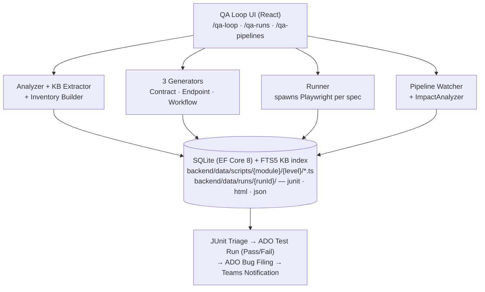
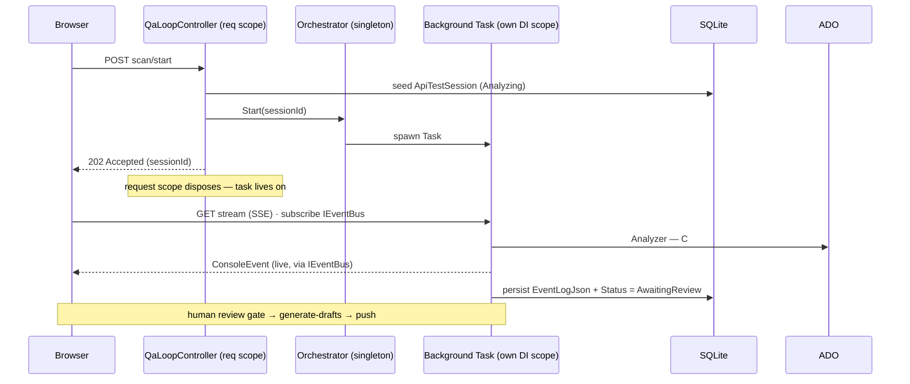
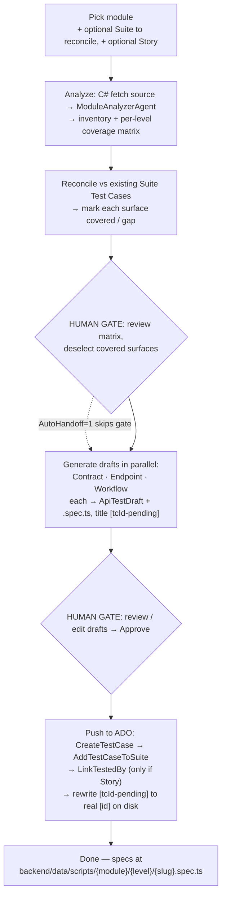
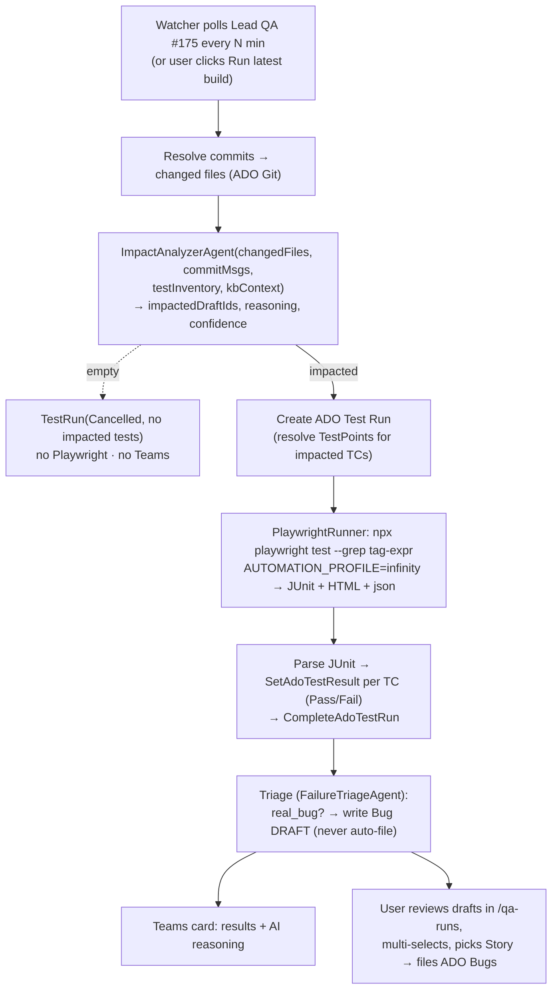
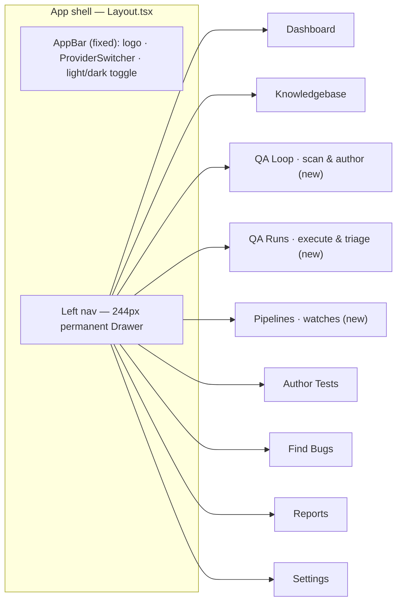
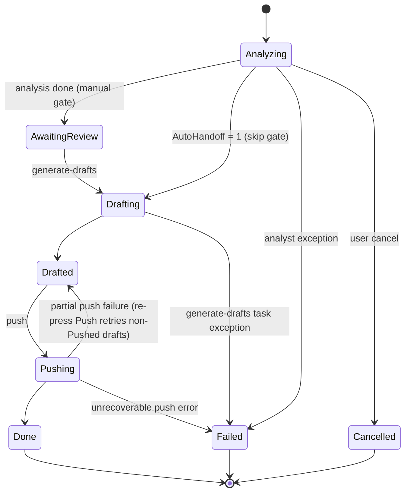
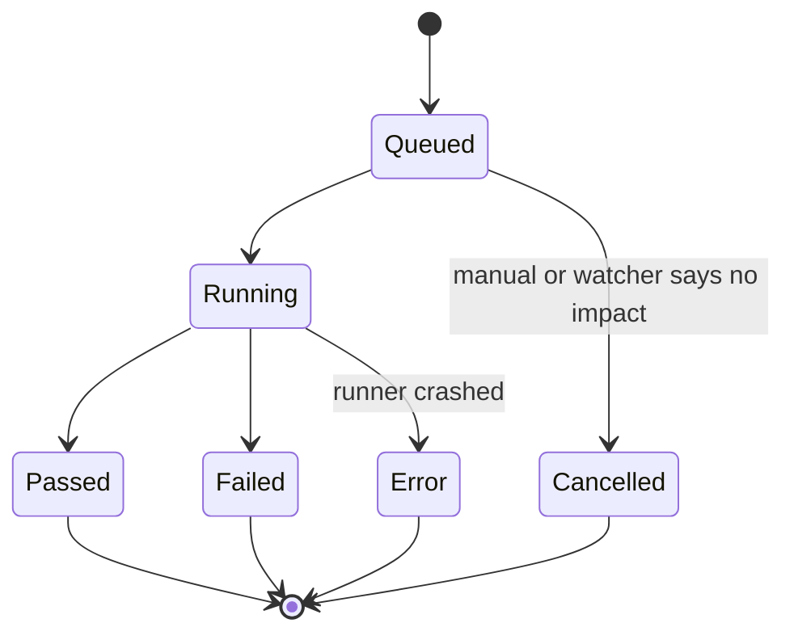

# Technical Design Document

| **Project Title**    | QA Loop Re-shape — 3-Level API Testing + AI Impact Analysis |
| -------------------- | ----------------------------------------------------------- |
| **Document Version** | 1.3                                                         |
| **Date**             | June 27, 2026                                               |
| **Prepared By**      | Mahmood Ahmad (BA / QA, YourOrg) + Claude       |
| **Reviewed By**      | \[Name(s)\]                                                 |

# Revision History

| **Version** | **Date**      | **Author**     | **Description of Change** |
| ----------- | ------------- | -------------- | ------------------------- |
| 1.0         | June 27, 2026 | Mahmood + Claude | Initial draft             |
| 1.1         | June 30, 2026 | Mahmood + Claude | Discussion-phase finalizations: existing-TC dedup/reconciliation review gate; bugs are draft-first (multi-select + Story picker) for both manual and pipeline runs; hybrid Module Analyzer (C# fetch + agent reasoning + one bounded refinement pass); agent/skill prompt-unification deferred post-hackathon (backend agents stay provider-portable single-shot completion calls); pipeline poll interval expressed in minutes (Settings-configurable) + manual "Run latest build" trigger on /qa-pipelines; added Backend Execution Flow + End-to-End Flow diagrams and frontend wireframes (navigation/IA, 3 page mockups, reused-component map); all structural diagrams (architecture, backend sequence, both flows, two state lifecycles, navigation IA) authored in Mermaid |
| 1.2         | June 30, 2026 | Mahmood + Claude | Closed 10 audit gaps: BugDraftJson draft store + ResultsIngestService split; ModuleAnalyzerAgent rewrite (inventory + per-level matrix) with InventoryJson schema; net-new ADO build-read methods; SessionWorkspace generalized for no-story + routing; two-layer settings wiring; idempotent re-push (dropped Pushing-with-errors); install Playwright runtime once + serialize spawn; coverage-matrix footer count + deselect-covered; ImpactAnalyzer fallback flag. Run-cancel deferred post-hackathon |
| 1.3         | June 30, 2026 | Mahmood + Claude | Final pre-blueprint verification (10 fixes): AnalysisJson schema; ApiTestDrafts SourceRoutesJson + ErrorMessage columns; TestRun TestPlanId/TestSuiteId + plan/suite resolution & skip rule; --grep built from [tcId] tags + Pushed-only spec gate; state diagram Drafting→Failed + Pushing→Drafted (idempotent re-push); generate-drafts error row; run-latest advances LastSeenBuildId; Purpose reuse claim corrected |

# Table of Contents

- [Purpose](#purpose)
- [Scope](#scope)
- [Architecture Overview](#architecture-overview)
- [Data Design](#data-design)
- [API Design](#api-design)
- [Generator Design](#generator-design)
- [Runner & ADO Test Run Design](#runner--ado-test-run-design)
- [Pipeline Watcher & AI Impact Analysis](#pipeline-watcher--ai-impact-analysis)
- [Teams Notifications](#teams-notifications)
- [Frontend Layout](#frontend-layout)
- [Error Handling](#error-handling)
- [Conclusion](#conclusion)
- [Appendix](#appendix)

# Purpose

The existing **QA Loop** page inside ADO_Tester (`/qa-loop`) is a four-step pipeline (Analyze
module → Extract KB → Generate one Playwright spec → Ingest JUnit + triage), scoped to the Deals
module and to a single UI-level scenario per session. In a separate prototype effort, a
Playwright framework was built **inside the Your Repo** at
`web-app/src/target-crm/automation` that introduced three API-test levels (Contract / Endpoint /
Workflow) with Zod schemas, DMS execution profiles, owned execution, and impact-based selection
— none of which exist in the current QA Loop.

This design **carves the QA Loop into a new shape** that absorbs the best of both:

- **From the QA Loop / Author Tests pattern:** Mahmood's QA house style, ADO integration
  (Plan/Suite/TestCase/Bug create + link), KB+FTS5 retrieval, LLM provider switching, SSE
  streaming, the proven `AgentOrchestrator` background-task skeleton, and the `FailureTriageAgent`
  classifier (reused as-is). The surrounding Bug-filing path is re-shaped draft-first —
  `ResultsIngestService` is split into a triage-persist pass and a user-gated file-from-row pass
  (see Data Design / Error Handling).
- **From the CRM automation prototype:** the 3-level API-test architecture (Contract / Endpoint
  / Workflow), Zod schemas, DMS profiles, machine-grounded JSON inventory, owned execution
  (backend-spawned Playwright), Teams notification card pattern, manual-edit protection regions
  inside generated specs.
- **Net-new for the carve:** **AI Impact Analysis** on pipeline-detected changesets (a new
  agent decides which tests to run for each Lead-QA build, rather than running everything or
  using a static path map), and **ADO Test Run** lifecycle (each ADO_Tester execution creates a
  fresh ADO Test Run and marks every executed Test Case Pass/Fail in ADO).

UI-level Playwright tests — the legacy QA Loop's output type — are **mothballed for the MVP**.
The `ui/` folder is reserved in the script-storage hierarchy so they can return as a fourth
level without restructuring.

The carved QA Loop must support two operating modes end-to-end:

1. **First-time module scan (no story required).** Point at a module's codebase → hybrid Analyzer
   pass (C# fetches the source, an agent reasons over it) produces a per-level coverage matrix,
   **reconciled against the chosen ADO Suite's existing Test Cases so already-covered surfaces are
   flagged** → user reviews/edits the matrix and **deselects any surface that should not be
   regenerated** → three generators emit Contract + Endpoint + Workflow drafts (ADO Test Case +
   Playwright `.spec.ts`) **only for the selected surfaces** → user reviews drafts → push to ADO
   (selected story + suite, OR a suite alone if no story).
2. **Pipeline-driven impacted runs.** Watch the Your Repo's **Lead QA pipeline
   (definitionId = 175)**. On a successful build → resolve commits to files → invoke the
   `ImpactAnalyzerAgent` to determine the impacted test subset with reasoning → execute only
   those tests against the **INFINITY** DMS profile → mark ADO Test Cases Pass/Fail → file
   ADO Bugs for `real_bug` failures → notify a Microsoft Teams channel with a card that includes
   the AI's impact reasoning.

# Scope

**In Scope:**

- Re-shaped Analyze step producing a per-level coverage matrix (Contract / Endpoint / Workflow),
  **reconciled against the chosen ADO Suite's existing Test Cases** so the user can deselect
  already-covered surfaces and the generators never duplicate an existing Test Case.
- KB extraction with per-level markdown docs + a structured JSON inventory.
- Three per-level generators (Contract, Endpoint, Workflow) — each emits both an ADO Test Case
  draft (Mahmood's house style) and the Playwright `.spec.ts` script.
- Draft persistence with review/edit/approve and push (story + suite OR suite-only).
- Saved generated scripts at `backend/data/scripts/{module}/{level}/{slug}.spec.ts`, with
  `ui/` reserved as a future fourth level.
- Backend-owned execution: spawn Playwright per selected drafts; capture JUnit + HTML +
  per-test results.
- JUnit triage → ADO Test Run create + per-Test-Case Pass/Fail update → user-gated ADO Bug filing
  for `real_bug` classifications (reuses `FailureTriageAgent` as-is; `ResultsIngestService` is split
  into a triage-persist pass and a file-from-row pass — see Data Design / Error Handling).
- Pipeline watcher polling Lead QA (#175) on a Settings-configurable interval (in minutes,
  default 5); for each new succeeded build, run the `ImpactAnalyzerAgent` and execute only the
  impacted tests. A manual "Run latest build" trigger on `/qa-pipelines` runs the same path on
  demand against the most recent succeeded build.
- DMS profile abstraction wired in code; **INFINITY** is the only credentialed profile for the
  MVP.
- Teams notifications fired on every run completion (always-notify default).
- New frontend pages: `/qa-loop` (workspace-style scan-and-author), `/qa-runs` (execute +
  triage), `/qa-pipelines` (watcher config).
- Everything inside `ADO_Tester/`; the Your Repo repo is read-only at all times.

**Out of Scope:**

- UI-level Playwright tests (the legacy QA Loop output type) — deferred to a fourth level
  post-MVP; the `ui/` folder is reserved.
- Modules other than **Deals** for the MVP; the analyzer + agents are generic so additional
  modules can be added one-by-one later through configuration alone.
- ADO pipelines other than **Lead QA #175**; multi-pipeline watching with `paths.include`
  parsing is a follow-up.
- DMS profiles other than **INFINITY** at the credential layer; the Profile registry has all
  four (Ideal/Infinity/Aspen/Quantum) so adding the rest is config, not code.
- A "Sync to product repo" button that copies approved specs into the Your Repo's
  `automation/` folder for native CI execution — deferred to a follow-up.
- CPQ module, performance/load testing, modifications to any Your Repo pipeline YAML.
- Converting the backend agents into Claude-CLI skills/subagents — they remain provider-portable
  single-shot completion calls. Sharing the house-style prompt *text* from one source between the
  backend embedded resources and the human-facing CLI skills (`buggy` / `tester` / `bugger`) is a
  post-hackathon follow-up (see Appendix → Open Questions).

# Architecture Overview



| Component | Role |
| --- | --- |
| **Module Analyzer (hybrid)** | Two parts. **(1) C# fetch** — `AzureDevOpsClient` deterministically pulls the module's source (controllers/route files, services, DTOs) via `SearchCodeAsync` + `GetFileContentAsync`. **(2) `ModuleAnalyzerAgent`** — **extend** the existing single-shot agent: reuse its completion + fetch plumbing and DI, but **rewrite the prompt + output contract** so it emits the machine-readable inventory (routes, methods, DTOs, validation rules, workflow membership) + per-level coverage matrix + markdown KB docs. (Today it returns only a flat flow list; the inventory/matrix output is net-new — see `InventoryJson` in Generator Design.) The agent may return `additionalFilesNeeded[]`; if non-empty, C# fetches those and re-invokes the agent **once** (bounded refinement — no unbounded tool loop, stays provider-portable across Anthropic / AzureOpenAI / GitHub Models). Reconciles the inventory against the chosen ADO Suite's existing Test Cases to mark each surface "covered" or "gap". |
| **KB Extractor** | Reuses the existing `KbExtractorAgent` + `KbExtractionService`; extended with `level` (contract / endpoint / workflow) on each KB doc. FTS5 chunks unchanged. |
| **Three Generators** | One LLM agent per level. `ContractGeneratorAgent` emits a Zod schema + a validator Playwright spec; `EndpointGeneratorAgent` emits status / auth / validation assertions; `WorkflowGeneratorAgent` emits a chained-call business flow. Each agent emits BOTH a `GeneratedTestCase` (for ADO push) and the `.spec.ts` text (for execution). |
| **Draft Store** | `ApiTestSession` (one per scan) + `ApiTestDraft` (one per generated test case, discriminated by `Level`). Mirrors the existing `TestSession`/`TestCaseDraft` shape; `WorkItemId` is nullable to support the no-story scan mode. |
| **Spec Storage** | Generated `.spec.ts` files persisted to `backend/data/scripts/{module}/{level}/{slug}.spec.ts`. Each spec title carries the `[<adoTcId>]` tag so the JUnit triage parser maps failures back to ADO Test Cases. |
| **Runner** | Backend hosted service that spawns `npx playwright test` against the saved scripts. Filters by module × level × tag × `impactedDraftIds`. Captures JUnit + HTML + per-test results to `backend/data/runs/{runId}/`. Streams stdout via the existing `IEventBus` + SSE. |
| **Pipeline Watcher** | Background hosted service polling Lead QA (#175) every 5 minutes. For each new succeeded build → fetch commits → resolve files via ADO Git → invoke `ImpactAnalyzerAgent` → if any tests are impacted, create a `TestRun` and enqueue it. |
| **Impact Analyzer Agent** | New LLM agent. Reads the changed files + commit messages against the saved test inventory and returns the impacted test subset with reasoning and confidence. Reasoning is persisted on `TestRun.ImpactAnalysisJson` and shown in the UI + Teams card. |
| **JUnit Triage + Bug Drafter** | `FailureTriageAgent` reused **as-is**; `ResultsIngestService` is **split** (a triage-persist pass + a file-from-row pass) but keeps the four classifications (real_bug / flaky / test_issue / stale_test) and reuses its house-style Bug body builders (ReproSteps / AC / SystemInfo HTML — same format as Find Bugs). **Change: bugs are never auto-filed.** For each `real_bug`, triage writes a Bug *draft* (serialized to `TestFailure.BugDraftJson`); the user multi-selects drafts in `/qa-runs` and picks the target Story before any `CreateBugAsync()` runs. Applies to both manual and pipeline-driven runs. |
| **ADO Test Run Manager** | New helper on `IAzureDevOpsClient`. For each `TestRun`, creates a fresh ADO Test Run via Test Management API (`POST /_apis/test/runs`), updates per-Test-Case outcomes (`POST .../results`), and completes the run on finish. The `AdoTestRunId` is stored on `TestRun`. |
| **Teams Notifier** | New service `TeamsNotifier` using a single configurable webhook URL and three templates (compact / developer / scheduled) loaded from embedded `.txt` resources. Fires after every run completion and after triage. |
| **DMS Profiles** | Registry of four profiles (Ideal / Infinity / Aspen / Quantum). MVP credentials are populated only for **INFINITY** (the QA test user's actual DMS, verified via bearer mint). The runner sets `AUTOMATION_PROFILE=infinity` for every run unless overridden. |

## Backend Execution Flow

Every long-running action follows the proven `AgentOrchestrator` pattern (CLAUDE.md → "background-work
pattern"): the HTTP call seeds a session row **synchronously**, returns its id, then runs the pipeline
on a **background `Task` with its OWN DI scope** (never the request scope, which disposes when the
handler returns). Live progress is pumped to `IEventBus` and streamed to the browser via **SSE**; the
durable narrative is persisted to `EventLogJson` for replay.



**Invariants carried over unchanged:** background task = own DI scope; `IEventBus` → SSE with
`Last-Event-ID` replay; `EventLogJson` is the durable transcript; cancellation via
`CancellationRegistry`; a global concurrency cap via `PipelineConcurrency`. The three generators and
the ADO push run inside this same background task.

## End-to-End Flow (both operating modes)

**Mode A — Scan & Author (human-driven, `/qa-loop`):**



**Mode B — Pipeline-driven impacted run (automatic, `/qa-pipelines` + `/qa-runs`):**



# Data Design

All new entities are added to `QaDbContext` in
`backend/src/QaAutomation.Infrastructure/Data/QaDbContext.cs`. Existing entities
(`KnowledgebaseDocument`, `TestSession`, `TestCaseDraft`, `BugSession`, `BugDraft`) are left
untouched — the new flow has its own tables and does not reuse the legacy Author Tests session
shape. EF Core migrations apply on startup via `DatabaseInitializer`; no separate `dotnet ef`
step is needed beyond generating the migration.

## ApiTestSession — on QaDB (Table: `ApiTestSessions`)

One row per module-scan session. Lives through Analyze → Drafts → Push.

| Column | Type | Description |
| --- | --- | --- |
| Id | INTEGER PK | Auto-increment |
| ProjectId | INTEGER | FK → Project (CASCADE on Project delete) |
| Module | TEXT NOT NULL | e.g. `"deals"` |
| Repository | TEXT NULL | ADO repo name (default from Settings) |
| Branch | TEXT NULL | Default branch when null |
| WorkItemId | INTEGER NULL | **Nullable** — module-scan mode has no story |
| WorkItemTitle | TEXT NULL | Display only |
| TestPlanId | INTEGER NULL | Chosen by user before push |
| TestSuiteId | INTEGER NULL | Chosen by user before push |
| Status | TEXT NOT NULL | enum-as-string: Analyzing / AwaitingReview / Drafting / Drafted / Pushing / Done / Failed / Cancelled |
| AnalysisJson | TEXT NULL | Analyst output (per-level coverage matrix) |
| InventoryJson | TEXT NULL | Machine-readable inventory (routes + DTOs + workflow graph) |
| EventLogJson | TEXT NULL | Persisted SSE narrative for replay |
| ErrorMessage | TEXT NULL | |
| AutoHandoff | INTEGER NOT NULL DEFAULT 0 | If 1, skip the human review gate between Analyze and Drafts |
| ActivityEnabled | INTEGER NOT NULL DEFAULT 1 | Captured from `qaloop.activity_enabled` at row creation; false suppresses agent token-level streaming + heavy `EventLogJson`. Migration DEFAULT 1 so existing sessions replay their activity |
| CreatedAt / UpdatedAt | DATETIME NOT NULL | |

**Constraints:**
- CASCADE delete on `ProjectId`.
- 1:many → `ApiTestDraft` (CASCADE).
- Index on `(ProjectId, CreatedAt DESC)` for the sessions list page.

## ApiTestDraft — on QaDB (Table: `ApiTestDrafts`)

One row per generated test case, regardless of level.

| Column | Type | Description |
| --- | --- | --- |
| Id | INTEGER PK | Auto-increment |
| SessionId | INTEGER FK CASCADE | → ApiTestSession |
| Level | TEXT NOT NULL | `contract` \| `endpoint` \| `workflow` |
| Title | TEXT NOT NULL | After push: prefixed with `[<adoTcId>]` |
| Preconditions | TEXT NOT NULL DEFAULT '' | ADO Test Case preconditions field |
| StepsJson | TEXT NOT NULL DEFAULT '[]' | ADO Steps array of `{ action, expected }` |
| SchemaJson | TEXT NULL | Zod schema source (Contract level only) |
| SpecCode | TEXT NOT NULL | The `.spec.ts` file contents |
| SpecFilePath | TEXT NULL | Filled after the spec is saved to disk |
| Tags | TEXT NULL | Space-separated, e.g. `"@deals @contract @smoke"` — level markers for the manual-run `tagFilter`; **not** used to scope an impacted run |
| SourceRoutesJson | TEXT NULL | JSON array of the route(s) this draft covers, e.g. `["GET /deals"]` (workflow drafts list all chained routes); populated by the generator from its inventory input — the **join key** the `ImpactAnalyzer` projection reads |
| ErrorMessage | TEXT NULL | Per-draft generator / spec-write error; set for graceful degradation without failing the batch |
| Status | TEXT NOT NULL | Draft / Approved / Pushed / Rejected |
| AdoTestCaseId | INTEGER NULL | Filled after ADO push |
| SortOrder | INTEGER NOT NULL | Stable display order |
| CreatedAt / UpdatedAt | DATETIME NOT NULL | |

**Constraints:**
- CASCADE delete on `SessionId`.
- Index on `SessionId`.

## TestRun — on QaDB (Table: `TestRuns`)

One row per execution. Manual or pipeline-driven.

| Column | Type | Description |
| --- | --- | --- |
| Id | INTEGER PK | |
| ProjectId | INTEGER FK CASCADE | |
| Module | TEXT NULL | Module filter; NULL = all |
| LevelFilter | TEXT NULL | `contract` / `endpoint` / `workflow` / NULL |
| TagFilter | TEXT NULL | Extra `--grep` |
| Profile | TEXT NOT NULL | DMS profile, e.g. `"infinity"` |
| TestPlanId | INTEGER NULL | ADO Plan for the ADO Test Run — resolved at run creation from the (single) `ApiTestSession` the selected/impacted drafts belong to; NULL → ADO Test Run skipped |
| TestSuiteId | INTEGER NULL | ADO Suite for the ADO Test Run (resolved with `TestPlanId`) |
| TriggerSource | TEXT NOT NULL | `manual` \| `pipeline-watcher` |
| TriggerPipelineId | INTEGER NULL | When source = pipeline-watcher |
| TriggerBuildId | INTEGER NULL | When source = pipeline-watcher |
| TriggerCommitSha | TEXT NULL | When source = pipeline-watcher |
| ImpactAnalysisJson | TEXT NULL | `{ impactedDraftIds, reasoning, confidence, skippedReason?, fallback? }` (pipeline-driven only) |
| Status | TEXT NOT NULL | Queued / Running / Passed / Failed / Cancelled / Error |
| Passed / Failed / Skipped | INTEGER | Counts |
| DurationMs | INTEGER | |
| JunitPath | TEXT NULL | `backend/data/runs/{Id}/junit.xml` |
| ReportPath | TEXT NULL | Human report. Allure single-file `backend/data/runs/{Id}/allure-report/index.html` (provider=allure\|both), else Playwright `backend/data/runs/{Id}/html/index.html` (provider=playwright); folder-index fallback per Allure Reporting; NULL if generate failed with no Playwright report |
| ActivityEnabled | INTEGER NOT NULL DEFAULT 1 | Captured from `qaloop.activity_enabled` at row creation; false suppresses stdout streaming + heavy `EventLogJson`. Migration DEFAULT 1 so existing rows replay their activity |
| AdoTestRunId | INTEGER NULL | The fresh ADO Test Run created for this execution |
| StartedAt / FinishedAt | DATETIME | |

## TestFailure — on QaDB (Table: `TestFailures`)

One row per failed test in a run; carries the LLM triage state.

| Column | Type | Description |
| --- | --- | --- |
| Id | INTEGER PK | |
| RunId | INTEGER FK CASCADE | → TestRun |
| TestTitle | TEXT NOT NULL | Full breadcrumb from JUnit |
| AdoTestCaseId | INTEGER NULL | Extracted from `[<id>]` tag in title |
| Classification | TEXT NOT NULL | `real_bug` / `flaky` / `test_issue` / `stale_test` |
| Confidence | TEXT NOT NULL | high / medium / low |
| Reason | TEXT NOT NULL | LLM-supplied |
| BugDraftJson | TEXT NULL | Composed Bug draft (title / severity / preconditions / repro / expected / observations) serialized at triage for `real_bug`; `/file-bugs` deserializes it and calls `CreateBugAsync` with **no second LLM call** so the user files exactly what they reviewed |
| BugId | INTEGER NULL | Set after the user files the draft |
| ArtifactPaths | TEXT NULL | JSON array of attachment paths |

## PipelineWatch — on QaDB (Table: `PipelineWatches`)

Configured pipelines being polled. MVP has exactly one row.

| Column | Type | Description |
| --- | --- | --- |
| Id | INTEGER PK | |
| ProjectId | INTEGER FK CASCADE | |
| AdoPipelineId | INTEGER NOT NULL | e.g. `175` (Lead QA) |
| AdoPipelineName | TEXT NOT NULL | For display |
| Module | TEXT NOT NULL | The module this pipeline maps to (`"deals"` for MVP) |
| LastSeenBuildId | INTEGER NULL | For incremental polling |
| LastPollAt | DATETIME NULL | |
| LastPollError | TEXT NULL | When polling fails — drives back-off |
| Enabled | INTEGER NOT NULL DEFAULT 1 | |
| CreatedAt / UpdatedAt | DATETIME NOT NULL | |

**Constraints:**
- Unique index on `(ProjectId, AdoPipelineId)`.

## Why SQLite (and not a separate store)

The existing tool already uses SQLite + EF Core 8 with FTS5 for the KB; reusing the same store
keeps the runtime to a single process and a single file (`backend/data/qa.db`). Migrations apply
on startup; backups are file-copies; the queue size is small (drafts + runs accumulate slowly).
No separate queue or run-store is needed for the MVP scale.

# API Design

All new endpoints live under `/api/qaloop/...` to make ownership clear. Existing endpoints
(`/api/modules/...`, `/api/knowledgebase/...`, `/api/generation/...`, `/api/results/...`) remain
for backward compatibility but are NOT used by the new UI. They will be removed in a follow-up
phase.

## Scan & Author endpoints

| Method | Path | Notes |
| --- | --- | --- |
| `POST` | `/api/qaloop/{projectId}/scan/start` | Body: `{ module, repository?, branch?, sourceDirs?, extensions?, workItemId?, testPlanId?, testSuiteId?, autoHandoff }`. Creates an `ApiTestSession` synchronously, returns `sessionId` (202 Accepted), launches background pipeline. **If a non-terminal or recently-`Drafted`/`Done` `ApiTestSession` already exists for the same `(projectId, module)`, the response includes an `existingSessionId` warning so the UI can offer to resume it instead of creating duplicate drafts.** When `testSuiteId` is supplied, the analyzer reconciles against that suite's existing Test Cases. |
| `GET` | `/api/qaloop/sessions/{sessionId}/stream` | SSE with `Last-Event-ID` replay. Emits `ConsoleEvent` from `IEventBus`. |
| `PATCH` | `/api/qaloop/sessions/{sessionId}/analysis` | Edit analyst output before generating drafts. |
| `POST` | `/api/qaloop/sessions/{sessionId}/generate-drafts` | After analyst review. Runs all three generators in parallel via `Task.WhenAll`, **generating Test Cases only for surfaces the user left selected (not flagged "covered") in the coverage matrix.** |
| `PATCH` | `/api/qaloop/drafts/{draftId}` | Edit a single draft (Title / Preconditions / Steps / SpecCode). |
| `POST` | `/api/qaloop/sessions/{sessionId}/approve-all` | Bulk-approve drafts. |
| `POST` | `/api/qaloop/sessions/{sessionId}/push` | Push all Approved drafts → ADO. Async; SSE reports per-draft. |
| `POST` | `/api/qaloop/drafts/{draftId}/push` | Push a single draft synchronously. |
| `POST` | `/api/qaloop/sessions/{sessionId}/cancel` | Cancel a running session. |
| `GET` | `/api/qaloop/sessions/{projectId}` | List sessions (paged). |
| `GET` | `/api/qaloop/sessions/detail/{sessionId}` | Session + drafts. |

## Runs endpoints

| Method | Path | Notes |
| --- | --- | --- |
| `POST` | `/api/qaloop/runs/start` | Manual execution. Body: `{ moduleFilter?, levelFilter?, tagFilter?, profile, draftIds?[] }`. Returns `runId`. |
| `GET` | `/api/qaloop/runs/{runId}/stream` | SSE — Playwright stdout streamed. |
| `GET` | `/api/qaloop/runs/{projectId}` | List runs (paged). |
| `GET` | `/api/qaloop/runs/detail/{runId}` | Run + failures + triage outcomes. |
| `POST` | `/api/qaloop/runs/{runId}/triage` | Run triage on a completed run. Persists **one `TestFailure` row per failure**, and for `real_bug` serializes the composed Bug into `BugDraftJson`. **Never files to ADO.** Body: `{}` (no auto-file flag). |
| `POST` | `/api/qaloop/runs/{runId}/file-bugs` | **User-gated Bug filing.** Body: `{ failureIds[], storyId? }`. For each selected failure, reads its `BugDraftJson` and calls `CreateBugAsync` (no re-triage), linking each Bug to its Test Case + `storyId` when supplied. |
| `POST` | `/api/qaloop/runs/preview-impact` | Manually invoke `ImpactAnalyzerAgent`. Body: `{ changedFiles[], commitMessages[] }`. Used to test/debug the agent. |

## Pipeline Watch endpoints

| Method | Path | Notes |
| --- | --- | --- |
| `GET` | `/api/qaloop/pipelines/{projectId}` | List configured watches. |
| `POST` | `/api/qaloop/pipelines/{projectId}` | Add a watch: `{ adoPipelineId, adoPipelineName, module }`. |
| `PATCH` | `/api/qaloop/pipelines/{watchId}` | Toggle Enabled / change Module / refresh metadata. |
| `DELETE` | `/api/qaloop/pipelines/{watchId}` | Remove a watch. |
| `POST` | `/api/qaloop/pipelines/{watchId}/run-latest` | **Manual trigger.** Fetches the most recent succeeded build of this watch's pipeline and runs the same resolve-commits → `ImpactAnalyzerAgent` → create `TestRun` path the poller uses. **Advances `LastSeenBuildId` to that build** so the next poll's `id > LastSeenBuildId` filter does not re-process it. Returns `runId`. |

## ADO mutation endpoints (reused, unchanged)

- `IAzureDevOpsClient.CreateTestCaseAsync(title, preconditions, steps)` — file
  `Infrastructure/AzureDevOps/AzureDevOpsClient.cs` line 408-422.
- `IAzureDevOpsClient.AddTestCaseToSuiteAsync(planId, suiteId, tcId)` — line 424-436.
- `IAzureDevOpsClient.LinkTestedByAsync(storyId, tcId)` — line 438-452. Called only when
  `WorkItemId.HasValue` (the single change vs Author Tests).
- `IAzureDevOpsClient.CreateBugAsync(...)` — invoked by the **user-gated `file-bugs`** action
  (not inline during triage) for the `real_bug` failures the user selected, linked to the chosen
  Story.

## ADO mutation endpoints (new)

Three methods added to `IAzureDevOpsClient`:

- `CreateAdoTestRunAsync(planId, suiteId, name, pointIds[]) → int adoTestRunId`
  POSTs `/_apis/test/runs?api-version=7.0` with `{ name, plan{id: planId}, pointIds[] }`.
- `SetAdoTestResultAsync(adoTestRunId, testPointId, outcome, errorMessage?, durationMs)`
  POSTs `/_apis/test/Runs/{runId}/results?api-version=7.0` with the per-point payload.
- `CompleteAdoTestRunAsync(adoTestRunId)`
  PATCHes `/_apis/test/runs/{runId}?api-version=7.0` with `{ state: "Completed" }`.

The PAT used by ADO_Tester already has the Test Management R/W scope per `CLAUDE.md`, so no
permission change is needed.

Also net-new: `GetTestPointsAsync(planId, suiteId, testCaseIds) → pointIds[]` (used by the ADO Test
Run lifecycle to resolve Test Points before `CreateAdoTestRunAsync`).

## ADO build/pipeline reads (new)

Mode B's watcher needs build reads the client does **not** have today — `IAzureDevOpsClient`
currently exposes Git item/commit/PR reads only, with **no Build/Pipeline surface**. Two net-new
methods (PAT already has the Build read scope):

- `GetPipelineBuildsAsync(pipelineId, minBuildId?) → Build[]`
  GETs `/_apis/build/builds?definitions={id}&statusFilter=completed&resultFilter=succeeded`; returns
  each build's id, `sourceVersion` (commit sha) and `repositoryId`. Drives both the poller and
  `run-latest`.
- `GetBuildChangesAsync(buildId) → Commit[]`
  GETs `/_apis/build/builds/{id}/changes`; returns the commit list. Each commit sha + the build's
  `repositoryId` then feed the **existing** `GetCommitChangedFilesAsync` to resolve changed files —
  so file resolution is reused, only the build enumeration is new.

# Generator Design

The new QA Loop has **three per-level generators**, each running in parallel inside the
re-shaped `QaLoopOrchestrator`. The orchestrator mirrors the existing `AgentOrchestrator`
skeleton (`Infrastructure/Orchestrators/AgentOrchestrator.cs:53-81, 99-134, 349-447`) — same
background-task-with-own-DI-scope pattern, same `IEventBus` for SSE, same global concurrency cap.

**`InventoryJson` shape** — produced by the (rewritten) Module Analyzer and consumed by all three
generators. This is the contract the generators read from; it does not exist today and is net-new:

```json
{
  "module": "deals",
  "routes": [
    { "method": "GET", "route": "/deals", "requestDto": null, "responseDto": "DealListDto",
      "validationRules": ["dealerId required"], "authRequirements": "bearer" }
  ],
  "dtos": [ { "name": "DealListDto", "fields": [ { "name": "id", "type": "string" } ] } ],
  "workflows": [
    { "name": "deal-lifecycle",
      "steps": [ { "endpoint": "POST /deals", "role": "create" },
                 { "endpoint": "PUT /deals/{id}/stage", "role": "move" } ] }
  ]
}
```

**`AnalysisJson` shape** — the per-level coverage matrix on `ApiTestSession`. The Analyzer writes
`status` + `linkedTestCaseId` (reconciled against the chosen suite) and a default `selected`; the
user toggles `selected` in Step 2 via `PATCH /sessions/{id}/analysis`; `generate-drafts` emits a
draft for every surface where `selected == true`, routing each by `level` to its generator:

```json
{
  "module": "deals",
  "surfaces": [
    { "id": "GET /deals", "level": "contract", "label": "GET /deals — response shape",
      "status": "gap", "linkedTestCaseId": null, "selected": true },
    { "id": "POST /deals", "level": "endpoint", "label": "POST /deals — 400 on invalid dealer",
      "status": "covered", "linkedTestCaseId": 41822, "selected": false }
  ]
}
```

`id` is the stable per-surface key that `PATCH /analysis` targets and `generate-drafts` filters on;
`selected` lives in `AnalysisJson` (server-visible) so the server-side generate filter can read it.

## Job 1: Contract Generator

- **Agent:** `ContractGeneratorAgent` (new) + `contract_generator_system.txt` (new embedded
  resource).
- **Input from inventory:** one endpoint `{ route, method, responseDto }`.
- **LLM produces:**
  - A Zod schema for the response DTO, stored in `SchemaJson` and emitted into the spec.
  - A Playwright `.spec.ts` asserting the live response satisfies the schema (single test per
    endpoint).
- **ADO Test Case payload (per draft):**
  - Title: `[<tcId-pending>] Contract: <METHOD> <route> — response shape matches schema`.
  - Preconditions: "QA environment is reachable; INFINITY DMS bearer is mintable."
  - Steps: `[{action: "Send <METHOD> <route> with valid auth.", expected: "Response status is 200."},
    {action: "Parse the response body.", expected: "Body satisfies the recorded shape."}]`.
- **Output location:** `backend/data/scripts/{module}/contracts/{route-slug}.contract.spec.ts`.

## Job 2: Endpoint Generator

- **Agent:** `EndpointGeneratorAgent` (new) + `endpoint_generator_system.txt`.
- **Input from inventory:** one endpoint `{ route, method, requestDto, responseDto, validationRules[], authRequirements }`.
- **LLM produces:** one spec per case (happy path 200 / 401 without bearer / 400 on invalid
  input). Each case is its own ADO Test Case per the locked granularity decision.
- **ADO Test Case payload (per case, per draft):** titles `[<tcId-pending>] Endpoint:
  <METHOD> <route> — <case>`, e.g. `"... — 200 returns array"`, `"... — 401 without bearer"`,
  `"... — 400 on invalid dealer id"`. Steps describe the request and the expected status +
  error message.
- **Output location:** `backend/data/scripts/{module}/endpoints/{route-slug}.endpoint.spec.ts`
  (one file groups all cases of one endpoint, but each case is a separate ADO Test Case).

## Job 3: Workflow Generator

- **Agent:** `WorkflowGeneratorAgent` (new) + `workflow_generator_system.txt`.
- **Input from inventory:** one workflow node `{ name, steps[]: each step has endpoint + role
  ("create"/"move"/"verify"/"won") }`.
- **LLM produces:** a Playwright spec that chains the calls with idempotent cleanup
  (mirrors the `deal-lifecycle.workflow.spec.ts` pattern from the prototype).
- **ADO Test Case payload:** title `[<tcId-pending>] Workflow: <flow name>`, steps narrate the
  chain end-to-end with one ADO Step per called endpoint.
- **Output location:** `backend/data/scripts/{module}/workflows/{flow-slug}.workflow.spec.ts`.

## Shared rules across all three generators

- **Title tag.** Every generated spec MUST include `[<tcId-pending>]` in its test title. After
  successful ADO push, the orchestrator rewrites the placeholder on disk with the real ADO Test
  Case ID so the JUnit triage parser (`JUnitParser.cs` line 38-39, regex `\[(\d+)\]`) can map
  failures correctly. A post-LLM regex check enforces this and auto-injects the placeholder if
  the model forgets it.
- **House style.** New embedded prompts under `Infrastructure/Agents/Prompts/`:
  `contract_generator_system.txt`, `endpoint_generator_system.txt`,
  `workflow_generator_system.txt`, plus per-level test-case-side prompts
  (`contract_testcase_system.txt`, `endpoint_testcase_system.txt`,
  `workflow_testcase_system.txt`). All three test-case-side prompts use the same skeleton as
  `tester_system.txt` to preserve Mahmood's voice.
- **Manual-edit protection.** Each spec contains explicit regions:
  ```
  // <auto-generated:start>
  // ...generator output...
  // <auto-generated:end>
  // <manual:start>
  // ...preserved on re-generation...
  // <manual:end>
  ```
  Re-generating a draft overwrites only the auto-generated region; the manual region survives.
- **Parallel execution.** When the user clicks "Generate drafts" after analyst review, the
  three generators run in parallel via `Task.WhenAll`, each producing its own list of drafts.
  Per-draft errors are captured to the draft row's `ErrorMessage` without failing the whole batch.

## Adding a new test level

To support a future fourth level (`ui`):

1. Add `UiGeneratorAgent.cs` + `ui_generator_system.txt`.
2. Register the agent in DI (`Infrastructure/DependencyInjection.cs`).
3. The orchestrator's `Task.WhenAll` extends to include the new agent.
4. `ApiTestDraft.Level` accepts `"ui"`.
5. UI specs land at `backend/data/scripts/{module}/ui/`.
6. No DB migration required.

# Runner & ADO Test Run Design

## The Runner

`PlaywrightRunner` is a backend hosted helper in
`Infrastructure/QaRuns/PlaywrightRunner.cs`. For each `TestRun`:

1. **Prepare working dir.** Create `backend/data/runs/{runId}/` containing a minimal
   `package.json` + `playwright.config.ts` that points its `testDir` at the saved spec roots
   (`backend/data/scripts/{module}/{level}/`). A single shared `playwright-runtime/` package at
   the backend data root holds the `node_modules`; it is **provisioned once at runner-service
   startup** (`npm ci` + `npx playwright install`) and is read-only at run time, so runs never
   re-install or race on a first install.
2. **Determine the spec set.** Only `Pushed` drafts (real `[<id>]` title tag, `AdoTestCaseId` set)
   are eligible — an un-pushed draft still carries `[<tcId-pending>]`, which the JUnit/ADO mapping
   cannot resolve; any result with no numeric `[<id>]` is logged and excluded from the ADO Test Run,
   never silently dropped.
   - Manual run: filter by `moduleFilter` × `levelFilter` × `tagFilter` × `draftIds`.
   - Pipeline-driven run: filter by `impactedDraftIds` from the `ImpactAnalysisJson`. Build the
     `--grep` as an **alternation of each impacted draft's unique `[<adoTcId>]` title tag** (e.g.
     `--grep "\[41833\]|\[41840\]"`) — the same `\[(\d+)\]` handle the JUnit parser keys on. The
     level-wide `Tags` column is **not** used here (it is the manual-run `tagFilter` only).
3. **Spawn Playwright.**
   `npx playwright test --reporter=junit,allure-playwright,json[,html] --grep "<tag-expr>"` with
   `AUTOMATION_PROFILE=<profile>` set on the **child-process environment** (`ProcessStartInfo`, not a
   CLI flag — Playwright has no `-e`). The reporter list **always** carries `junit` + `json` +
   `allure-playwright` (Allure writes raw `allure-results/`); the Playwright `html` reporter is
   appended **only when** `qaloop.report_provider ∈ {playwright, both}` (see Allure Reporting). The
   spawn is **serialized via the existing `PipelineConcurrency` cap** so a manual run and a watcher run
   never collide on the shared runtime. Stream stdout/stderr line-by-line through `IEventBus` for SSE.
4. **Generate the Allure report** (when provider ∈ {allure, both}). Seed the per-(module, pipeline)
   history store into `allure-results/history`, write the Allure context files
   (`environment.properties`, `categories.json`, `executor.json`), then run the Node-native Allure
   `generate --single-file` to emit one self-contained `.html`; copy the fresh `history/` back to the
   server-side store afterward (cross-run trends, see Allure Reporting). A generate failure never
   fails the run (Error Handling).
5. **Persist outputs.** `junit.xml`, `results.json`, the Allure single-file `.html` (and `html/` when
   the Playwright reporter ran) end up in `backend/data/runs/{runId}/`. `TestRun.JunitPath` is set on
   completion; `TestRun.ReportPath` = the Allure single-file `.html` (provider=allure|both), else the
   Playwright `html/index.html` (provider=playwright), with the fallback resolution from Allure
   Reporting decision 4/7 applied.
6. **Counts.** Parse JUnit to hydrate `Passed`, `Failed`, `Skipped`, `DurationMs`.

## ADO Test Run lifecycle

For every `TestRun`, ADO_Tester also creates a fresh ADO Test Run so the ADO Test Plan/Suite
shows per-Test-Case Pass/Fail:

1. **Resolve plan/suite, then before execution.** `TestRun.TestPlanId`/`TestSuiteId` are populated
   at run creation from the (single) `ApiTestSession` the selected/impacted drafts belong to; the run
   is rejected if its drafts span more than one `(plan, suite)`. If plan/suite is unknown — a
   `moduleFilter`-only manual run, or drafts that were never pushed — the **ADO Test Run is skipped**
   (warning on `TestRun.ErrorMessage`); the Playwright run and Bug drafting still proceed. Otherwise:
   gather the impacted/selected drafts' ADO Test Case IDs, resolve their `TestPoint` IDs via
   `IAzureDevOpsClient.GetTestPointsAsync(planId, suiteId, testCaseIds)` (helper to add), then
   `CreateAdoTestRunAsync(planId, suiteId, name, pointIds[])` → store the returned ID on
   `TestRun.AdoTestRunId`.
2. **As JUnit parses.** For each result, look up the `TestPointId` for the
   `AdoTestCaseId` (extracted from the `[<id>]` title tag) and call `SetAdoTestResultAsync(...)`.
3. **On finish.** `CompleteAdoTestRunAsync(adoTestRunId)`.
4. **On Bug filing.** Triage classifies and writes Bug *drafts* — serializing the composed
   house-style body (built by the reused `ResultsIngestService` builders) into
   `TestFailure.BugDraftJson`; it does **not** auto-create ADO Bugs. The user multi-selects drafts in
   `/qa-runs` and chooses the target Story, then `file-bugs` **deserializes each `BugDraftJson` and
   calls `CreateBugAsync` (no second LLM call)**, linking each Bug to its Test Case + the chosen
   Story. Filed Bugs include a deep link to the ADO Test Run for forensic context.

If the ADO Test Run create call fails, the Playwright run still proceeds — the Test Run failure
is recorded on `TestRun.ErrorMessage` as a warning, and Bug filing still works.

## Allure Reporting

Each run also produces a rich, human-facing **Allure** HTML report. The report is a presentation
layer only; **`junit.xml` + `results.json` always emit on every run regardless of the report
provider setting** — they are the load-bearing triage inputs (the JUnit `[<id>]` parser, the ADO
Test Run Pass/Fail update, the failure-counts hydrate, and the draft-first Bug drafting all key off
them and are **left untouched**). The `report_provider` setting switches **only the human-facing HTML
report**; the Playwright `html` reporter is the single thing gated off when provider = allure.

1. **Node-native Allure, no Java.** Allure HTML is generated by a Node-native Allure (the latest
   stable that runs on Node with no JRE dependency), driven by the `allure-playwright` reporter that
   writes raw `allure-results/` during the run. The exact package + version, and that it supports the
   Playwright reporter + `--single-file` + the trend widget, are **verified in QAL-055**. **Documented
   fallback:** if a required capability is missing, ship a bundled JRE + Allure 2.

2. **Report provider is a Settings toggle.** Setting key `qaloop.report_provider` ∈
   `{ allure (DEFAULT), playwright, both }`. It gates only the human HTML report:
   - `allure` — Allure single-file `.html`; the Playwright `html` reporter is **off**.
   - `playwright` — the legacy Playwright `html/` report only; no Allure generate.
   - `both` — emit Allure single-file **and** the Playwright `html/` report.
   `junit` + `json` emit in all three cases. Follows the CLAUDE.md two-layer settings pattern (flat
   `.env` key → typed `Options` via `PostConfigure`, then `RuntimeSettings.Get` overlay; registered in
   `AppSettingsService`).

3. **Trends / history (included now).** A server-side Allure `history/` store is persisted keyed by
   `(module, pipeline)` (e.g. under `backend/data/allure-history/{module}/{pipeline}/`). Before
   `generate`, the store is seeded into `allure-results/history`; after generate, the fresh `history/`
   is copied back. Cross-run trend continuity therefore lives server-side and survives regardless of
   report format (a single-file build that drops the folder does not lose trends).

4. **Primary artifact = single-file `.html`.** Generate **with history seeded** so trend data is baked
   into one self-contained `.html` (= `TestRun.ReportPath`); the same file serves open-in-new-tab and
   download. **Single-file vs trends resolution / fallback (verified in QAL-057):** if the single-file
   build cannot render the trend widget, `ReportPath` falls back to the **folder `index.html` + a zip
   download**. Single-file is honored whenever it can carry trends; trends are never silently lost.

5. **API-level capture only — no UI capture.** There is **no** screenshot / video / browser-trace
   anywhere; the per-run `playwright.config.ts` gets **no `use:` capture block**. Report richness is
   the HTTP exchange, authored **into the generated specs by the generator prompts**: each call is
   wrapped in `test.step` + `allure.attachment` for **request** (method / url / headers [auth redacted]
   / payload), **response** (status code / headers / body), **schema-validation diff** (Contract
   level), **assertion expected-vs-actual**, and **latency as a parameter**. Plus Allure metadata:
   `epic` = module, `feature` = level (Contract / Endpoint / Workflow), `story` = route / flow,
   `severity`, `tags`, and the `[tcId]` as an `allure.link` to the ADO Test Case. (Generator prompts in
   Generator Design own emitting these — listed here for the report contract.)

6. **Allure context files** written into `allure-results/` before `generate`:
   - `environment.properties` — profile, branch, commit, build id, trigger source, module, ADO Test
     Run id.
   - `categories.json` — defect buckets mapped to the triage taxonomy (`real_bug` / `flaky` /
     `test_issue` / `stale_test`).
   - `executor.json` — deep links to the ADO build + the ADO Test Run.

7. **A broken report never breaks a run.** If `allure generate` fails, the run still passes/fails
   normally; `ReportPath` falls back to the Playwright `html` report if present, else `null`, and a
   warning is appended to `TestRun.ErrorMessage` (Error Handling row).

## Activity Capture

Streaming + durable-narrative capture is globally toggleable so high-volume runs/scans can drop the
SSE + `EventLogJson` overhead while still reporting coarse progress and completion.

8. **Settings toggle.** New setting key `qaloop.activity_enabled` (DEFAULT `true`). Global — applies to
   all modules, all scan sessions, and all execution runs. Same two-layer settings wiring as the other
   `qaloop.*` keys.

9. **Per-row capture flag.** A bool `ActivityEnabled` column is added to **`ApiTestSession`** and
   **`TestRun`**, captured from the setting **at row creation**. The migration DEFAULT is `true` so
   **existing rows always replay their stored activity**.

10. **When `ActivityEnabled = false` (new row).** `QaLoopOrchestrator` (sessions) and
    `PlaywrightRunner` / the run-execution path (runs) **suppress verbose streaming** — agent
    token-level output for sessions, Playwright stdout for runs — **and skip the heavy `EventLogJson`
    persistence**. They **still emit coarse phase / status transitions** so the step-state stepper and
    the completion signal keep working. The FE swaps `AgentConsole` for an indeterminate
    `LinearProgress` (or `LiveActivityIndicator`) + step pills.

11. **When `ActivityEnabled = true`** (or any existing row that has stored `EventLogJson`):
    `AgentConsole` behaves exactly as today — live SSE while running, `EventLogJson` replay when done.

12. **DTOs.** `activityEnabled` is added to `ApiSessionSummary` / `ApiSessionDetail` and
    `TestRunSummary` / `TestRunDetail` so the FE picks console vs progress per row. (`reportPath`
    already exists on the run DTOs.)

13. **Honest scope note.** The activity toggle removes the **SSE streaming + `EventLogJson`
    persistence** overhead (storage / bandwidth / UI render). LLM-generation **tokens** are saved
    **only for scan / generate SESSIONS** (the agents stream their own generation). **Execution runs**
    stream Playwright stdout (no LLM), so for runs the saving is **bandwidth / clutter / storage, NOT
    LLM tokens**. The toggle is applied globally regardless.

# Pipeline Watcher & AI Impact Analysis

## The Watcher

`PipelineWatcherHostedService : IHostedService` in
`Infrastructure/QaPipelines/PipelineWatcherHostedService.cs`. Polls on a Settings-configurable
interval in minutes (setting key `qaloop.poll_interval_minutes`, default `5`). For each enabled
`PipelineWatch`:

```
list_runs(adoPipelineId)
  filter where state=completed AND result=succeeded AND id > LastSeenBuildId
for each new build (oldest first):
  changes = get_build_changes(build.id)                  // commits list
  changedFiles = []
  for commit in changes:
      changedFiles.append(resolve_files_via_ADO_git(commit.id, build.repositoryId))
  result = ImpactAnalyzerAgent(changedFiles, commit.messages, testInventory)
  if result.impactedDraftIds is empty:
      record TestRun(... ImpactAnalysisJson = result, Status="Cancelled",
                     ErrorMessage="no impacted tests")
      // no Playwright spawn, no Teams ping for skipped runs
  else:
      create TestRun(TriggerSource="pipeline-watcher",
                     TriggerPipelineId=adoPipelineId,
                     TriggerBuildId=build.id,
                     TriggerCommitSha=build.sourceVersion,
                     ImpactAnalysisJson=result,
                     Profile="infinity")
      enqueue Playwright run scoped to result.impactedDraftIds
  LastSeenBuildId = build.id
update LastPollAt, clear LastPollError
```

On poll errors (ADO unreachable, transient 5xx), back off to 15 min interval until recovered;
record the error on `PipelineWatch.LastPollError`. MVP scope: exactly one watch row →
`AdoPipelineId = 175` (Lead QA), `Module = "deals"`.

**Bug filing on pipeline runs follows the same draft-first rule:** when a pipeline-driven run
finishes, triage writes Bug *drafts* only — it never auto-files. The user reviews them in
`/qa-runs`, multi-selects, and picks the Story to log them against. This prevents a flaky build
from spamming ADO with Bugs.

## The ImpactAnalyzerAgent

New agent: `Infrastructure/Agents/ImpactAnalyzerAgent.cs`. Embedded prompt:
`impact_analyzer_system.txt`. Reuses the existing `JsonUtils.CompleteJsonAsync` + global
`_concurrency.Gate` patterns.

**Input prompt body** (assembled by the watcher before each LLM call):

- `changedFiles[]` — each entry has `path`, an optional diff summary, and a hunk-line range.
- `commitMessages[]` — joined PR titles and commit subjects.
- `testInventory` — a compact projection of the saved `ApiTestDraft` rows:
  `{ id, module, level, title, sourceRoutes[], tags[] }` (the full SpecCode is NOT sent; only
  the metadata the agent needs to reason about impact).
- `kbContext` — FTS5-retrieved KB chunks for the changed module (uses
  `KnowledgebaseService.SearchAsync`, same retrieval pattern as `AnalystAgent`).

**Output JSON shape:**

```json
{
  "impactedDraftIds": [int, ...],
  "reasoning": "string — human-readable rationale tying the change to the picked tests",
  "confidence": "high" | "medium" | "low",
  "skippedReason": "string — only set when impactedDraftIds is empty",
  "fallback": "bool — true when the agent's JSON was malformed twice and the watcher fell back to a module-wide run"
}
```

**Why this is preferred over a static path map.** The CRM team's own pipelines use
`paths.include` blocks (e.g. Lead QA triggers on `Lead/src/*`, `shared/src/*`, `customer/src/*`,
`dealer/src/*`) — these are coarse, designed for "should the build fire", not "which tests does
this specific change touch". The agent reads the actual diff (e.g. "the `MoveStage` method in
`DealService.cs` changed") and picks the move-stage Workflow test plus relevant endpoint tests,
skipping unrelated Contract checks. Reasoning is persisted and shown in the UI + Teams card.

**Multi-module-ready by design.** Even though MVP only has Deals tests, the agent's input
includes the full test inventory and its output is a flat list of `impactedDraftIds`. When
additional modules' drafts exist, the same agent picks them up automatically — no code change.

# Teams Notifications

## TeamsNotifier

`Infrastructure/Notifications/TeamsNotifier.cs` is a single service with one configurable webhook
URL (setting key `teams.webhook_url`). Templates are embedded `.txt` resources:

- `teams_summary_compact.json.template` — minimal: pass/fail counts + duration + Allure report link
  (the `TestRun.ReportPath` single-file `.html`; falls back to the Playwright report or omits the link
  when no report was produced).
- `teams_summary_developer.json.template` — richer: per-level breakdown, failed tests with the
  AI impact reasoning, ADO Test Run link.
- `teams_summary_scheduled.json.template` — Mahmood's preferred format for pipeline-driven runs:
  greeting, environment context, results vertical-pair format, per-level table, mailto link to
  Mahmood.

Active template is selected in Settings (setting key `teams.template`, default `"developer"`).

> **Settings wiring.** All new settings (`teams.webhook_url`, `teams.template`,
> `qaloop.poll_interval_minutes`) follow the CLAUDE.md two-layer pattern — a typed `Options` class
> bridged from a flat `.env` key via `PostConfigure`, then a `RuntimeSettings.Get(key)` overlay so a
> DB value wins. Each key must be registered in `AppSettingsService` so the Settings UI can read/edit
> it. `RuntimeSettings` itself is a key/value bag (`Get`/`Replace`), **not** a typed-property class.

Fired on:

- **Run completion** — manual or pipeline-driven. Card includes:
  - Status word + pass/fail badge.
  - Pass / Fail / Skipped counts (overall and per-level).
  - Duration, profile, branch, commit (when pipeline-driven).
  - **Allure report link** (`TestRun.ReportPath`; conditional — falls back to the Playwright report or
    is omitted when generate failed / no report).
  - ADO Test Run link.
  - For pipeline-driven runs: collapsible "Why these tests?" section with the AI's reasoning +
    confidence.
- **Triage completion** — a follow-up card noting the count of `real_bug` **drafts awaiting
  review** (with a link to `/qa-runs`), and — after the user files them — the new ADO Bug IDs
  with deep links.

If the `teams.webhook_url` setting is empty, `TeamsNotifier` **logs and returns silently** — a
missing webhook never fails or blocks a run. Notification trigger default is **always notify**.
Configurable from Settings; future option to switch the watcher-driven runs to "failures only" if
green-build noise becomes a problem.

# Frontend Layout

The current single-page QA Loop UI (sequential 0-Analyze, 1-Extract, 2-Generate, 3-Ingest
sections) is replaced by **three pages**:

| Route | Page | What it shows |
| --- | --- | --- |
| `/qa-loop` | **Scan & Author** | Workspace-style (mirrors `client/src/session/configs/authorTests.tsx`'s `SessionWorkspace` pattern). One `ApiTestSession` at a time. Stepper: 1) Scan module (optionally pick the ADO Suite to reconcile against) → 2) **Review the coverage matrix** — each surface shows covered/gap with a link to its existing Test Case (opens in a new tab); **uncheck any surface to exclude it from generation**; a sticky footer shows "N of M selected → will generate N" plus a **Deselect all covered** action → 3) Drafts (three tabs: Contract / Endpoint / Workflow, each a list of `ApiTestDraft` rows with inline edit and spec-code preview) → 4) Push (select ADO Plan + Suite + optional Story → push all-Approved or per-row). Progress at the top: `AgentConsole` (SSE-driven) when the session's `activityEnabled` is true (or it has stored `EventLogJson`), else an indeterminate `LinearProgress` (`LiveActivityIndicator`) + step pills. |
| `/qa-runs` | **Execute & Triage** | Manual run launcher (module × level × tag × profile dropdowns + "Run" button) above a paged run-history grid. Drawer per run: an **"Allure report" button (opens the single-file report in a new tab) + a "Download" button (same `.html`)** — both conditional on `reportPath` + provider, with a muted "report unavailable" state when generate failed; the **"Playwright report" button is conditional on provider = playwright \| both**; ADO Test Run link; per-failure cards (classification, confidence, reason). While a run is in flight, the drawer shows `AgentConsole` (live SSE) when `activityEnabled`, else an indeterminate `LinearProgress` + step pills. **`real_bug` failures carry a checkbox; the user multi-selects, picks a target Story, and clicks "File Bugs" to create them in ADO** (Bug link appears after filing). For pipeline-driven runs, the collapsible AI impact reasoning is shown. The run-history grid carries an optional small **"report available"** indicator. |
| `/qa-pipelines` | **Pipeline Watches** | List of `PipelineWatch` rows (MVP: one — Lead QA #175). Add/enable/disable. Per-row: last-poll time, last-build seen, last-impacted-count, and a **"Run latest build"** button that triggers an impacted run on demand (same logic as the poller, against the most recent succeeded build). Click into a row to see recent triggered runs. |

Existing `client/src/api/qaLoop.ts` is rewritten; new `api/qaRuns.ts` and `api/qaPipelines.ts`
modules. The Layout sidebar gains entries for the three pages.

The existing **Settings** page also gains two new controls alongside `teams.webhook_url`,
`teams.template`, and `qaloop.poll_interval_minutes`: a `report_provider` **SELECT** (Allure default /
Playwright / Both → `qaloop.report_provider`) and an `activity_enabled` **SWITCH**
(`qaloop.activity_enabled`, default on). These render as a real select + a real switch — **not** plain
text fields.

The legacy `QaLoopPage.tsx`'s old UI is removed; its component is preserved in git history if
ever needed.

## Navigation & app chrome

The existing shell is unchanged: a fixed `AppBar` (logo · `ProviderSwitcher` · light/dark toggle)
over a permanent 244px left `Drawer`. The QA Loop carve adds **QA Runs** and **Pipelines** beside
the existing **QA Loop** entry (`client/src/layout/Layout.tsx` `navItems` + `routes/paths.ts`).



## Page wireframes

**`/qa-loop` — Scan & Author.** Card-grid of sessions (the `SessionWorkspace` pattern); opening one
reveals the 4-step stepper with a live SSE console pinned at the top.

```
 Scan & Author                                                      [ + New scan ]
 [ List ] [ Analytics ]
 ┌────────────┐ ┌────────────┐ ┌────────────┐ ┌────────────┐
 │ + New scan │ │ deals      │ │ deals      │ │ deals      │
 │  (dashed)  │ │ ● Drafted  │ │ ◍ Analyzing│ │ ✓ Done     │
 │            │ │ 18 drafts  │ │ live ▮▮▯   │ │ 18 TC push │
 └────────────┘ └────────────┘ └────────────┘ └────────────┘

 ── open a session ─────────────────────────────────────────────────────────────
 deals scan                                                          [Cancel] ✕
 ① Scan ─▶ ② Review coverage ─▶ ③ Drafts ─▶ ④ Push              ● Drafting
 ┌─ Live (AgentConsole, SSE) ──────────────────────────────────────────────────┐
 │ ▸ Analyst: 14 routes · 6 DTOs · 3 workflows                                  │
 │ ▸ Contract gen: GET /deals → schema OK                                       │
 └──────────────────────────────────────────────────────────────────────────────┘
 STEP ② Review coverage matrix
 ┌──────────────────────────────────────────────────────────────────────────────┐
 │ ☑  GET /deals          contract   ● gap        —                             │
 │ ☐  POST /deals         endpoint   ✓ covered    [TC 41822]   (unchecked=skip) │
 │ ☑  deal-lifecycle      workflow   ● gap        —                             │
 └──────────────────────────────────────────────────────────────────────────────┘
 [ Deselect all covered ]                  2 of 3 surfaces selected → generate 2
                                            [ Generate 2 drafts → ]

 STEP ③ Drafts      [ Contract (6) ] [ Endpoint (9) ] [ Workflow (3) ]
 ┌──────────────────────────────────────────────────────────────────────────────┐
 │ ▸ [pending] Contract: GET /deals — response shape matches schema      ✎  ⌄  │
 │     Preconditions · Steps · Zod schema · spec.ts preview   (inline edit)     │
 └──────────────────────────────────────────────────────────────────────────────┘
 STEP ④ Push   Plan [ Deals master ▾ ]  Suite [ Smoke ▾ ]  Story (opt) [ #171740 ▾ ]
                                            [ Approve all ]   [ Push 18 → ADO ]
```

**`/qa-runs` — Execute & Triage.** Manual launcher over a run-history grid; a right drawer per run
holds the report links, AI impact reasoning, and the draft-first Bug filing.

```
 Execute & Triage
 Run:  Module [deals ▾]  Level [all ▾]  Tag [____]  Profile [infinity ▾]   [ ▶ Run ]
 ┌──────────────────────────────────────────────────────────────────────────────┐
 │ #142  ● Failed   deals  18✓ 3✗ 1⊘   2m14s   pipeline #175 · build 90321   ⌄ │
 │ #141  ✓ Passed   deals  21✓ 0✗      1m58s   manual                        ⌄ │
 └──────────────────────────────────────────────────────────────────────────────┘
 ── drawer (open #142) ──────────────────────────────────────────────────────────
 Run #142  ● Failed   [ Allure report ↗ ] [ Download ⤓ ]  [ Playwright report ↗ ]*  [ ADO Test Run ↗ ]
                      (* Playwright button only when provider=playwright|both; muted "report
                       unavailable" if generate failed)
 ▾ Why these tests? (AI impact · conf: high)
   "MoveStage changed in DealService.cs → deal-lifecycle workflow + 2 endpoint tests"
 Failures
 ☑ [41833] Workflow: deal-lifecycle     real_bug    high   "500 on stage=Won"
 ☐ [41840] Endpoint: POST /deals 400    test_issue  med    "assertion outdated"
                              Story [ #160728 ▾ ]   [ File 1 selected Bug → ADO ]
```

**`/qa-pipelines` — Pipeline Watches.** One row per watch (MVP: Lead QA #175), with the manual
trigger and the recent triggered runs inline.

```
 Pipeline Watches                                                  [ + Add watch ]
 ┌──────────────────────────────────────────────────────────────────────────────┐
 │ ✓ Lead QA (#175)    module: deals    [ ● Enabled ]                            │
 │   last poll 2m ago · last build 90321 · last impacted 3      [ ▶ Run latest ] │
 │   ─ recent triggered runs ───────────────────────────────────────────────     │
 │   build 90321 → run #142   ● Failed (3 fail)                                  │
 │   build 90318 → run #139   ✓ Passed                                           │
 │   build 90290 → run #137   ⊘ Cancelled (no impact)                            │
 └──────────────────────────────────────────────────────────────────────────────┘
 Poll interval: Settings → qaloop.poll_interval_minutes (default 5)
```

## Shared UX patterns (reused components, not rebuilt)

| Need | Existing component reused |
| --- | --- |
| Page title bar | `components/PageHeader.tsx` |
| Live SSE log | `components/AgentConsole.tsx` + `hooks/useEventStream.ts` (the `/stream` SSE) — rendered when the row's `activityEnabled` is true / it has stored `EventLogJson`; otherwise swapped for the indeterminate-progress fallback below |
| Indeterminate progress (activity off) | `components/LiveActivityIndicator.tsx` / MUI `LinearProgress` + step pills — shown instead of `AgentConsole` when `activityEnabled = false` |
| Pipeline step state | `components/AgentPipeline.tsx` / `PipelineStepIcon.tsx` |
| Status pills (Drafted / Failed / Passed / Cancelled) | `components/StatusChip.tsx` |
| In-flight pulse | `components/LiveActivityIndicator.tsx` |
| Counts / mini stats | `components/StatTile.tsx`, `components/MiniDonut.tsx` |
| Card grid + right detail drawer + new-session dialog | `session/SessionWorkspace.tsx` (parameterised by a config, same as Author Tests / Find Bugs) |
| Empty states | `components/EmptyState.tsx` |

`/qa-loop` is a new `SessionWorkspace` config (mirrors `session/configs/authorTests.tsx`); `/qa-runs`
and `/qa-pipelines` are lighter list+drawer pages. New API modules: `api/qaRuns.ts`,
`api/qaPipelines.ts`; `api/qaLoop.ts` is rewritten.

## Shared-shell changes for `/qa-loop` (no-story + routing)

Reusing `SessionWorkspace` needs three small but real changes — today it is keyed on a work item:

- **Nullable, config-driven identity.** `SessionSummary`/`SessionDetail.workItemId` become
  nullable, and the identity line (card, drawer header, full-screen, analytics) becomes
  config-driven via a new `renderIdentity(summary|detail)` on `SessionModuleConfig`. A no-story scan
  then renders `deals · <status> · N drafts` instead of `#<id> — <title>`. (Today four sites hardcode
  the work-item template: `SessionWorkspace.tsx` card/drawer/analytics + `SessionDetailFullScreen.tsx`
  — so without this a no-story session shows a bare `# —`.)
- **Config key.** Widen `SessionModuleConfig.key` to include `'qa-loop'`.
- **Routing.** Register `/qa-loop/:sessionId` (and `/qa-loop/epic/:batchId` if epic runs apply) in
  `AppRoutes.tsx` — routes are enumerated **per-config, not looped**, so this is a 2-route edit — and
  repoint `Layout.tsx`'s `/qa-loop` off the removed `QaLoopPage` to the new `SessionWorkspace` page.
  (Without this, the always-visible "open full screen" button dead-ends on the catch-all "Coming
  soon" page.)

The new scan form is a `QaLoopStartForm` that owns its own fields (module + repo/branch + optional
suite/story) and POSTs `scan/start`; the `StartFormProps` contract (`{onStarted, onError, onClose}`)
is unchanged, so no shared-interface widening is needed there.

# Error Handling

## Status lifecycle for `ApiTestSession`



`AutoHandoff = 1` skips the `AwaitingReview` stop. **Default is `0` (review required)** — the
review gate is now load-bearing for de-duplication (it is where the user deselects already-covered
surfaces), so `AutoHandoff` is opt-in and surfaces a warning that covered-surface filtering will be
auto-accepted.

## Status lifecycle for `TestRun`



## Error classification

| Failure | Action | Notification |
| --- | --- | --- |
| LLM call fails during analyze | `Session.Status = Failed`, error persisted, partial drafts preserved | None during analyze; UI surface |
| Generate-drafts orchestrator throws (`Task.WhenAll` rethrow / DB write fail — not a per-draft error) | `Session.Status = Failed` (the `Drafting → Failed` edge), partial drafts preserved, error persisted | None; UI surface |
| Generator emits invalid TypeScript | Draft saved with `SpecCode` flagged + `ErrorMessage` set; user can edit; not blocking on push | None |
| Generator forgets `[<tcId-pending>]` tag | Auto-injected by post-LLM regex | None |
| Spec file write fails (disk full / permissions) | Draft saved with `SpecFilePath = NULL`; warning shown; a re-push re-attempts the write | None |
| ADO Test Case create fails mid-bulk push | Drafts already pushed stay `Pushed`; the failing + remaining drafts stay non-`Pushed`; session returns to `Drafted`. Re-pressing **Push** retries only the non-`Pushed` drafts (push is idempotent on draft `Status`) — no partial-failure state or separate retry button | None |
| Playwright runner exits non-zero | `TestRun.Status = Failed`; JUnit still parsed if produced; triage runs as usual | Teams card with red badge |
| ADO Test Run create fails | Run still proceeds; ADO Test Run is skipped; warning on `TestRun.ErrorMessage`; Bug filing still works | Teams card includes warning |
| `allure generate` fails | Run unaffected (passes/fails normally); `ReportPath` falls back to the Playwright `html` report if present, else `null`; warning appended to `TestRun.ErrorMessage` | Teams card includes warning; report link omitted/falls back |
| Triage finds `real_bug`(s) | Bug **drafts** written; nothing filed to ADO until the user selects + picks a Story | Teams card notes N drafts await review |
| `teams.webhook_url` not configured | Notification logged and skipped; run unaffected | None (no webhook to notify) |
| Pipeline watcher poll fails | `PipelineWatch.LastPollError` set; back-off to 15 min | None on first failure; P2 alert (via Teams) after 3 consecutive failures |
| `ImpactAnalyzerAgent` returns malformed JSON | Retry once; on second failure, fall back to "run everything in the watched module" and set `fallback: true` in `TestRun.ImpactAnalysisJson` | Teams card notes "AI impact analysis fell back to module-wide run" |
| Pipeline build has no parseable changed files | `TestRun.Status = Cancelled`, `ErrorMessage = "no impacted tests"`; no Playwright spawn | None (skipped runs don't notify) |

## Monitoring (SQL-based on `qa.db`)

Key queries usable for ad-hoc health checks (and a future dashboard):

- Sessions stuck in non-terminal states for > 30 min:
  `SELECT * FROM ApiTestSessions WHERE Status IN ('Analyzing','Drafting','Pushing') AND datetime(UpdatedAt) < datetime('now','-30 minutes')`.
- Run failure rate over the last 24 h:
  `SELECT COUNT(*) FILTER (WHERE Status='Failed')*1.0 / COUNT(*) FROM TestRuns WHERE StartedAt > datetime('now','-24 hours')`.
- Watcher poll health:
  `SELECT Id, AdoPipelineName, LastPollAt, LastPollError FROM PipelineWatches WHERE Enabled=1`.
- Bug filing volume:
  `SELECT date(FinishedAt) AS day, COUNT(*) FROM TestFailures WHERE BugId IS NOT NULL GROUP BY day`.
- ImpactAnalyzer fallback rate (how often the agent's JSON failed):
  `SELECT COUNT(*) FILTER (WHERE json_extract(ImpactAnalysisJson,'$.fallback')=1)*1.0 / COUNT(*) FROM TestRuns WHERE TriggerSource='pipeline-watcher'`.

# Conclusion

This carve preserves the QA Loop's mature ADO-integration patterns (Plan/Suite/Test Case/Bug
create + link, KB+FTS5, LLM provider switching, SSE, Mahmood's house style) and absorbs the CRM
automation prototype's per-level API testing architecture (Contract / Endpoint / Workflow with
Zod schemas, DMS profiles, owned execution). The two net-new capabilities — **AI Impact
Analysis** on pipeline changesets and **ADO Test Run** lifecycle integration — close the loop
end-to-end inside ADO_Tester for the Deals module on the Lead QA pipeline.

The failure-triage path reuses `FailureTriageAgent` as-is and the existing house-style Bug body
builders; `ResultsIngestService` is refactored (a triage-persist pass + a user-gated file-from-row
pass) for draft-first filing. The MVP cost is concentrated in three new generator agents (Contract,
Endpoint, Workflow), one impact-analysis agent, **the Module Analyzer rewrite (new prompt +
inventory/per-level-matrix output contract + one-pass refinement)**, net-new ADO build-read +
Test-Run helpers, the runner, the pipeline-watcher hosted service, and the three new frontend pages.

The `ui/` script-storage folder is reserved so a fourth level (UI tests) can return without any
restructuring. Additional DMS profiles beyond INFINITY are wired in code and add nothing but
env-var credentials when the user is ready to credential them. Additional modules beyond Deals
work through the same UI; the analyzer is generic and additional pipelines beyond Lead QA #175
work through the same watcher.

# Appendix

## Open Questions (post-MVP)

- **DMS conflict for the runner.** When the runner spawns Playwright with
  `AUTOMATION_PROFILE=infinity`, the generated specs need an `automation/.env`-style config to
  pick up. The runner sets it as an env var; the saved specs need to read `process.env`
  consistently. To be finalized in `blueprint.md`.
- **Sync-to-product-repo.** If/when we revisit Option C from the script-storage discussion, the
  one-way "Sync approved specs to Your Repo's `automation/` folder" button needs a conflict
  policy (don't overwrite local edits, keep `<manual>` regions intact).
- **Multi-pipeline support.** When watchers expand beyond Lead QA #175, do we ingest each
  pipeline's `paths.include` block automatically by reading the YAML from ADO Git, or require
  manual Module mapping on each new watch?
- **Per-pipeline notification config.** Currently one global webhook URL + one default template.
  At what point should the design accept per-pipeline overrides?
- **Run history retention.** No retention policy is defined for `TestRun` / `TestFailure` /
  `backend/data/runs/{runId}/` artifacts. A 90-day default is reasonable for the MVP scale.
- **Cancel an in-flight run (post-hackathon).** Scans support cancel; `TestRun` execution does not
  in the MVP. Follow-up: add `POST /api/qaloop/runs/{runId}/cancel` + a `Running → Cancelled`
  transition + a Stop button on the run drawer, routed through the existing `CancellationRegistry`
  (which already kills the Playwright child process).
- **Prompt source-of-truth unification (post-hackathon).** The backend's house-style prompts are
  provider-portable single-shot completion calls (embedded `.txt` resources), **not** Claude-CLI
  skills/subagents — converting them would break the multi-provider design (Anthropic / AzureOpenAI
  / GitHub Models have no skill machinery) and would worsen the documented Claude-CLI usage-limit
  failures on big generations. A post-hackathon cleanup may share the prompt *text* from one source
  between the backend embedded resources and the human-facing CLI skills (`buggy` / `tester` /
  `bugger`) so both stay in sync. The new QA-Loop generators follow the same embedded-prompt
  pattern; **no conversion to skills is planned for the MVP.**

## Reference Documents

- [`ralph-loop/specs/solution.md`](file:///C:/Users/temp/Downloads/example-artifacts%202/example-artifacts/ralph-loop/specs/solution.md) — structural reference for this document.
- [`ralph-loop/specs/blueprint.md`](file:///C:/Users/temp/Downloads/example-artifacts%202/example-artifacts/ralph-loop/specs/blueprint.md) — structural reference for the upcoming implementation guide.
- [`ADO_Tester/CLAUDE.md`](../../CLAUDE.md) — architecture invariants (.NET projects, DI root, background-task DI scope, parity rules).
- [`ADO_Tester/backend/README.md`](../../backend/README.md) — backend internals, parity deviations.
- [`ADO_Tester/docs/dotnet-migration-spec.md`](../dotnet-migration-spec.md) — locked migration decisions (referenced as "spec §N" in code).
- `Infrastructure/Orchestrators/AgentOrchestrator.cs` — pattern to copy for `QaLoopOrchestrator` (lines 53-81 Start, 99-134 PushDraft, 349-447 PushAll).
- `Api/Controllers/AuthorTestsController.cs` — controller archetype for `QaLoopController`.
- `Infrastructure/Agents/AnalystAgent.cs` + `TesterAgent.cs` — prompt-load + JSON-completion pattern.
- `Infrastructure/Agents/FailureTriageAgent.cs` — reused **as-is**. `Infrastructure/Results/ResultsIngestService.cs` — house-style body builders (`BuildReproHtml` / `BuildSystemInfo`) reused, but `IngestAsync` is **split** into a triage-persist pass (writes `TestFailure` + `BugDraftJson`) and a user-gated file-from-row pass (`file-bugs`).
- `Infrastructure/Results/JUnitParser.cs` line 38-39 — the `\[(\d+)\]` regex that drives the `[<tcId>]` title-tag convention in generators.
- `Infrastructure/Data/QaDbContext.cs` lines 72-106 — entity registration patterns (enum-as-string, cascade FKs).
- `Your Repo/automation/docs/` (external repo) — prototype framework being absorbed; design DNA only, no code import.
- `Your Repo/Lead/build/build-qa.yml` (external repo) — Lead QA pipeline definition (`paths.include` block documents the team's own impact intent for the watched pipeline).
- ADO Test Management API reference:
  - `POST /_apis/test/runs?api-version=7.0` — create test run.
  - `POST /_apis/test/Runs/{runId}/results?api-version=7.0` — set per-point outcomes.
  - `PATCH /_apis/test/runs/{runId}?api-version=7.0` — complete test run.

## Out-of-Scope Reminders (carried from prior decisions)

- The carve writes **nothing** into the Your Repo repo. Verification step: `git status` inside
  the Your Repo after any QA Loop action must show no changes.
- ADO_Tester's existing pages (Settings, Knowledgebase, Author Tests, Find Bugs, Reports,
  Diagnostics) are unaffected.
- The existing `/api/modules/...`, `/api/knowledgebase/...`, `/api/generation/...`,
  `/api/results/...` endpoints remain operational during the migration but are not used by the
  new UI; they will be removed in a follow-up cleanup phase.
