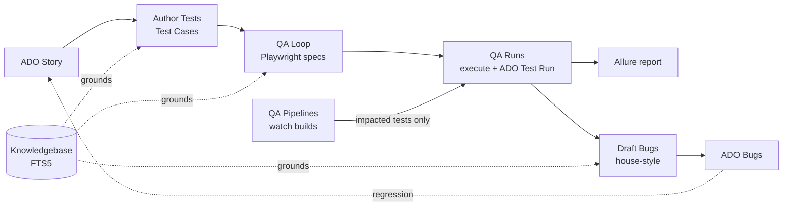
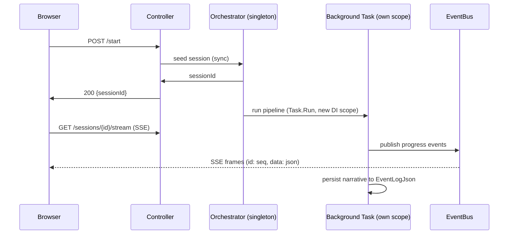

# The AI QA Copilot — Concept, Capabilities & Build Blueprint

> **Purpose of this document.** This is a self-contained, hand-off brief describing *everything* an
> existing tool ("ADO_Tester" / "QA Automation") does — its vision, every feature, how it works under
> the hood, and the design ideas that make it good. It is written so another AI or team can take the
> idea and **build something great** from it: reimplement it, extend it, retarget it to a different
> tracker, or spin off new products from its parts. You do **not** need the original source to use this.

---

## 1. The one-sentence pitch

**A locally-hosted, human-in-the-loop AI copilot that plugs into your issue tracker (Azure DevOps
today) and drives the *entire* QA lifecycle** — requirement analysis → test design → test automation
→ execution → defect reporting → regression → status reporting — with AI agents that write in a
specific QA author's house style, while a human reviews and approves everything before it is written
back to the tracker.

## 2. The problem it solves

QA teams are stuck in a **manual-first trap**:

- Reading a story and hand-writing 15–30 test cases in a house style takes hours per story.
- The same boilerplate is retyped forever: preconditions, numbered steps, expected results, priorities.
- Automation is written separately (if ever), so the automated tests drift away from the test cases.
- Tests are run by hand against a QA environment, responses are eyeballed, the test run is updated manually.
- Bugs are filed by hand: copy/paste repro steps, screenshots, expected vs actual, severity.
- Regression means re-doing all of the above under time pressure.

Every one of these is **repetitive, high-volume, low-judgement** work — exactly what AI plus
automation should absorb, leaving the human to decide *what matters*. The core insight:

> **Manual-first is a trap: manual execution eats the time you'd need to automate, so the next
> regression is manual too. Make automation the *byproduct* of testing a story, and the loop breaks.**

## 3. Guiding principles (the soul of the tool)

These are the non-negotiable ideas. If you rebuild this, keep these:

1. **Human-in-the-loop, always.** AI *drafts*; the human *reviews, edits, and approves* before
   anything is written to the tracker. Nothing is filed silently. This is the trust contract.
2. **Tracker-native.** Everything lands back in the system of record (Azure DevOps): Test Cases, Test
   Runs, Bugs, Tested-By / Related links, and reports. The tool is a copilot *inside* the existing
   workflow, not a parallel island.
3. **House style is load-bearing.** Output must read as if a specific senior QA author wrote it —
   same title grammar, same step style ("one action per step", "step 1 is always Login"), same bug
   format. Consistency across people is a feature, not a nice-to-have.
4. **Automation is a byproduct.** The executable test and the written test case are generated from the
   same act of "testing the story", so they can't drift apart.
5. **Local-first, zero-cloud-cost by default.** Runs on the QA's machine, against their tracker org,
   with a local database and a local LLM CLI as the default provider. Their data stays with them.
6. **Grounded, not hallucinated.** A per-project knowledgebase and the story's own linked code ground
   the agents so the output is domain-correct, not generic.
7. **Judgement over typing.** The human's time shifts to the high-value questions — *is this a real
   bug? is this coverage right?* — not the mechanical typing.

## 4. The QA lifecycle, mapped to features (the centerpiece)

Every stage of the QA lifecycle gets an AI-assisted shortcut, and they connect into one loop:

| # | QA lifecycle stage | Manual today | With this tool | Feature |
|---|---|---|---|---|
| 1 | Requirement analysis | Read story, dig through code/docs | Analyst agent reads story + acceptance criteria + linked code + KB | Knowledgebase + Analyst |
| 2 | Test design | Hand-write cases in house style | Generates house-style Test Cases (steps, expected, priority) | **Author Tests** |
| 3 | Test automation | Separate, often skipped | Generates executable Playwright API tests from the module's API surface | **QA Loop** |
| 4 | Test execution | Run manually, eyeball results | Executes against the real QA env with authenticated API calls | **QA Runs** |
| 5 | Results & traceability | Update test run by hand | Auto-created ADO Test Run + per-case pass/fail + Allure report | **QA Runs** |
| 6 | Defect reporting | Hand-file each bug | House-style draft Bugs built from failures; one-click file | **Find Bugs** / Draft Bugs |
| 7 | Regression / CI | Re-run everything | Watches builds, runs only the *impacted* tests | **QA Pipelines** |
| 8 | Reporting / metrics | Manual status decks | Weekly self-contained HTML board-activity report | **Reports** |

## 5. Feature-by-feature: what the app does

The app is a single web SPA with **nine pages** in a left sidebar, plus two "no-sidebar" surfaces
(Batch/Epic runs and Diagnostics). Each page maps to one backend controller.

### 5.1 Dashboard — live workspace snapshot
Read-only landing page. KPI tiles (test sessions, bug sessions, reports, KB docs), an outcome donut
(Done / Failed / Running), a merged recent-activity feed across sessions/reports/KB, and quick-launch
tiles. It's the jumping-off point, not a pipeline.

### 5.2 Knowledgebase — grounding the AI in your domain
A per-project markdown knowledge base. Upload individual `.md` files or a whole folder; each document
is split into ~1000-character chunks (greedy, on blank lines) and indexed into a **SQLite FTS5** virtual
table. A search box runs a **BM25** ranked match — the *same* lexical retrieval the Analyst calls
automatically before analysing a story. **No embeddings, no API calls, fully local.** This is what makes
the output read like *your* QA author wrote it. Deleting a document removes its chunks and the file.

### 5.3 Author Tests — story → house-style Test Cases
The flagship "test design" flow:
1. Search for and pick a story.
2. **Analyst agent** reads title/description/acceptance criteria (plus KB context) → a structured
   analysis: module, feature, happy path, edge & negative cases, business rules, permissions, open questions.
3. **Tester agent** turns the analysis into Test Case drafts — title, preconditions, numbered steps,
   expected results — automatically (auto-handoff) or on demand.
4. Review and edit every draft inline; editing the analysis can regenerate the tests.
5. **Approve** → choose a Test Plan/Suite → **Push**: each Test Case is created in ADO, added to the
   suite, and linked **Tested-By** back to the story.

Progress streams live to the browser. Traceability (story ↔ case) is automatic.

### 5.4 Find Bugs — expected vs actual, code-aware bug hunting
1. Pick a story → **Analyst** produces the expected-behaviour analysis.
2. You paste the **actual behaviour** and, optionally, code context — commit/PR ids the backend
   resolves into real Git diffs.
3. **CodeVerifier agent** inspects the linked code; **BugWriter agent** contrasts expected vs actual
   vs code evidence → prioritized bug drafts (severity, repro steps, expected/actual/suggested fix).
4. Review/edit → **Approve** → **Push**: each Bug work item is created and linked **Related** to the story.

Also supports "bug from a failed test verdict" — instantly, or via an agent review pass.

### 5.5 QA Loop — module → executable automation (the "automation-first" leap)
Scan a backend API module and author a full **3-level** suite as Playwright specs *and* ADO Test Cases:
1. **Scan** — supply a module, repo/branch, target Plan/Suite, optionally a story + source dirs. A
   **ModuleAnalyzer agent** reads the source over the tracker's Git API and emits an **inventory**
   (routes, DTOs, workflows) plus a **coverage matrix** reconciled against the story's existing Test
   Cases — every row marked *gap* or *covered*.
2. **Review** — tick the surfaces to author; edit the matrix.
3. **Generate** — three agents run in parallel over the selected rows:
   - **Contract** → a Zod schema + a `.spec.ts` asserting response shape/types.
   - **Endpoint** → one spec with `200` / `401` (no bearer) / `400` (invalid body) cases.
   - **Workflow** → a chained multi-step spec with idempotent cleanup.

   Specs are written to disk, instrumented for Allure, each carrying a `[<tcId-pending>]` title tag.
4. **Push** — creates the ADO Test Cases, rewrites the pending tag to the real id (in both title and
   spec), adds them to the suite, links Tested-By. Re-pushing is idempotent.

The key idea: **the test case and the automated test are the same artifact**, so they can't drift.

### 5.6 QA Runs — execute for real, triage failures, file bugs
1. **Start** — pick a module (optionally filtered by level/tag) and a target environment profile.
2. **Execute** — a Playwright runner provisions a Node runtime once, then runs the selected specs
   against the profile's base URL + a bearer token minted at run start; results parsed from JUnit XML.
3. **ADO Test Run** — a fresh Test Run is created, each Test Case marked Pass/Fail, run completed
   (visible in the tracker's Test hub).
4. **Triage** — a **FailureTriage agent** classifies each failure as **real_bug / flaky / test_issue
   / stale_test** with confidence + reasoning; real bugs get a pre-built bug draft.
5. **File bugs** — select failures → ADO Bugs created and linked to the Test Case + story.
6. **Report + notify** — a single-file **Allure** HTML report (with per-(module, pipeline) trend
   history) is generated and served in-app, and a **Microsoft Teams** card posts the summary.

### 5.7 QA Pipelines — regression on autopilot
- Add a **watch**: a build-pipeline id + display name + the module its tests map to.
- A background service **polls** every few minutes. First poll fast-forwards to the newest build;
  after that it processes new builds oldest-first, backing off on error.
- Per build it collects the **changed files**, projects the module's pushed drafts to a token-cheap
  inventory (no spec code), and asks an **ImpactAnalyzer agent** which tests are affected (impacted
  ids + reasoning + confidence). If analysis fails repeatedly it **falls back** to running the whole module.
- It then fires a QA Run down the same execution path as a manual run. Manual "Run latest" / "Skip to
  latest" controls and an enable switch are available.

This is how the loop closes: every code change gets fast, targeted QA feedback with no human kicking off runs.

### 5.8 Reports — weekly board-activity narrative
Choose a date range + boards + theme → the backend pulls the tickets, an LLM **summarizer** groups
them into themes / wins / risks, and an HTML builder renders a **fully self-contained** `.html`
slide-deck (Executive / Standup / Branded themes) with a present mode, an explore/filter mode, and a
per-ticket modal. A scheduler auto-fires it weekly (e.g. Thursday 11:00 local) while the app is running.

### 5.9 Settings & Diagnostics
- **Tracker connection** — org / project / PAT, with pickers that auto-discover orgs, projects, area
  paths, repos and branches.
- **LLM providers** — configure all providers and switch the active one **live** from the app bar.
- **Defaults** — Author-Tests plan/suite; Reports boards/schedule/theme; a QA-Loop tab (Teams webhook
  + template, watcher poll interval, Allure provider, verbose-activity toggle).
- **Two-layer settings** — a flat `.env` seeds strongly-typed options; a DB-persisted overlay edited
  in the UI **wins over** `.env` (applied at startup and on save).
- **Diagnostics** — one-click probes: required secrets present, a tracker read of a work item, and an
  LLM ping to the active provider.

### 5.10 Batch / Epic runs (no sidebar entry)
Launched from Author Tests / Find Bugs to **fan a pipeline across every child of an epic**. Batch
status is *derived from children at read time* (Empty / Running / AwaitingInput / CompletedWithFailures
/ Cancelled / Completed), never stored. Fan-out is concurrent; failed children are skipped, not fatal.

## 6. The AI agents (the "brains")

Each agent wraps a runtime-switchable LLM client, streams its output, and is grounded by the
knowledgebase and/or linked code. System prompts encode the house style.

| Agent | Role | Output |
|---|---|---|
| **Analyst** | Read a story + acceptance criteria + KB → structured understanding | module, feature, happy/edge/negative cases, rules, permissions, open questions |
| **Tester** | Analysis → test cases | `{title, preconditions, steps:[{action, expected}]}` |
| **BugWriter** | Expected vs actual vs code → bug drafts | `{title, severity, preconditions, reproSteps[], expected, actual, suggestedFix}` |
| **CodeVerifier** | Inspect linked code, verify steps against it | per-case + per-step verdicts (`pass/fail/inconclusive`) with evidence |
| **ModuleAnalyzer** | Read a module's source → API inventory + coverage matrix | routes, DTOs, workflows; per-level `gap`/`covered` rows |
| **ContractGenerator** | One endpoint → schema + shape test | Zod schema + `.spec.ts` + house-style Test Case |
| **EndpointGenerator** | One endpoint → status/auth/validation tests | spec with 200/401/400 cases + one Test Case per case |
| **WorkflowGenerator** | A business flow → chained multi-step test | chained `.spec.ts` with idempotent cleanup + Test Case |
| **ImpactAnalyzer** | Changed files + test inventory → affected subset | impacted ids + reasoning + confidence + fallback flag |
| **FailureTriage** | A test failure → classification | real_bug / flaky / test_issue / stale_test + confidence + reasoning |
| **Summarizer** | A week of tickets → narrative | tldr, themes, wins, risks, speaker script |

**House-style rules encoded in prompts** (examples): ALL-CAPS keyword conventions; environment names;
title grammar `[Module] - [Feature] - Verify that … .`; "no preconditions — step 1 is always Login";
"childlike, one action per step"; evidence tags like `[src:]` / `[ticket]` / `[ASSUMED]` / `[UNCLEAR]`.

## 7. Architecture — how it's built

### 7.1 Stack
- **Backend:** .NET 8 (ASP.NET Core) Web API on Kestrel, EF Core 8 over **SQLite** (with **FTS5** for
  KB retrieval). Clean layering across four projects. Port 5250.
- **Frontend:** React 19 + Vite + MUI + Redux Toolkit (UI state) + React Query (server state). Port
  5173, proxying `/api/*` to the backend. You open **one URL**.
- **Execution:** Playwright / TypeScript specs, run via a provisioned Node runtime; **Allure** for reports.
- **Integrations:** Azure DevOps REST (PAT auth), Microsoft Teams webhooks.

> The original implementation was a Python FastAPI app; it was re-platformed to .NET 8 with byte-exact
> behavioural parity verified by golden-file diffing. The concept is stack-agnostic — the *ideas*
> below matter more than the language.

### 7.2 Clean layering (backend)
- **Core** — abstractions (interfaces), options, entities + DTOs, contracts. No implementation deps.
- **Infrastructure** — implements everything: EF data, tracker client, LLM providers, agents,
  orchestrators, event bus, KB, reports, batches, settings. The DI composition root lives here.
- **Api** — thin host. `Program.cs` is deliberately just `AddCustom*` / `Configure*` one-liners; real
  wiring lives in a configuration-extensions file + the infra DI root. Flat `/api` controllers,
  middleware (a global exception handler registered first, returning ProblemDetails), SSE writer.
- **Tests** — xUnit golden-file + parity + unit tests.

### 7.3 The background + streaming pattern (most important design idea)
Long-running LLM pipelines can't block an HTTP request. The pattern:

1. An HTTP call **seeds a session row synchronously** (insert + commit + capture id + register a
   cancellation token source) and returns the id immediately (`200` / `202`).
2. The pipeline then runs on a **background task with its own DI scope** (never the request scope,
   which disposes when the handler returns).
3. Live progress is published to an **in-memory event bus** (pub/sub) and streamed to the browser over
   **Server-Sent Events (SSE)**. The durable narrative is persisted to the session's event log, so a
   page refresh replays it.
4. **Cancellation** flows through a registry of token sources; a global **concurrency cap** (a
   semaphore, e.g. 4) protects the machine. The orchestrators are **singletons** and the app is
   single-instance — scoped registration would fragment the cancellation registry and event bus.

SSE details worth copying: `X-Accel-Buffering: no` (proxies buffer by default → console never
updates), a `: connected` preamble, `: keepalive` every 15s, `Last-Event-ID` replay by sequence
number, and terminal events close the stream.

### 7.4 Runtime-switchable LLM layer
- A single `ILlmClient` abstraction: `Complete(system, user, model?, progress?, emit?) → string`.
- A **factory builds a fresh client per call, reading settings at construction** (no cached singleton
  client) — so switching the provider or editing settings applies on the *next* call.
- The active provider is **persisted in the database** and switched **live from the app bar**.
- Providers implemented:
  - **Local CLI** (default) — spawns a local `claude` process, streams stdout, no API key / no
    per-run cost. Prompt via stdin (argv length limits), idle + absolute timeouts, stream-json parsing.
  - **Anthropic API** (raw HttpClient), **Azure OpenAI**, and **OpenAI-compatible** (e.g. free GitHub
    Models, Groq, Ollama).
- Each provider sanitizes secrets out of error messages and surfaces a provider-specific error prefix.
- Streaming progress is polled (~1.5s) into a "typing" activity string like `{label} — {chars} chars · {elapsed}s`.

### 7.5 Tracker (Azure DevOps) client
One cached client (PAT Basic auth). Full surface:
- **Reads:** work items, children/epics, test plans/suites, comments/updates, Git refs/diffs/commits,
  code search, pipeline builds + changed files.
- **Writes:** create Test Case, add to suite, link Tested-By, create Bug, link Related, create + complete
  a full Test Run with per-case outcomes.
- **Write bodies are byte-frozen** — the Steps XML, bug ReproSteps/AC/SystemInfo HTML, json-patch op
  order, and integer priorities are reproduced exactly so tracker artifacts look identical to
  hand-authored ones. (HTML-escaping is load-bearing, e.g. escaping `'` → `&#x27;`.)
- Work-item reads are cached ~60s; the client is rebuilt when settings change.

### 7.6 Knowledgebase retrieval (local, lexical)
Markdown → ~1000-char chunks → SQLite **FTS5** virtual table (`content` indexed; `project_id`,
`doc_id` unindexed). Retrieval is **BM25** ranked (lower score = better), top-k (e.g. 8), with a
match-expression builder that de-dups tokens and quotes them as an OR query. No embeddings, no API —
deliberately simple, fast, and fully local. Storage is traversal-safe (`kb/{projectId}/{uuid}-{basename}`).

### 7.7 Two-layer settings
A flat `.env` (Python-style names) is bridged into strongly-typed options; then a **DB-persisted
overlay** (UI-edited) is applied *after* it, so a saved DB value **wins over** `.env`. Applied at
startup and on save. Add a new setting in both places.

### 7.8 Data model (entities)
UTC timestamps throughout; enums stored as strings.

| Entity | Purpose |
|---|---|
| **Projects** | The tracker org/project binding; seeds one default project |
| **Settings** | Key/value store for the active provider + all UI-editable settings |
| **Documents** | KB uploads (file name, stored path, chunk count, size) |
| **TestSessions** / **TestCaseDrafts** | Author-Tests pipeline state + drafts |
| **BugSessions** / **BugDrafts** | Find-Bugs pipeline state + drafts |
| **Reports** | Generated report metadata (range, boards, theme, html path, summary) |
| **Batches** | Epic fan-out (status derived from children, not stored) |
| **ApiTestSession** / **ApiTestDraft** | QA-Loop scan/author state + generated specs |
| **TestRun** / **TestFailure** | QA-Runs execution results + per-failure triage + bug draft |
| **PipelineWatch** | A watched pipeline → module mapping for auto-regression |

Session rows carry an `EventLogJson` column so the live console can be replayed after a refresh.

## 8. The design ideas worth stealing

If you rebuild or extend this, these are the insights that make it work:

1. **Seed-then-stream.** Return an id synchronously, run the work in a background task with its own DI
   scope, and stream progress over SSE with durable replay. This one pattern powers six features.
2. **Draft → review → push.** Never write to the system of record without a human approval gate. Make
   every draft editable. This is what makes AI output *trustable* in a QA context.
3. **Same artifact for test case and automation.** Generate the executable test and the written test
   case together so they cannot drift. Tag the spec with a placeholder id, then rewrite it to the real
   id on push (idempotent).
4. **Byte-exact house style.** Freeze the write formats and verify them with golden-file diffs. The
   output must be indistinguishable from the team's hand-authored artifacts, or adoption stalls.
5. **Local, lexical grounding.** FTS5 + BM25 beats embeddings for a single-user domain KB: zero API
   cost, instant, good enough, and fully offline.
6. **Runtime-switchable, per-call LLM clients.** Persist the provider choice; build a fresh client per
   call. Users can start free (local CLI / free models) and switch to a paid API for big jobs.
7. **Impact analysis over "run everything".** On each build, ask an agent which tests the changed files
   affect, and run only those — with a safe fallback to the whole module if the agent is unsure.
8. **Triage failures into drafts, not just red X's.** Classify each failure (real bug / flaky / test
   issue / stale test) and pre-build a bug draft for the real ones, so filing is one click.
9. **Derived status.** Compute batch/epic status from children at read time instead of storing and
   syncing it — fewer bugs, no drift.

## 9. Integrations & external dependencies

- **Azure DevOps** (system of record) — PAT with Work Items R/W, Test Management R/W, Code Read.
- **LLM provider** — at least one of: a local Claude CLI (default, no key), Anthropic API, Azure
  OpenAI, or any OpenAI-compatible endpoint (GitHub Models is free).
- **Playwright + Node** — for executing the generated API specs.
- **Allure** — for the per-run HTML test report with trend history.
- **Microsoft Teams** — incoming webhook for run-summary cards.

## 10. Where to take it next (ideas to "build something great")

The concept generalizes well beyond its current form. Promising directions:

**Retarget the tracker.** The tracker client is one interface behind everything. Add adapters for
**Jira, GitHub Issues, GitLab, Linear, Polarion**, etc. The whole lifecycle loop then works on any stack.

**Broaden test types.** Today it's API/Playwright. Add **UI/E2E** (Playwright browser), **contract
testing** (Pact), **load testing** (k6), **mobile** (Appium), or **unit-test scaffolding** from the
same story → coverage-matrix pattern.

**Smarter grounding.** Layer optional **embeddings / hybrid retrieval** on top of the FTS5 base for
larger KBs; ingest **OpenAPI/Swagger specs**, **Postman collections**, or **code symbols** directly so
the ModuleAnalyzer needs less raw-source reading.

**Richer regression intelligence.** Use historical pass/fail data to learn **flaky-test detection**,
**risk-based test selection**, and **auto-quarantine**. Feed coverage back into the matrix to show
coverage drift over time.

**Close more of the loop.** Auto-open a PR with a **suggested fix** when CodeVerifier is confident;
auto-retry flaky tests before filing; auto-link bugs to the offending commit/PR and notify the author.

**Collaboration & scale.** Move from single-user/SQLite to **multi-user** (Postgres/SQL Server, real
auth, per-team KBs), externalize the event bus (SignalR / Redis) so it can run multi-instance, and add
**role-based review queues** (BA drafts, QA lead approves).

**Analytics.** A metrics layer over sessions/runs/bugs: cycle time from story→test→bug, coverage
trends, defect-escape rate, "hours saved" dashboards for QA leads.

**Prompt & style management.** Make the house style a **first-class, editable, versioned artifact** in
the UI (per-team style profiles), with golden examples and A/B evaluation of prompt changes.

**Agent autonomy dial.** A per-team setting from "draft only" → "auto-push low-risk artifacts" →
"fully autonomous regression", with an audit trail — letting teams increase trust gradually.

**Packaging.** Ship as a **VS Code extension** or **desktop app** so it installs in one click; offer a
hosted SaaS tier for teams that don't want to run it locally.

## 11. Glossary

- **House style** — the specific, consistent format a senior QA author uses for test cases and bugs.
- **Test Plan / Suite / Test Case / Test Run** — Azure DevOps test-management artifacts.
- **Tested-By / Related** — ADO work-item link types (case→story, bug→story).
- **Coverage matrix** — per-endpoint rows marked *gap* (needs a test) or *covered* (already tested).
- **Contract / Endpoint / Workflow** — the three API test levels (shape, status/auth/validation, chained flow).
- **Impact analysis** — picking only the tests a code change affects, instead of running everything.
- **Triage classification** — real_bug / flaky / test_issue / stale_test verdict on a failure.
- **DMS profile** — a named target environment (base URL + credentials) a run executes against.
- **SSE** — Server-Sent Events, the one-way stream that powers the live console.
- **FTS5 / BM25** — SQLite full-text search and its ranking function, used for local KB retrieval.
- **Golden-file diff** — a test that asserts output is byte-identical to a captured reference.

---

*This brief describes the concept and architecture of an existing, working tool so it can be
reimagined and rebuilt. The strongest parts to preserve are the human-in-the-loop trust model, the
tracker-native round-trip, the house-style fidelity, and the seed-then-stream pipeline pattern. Everything
else — stack, tracker, test framework, LLM provider — is swappable.*
